# WoWDataTool (`wowdata`)

A tool for the World of Warcraft **1.12.1 (build 5875)** client data. It can:
* **find** an asset by how the game uses it (creature, game object, item, player race, file path);
* **extract** it from the MPQ archives;
* **convert textures** to PNG and back to BLP in the exact original format;
* **view and export models** (M2) to glTF 2.0 for Blender, with skeleton, skins and every animation, or look at them in a browser page;
* **edit models in Blender and bring them back**: the mesh, the textures, and (0.10.0) the skeleton, the animations, the attachment points and the events, checked against the 1.12 client's rules;
* **edit the data tables** (DBC: spells, items, creatures, maps, flight points, talents...) with typed 1.12.1 layouts (desktop app, 0.7.0);
* **edit your server's world database** (VMaNGOS: items, creatures, quests, spells, loot, vendors, trainers...), check it against the game's tables, and deliver it as an SQL patch or apply it to the server with a backup and undo (desktop app and `wds`, 0.9.0);
* **design spells, talent trees and classes** (0.12.0): the Spell designer (new or cloned spells with a guided form, the tooltip as the game writes it, checks of what the 1.12 game and server handle, visuals, trainers, skill lines; the game's `Spell.dbc` and the server's `spell_template` kept in step) and the Classes and talents tab (talent trees on the game's grid, a class's spells by level, class masks, and an experimental new class with the list of what the game and the server still need in code);
* **design quest chains** (0.13.0): the Quest chains tab (any chain as a flowchart with lanes per faction and class, a quest editor in plain fields with the client's text preview, givers and enders on the map, drop sources, speak-to and explore objectives, reward spells, branches and choices, the same chain for the other faction, the discipline template, new quest-giver NPCs, checks of what VMaNGOS and the 1.12 game can handle);
* **put the result back into the game**, either as loose files (with the client patch in `docs/LOOSE_FILES_PATCH.md`) or as `Data\patch-3.MPQ`.

Status: phase 1 (core + search), the texture round trip and phase 2 (the M2 reader, glTF export, the Blender add-on and the quick-look viewer) in the Python command line; **the desktop app WoW Data Studio**: phase 3a (C#, textures end to end), phase 3b (the 3D model viewer), phase 3c (model export / import through Blender: mesh edits on the same skeleton, textures, all skins) and **phase 4 (maps and terrain: the Maps tab, a tile in 3D, editing in Noggit, import with the 1.12 check and a 3D before/after, test / release, and the guided server-map update)**, plus **pop-out 3D windows with full screen and a fly camera (0.5.1)** and **the tile breakdown and terrain through Blender with neighbour tiles (0.6.0)**, and **the fixes from the in-game visual test (0.6.1: ground textures and their `_s` files, colour / alpha change figures, the additive-texture advice, uninstalling the release patch)**, and **the DBC editor (0.7.0: the Data tables tab, every table of the client with typed layouts, links, Used by, checked edits, undo, CSV / JSON, Copy to server)**, and **the command line `wds` (0.8.0: every feature of the app as a command, for scripts and automation)**, and **the server data editor (0.9.0: the Server data tab and `wds server`: the world database in friendly views, checked edits, client / server checks, SQL patch, apply with backup and undo)**, and **the skeleton and animation round trip (0.10.0: bones, animations, attachment points and events to Blender and back, with the client's own animation rules, previews and compare, and "Used in game" for animations)**, and **hot reload (0.11.0: "Reload in running game" and `wds changes reload`: the running game reads changed textures, models, buildings, terrain and tables again without a restart, with the project's client from its HR1 update on; `docs\HOT_RELOAD.md`)**, and **the designers (0.12.0: the Spell designer and the Classes and talents tab, `wds spells`, `wds talents`, `wds classes`)**, and **the quest-chain designer (0.13.0: the Quest chains tab, `wds quests`)**, and **other versions (0.14.0, experimental: the Other versions tab and `wds versions`: reading other clients, converting a 1.60 map to 1.12, the 1.60 update catalog; "Revert this import" now gives back your earlier edits)**, and **opening other versions read only (0.15.0, experimental: a modern client such as 1.60 opens like your 1.12 game, read only, with its models, textures, maps and buildings) and the particles and ribbons of 1.12 models drawn in every 3D view**, version 0.15.0. What changed in each version: `CHANGELOG.md`; bugs not fixed yet: [Known issues](#known-issues).
Licence: MIT (`LICENSE`); third-party notes in `THIRD_PARTY.md`.

**WoW Data Studio is one product with two front ends**, built from one solution, installed together and always the
same version:
* **the desktop app** (`WoWDataStudio.exe`, `app\WoWDataStudio\`) for everyday use. See the next section;
* **the command line `wds`** (`wds.exe`, `app\WoWData.Cli\`, since 0.8.0): every feature of the app as a command, for scripts
  and automation. See [The command line: wds](#the-command-line-wds-080).

Both call the same core library (`app\WoWData.Core\`), so an operation gives the same result in either; the feature
registry (`WoWData.Core\Features\FeatureRegistry.cs`) and its tests keep the two in step (`CONTRIBUTING.md`).

Separately, **`wowdata`** (`wowdata\`, Python) is the original command line of the formats; it is the reference
implementation and the test oracle of the app.

## WoW Data Studio (desktop app)

Find any creature, character, item, game object, world object, spell effect or texture, look at it in 3D with its animations and skins, export its textures as PNG, edit them in any image editor, check the result against the original, and put the change back into the game. Edit the game's data tables (DBC) in the **Data tables** tab.

### Install it

Run **`dist\WoWDataStudio-Setup-<version>.exe`** (built by `build_installer.ps1`, see "Installer" below). The app is self-contained: nothing else has to be installed (no .NET, no Python).
* Per-user install, no administrator rights: `%LOCALAPPDATA%\Programs\WoW Data Studio` by default, with a Start-menu entry (app, user manual, uninstall) and an optional desktop shortcut.
* It installs the app and its command line (`bin\WoWDataStudio.exe`, `bin\wds.exe`; always both, the same version), a Start-menu *WoW Data Studio command prompt*, an optional *Add the command line tool to PATH* task (per user, removed on uninstall), the command line's example scripts (`scripts\`), the user manual as HTML (`manual\`), the Blender add-on zip (`blender\wowdata_blender.zip`), `docs\LOOSE_FILES_PATCH.md`, `docs\NOGGIT.md` (Noggit is not bundled: where to get it) and the licence files. It never touches the World of Warcraft folder.
* Upgrade: run the newer installer (settings, index and edits are kept). Uninstall: Windows *Settings > Apps*, or *Uninstall WoW Data Studio* in the Start menu; the user's data in `%APPDATA%\WoWDataStudio` and the exports are kept.
* The installer is not code-signed (no certificate), so SmartScreen may say "Windows protected your PC": *More info* > *Run anyway*. The manual explains this to users.

Without installing (developers): double-click `app\publish\Start WoW Data Studio.cmd` after a publish.

### User manual

**`docs\manual\`** ([`index.md`](docs/manual/index.md)): a step-by-step manual for modders, one chapter per task (getting started, the main window, finding things, the texture viewer, editing textures, the 3D viewer, testing in the game, releasing, my changes, models and Blender, settings, troubleshooting, safety, glossary, used in game, maps and terrain, terrain in Blender, data tables (the DBC editor), server data (the world database), the command line (wds), known issues). In the app: **Help > User manual**, the link in the "How it works" panel, and **F1** on any screen opens that screen's chapter. The installer ships it as HTML (rendered with Markdig at build time).

**Upkeep rule:** every feature change updates its manual chapter and screenshots in the same change (`CONTRIBUTING.md`, `docs\manual\MAINTAINING.md`); since 0.8.0 a change to a feature is not done until the app, the command line, the feature registry, the manual chapter, `command-line.md`, the known issues and the changelog are all updated together. `ManualTests` fails when a bold UI label in the manual no longer exists in the app, a referenced screenshot is missing, or an F1 topic has no chapter.

### Step by step

1. **Select your World of Warcraft folder** (first start only). Pick the folder with `WoW.exe` and the `Data` folder. The app checks that it is version 1.12.1, build 5875, with the game archives, and says plainly what is wrong otherwise. It remembers the folder; change it later with **File > Change World of Warcraft folder...** or **Settings**.

   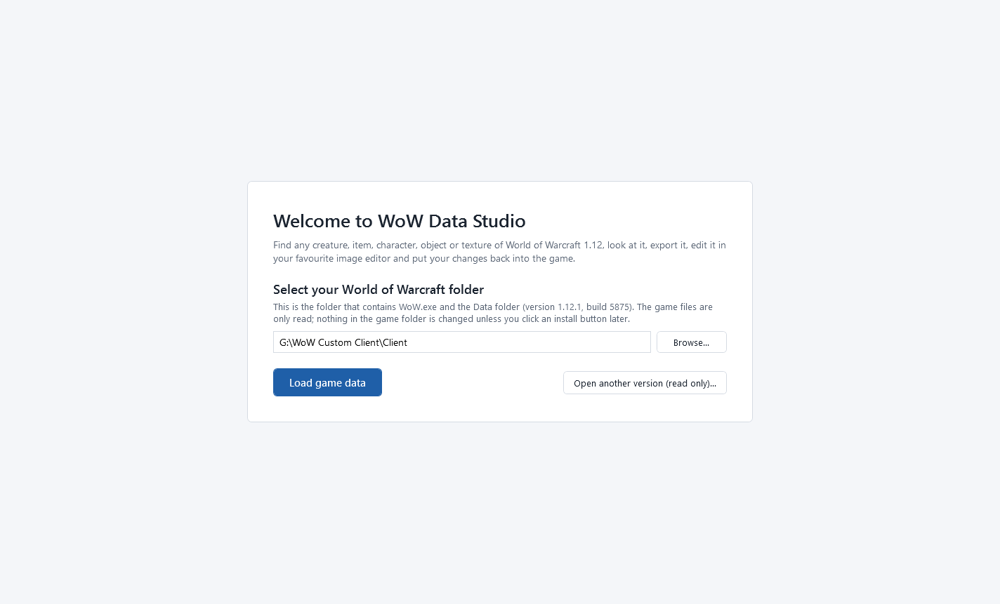
   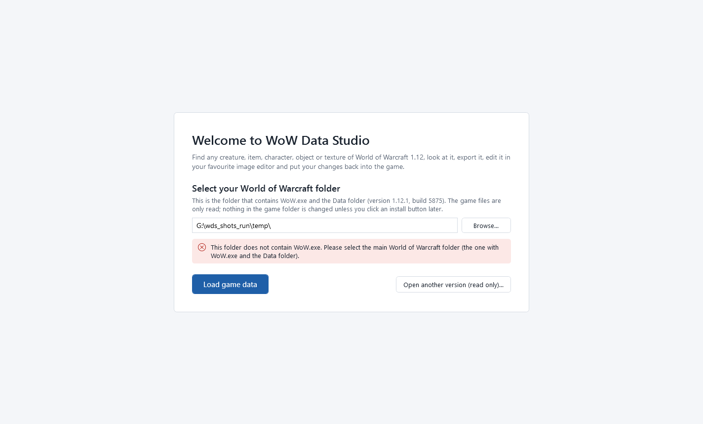

2. **Organizing game data.** The first time, the app reads the archives and builds its index (about 5 seconds; the stages are listed with a progress bar). Next time it opens instantly. It rebuilds by itself when the game's archives change (**File > Rebuild the index** forces it).

   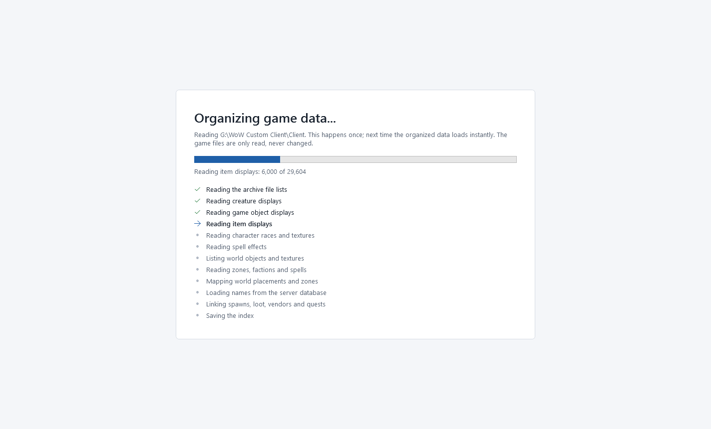

3. **Find it.** Type in the search box: a name (`mottled boar`), a race (`orc male`), an item (`worn battleaxe`), a file name (`BoarSkinIvory`), a path or an id. All words must match; the best matches come first. The type buttons (**Creatures, Characters, Items, Game objects, World objects, Spell effects, Textures**) narrow the list (right-click one to show only that type); **Show only my changes** lists what you edited. Click a column title to sort. The list holds all ~97,000 entries without slowing down.

4. **Look at it.** Click a row. The right panel shows **where it comes from** (Mottled Boar → display 503 → `Creature\Boar\Boar.m2` → skin BoarSkinIvory), who else uses the same files (the same skin is used by 6 boar displays: an edit changes all of them), the **3D view** of models (see "The 3D view" below), the **textures it uses** (click one), and the **texture viewer** (mouse wheel to zoom, drag to move, double-click to fit; transparency as checkerboard / ignored / alpha channel only; mip levels; format, size and source archive).

   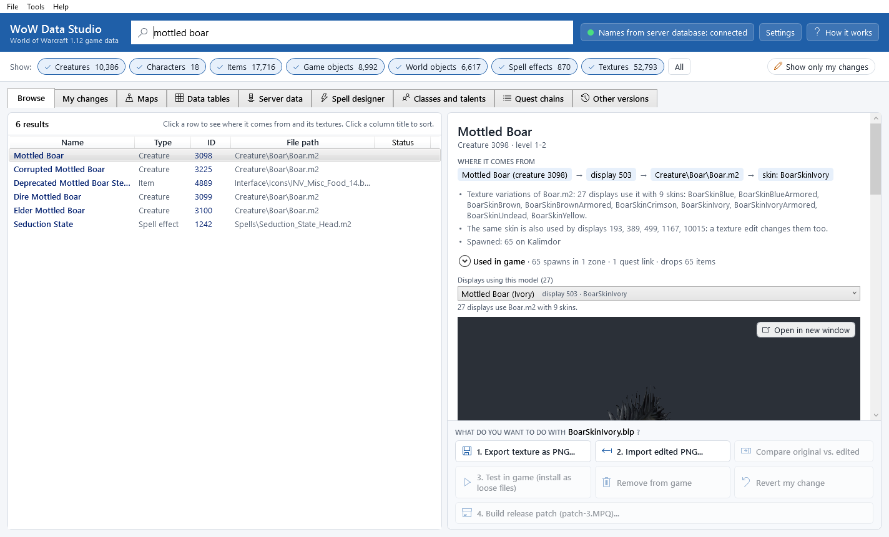
   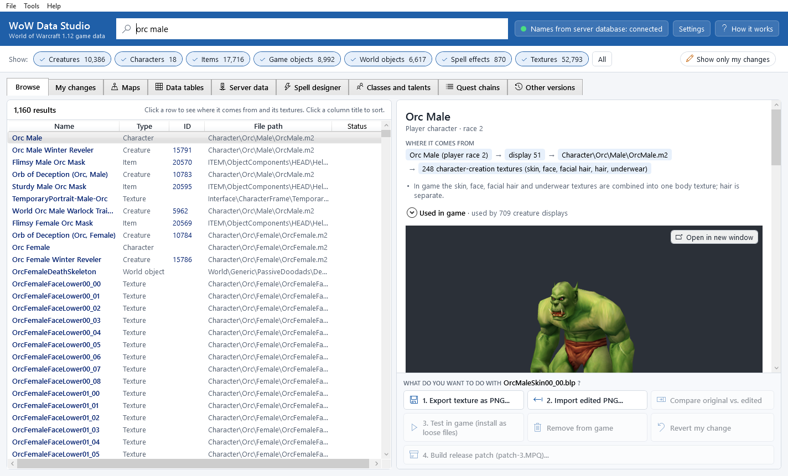
   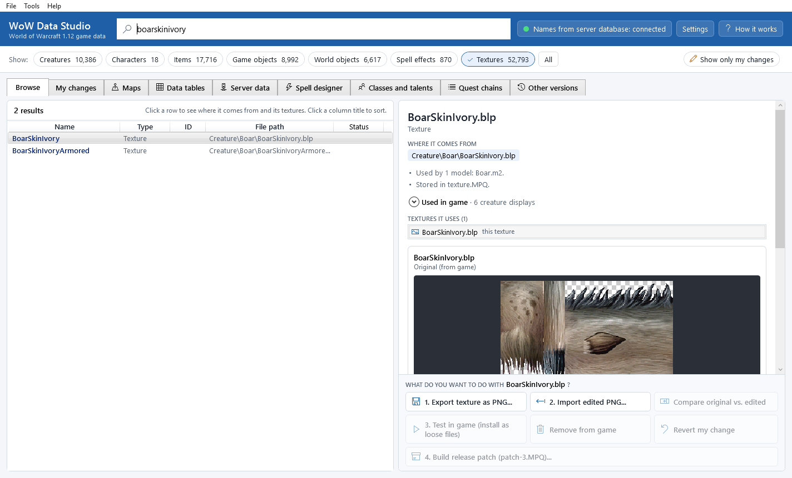

5. **1. Export texture as PNG...** saves the PNG and a small `.blp.json` file next to it (keep them together), then opens the folder. Default folder: `Documents\WoW Data Studio\Exports\<game path>`.

6. **Edit** the PNG in any image editor. Keep its size (for example 256 x 256) and keep transparent areas transparent.

7. **2. Import edited PNG...** reads your PNG and checks it:
   * the size must be a power of two up to 512; a different size is offered a resize (with an explanation);
   * transparency added to a texture without alpha: keep the original format, or save as DXT5;
   * on/off (1-bit) transparency: partly transparent pixels are rounded.

   It converts the PNG to the game's format the way the Python tool does: same format and mip layout, only the 4x4 blocks you changed are re-encoded, an unchanged PNG gives the identical file. Then the **comparison** opens as the last step: **Original (from game)** next to **Your edit** (as the game will show it), with the checks, the share of changed pixels and the other users of the texture. **Keep this change** saves it into your workspace; **Cancel** saves nothing. The game is not changed yet.

   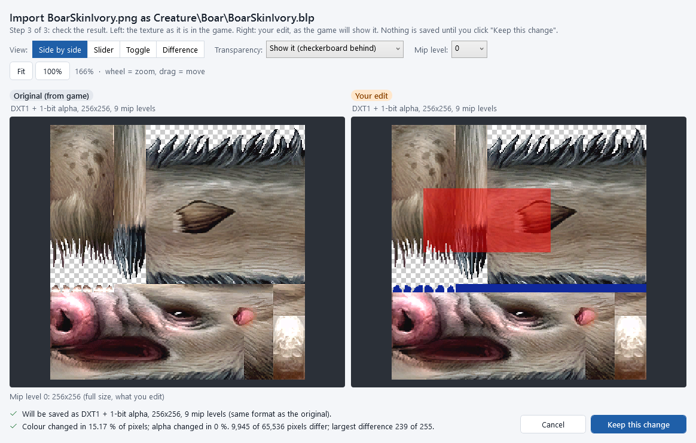

8. **Compare original vs. edited** (in the texture actions and in **My changes**, at any time later). Four views, all with synchronized zoom and pan, the transparency options and the mip level:
   * **Side by side**;
   * **Slider**: drag the round handle across one image (original on the left, your edit on the right);
   * **Toggle**: switch in place (button, automatic, or hold the Space bar);
   * **Difference**: a heat map (grey = unchanged, yellow to red = colour changed, blue = only the alpha changed) with "Colour changed in X % of pixels; alpha changed in Y %." (0.6.1: colour changes under fully transparent pixels count too, because in many textures the alpha is not transparency).

   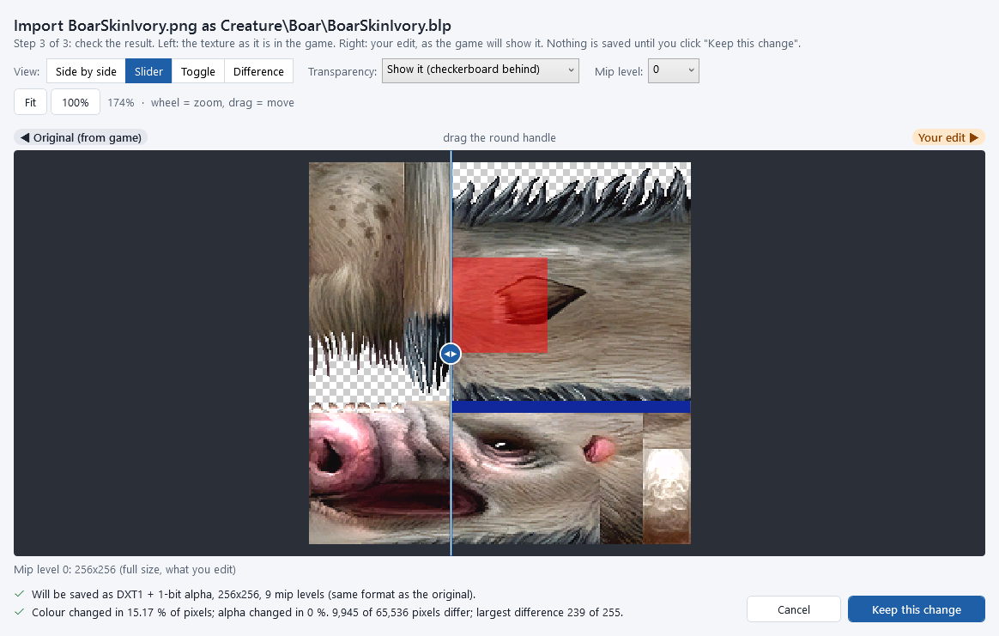
   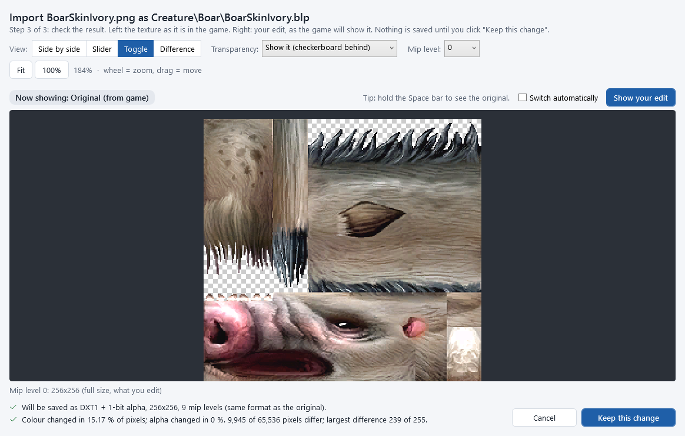
   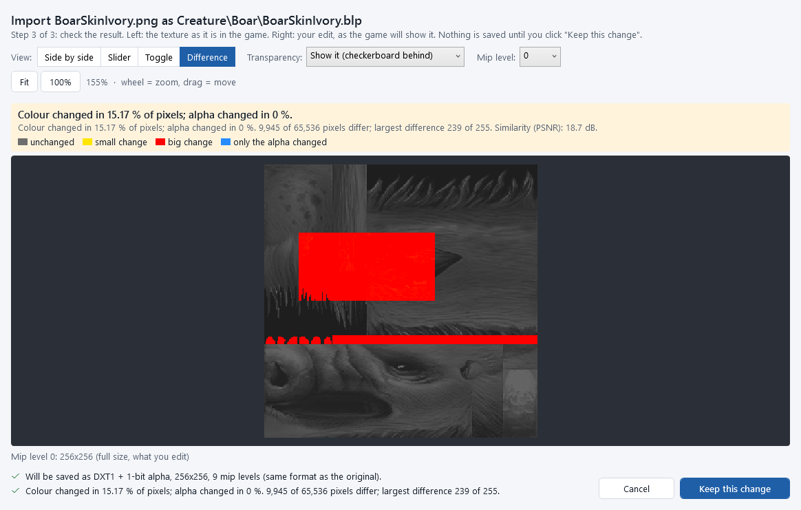
   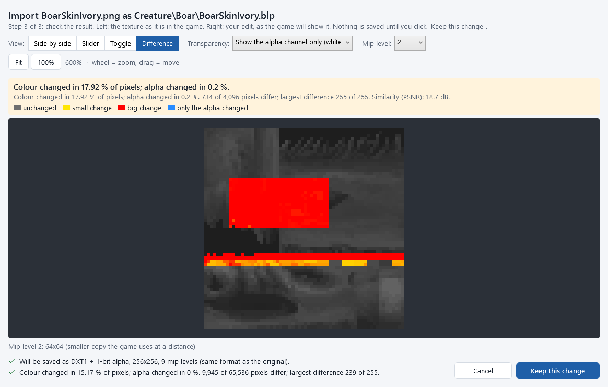

9. **3. Test in game (install as loose files)** copies the edit to `Client\Data\<game path>`. The game reads such loose files only with its **loose-file mode** on, a one-byte client patch, built into the project's client from update wave185 on (a stock 1.12.1 client ignores loose files) (`docs\LOOSE_FILES_PATCH.md`; the dialog links to it). Restart the game to see the change, or (0.11.0) with hot reload switched on in Settings and the project's client from the HR1 update on, click **Reload in running game** (the dialog after the install offers it): the running game reads the file again and says what is live now and what needs a relog or a restart (`docs\HOT_RELOAD.md`). **Remove from game** takes the file out again (only files the app installed and that are unchanged since; a file that was already there is backed up first and restored).

   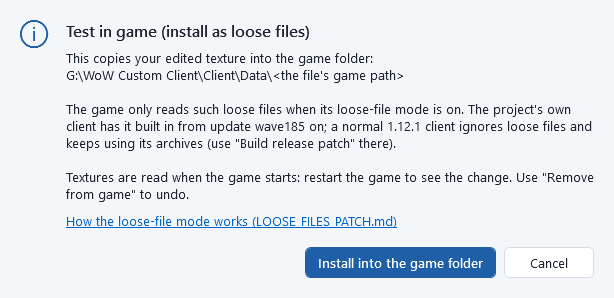

10. **4. Build release patch (patch-3.MPQ)...** lists every included file, builds `patch-3.MPQ`, reads it back to check it, and (ticked by default) installs it as `Client\Data\patch-3.MPQ` after backing up an existing one. This one file carries all your changes; the game's own archives are never modified.

    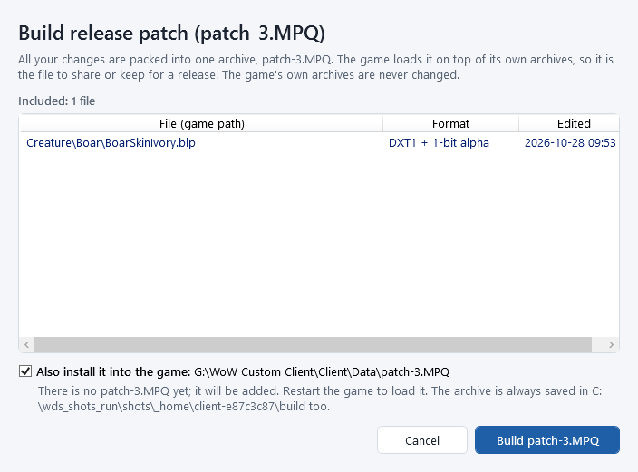

    **Uninstall release patch (patch-3.MPQ)** (My changes, 0.6.1) takes it out again: it removes the release patch the app built (the checksum it records proves it) and puts back the `patch-3.MPQ` that was there before; one the app did not create is only moved to the backup folder after a warning, never deleted. My changes says what is installed ("A release patch built by WoW Data Studio is installed: N files, date").

11. **Revert my change** deletes your edited copy (and its loose copy in the game folder). The **My changes** tab lists every changed file with its status (*in workspace*, *installed as loose file*, *in patch-3.MPQ*, or an older version of them), the import it came from, and **Compare / Show / Revert / Revert this import** buttons.

    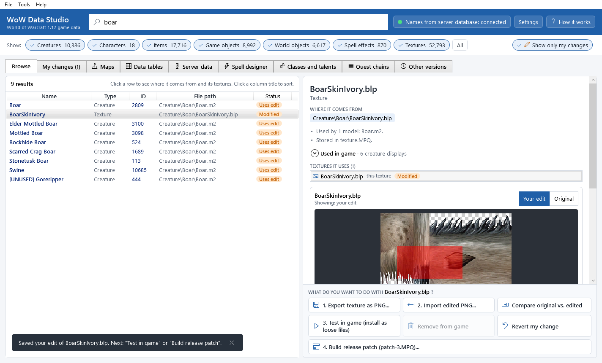
    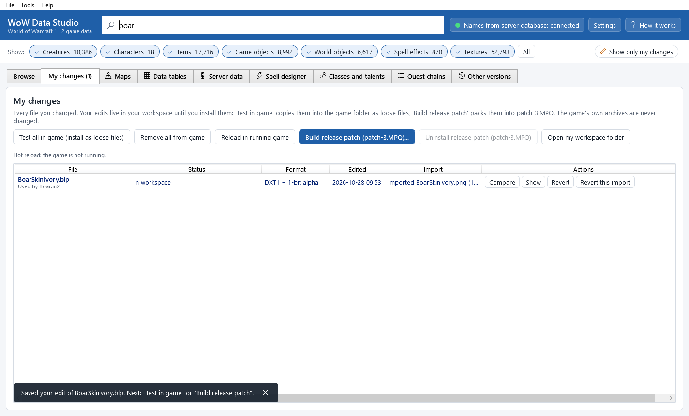

### Ground textures and their `_s` files (0.6.1)

With terrain specular on (`SET specular "1"` and `SET pixelShaders "1"` in the game's `WTF\Config.wtf`), the 1.12
client draws `<name>_s.blp` *instead of* the ground texture a map names (`CMapArea_LoadTextureNames` @006c20e0, no
fallback). The `_s` file has the same colours and keeps the ground's shine (specular strength) in its alpha channel. The
app reads the game's `Config.wtf` (read only) and:
* shows **both files** everywhere a ground texture appears: the details panel (**TEXTURES IT USES**), the search list
  (*ground texture* / *specular variant*), **Used in game** (*Ground (map terrain)*: tiles and zones, a link to the other
  file), the tile breakdown (both files; the `_s` file on its own with its shine map), the terrain previews and the
  terrain package for Blender (both PNGs; the materials use the file the game draws);
* says which file *your* game draws, and offers **Edit both (recommended)** on import (the other file gets your
  colours, the `_s` file keeps its shine map; **Keep the shine map?** when your PNG changed it);
* draws the 3D previews by the same rule, with **Specular ground (_s textures)** in the Maps tab to switch.

**Additive textures:** a texture that a model draws additively (glows, fire, missiles: black is invisible) gets a
plain-language note on import, and **Keep black areas black (recommended)** when your picture brightened its black
background (a tinted background shows as a visible square in the game). The blend modes come from every model and
building that draws the texture. The model import counts colour changes under fully transparent pixels as edits when an
opaque material draws the texture.

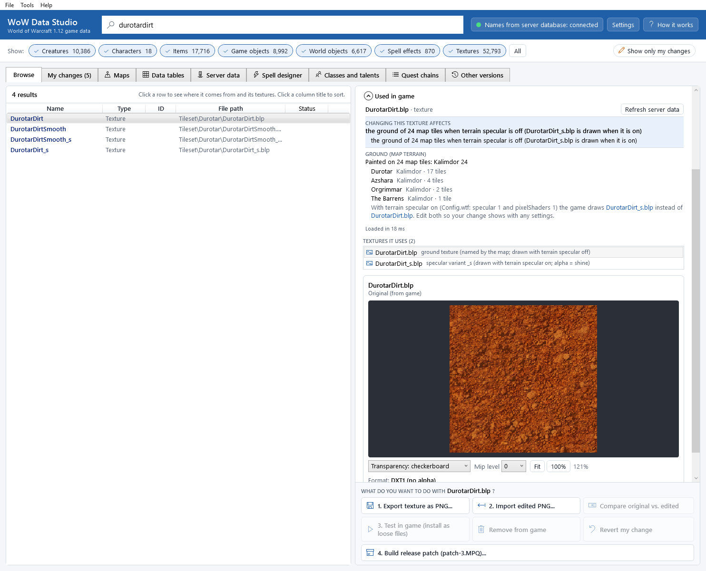
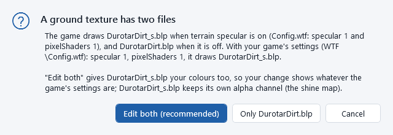
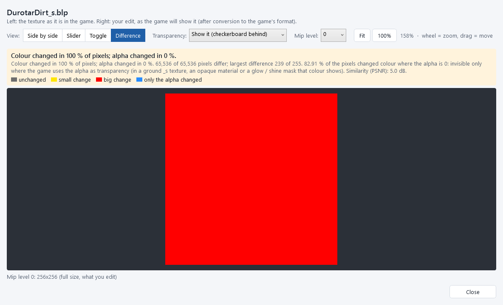

### The 3D view

Every creature, character, item, game object (M2 models), world object and spell effect is shown in 3D in the details panel, with its textures, animations and skins. Loading happens in the background (a typical creature takes about 30 ms); the window never waits for it.


**Moving around** (click the view first for the keys). The camera bar under every 3D view: **Orbit** / **Fly**,
**Front** / **Side** / **Top** (keys 1 / 2 / 3), **Reset view** (Home, R, double-click), **Controls help (H)** (an overlay
listing every control). F = focus on the selection; Space = play / pause.

| Do | Orbit (default for models) | Fly (default in the terrain pop-out) |
|---|---|---|
| Move | right / middle drag (or Shift + left), Shift + arrows | W A S D or arrows, Q / E down / up, Shift 4x faster, Ctrl 4x slower |
| Turn / look | left drag, arrows | right (or left) drag: look around |
| Zoom / speed | wheel, + / - | wheel or + / -: fly speed (shown in the corner) |

**Pop-out windows (0.5.1):** **Open in new window** (top-right of the 3D view, **Tools > Open the 3D view in a new
window**, Ctrl+Shift+O) opens the model, or in the Maps tab the tile, in a window of its own: resizable, maximizable, on
any monitor, **Full screen (F11)** (Esc leaves it), with the same controls in a collapsible side panel, **Hide controls**
(Ctrl+H) for an unobstructed view, and F1 for the manual. **Follow selection** (on) shows what is selected in the main
window; off, the window is pinned (title "... (pinned)"), so several windows compare models or tiles side by side. The
title says what is shown ("Mottled Boar — Boar.m2"). Each kind remembers its size, position, monitor, side panel and
camera mode (`settings.json`); a missing monitor puts it on the primary one, always fitted on screen. While a following
model window is open, the docked view stops redrawing every frame (the animation plays in the pop-out). The compare
windows have **Full screen (F11)** too.


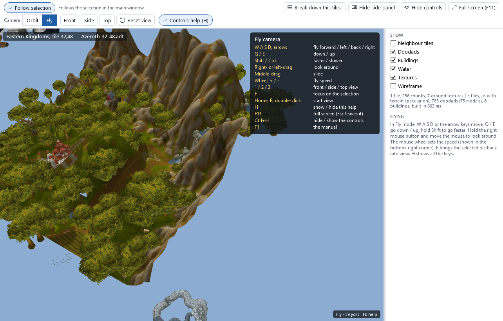

**Under the view:**
* **Animation**: every sequence of the model, named from AnimationData.dbc (`Stand`, `Walk`, `Attack1H`; a variant gets a number in brackets), with its length; play / pause, **Speed** (0.1x to 3x) and the **timeline** (drag to scrub; it pauses). Global sequences (glowing runes, swaying leaves) run on their own clock, as in the game.
* **Grid**, **Ground**, **Wireframe**, **Bones** (the skeleton, key bones in red), **Attachment points** (cyan), **Loop**, **Bounding box**; the **Background** colour (presets or any `#RRGGBB`). Under the timeline: the animation's properties, what the game plays it for and its events; **Skeleton, attachment points and events** lists key bones, attachment points and events.
* **View**: the model's four views (the 1.12 "skin profiles"). They have the same triangles but split the mesh into parts for 256, 75, 53 or 21 bones per draw; the game uses the largest its graphics card supports (1 on any modern card). An imported mesh edit rebuilds all four; check them here.
* **Save image...**: the 3D view as a PNG (default folder `Documents\WoW Data Studio\Exports\Images`).
* **Textures shown on the model**: each texture as it is used now (which slot, which file); click one to open it in the texture viewer below, with the usual Export / Import / Compare actions. For characters, the parts of the composited body texture are listed one by one.
* **Geosets**: tick or untick the parts of the mesh (characters: hair styles, beards, ears, gloves... by name); **Default** returns to what the game shows with no items worn.
* **Model statistics**: vertices, triangles, bones, sequences, texture units, attachments, textures, geosets, particle emitters and ribbons (listed, not drawn yet), load time.

**Skins (above the view):**
* **Creatures**: every display that uses the model, by the creature's name when the server database is connected (`Mottled Boar (Ivory)`, `Agam'ar (BrownArmored)`; otherwise `Display 503 (Ivory)`). Switching is instant (each skin is decoded once).
* **Items**: every item display that uses the model (`Worn Battleaxe (Axe_2H_Battle_A_01)`).
* **Characters** (player races): the character-creation choices **Skin colour, Face, Hair style, Hair colour, Facial hair**, plus **Random look**. The body texture is composited like the game does (skin, face, facial hair, scalp, underwear), and the hair-style and facial-hair geosets follow the game's tables.
* Humanoid NPCs (creatures on a character model) show their own baked texture, hair and beard.


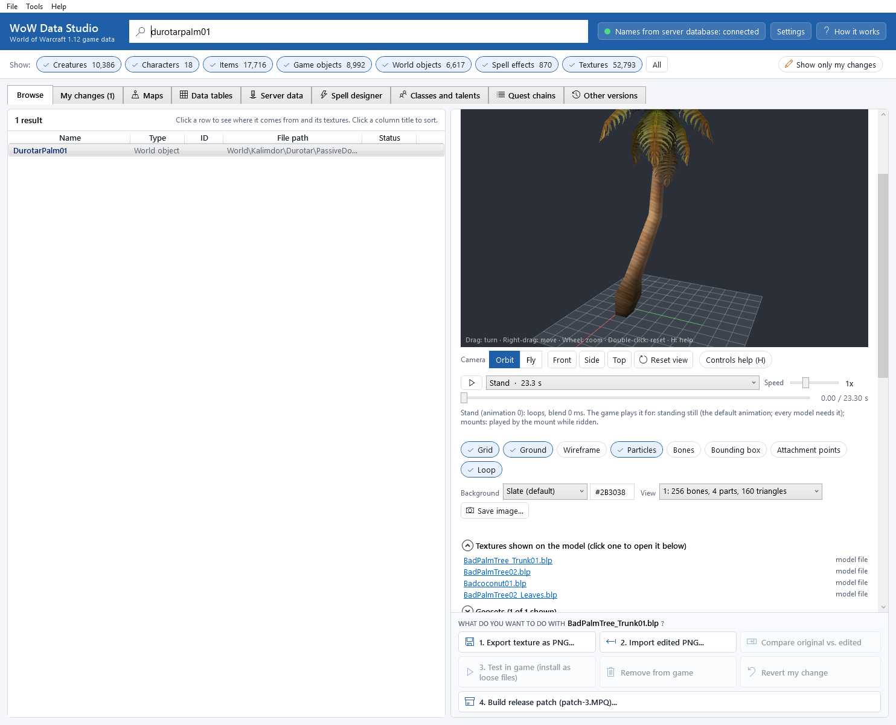

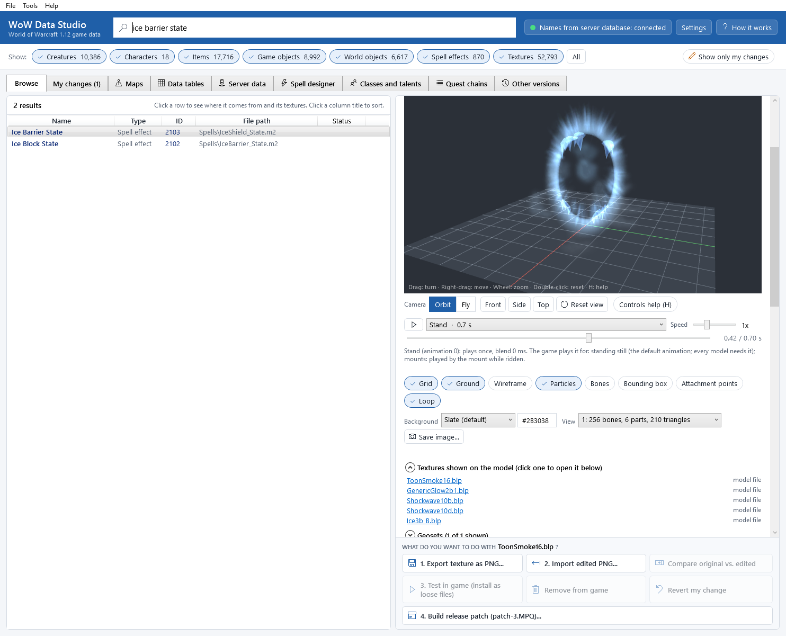

**Compare two skins** (**Tools > Compare two skins of this model**): two 3D views side by side (or **Toggle** in place) sharing one camera: turning, moving or zooming one moves both; **Same animation on both** keeps them in step. For a character it compares your look with the default one. The same two-view comparison shows "original vs. your edited model" after a model import (see the next section).


How it is drawn: materials follow the game's render flags and blend modes (opaque, alpha key, alpha, additive, modulate; two-sided, unlit, no depth write), with colour, transparency and texture-scrolling animation, environment-mapped shine on weapons, and billboards. Particles and ribbons (sparks, trails) are not drawn yet; the statistics list them. Your edited textures appear on the model as soon as you keep an import.

### Models and Blender (export / import, Phase 3c)

The full guide is the manual chapter [Models and Blender](docs/manual/model-export-import.md). In short:

* **Under the 3D view**: **Export for Blender...**, **Open in Blender**, **Import edited model...**, **Compare original vs. edited model**, **Revert the model**; **Tools > Install the Blender add-on...** (builds `wowdata_blender.zip` and installs it into Blender 4.5 with Blender's own installer, after asking, or shows the zip).
* **Export** writes a package folder `Documents\WoW Data Studio\Exports\Models\<Model>_export\`: `<Model>.gltf` + `.bin` (meshes per part, skeleton, every animation, attachments, collision), `textures\*.png` and `wowdata_manifest.json` (each PNG -> its game BLP, original format, pixel fingerprint; the model's checksums; the ids of every part). Three modes: the current look; **all skins in one file** as glTF `KHR_materials_variants` (Blender's *glTF Variants* panel); one file per skin. The add-on tags meshes, materials, images and bones with their ids as custom properties, so matching survives renames, and exports back with *File > Export > WoW 1.12 model for WoW Data Studio*.
* **Import** reads the package folder (with Blender's export in `blender_export\`, or your edited PNGs), a `.gltf` or a `.glb`, and shows a review screen: the mesh (what changed per part) and every texture (edited / unchanged / new), each with include checkbox, plain-language checks and **Compare** (the texture compare, or two synchronized 3D views). **Save into my workspace** saves the included files as one change set (**Revert this import**). Test in game and the release patch work as for textures.
* **Checks and conversions**: weights to the strongest 4 summing to 255; all four views rebuilt for the 256 / 75 / 53 / 21 bone limits (parts split as needed); at most 65,535 vertices; vertices weighted to bones outside the game's skeleton are rejected with an explanation; parts matched by id (new objects are explained, not imported); bounds and per-animation bounds recomputed; bones, animations, attachments, events, particles, ribbons and collision copied byte for byte (unless exported with the skeleton, below); the validator must pass. Textures: power of two (resize offered), transparency added to DXT1 (keep / DXT3 / DXT5), shared textures listed, only changed blocks re-encoded.
* **Skeleton and animations (0.10.0)**: with **Skeleton and animations (for editing)** the export adds the armature with key bones, every animation as an action named by AnimationData (variations as *Stand [2]*), global sequences, attachment and event empties, event markers and `wowdata_effects.json` (particles / ribbons). The import lists every bone, animation, attachment and event change in words, keeps unchanged animations byte for byte, encodes edited and new ones as the 1.12 client plays them (linear keys at the end of the one timeline), recomputes move speeds of retimed movement animations, rebuilds the animation, playable-animation (the client's fallback algorithm), key-bone and attachment lookups, remaps every bone reference, and refuses what the game cannot use (unknown animation names, removed key bones, removing Stand or a character's played animations). Compare plays any animation on both sides. See `docs\manual\skeleton-and-animation.md`.
* An unchanged round trip through Blender is detected as **no change** (nothing is written).

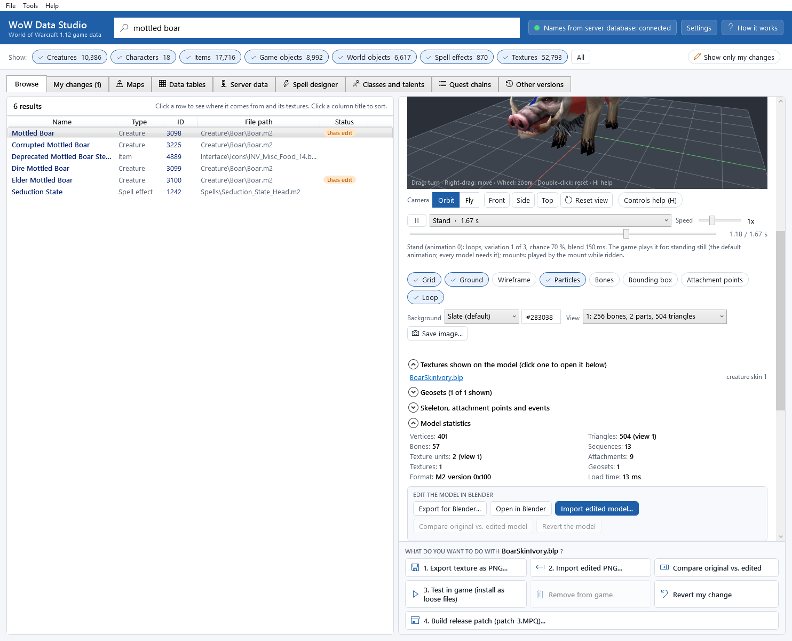
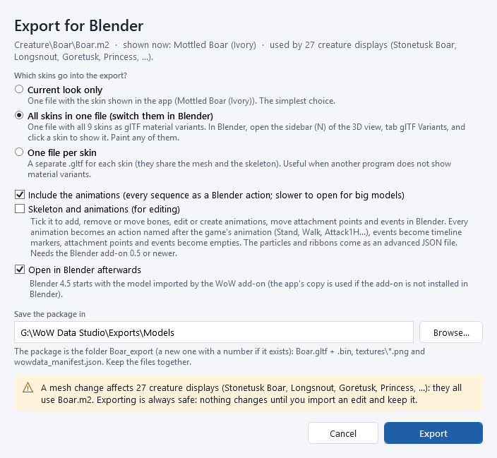
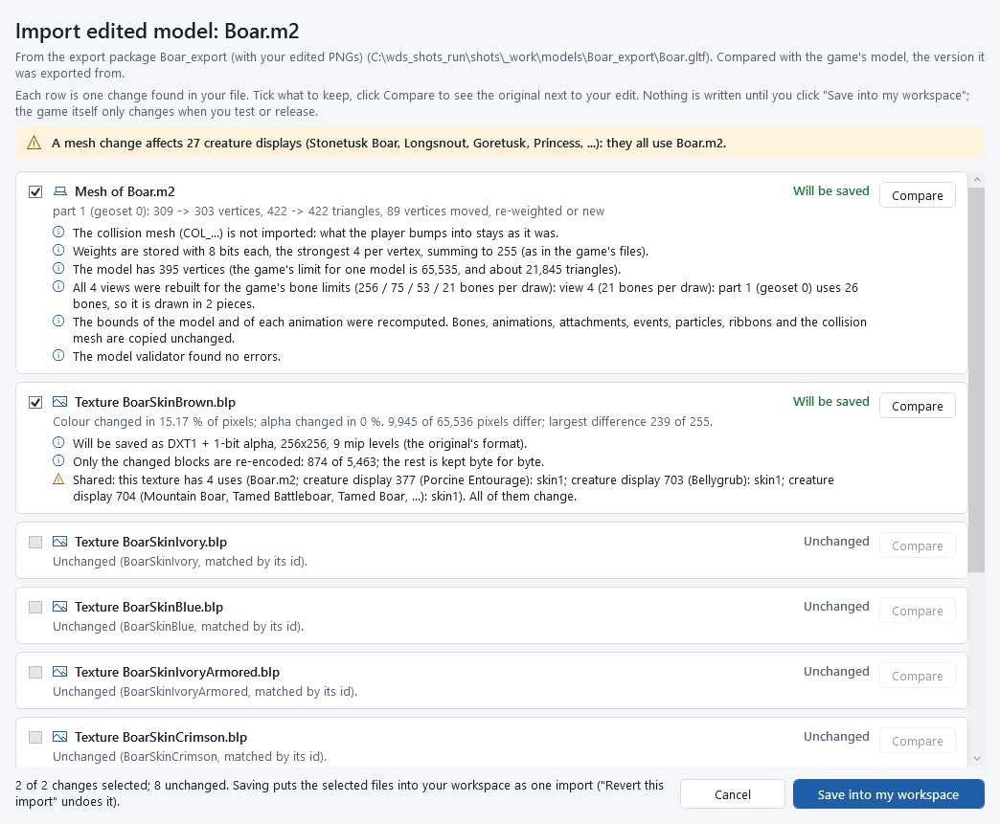
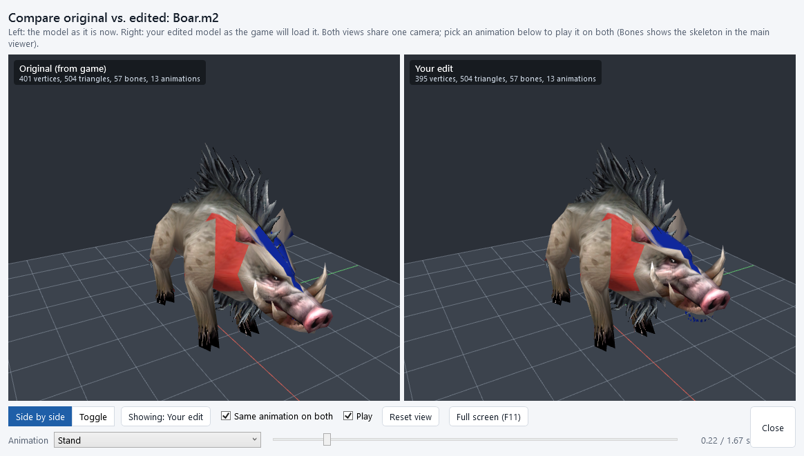

### Maps and terrain (Phase 4)

The full guide is the manual chapter [Maps and terrain](docs/manual/maps-and-terrain.md); the command-line side is
`docs/MAPS_WORKFLOW.md`. In short, the **Maps** tab:

* **Maps and zones:** every map of Map.dbc grouped as continents, world maps, dungeons, raids and battlegrounds (single-building
  maps are marked); the zones of a map (AreaTable, from the index's per-chunk area ids) light up their tiles.
* **Minimap overview:** built from the client's minimap textures (`textures\Minimap` + `md5translate.trs`, BLP decoder),
  cached as PNG per map; click a tile; changed tiles (orange) and tiles Noggit saved but not imported (dashed) are marked.
* **The tile:** zones, size, heights, doodad / WMO / texture counts and an "On this tile" report in the style of "Used in
  game" (zones with their share of chunks, every doodad model and building with links to the Browse list, ground
  textures, terrain facts, server spawns).
* **3D terrain preview** (the 3D view's viewport and camera): heights, MCNR normals, up to 4 texture layers blended with the
  4-bit alpha maps, shadows, holes, MCLQ liquids, doodads (the model viewer's M2 assets, rest pose) and WMO groups (simple:
  first texture per batch); optionally the 8 neighbour tiles.
* **Edit in Noggit...:** our fixed Noggit fork, run as a separate GPL program. The app makes a *client view* for it
  (hard links to the game's archives: no copy, Noggit can never write into the game folder), one Noggit project per map
  (`WDS_<map>.noggitproj`, ClientVersion Vanilla) with a bookmark at the selected tile (the fork has no command-line start
  location; a double-click on the bookmark flies there), and a guidance window (steps, what is disabled for 1.12).
* **Import map changes...:** every file Noggit saved is compared with what the app has (your earlier import, else the
  game's file), validated with the C# port of the 1.12 map validator (errors block the file, explained in words) and
  described by the semantic diff ("Heights changed in 78 chunks (up to 70 yards), holes changed in 1 chunk, 3 doodads
  moved"); review with include checkboxes and **Compare** (two synchronized 3D terrain views, the height difference as a
  heat map, every change listed); saved as one change set.
* **Test map in game (loose files)**, **Build release patch (patch-3.MPQ)...** as for textures, with the note that the server
  needs its own update.
* **Update server maps...** (guided): checks the map changes are in the installed `patch-3.MPQ`, runs
  `server\reextract.ps1` (maps / vmaps / mmaps for the changed maps) into the staging folder with progress and the change
  report, tells you how to stop the world server, runs `server\swap_in.ps1` (it refuses while mangosd runs; verified
  backup), shows the backup and offers **Undo server update** (`swap_in.ps1 -Restore`). The app never stops or starts the
  server.

* **Break down this tile... (0.6.0):** a window listing every piece of a tile by kind: the terrain mesh and its 256 chunks
  (heights, holes, zone, water), the ground textures (share of the ground), the doodads grouped by model with every
  placement, the buildings with their groups and doodad sets, the water (MCLQ) per chunk, sound emitters, the shadow map
  and the zones; searchable. Selecting a piece highlights it in the tile's 3D view (the rest dimmed) or shows it on its own
  (a model in the model renderer, a building alone, a texture with its coverage map, the ground as a height heat map);
  **Show in Browse** opens its entry with "Used in game", **Open in Blender** opens the model, building or terrain. Also
  in the terrain pop-out and **Tools**. Manual: [Maps and terrain](docs/manual/maps-and-terrain.md#break-down-a-tile).
* **Terrain in Blender (0.6.0):** **Open terrain in Blender...** picks the tiles (1 x 1 / 3 x 3 / 5 x 5 or clicked on the
  minimap) and writes a terrain package (`wowdata_terrain.json`, heights, ground textures and their weights as images,
  optional doodads / buildings as references); the add-on (0.4.0) makes one object per tile ("Tile 32_48", own
  collection, colour, label, vertex groups EDGE_N/E/S/W, a material blending the ground textures as the game does) and has
  *Sync shared edges*, *Check edge seams* and *Export terrain for WoW Data Studio*. **Import edited terrain...** maps the
  vertices back by id, keeps heights only (sideways moves snapped, added / deleted vertices reported), checks the edges
  against the other imported tiles and the existing neighbours (and syncs them, pulling an unedited neighbour in),
  recomputes the normals around the change, keeps every other byte, validates, and goes through the map import review,
  compare and change set. Manual: [Terrain in Blender](docs/manual/terrain-in-blender.md).

The C# map formats (`WoWData.Core\Maps`): ADT / WDT / WDL readers, an ADT document that re-serialises every stock tile
byte-identically, the validator and the semantic diff (ports of `wowdata\maps`, word-for-word the same messages); 0.6.0
adds the tile breakdown (`TileBreakdown`), the terrain grid and normals (`TerrainGrid`, `TerrainNormals`) and the
terrain package export / import (`TerrainPackage`, `TerrainImport`).

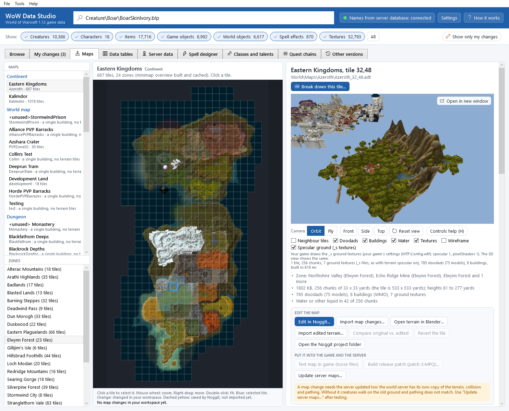
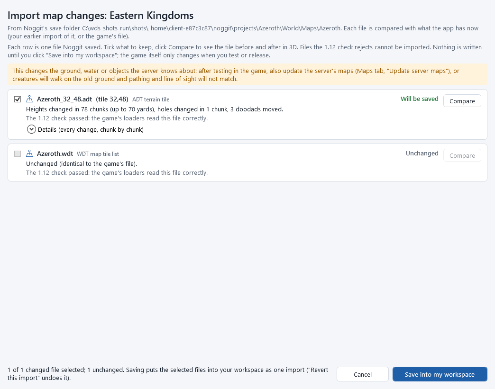
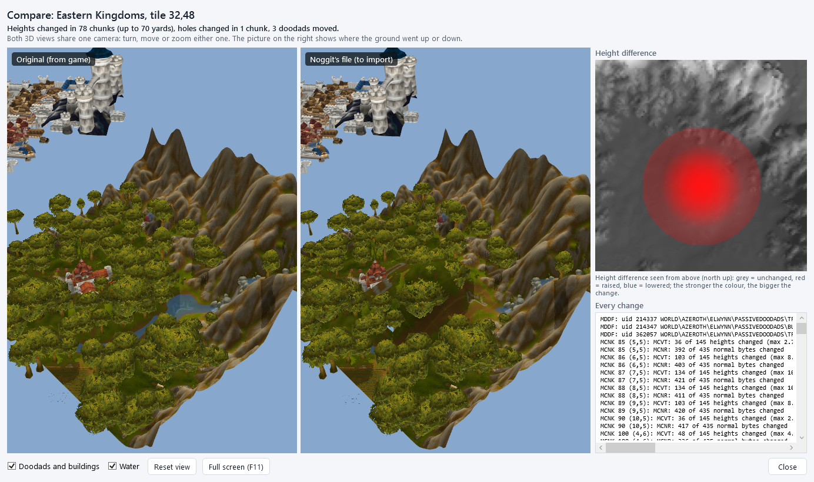
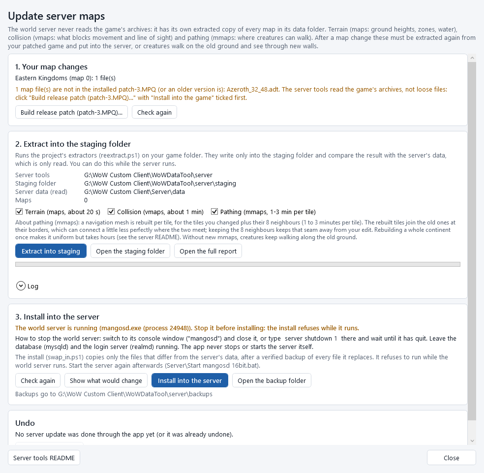
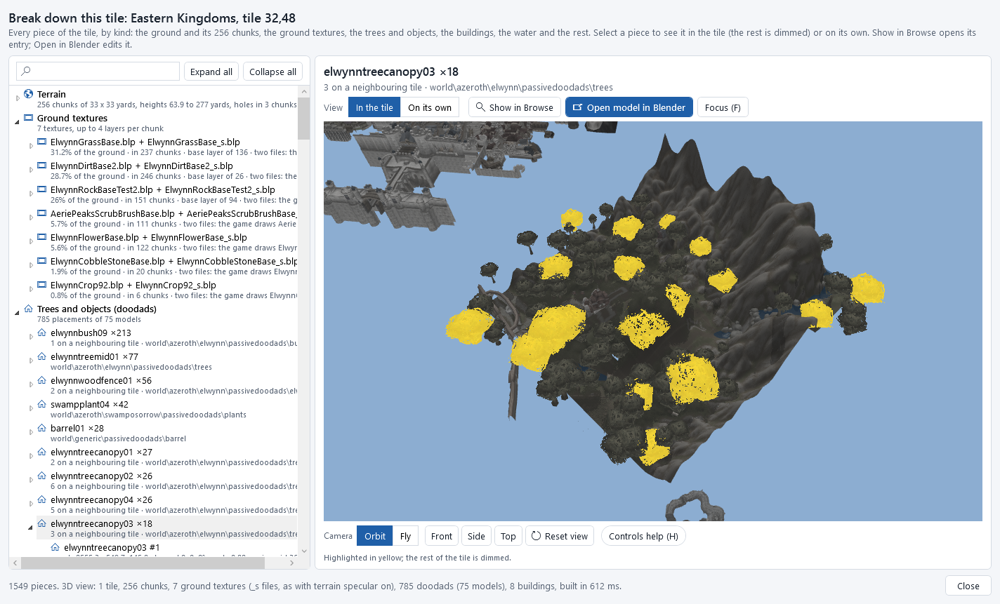
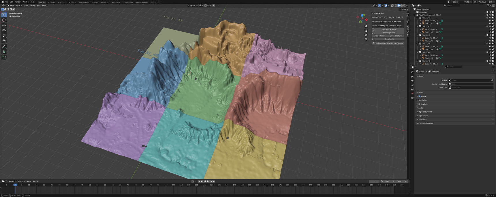

**Names from the server database.** With the local server's world database running (CMaNGOS or VMaNGOS schema, MySQL; default `127.0.0.1:3306`, `root`/`root`, database `mangos`, editable in **Settings**, with a **Test connection** button), creatures, items and game objects are listed by their names. The password is saved encrypted for your Windows user (DPAPI); a password saved as plain text by an older version is encrypted the next time the app starts. The app only runs SELECT statements. The top bar says **Names from server database: connected / not connected**; without it, they are listed by model and display id ("Boar - BoarSkinIvory", "creature display 503"). **File > Reload names from the server database** adds them later without rebuilding the rest.

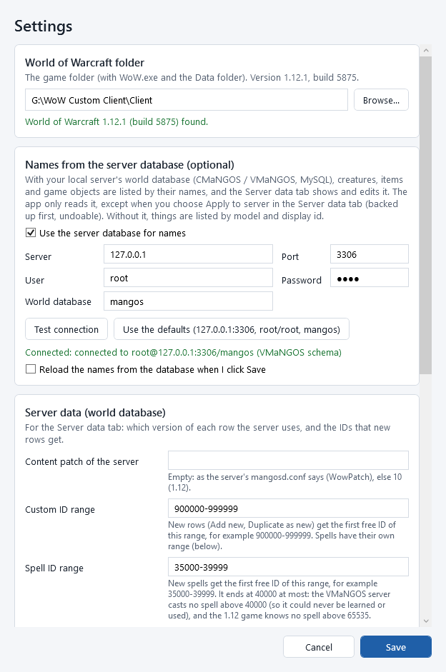
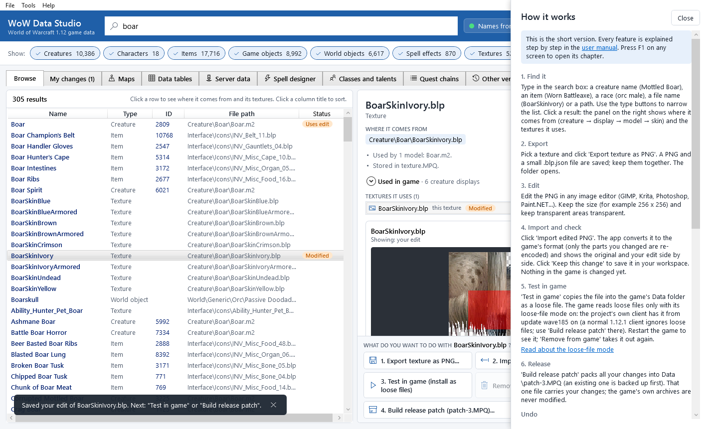

**Where the app keeps its files:** `%APPDATA%\WoWDataStudio\`: `settings.json` (with the server password encrypted), and per game folder `<folder>-<hash>\` with `index.sqlite` (the index), `workspace\` (your edited files, mirroring game paths), `changes.json` (each change with the original's archive, SHA-256, format, the models/displays that use it, its import "change set", and where it was installed or packed), `backups\` (also `backups\server\server_dbc_<time>\`, the server tables replaced by Copy to server) and `build\`, `server_dbc_copies.json` (the copies to the server, for Undo); for the maps: `noggit\client\` (Noggit's client view), `noggit\projects\<map>\` (the Noggit projects and what Noggit saves), `cache\minimap\` and `server_updates.json`.

**Command-line options** (for `bin\WoWDataStudio.exe` or the `.cmd`): `--client "<WoW folder>"`, `--home "<folder>"` (instead of `%APPDATA%\WoWDataStudio`), `--screenshot "<folder>"` (renders the screens above to PNG files using a temporary home, then exits; it never installs anything into the game folder; it also writes offscreen renders of the 3D view, `render_*.png`). The screenshots show textures and models from the local client (Blizzard's data). Developer tool: `--render <model.m2> <out.png> [--display N] [--sequence N] [--time ms] [--yaw degrees] [--size WxH] [--original]` renders one model offscreen and exits (it needs `--client`, or a game folder saved in the settings). Since 0.6.1 it renders your workspace version (edited model and textures, from the `--home` app folder or the default one) like the app's views; `--original` renders the game's files only.

### Data tables: the DBC editor (0.7.0)

The full guide is the manual chapter [Data tables](docs/manual/dbc-editor.md). In short, the **Data tables** tab:

* **All tables:** the 154 DBCs the client loads (and the 4 that `patch.MPQ` deletes, listed as server-only), grouped by
  subject, read in the game's archive order; each says which archive it comes from (and what it overrides), whether a
  loose copy is in the game folder and whether your workspace has an edit.
* **Typed 1.12.1 layouts** (`app\WoWData.Core\Dbc\Layouts\dbc_layouts_5875.txt`, a readable text file): named columns
  (whole numbers signed / unsigned / 1- and 2-byte, decimal numbers, texts, file paths, localized texts with 8 languages
  and flags, flags with named bits, choices with named values, links to other tables). Evidence per table: the client's
  record readers in our decompile (`WoWDecomp\work\out66`: field counts, record sizes, text fields, names proven by the
  client code), the VMaNGOS loader (formats and names, read for facts only), checks on the files. 107 tables fully
  named, 30 partly, 17 raw apart from the ID; 1,214 of 1,484 columns named; unknown columns stay visible as `col_N`.
* **Grid and details:** virtualized grid, search over all text, column filters, sorting, Go to ID; links shown with the
  linked row's name and followed with a click (Back); icons and textures previewed (a spell's icon through SpellIconID,
  item icons, creature skins); **Show in 3D** opens displays in the Browse tab's 3D viewer; **Used by** lists the rows
  of other tables that link to a row.
* **Editing:** checked values (ranges, links that exist, unique IDs, text and path lengths), add / duplicate / delete
  rows (warned when used), bulk edit (set / add / multiply), undo / redo, localized texts per language.
* **Workspace, test, release:** **Save to my workspace** (with the row diff first) makes one change set; My changes,
  Compare (row by row), Test in game and Build release patch work as for textures. Tables are written byte for byte
  like the client's files (all 154 written back unchanged are identical).
* **CSV / JSON** export (all rows, the rows shown, the selected rows) and import with a preview diff and validation.
* **Server:** each table says *Client only*, *Server also needs this file* (46 tables VMaNGOS reads from
  `Server\data\5875\dbc`) or *Server uses its database instead (edit there)* (11 tables: Spell from `spell_template`,
  Map, AreaTable, Faction, FactionTemplate, TaxiNodes, SkillLineAbility, SoundEntries, AreaTrigger, MailTemplate,
  CreatureSpellData). **Copy to server...** copies the first kind into the server's dbc folder with a verified backup,
  refused while `mangosd` runs, with **Undo last copy to server**.

### Server data: the world database (0.9.0)

The full guide is the manual chapter [Server data](docs/manual/server-data.md). In short, the **Server data** tab (and
`wds server ...`):

* **Views** of the VMaNGOS world database: items (with vendors and where they drop), creatures (spawns, loot, vendor and
  trainer lists, quests, gossip, equipment, looks), quests (givers, enders, chain, objectives, rewards), game objects,
  spells (next to the game's Spell.dbc row), every loot table, vendors, trainers, areas, maps, flight paths, factions,
  faction templates, languages, and every one of the 176 tables raw. The column names and types come from the live
  schema; their meaning (groups, choices, flags, money, times, links, hints) from
  `app\WoWData.Core\ServerData\Layouts\server_layouts_vmangos.txt` (53 tables described: 41 fully, 12 partly).
  VMaNGOS row versions (content patch, client build, ranges) are shown with the one the server uses.
* **Editing** with the SQL type checks and VMaNGOS's own load rules, links that must exist, add / duplicate (free IDs
  of a custom range) / delete (with Used by) / bulk edit / undo / redo; edits saved into the workspace (one file per
  table, My changes, row diff).
* **Client and server:** Spell.dbc vs `spell_template`, item and creature looks vs ItemDisplayInfo / CreatureDisplayInfo,
  Map / AreaTable / Faction / FactionTemplate / TaxiNodes / SkillLineAbility vs the server's tables: every difference,
  "make them match" in either direction.
* **Delivering:** an idempotent SQL patch with its revert script, or **Apply to server** (statements shown, rows backed
  up and whole tables dumped, one transaction, read back, logged, **Undo last apply**); the `.reload` commands or the
  restart the server needs; clearing the game's WDB cache. Only the world database is ever written.
* **CSV / JSON** export and import with a preview.
* **Tests never touch the user's databases:** they start a throwaway MySQL server (own data folder and port) from the
  local server's `mysqld.exe` and load `app\WoWData.Tests\serverdb\world_fixture.sql` (schema + a sample of rows).

### The spell designer and the class and talent designer (0.12.0)

The full guides are the manual chapters [The spell designer](docs/manual/spell-designer.md) and
[The class and talent designer](docs/manual/class-and-talent-designer.md). In short:

* **Spell designer** (`wds spells ...`): make a new spell or clone one, in a form grouped like a player thinks (basics,
  casting, targeting, the three effects with plain-language explanations of every effect and aura type, mechanics and
  flags, procs, duration and stacks, visuals, server-only values), with friendly units (seconds, yards, rage, icon
  file names: the helper rows of SpellCastTimes, SpellDuration, SpellRange, SpellRadius, SpellIcon are found or added).
  The tooltip preview fills in the `$` variables as the client's own code does; the checks list what the 1.12 client
  and the VMaNGOS server cannot handle (empty handlers, scripted effects, missing auras, ticks, procs, triggers,
  targets, radiuses, items and creatures on the server). Visuals are picked whole or by part from other spells, or
  duplicated with a tint and a size (copied, scaled and tinted effect models), and previewed in 3D. Trainer entries get
  their *learn* spell (the only kind the server accepts), skill lines go into SkillLineAbility and `skill_line_ability`
  with the same ID. One save writes the client tables and the server rows together (one change set); new spells take
  free IDs of the custom ID range.
* **Classes and talents** (`wds talents ...`, `wds classes ...`): a class's talent trees on the 1.12 grid (add / remove
  trees, place and move talents, rank spells made with the spell designer, prerequisites and arrows, icons and
  backgrounds), checked against the client's talent frame (5 trees, 20 talents, 8 x 4 grid, 30 arrows) and the server
  (5 ranks, 5 points per tier, no talent spells at trainers); the class's spells by level (trainers, skill lines,
  automatic, starting spells, talents) with level and trainer assignment; class masks across game and server tables;
  and, experimental, a new class's data with the honest report of the code it still needs in the client (decompile
  addresses, interface files) and the server (VMaNGOS source files and lines).

### Quest chains (0.13.0)

The **Quest chains** tab (**Tools > Quest chains**) and `wds quests ...`; manual chapter
[The quest-chain designer](docs/manual/quest-chain-designer.md). In short: any quest's chain as a flowchart (lanes per
faction, race and class; steps; arrows for "must be done first", "must be in the log", "opens", "next in chain" and
breadcrumbs; choice and "all of" frames; problem badges), the quest editor in plain fields (texts with the client's own
`$N` / `$C` / `$R` / `$G` preview, levels, classes and races as checkboxes, chain links, objectives, rewards), givers and
enders with the NPC's model and their place on the Maps tab, drop sources linked to the loot editor, speak-to and explore
objectives, reward spells made learnable through the spell designer; building chains (after, before, branches, joins,
the other faction's copy with swaps, the Warrior's discipline template, new quest-giver NPCs placed on the map); checks
from VMaNGOS's quest rules and the 1.12 client's quest cache; delivery through the workspace (Apply to server, SQL
patch, undo, the quest-cache reminder, the GM commands to test it).

### The command line: wds (0.8.0)

`wds` does everything the app does, without a window: `setup`, `settings`, `serverdb`, `index`, `find` (the Browse tab),
`textures`, `models`, `maps`, `server-maps`, `dbc` (the Data tables tab), `server` (the Server data tab, 0.9.0),
`spells`, `talents` and `classes` (the designers, 0.12.0), `quests` (the quest-chain designer, 0.13.0) and `changes`
(My changes). It shares the app's
settings, index and workspace (or uses its own with `--home`), prints text or one JSON object (`--json`), sends progress
to stderr, has documented exit codes (0 ok, 1 error, 2 usage, 3 validation failed, 4 refused for safety, 5 needs `--yes`,
6 not found), never changes the game folder or the server or deletes an edit without `--yes`, and has `--dry-run` wherever
the app shows a preview. The same safety rules as the app: refused while `mangosd` runs, backups, and a `patch-3.MPQ` the
app did not create is only moved to the backups with `--force`.

```
wds setup client "C:\Games\World of Warcraft"
wds find search mottled boar --type creature
wds textures export Creature\Boar\BoarSkinIvory.blp --out boar.png
wds textures import boar.png --dry-run
wds dbc set Spell 133 SpellIconID 184
wds server set item_template 25 dmg_max1 12
wds changes build-patch --install --yes
```

Every command with examples, the coverage table app <-> command line, the exit codes, JSON and recipes: the manual
chapter [The command line](docs/manual/command-line.md). Example scripts (PowerShell and batch): `scripts\`. Only looking
at things on screen (3D views, pop-out windows, the compare views), moving between tabs and the Data tables tab's unsaved
state are app-only; `wds models render`, `wds maps render` / `minimap` and the `--heatmap` / `--out` pictures of the
compare commands cover the pictures.

### Build and test (developers)

Requirements: the .NET 8 SDK (pinned by `app\global.json`); Visual Studio 2022/2026 opens `app\WoWDataStudio.sln`. Projects: `WoWData.Core` (class library: MPQ, DBC, BLP, PNG, M2 read / write / validate / animate, model looks, index, workspace, and since 0.8.0 the operations both front ends share: the session, search, the texture import flow, change operations, map operations, the server-map updater, the table edit session, settings, the feature registry), `WoWDataStudio` (WPF, MVVM, the OpenGL 3D view), `WoWData.Cli` (`wds.exe`, the command line; no WPF), `WoWData.Tests` (xUnit). The version of all of them is in `app\Directory.Build.props`. The 3D view needs OpenGL 3.3 (any graphics driver of the last ten years).

```powershell
cd "<your WoW Custom Client folder>\WoWDataTool\app"
dotnet build WoWDataStudio.sln
dotnet test WoWData.Tests\WoWData.Tests.csproj           # 201 tests, about 8 min (the first run also builds the Python oracles, about 1.5 min)
dotnet publish WoWDataStudio\WoWDataStudio.csproj -c Release -r win-x64 --self-contained true -o publish\bin
dotnet publish WoWData.Cli\WoWData.Cli.csproj -c Release -r win-x64 --self-contained true -o publish\bin   # wds.exe next to the app
```

The tests run on the real client (read-only) and compare with the Python reference: the first run generates `app\.testcache\oracle\` with `python` (numpy, Pillow). Delivery is tested against a fake client folder, and the tests check that the real `Client\Data` folder is unchanged afterwards. The UI smoke test starts the built app with `--screenshot` and requires every step to pass; it is also the render smoke test of the 3D view (offscreen renders of the boar with two skins, the orc male with three looks, an animation frame and all four views, a palm tree, an item, a spell effect and both sides of the compare view must render, and differ where they should). The C# M2 port is checked on all 9,691 client models: each parses, re-serialises byte-identically and validates exactly like the Python; 259 of them are compared field by field with the Python's parse, including evaluated animation values. Phase 3c: the view regenerator is run on 1,388 client models (every view keeps its triangles and passes the validator); the model round trip runs Blender 4.5 headless with the add-on (skipped when Blender is not installed): the boar (all 9 skins), a palm tree, an item (10 skins) and the orc male come back from Blender as "no change", and a scripted Blender edit (vertices moved, a texture tinted) of the boar, the tree and the item imports with only the edited part and texture changed, the validator passing and every animation evaluating; the add-on zip installs into a temporary Blender profile and "Open in Blender" imports a package in a real Blender window. Phase 4: the C# map validator gives the same findings as the Python on all 2,515 client map files (none) and on 41 deliberately edited or broken tiles, WDTs and WDLs (word for word), the semantic diff gives the same lines; all 2,429 tiles re-serialise byte-identically; the placement matrix reproduces the stock MODF boxes; a scripted tile edit saved into a Noggit project folder is found, validated, described and imported as one change set; the Noggit project and the client view are checked against a fake game folder (hard links, the game folder refused); the server update runs against fake server data folders (the real `swap_in.ps1` refuses while mangosd runs; a copy with only that check stubbed installs with a backup and restores; the real `reextract.ps1` extracts into a temporary staging folder); the UI smoke test walks the Maps tab, renders a tile, its neighbours and both sides of the terrain compare. 0.5.1: the
pop-out windows are checked off screen in the same run (follow / pin, the title, the docked pause, F11 / Esc, Ctrl+H, H,
presets, the fly camera, the placement saved and restored per kind, F1 topics) and opened and closed 20 times per kind
with the GL contexts, textures, buffers, vertex arrays and programs counted (`GlTracker`): every count must come back;
`PopoutTests` checks the placement fitting (monitor gone, rearranged, too big, off screen), the settings round trip, the
camera presets / focus / fly operations and the fly keys without a window. 0.6.0: the tile breakdown is checked against
the ADT and against `MapScanner` (the scan behind the index) on four tiles, its Browse keys resolve in the index; the
terrain normals formula matches the stock MCNR (mean 0.37 degrees); a 3 x 3 terrain package goes through headless
Blender (9 objects with names, collections, colours, labels, edge groups), a scripted edge raise + *Sync shared edges*
comes back seamless with only the edge chunks changed, recomputed normals and the validator passing, an unchanged
round trip is "no change", sideways moves and an added vertex are snapped / ignored with a message, and the seam sync into
an existing neighbour tile is checked without Blender; the UI smoke test walks the breakdown, the tile picker and a
scripted terrain import (`Services\BreakdownScreenshots.cs`). 0.6.1 (`GroundTextureTests`, `RenderCliTests`,
`PerformanceTests`): the client's `_s` name rule and the `Config.wtf` settings, both files in the breakdown, the index,
the search list, the details and **Used in game**, the specular preview and the terrain package, "edit both" keeping the
shine map, the colour / alpha statistics (a whole-texture tint of `DurotarDirt_s.blp` reports 100 %), the model import's
blend-mode rule (an opaque material whose texture has alpha 0 in places), the blend modes of real models (the Shadow
Bolt missile is additive), "keep black areas black", uninstalling the release patch (the earlier one put back; a foreign
one only moved with consent), and `--render` showing the workspace; the UI smoke test adds screenshots 75-82
(`Services\SpecularScreenshots.cs`, the patch steps in a fake game folder). 0.7.0 (`DbcEditorTests`): every one of the 154
client tables has a layout whose field count and record size match the file, is written back byte for byte (also with
its string block rebuilt), holds string offsets at string starts and unique IDs, and reads the same headers and 1,023,337
typed values as the Python reference (`oracle\make_dbc.py`); verified links resolve on the data; an edit goes through the
workspace, a fake client's loose install and the release patch and reads back; CSV and JSON round trips of every table
change nothing; imports show changed / added / removed rows and block on errors; links, Used by and file lookups;
validation; undo / redo; Copy to server into a fake server folder (refused while "running", backup, undo). The UI smoke
test adds screenshots 83-94 and types into the grid (`Services\DbcScreenshots.cs`; `WDS_SCREENSHOT_ONLY=tables` runs only
those). 0.8.0 (`CliTests`, `ParityTests`, `ManualTests`): every command group of `wds` in-process and as its own
process against isolated homes and fake game and server folders (the help and examples of all 81 commands, usage errors,
the JSON envelope, the exit codes 0 / 2 / 3 / 4 / 5 / 6, loose install and remove with a foreign file, the release patch
built, installed over a foreign `patch-3.MPQ` and uninstalled, a scripted terrain edit through the seam refusal and sync,
a table through CSV and back, copy to a fake server, the example scripts, the app and `wds` sharing one workspace);
the same texture import, table edit and release patch made through the app's view models and through `wds` give
identical workspaces and byte-identical patches; the feature registry against both front ends; the manual's commands,
coverage table and exit codes against the program. 0.9.0 (`ServerDataTests`, `ServerCliTests`): against a throwaway
MySQL server the tests start themselves (`ServerTestDb`: the local VMaNGOS `mysqld.exe`, only read, or `WDS_TEST_MYSQLD`;
its own empty data folder in `%TEMP%` and its own port; killed and deleted at the end), loaded from
`app\WoWData.Tests\serverdb\world_fixture.sql` (made by `app\tools\ServerFixtureBuilder` from a read-only copy of the
world database's files: the schema of all 176 tables and 9,945 connected rows), each test on its own copy of the
database: the layout file against the live schema, views, links, sections and Used by, value and row checks, editing
with undo / redo and custom IDs, the workspace files and their row diff (never game files), the SQL patch applied twice
(the same checksums and rows) and its revert (the original rows exactly), apply with backups, log, conflict refusal, a
failure in the middle taken back, undo to the original checksums, a database that is not the world database refused,
the client / server checks and "make them match" both ways, CSV / JSON round trips and the import preview, the game's
cache, every `wds server` command with its exit codes, and the Server data tab and `wds server` making byte-identical
workspace files and SQL. Without a `mysqld.exe` these tests are skipped with the reason; they never fall back to a live
database. 0.10.0 (`RigFormatTests`, `RigRoundTripTests`, `CliRigTests`): on every client model an identity rig plan writes the same bytes and re-encoded or relocated animation tracks play the same as the original (evaluated like the client); the lookup rules; a 25-model sample (creatures, characters, items, doodads, spell effects) exported with the skeleton and imported without edits comes back unchanged and byte-identical, five of them through headless Blender; a scripted Blender edit (a new bone, a new animation, a retimed walk, a moved attachment point, a new event) is imported, validated and read back; the limits; the particles JSON; Used in game for animations; the `wds models anims` / `skeleton` commands and their parity with the app. 0.11.0 (`HotReloadTests`): the protocol against the replies the game side's real C code gave in its offline harness, the switch file, every state the app explains (no game, off, started before, no support, not answering), reloads against a stand-in game (`FakeGame`, a real named pipe), the release patch replaced while the stand-in game holds it open (refused without hot reload, released / installed / re-mounted with it, nothing written when the game cannot let go), and `wds changes reload` / `--reload` / `settings set hot-reload` with their exit codes; with `WDS_HR_HARNESS` set, the app also talks to the real C code.

**A deterministic suite (0.6.1):** the index of a run is built once and shared (`IndexFixture.Instance`); every class
that uses it, builds an index of its own or runs the app is in one test collection (`IndexCollection`), so no two index
builds run at the same time; tests that need the server's data are `[ServerFact]` (skipped when the server does not
answer) and read the one snapshot of the shared index (re-read once if the server answered with empty tables); every
timing limit is in `PerformanceTests`, which runs alone after the rest and takes the best of several runs; the UI smoke
test logs its timings instead of judging them.

**Installer:**

```powershell
cd "<your WoW Custom Client folder>\WoWDataTool"
powershell -ExecutionPolicy Bypass -File build_installer.ps1            # version from app\Directory.Build.props
powershell -ExecutionPolicy Bypass -File build_installer.ps1 -Version 0.11.0
```

It runs `ManualTests`, publishes the app and the command line self-contained into one `bin\` (Release, win-x64, one
version and build stamp in both exes; it fails when either is missing, their versions differ or `wds version` does not
run), renders the
manual (`app\tools\ManualBuilder`, Markdig) to `build\manual\`, builds the Blender add-on zip, stages everything in
`dist\stage\` and compiles `installer\WoWDataStudio.iss` with **Inno Setup 6** into `dist\WoWDataStudio-Setup-<version>.exe`
(about 75 MB, about a minute). Needs the .NET 8 SDK, Python and Inno Setup (`winget install --id JRSoftware.InnoSetup -e --scope user`).
Why Inno Setup: see ARCHITECTURE "Installer".
**Testing the installer never touches the real installation** (CONTRIBUTING.md, "Testing the installer"): a silent
install of the normal setup into another folder still uses the real AppId and Start-menu group, and its uninstall
removes the user's real shortcuts and Apps entry. So tests use the TEST build only:

```powershell
powershell -ExecutionPolicy Bypass -File build_installer.ps1 -Version 0.9.0 -TestBuild     # dist\WoWDataStudio-TestSetup-0.9.0.exe
powershell -ExecutionPolicy Bypass -File installer\test_install.ps1 -Setup dist\WoWDataStudio-TestSetup-0.9.0.exe -Version 0.9.0
```

The TEST build is a separate product ("WoW Data Studio TEST": its own AppId, folder, Start-menu group and Apps entry);
`test_install.ps1` installs it into a temporary folder (`/DIR`, `/NOICONS`, only the PATH task), checks it (both exes, the
same version, `wds` runs, the TEST bin folder in the user's PATH), uninstalls it with its own uninstaller (the PATH is
then exactly as before), and compares the real installation (Start-menu group with hashes, Apps entry, folder, desktop shortcut)
before and after.

**Noggit is not in the installer** (by decision, see ARCHITECTURE "Noggit and the installer"): it is a GPL-3 program with
Qt 5 (LGPL) and other libraries, and shipping its binary would oblige us to ship (or offer in writing) its complete
corresponding source and Qt's, for a 0.6 GB developer build. The app finds the fork's build next to it
(`third_party\noggit-build\bin\noggit.exe`) or uses the path set in **Settings > Maps and terrain**; how to build it:
`third_party\noggit-cinder-fork\BUILD_NOTES.md`. The server tools (`server\`, Python and GPL extractors) are not in the
installer either; "Update server maps" finds them next to the app or through the same settings.

**Release build:** self-contained, one folder (`app\publish\bin`, about 150 MB) rather than framework-dependent (about 10 MB). It runs on any 64-bit Windows 10/11 without installing the .NET 8 Desktop Runtime, which a "standalone tool" should not ask of a modder; the size is the price. Not a single-file exe: WPF's native libraries would be extracted to a temporary folder at every start.

### Known issues

Bugs and limitations that are not fixed yet are listed, with who they affect and the workaround, in the manual chapter
[Known issues](docs/manual/known-issues.md) (shipped with the app: **Help > User manual**). A fixed bug is removed from
that list and recorded in `CHANGELOG.md`. The main ones in 0.9.0: most VMaNGOS tables are MyISAM, so an apply that
fails in the middle is taken back from the backup by the app, not by the database; the world server needs a restart (or
`.reload`) and the game a cleared cache to show server edits; 123 of the 176 world tables are only shown as stored;
Apply to server was tested against throwaway databases only; some DBC columns are not verified (shown as stored, with a
hint); edits of tables the server takes from its database (Spell...) change only what the game shows; the Browse list
and Used in game show the game's tables, not your edited ones; a terrain edit changes only what the game draws until
the server's maps are updated; CMaNGOS databases are untested; 17 ground textures the maps use have no `_s` file (what
the game shows there with terrain specular on is unverified); the 3D views are previews (no particles, worn equipment
or ground shine); new textures cannot be added; only heights come back from Blender. Hot reload (0.11.0) needs the
client update HR1 (staged in the client project, not deployed yet) and some changes still need a relog or a restart (the
result says which).

## Command line (`wowdata`, Python)

**The tool never modifies the original MPQs.**
* Everything is written to `WoWDataTool\staging\` first.
* Only `wowdata loose install` and `wowdata pack --install` write into `Client\Data`.
* `pack --install` backs up any existing `patch-3.MPQ` into `WoWDataTool\backups\`.

## Install

Requirements: Python 3.10 or later with **numpy** and **Pillow** (this machine's default Python 3.11 has both). Nothing else is installed.

```powershell
cd "<your WoW Custom Client folder>\WoWDataTool"
.\wowdata.cmd info                 # archives in the client's lookup order, paths, index state
```

* `wowdata.cmd` runs the tool from this folder. Add the folder to `PATH` to type just `wowdata`.
* Alternatives: `python -m wowdata ...` (from this folder), or `pip install -e .` for a `wowdata` command.

Paths default to this machine's layout (`..\Client`, `..\Server`). To change them, copy `wowdata.example.json` to `wowdata.json` and edit it, or set `WOWDATA_CLIENT_DIR` etc.

To search creatures, game objects and items by name, the server database must be running (`mangos` on 127.0.0.1; the tool only runs SELECTs). Build the index once (about 5 seconds):

```powershell
.\wowdata.cmd index build          # --no-server: DBCs + archives only
```

Run `index build` again after DBC or server-database changes. `find` builds the index automatically the first time.

## Commands

| Command | What it does |
|---|---|
| `info` | the 14 MPQ files in the client's lookup order (12 mounted by the game; `base.MPQ`/`backup.MPQ` are installer files) |
| `index build [--no-server]` | (re)build `cache\asset_index.sqlite` |
| `find TEXT [--type creature,gameobject,item,race,model,file] [--limit N] [--json]` | find assets by name or use |
| `extract TARGET... [--out DIR]` | copy files out of the archives, mirroring archive paths (default `work\extract`) |
| `ls PATTERN` | list archive paths matching a wildcard, with every archive that has them |
| `dbc TABLE [ID...]` | print rows of a client DBC table |
| `texture export TARGET... [--out DIR]` | BLP to PNG + a `.blp.json` sidecar (default `work\export`) |
| `texture import PNG... [--as PATH] [--format F] [--palette auto/keep/new] [--full]` | PNG back to BLP, into `staging\` |
| `texture info PATH` | BLP header, mip layout and client-compatibility check (archive path or file) |
| `texture tint PNG OUT [--color R,G,B]` | a visibly tinted copy, for in-game tests |
| `staging` | list and check the staging folder |
| `loose install / remove / status [--dry-run] [--force]` | copy the staging folder to `Client\Data\<path>` as loose files, or remove exactly those |
| `pack [--install] [--name patch-3.MPQ]` | build `build\patch-3.MPQ` from staging (verified by read-back). `--install` copies it to `Client\Data` |
| `model export TARGET [--out DIR] [--view N] [--no-anims]` | M2 to `<Name>.gltf` + `.bin` + `textures\*.png` + `<Name>.wowm2.json` sidecar (default `work\export\models`) |
| `model view TARGET [--no-open]` | the same, plus `<Name>.html`, a self-contained viewer page (three.js) opened in the browser |
| `model info TARGET` | parse a model (or an `.m2` file on disk): counts, views, textures, render flags, round-trip check, validation |
| `model check [PATTERN]` | parse + re-serialise + validate every model matching a wildcard (all 9,691 take about 30 s) |
| `map validate PATH... [--all-client] [--json] [--show-info]` | check ADT/WDT/WDL files (disk files, folders, or archive paths/wildcards) against what the 1.12 client loaders read; exit code 1 on errors. See `docs/MAPS_WORKFLOW.md` |
| `map diff OLD [NEW] [--layout] [--json]` | semantic chunk-level diff of map files (heights, alpha, layers, placements, liquids, emitters...). With one path (a file or folder under `...\World\Maps\`), it is compared with the client's own copy |

**Targets** (for `extract`, `texture export` and `model`):

| Target | Means |
|---|---|
| an archive path | `Creature\Boar\BoarSkinIvory.blp`, `Creature\Boar\Boar.mdx` (read as `.m2`). Wildcards: `Creature\Boar\*` |
| `3098` or `creature:3098` | a creature entry: every display of it (needs the server DB or the index) |
| `display:503` | a CreatureDisplayInfo id |
| `item:12282` / `itemdisplay:22291` | an item entry / an ItemDisplayInfo id |
| `go:178561` / `godisplay:3813` | a game-object entry / a GameObjectDisplayInfo id |
| `race:orc`, `race:2:male` | a player race: its model and all its CharSections textures |

An `.m2` path also brings the textures named inside the model and every skin used by a display of that model (its texture variations).
For `model` commands a target names one model: `creature:` shows its first display, `item:` the item's first model, `race:` the male model unless `:female` is given.

### Example: `find`

```
> .\wowdata.cmd find "mottled boar" --type creature
CREATURES (4 matches)
  3098 Mottled Boar  lvl 1-2  (65 on map 1 Kalimdor)
    display 503  model Creature\Boar\Boar.m2  scale 0.60
      model                  Creature\Boar\Boar.m2 [model.MPQ]
      skin1                  Creature\Boar\BoarSkinIvory.blp [texture.MPQ]
      texture variations of this model: 27 displays, 9 skins: BoarSkinBlue, BoarSkinBlueArmored, BoarSkinBrown, ...
```

More examples:
* `find "orc male"`: race, model `Character\Orc\Male\OrcMale.m2`, and its 248 CharSections rows by section;
* `find durotarpalm`: the palm tree models by path;
* `find "worn battleaxe"`: item, model, model texture and icon.

## Texture workflow, step by step

Example: repaint the Mottled Boar.

1. **Find it:** `.\wowdata.cmd find "mottled boar"`. Creature 3098 uses display 503, model `Creature\Boar\Boar.m2`, skin `Creature\Boar\BoarSkinIvory.blp`. The same skin is also used by other boars (displays 193, 389, 499, 1167, 10015), so they all change.
2. **Export:** `.\wowdata.cmd texture export creature:3098`. This writes:
   * `work\export\Creature\Boar\BoarSkinIvory.png`;
   * `work\export\Creature\Boar\BoarSkinIvory.blp.json`: the sidecar with the archive path, the source archive, the SHA-256 and the exact format (`DXT1 + 1-bit alpha`, 256x256, 9 mip levels, offsets and sizes). **Keep it next to the PNG.**
3. **Edit** the PNG in any editor (GIMP, Krita, Photoshop...):
   * keep the size, which must be a power of two (256x256 here);
   * keep transparency where it was: this skin has 1-bit alpha, so pixels are either fully transparent or fully opaque.
4. **Import:** `.\wowdata.cmd texture import work\export\Creature\Boar\BoarSkinIvory.png`.
   * The BLP is written to `staging\Creature\Boar\BoarSkinIvory.blp`, in the same format and with the same mip layout as the original.
   * Only the 4x4 blocks you changed are re-encoded, and the lower mips are rebuilt only where your edit reaches. An unmodified PNG gives a **byte-identical** file.
   * The report shows how many blocks were re-encoded and how far the in-game result is from your PNG (DXT is lossy).
   * To save it under a new name instead (a new skin), add `--as Creature\Boar\BoarSkinGreen.blp`. A new skin also needs a new CreatureDisplayInfo row; that comes in a later phase.
5. **Try it in the game.** Pick one way:
   * **Loose files** (needs the client patch in `docs/LOOSE_FILES_PATCH.md`): `.\wowdata.cmd loose install`, then restart the game. Undo with `.\wowdata.cmd loose remove`.
   * **Patch archive:** `.\wowdata.cmd pack --install` writes `Client\Data\patch-3.MPQ`, after backing up any existing one into `backups\`. Restart the game. To undo, delete `Client\Data\patch-3.MPQ`.
   * Loose files win over every MPQ. Run `loose remove` before testing the archive alone.
6. **Look:** go to the Valley of Trials, or summon the creature on the test-bed server (`.npc add 3098`).
   * Textures are read at start-up and cached, so restart the game after every install or remove.
   * After **display ID** changes on the server (not needed for a texture edit), also delete `Client\WDB`.

Format notes:
* **DXT textures** (most creature skins): unchanged blocks are kept bit for bit. Edited blocks get the usual DXT approximation; the import report gives the numbers. For a full re-encode of the Mottled Boar skin (`--full`), PSNR against the original is 51.8 dB.
* **Palette textures** (character skins): edited pixels are mapped to the original 256-colour palette. If that is too far off (RMS above 6), a new palette is built (`--palette new` to force it, `--palette keep` to forbid it).
* **New textures** (no original): the format is chosen from the alpha. `--format dxt1/dxt1a/dxt3/dxt5/pal/pal1/pal4/pal8` overrides it.
* Every BLP the tool writes is checked against the client's loader rules (`texture info` shows the check).

## Models: view and export

```powershell
.\wowdata.cmd model view display:503                 # the Mottled Boar in the browser
.\wowdata.cmd model export display:503               # work\export\models\Boar\Boar.gltf for Blender
.\wowdata.cmd model export race:orc                  # OrcMale with a default skin
.\wowdata.cmd model export race:orc --skin 3 --face 2 --hair-style 4 --hair-color 1
.\wowdata.cmd model export "World\Kalimdor\Durotar\PassiveDoodads\Trees\DurotarPalm01.m2"
.\wowdata.cmd model export item:12282                # Worn Battleaxe
```

What gets exported (`work\export\models\<Name>\`):
* `<Name>.gltf` + `<Name>.bin`: one mesh per submesh (named `<Name>_g<geoset>_s<submesh>`, from view 0, the full-detail level), the skeleton (`bone_<index>[_<key bone>]`) with up to 4 weights per vertex, every sequence as an animation named from AnimationData (`Stand`, `Walk`, `Attack1H`; variants get `_<n>`), attachment points as empties (`ATT_<id>_<name>`), and the collision mesh (`COL_<Name>`, hidden);
* `textures\*.png`: the model's own textures and the replaceable slots filled from the target:
  * creatures: the skins of the display (CreatureDisplayInfo texture variations, slots 11-13);
  * player races: a **default skin** composited like the client does it (CharSections skin, face, facial hair, scalp and underwear in the 10 regions of the 256x256 body texture; the hair texture of the hair style). All choices default to 0, the first option of each; change them with `--skin --face --hair-style --hair-color --facial-hair`. The visible geosets are the client's defaults (geoset 0, the geosets of the hair style and of the facial hair, x01 of the other groups, ears 702); no items are worn;
  * humanoid NPCs (`display:` with a CreatureDisplayInfoExtra row): the baked NPC texture;
  * items: the ItemDisplayInfo model texture;
  * an unfilled slot (e.g. a cape) gets a grey placeholder, a missing file a magenta one;
* `<Name>.wowm2.json`, the **sidecar**: everything glTF cannot hold, for the later re-import: the source file (archive path, SHA-256), bone flags, key bones and track headers, the sequences and lookups, the submeshes and texture units of all four views, render flags, colours, transparency, texture transforms, attachments, events, lights, cameras, particle emitters and ribbons, the collision data, the vertex mapping of every exported mesh, and the validation result. **Keep it next to the `.gltf`.**

Materials: the M2 render flags and blend mode are in each material's extras. Opaque, alpha key (cut-off 224/255, as in the client) and alpha blend map to glTF alpha modes; additive and modulate need the Blender add-on; two-sided materials are double-sided, unlit ones use `KHR_materials_unlit`.

**Coordinates.** M2 files are Z-up (yards, the model faces +X). glTF is Y-up, so the exporter writes `glTF (x, y, z) = M2 (x, z, -y)`. Blender's glTF importer converts back, so **in Blender every coordinate equals the M2's** (Z up, 1 unit = 1 yard). The add-on only rotates the top-level object so that the model faces Blender's front view, and records that rotation.

### The Blender add-on (Blender 4.5 LTS)

Install once:
1. `python blender_addon\build_zip.py` writes `build\wowdata_blender.zip`.
2. In Blender: **Edit > Preferences > Add-ons**, the drop-down arrow at the top right, **Install from Disk...**, pick `build\wowdata_blender.zip`.
3. Tick **Import-Export: WoW 1.12 model (wowdata)**. In its preferences, set the WoWDataTool folder (the folder with `wowdata.cmd`; needed only for *from the game data* below, empty until you set it) and check the Python command (it needs numpy and Pillow; `python` on this machine).

(WoW Data Studio installs the same add-on with **Tools > Install the Blender add-on...**.)

Use:
* **File > Import > WoW 1.12 model (.gltf from wowdata)**: pick an exported `.gltf`. Options: orientation (front view, or as in the game), scale (1.0 = yards; 0.9144 for metres), hide the geosets the game hides by default.
* **File > Import > WoW 1.12 model from the game data (wowdata)**: type a target (`display:503`, `race:orc`, an `.m2` path). The add-on runs `wowdata model export` and imports the result.
* Every sequence is an action, kept with a fake user so none is lost. To play one: select the armature, open the Dope Sheet's Action Editor, pick the action and press Space. Each action's custom properties hold its sequence index, animation id and the original sequence record.
* The import fixes the materials (blend mode, back-face culling, additive and modulate shaders), hides the non-default geosets and the collision mesh, and stores the sidecar on the armature (`wow_sidecar`, plus `wow_bone`, `wow_key_bone_id`, `wow_flags`, `wow_pivot` on each bone) for the later export back to WoW.

* **File > Export > WoW 1.12 model for WoW Data Studio (.gltf)** (add-on 0.3): the scene as glTF with the ids as extras, the skins as `KHR_materials_variants`, textures as PNG, plus `wowdata_manifest.json` and `wowdata_blender.json`, for the app's **Import edited model...**.

Blender's own **File > Import > glTF 2.0** also works without the add-on (same coordinates and animations); only the material fix-ups, the hidden geosets and the custom properties are missing.

### Quick look without Blender

`.\wowdata.cmd model view <target>` writes `<Name>.html` next to the glTF and opens it in the default browser. The page embeds the model and loads three.js 0.160.0 from cdn.jsdelivr.net (internet needed), so it works when opened by double-click. It has an animation list, play/pause, speed, skeleton and wireframe toggles, and the geoset list (default-hidden geosets start unticked).

## Tests

```powershell
python -m unittest discover -s tests -v
```

There are 100 tests (about 60 s), run on the real client files (the map tests validate all 2,515 stock map files):
* the MPQ reader, the client archive order and delete markers;
* DBC layouts;
* BLP decode against Pillow and the client's alpha rules;
* byte-identical round trips;
* the MPQ writer;
* the search index;
* the full Mottled Boar workflow;
* M2: every model in the client (9,691) parses, re-serialises **byte-identically** and passes the validator with no error; the contents of named models; edits re-serialise with new offsets; the track semantics;
* glTF: file structure, textures, sidecar, and the skinning maths (the bone matrices rebuilt from the glTF equal the client's formula for the boar, the orc male and the palm tree);
* the Blender add-on, headless in Blender 4.5: the zip installs and enables; the boar, orc male and palm tree import with armature, actions, materials and hidden geosets (skipped when Blender is not installed).

`WOWDATA_QUICK=1` checks every 10th model instead of all of them.

Delivery is tested against a temporary fake client folder. The tests also check that the real `Client\Data` folder is unchanged afterwards.

## Folders

| Folder | Content |
|---|---|
| `app\` | WoW Data Studio: the C# solution (`WoWDataStudio.sln`) and `publish\` (the built app) |
| `wowdata\` | the Python package (see `docs\ARCHITECTURE.md`) |
| `tests\` | unit tests |
| `blender_addon\` | the Blender add-on (`wowdata_blender\`), its zip builder and its headless test scripts |
| `docs\` | architecture, the loose-file client patch (applied from wave185), `manual\` (the user manual), `screenshots\` of the app |
| `installer\`, `build_installer.ps1` | the installer script (Inno Setup) and its build script |
| `dist\` | built installers (`WoWDataStudio-Setup-<version>.exe`) and their staging folder |
| `staging\` | files waiting to be delivered (mirrors archive paths) |
| `work\export`, `work\extract` | default output folders |
| `build\` | built `patch-3.MPQ` |
| `backups\` | replaced `patch-3.MPQ` / loose files |
| `cache\` | search index, decrypted MPQ tables (safe to delete) |
| `state\` | the loose-file install manifest |
