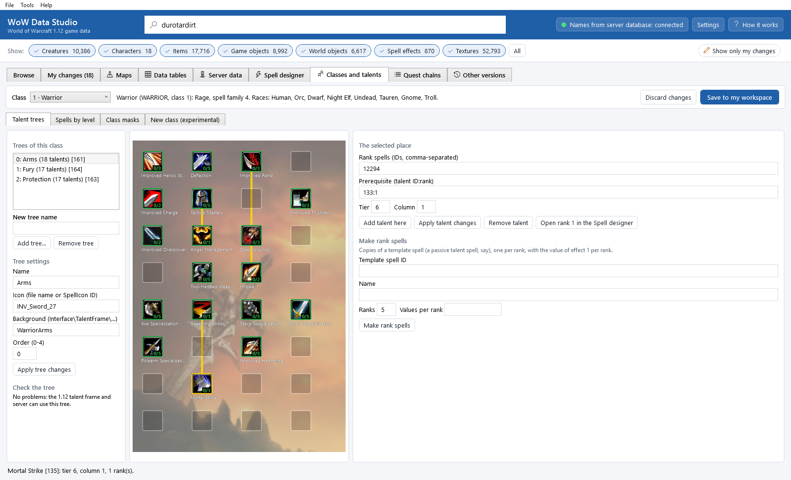
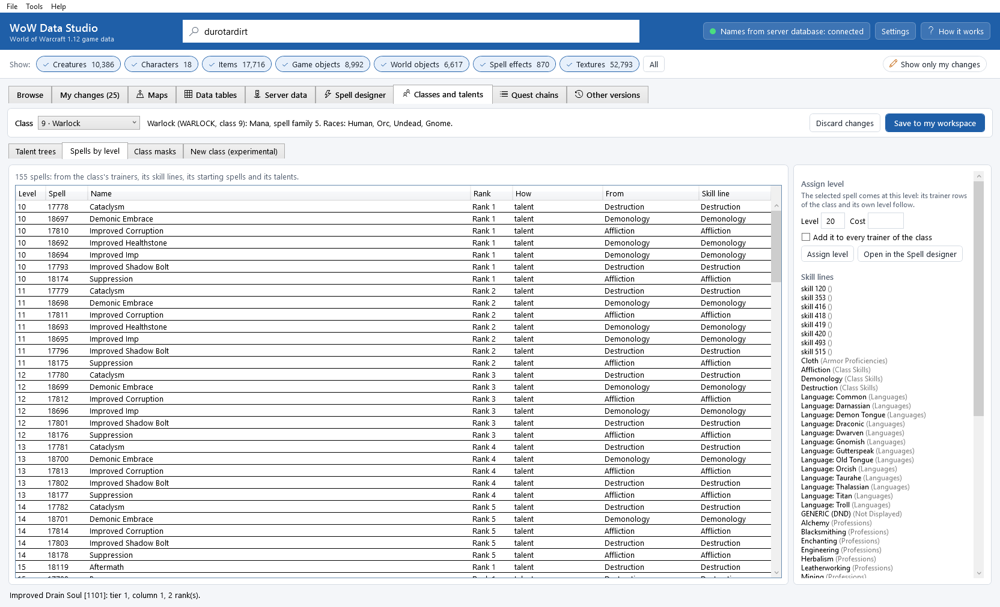
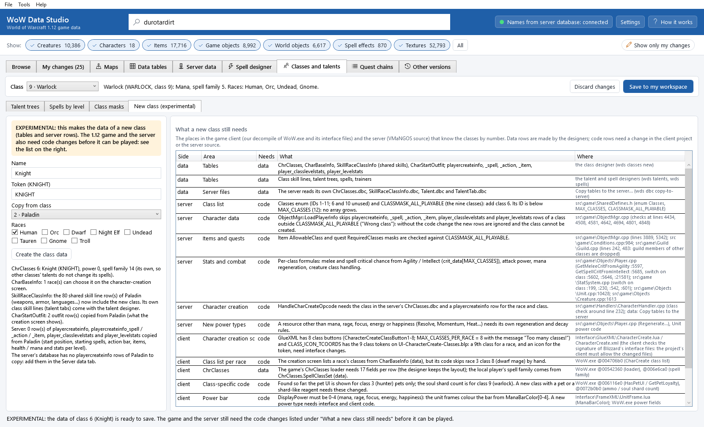
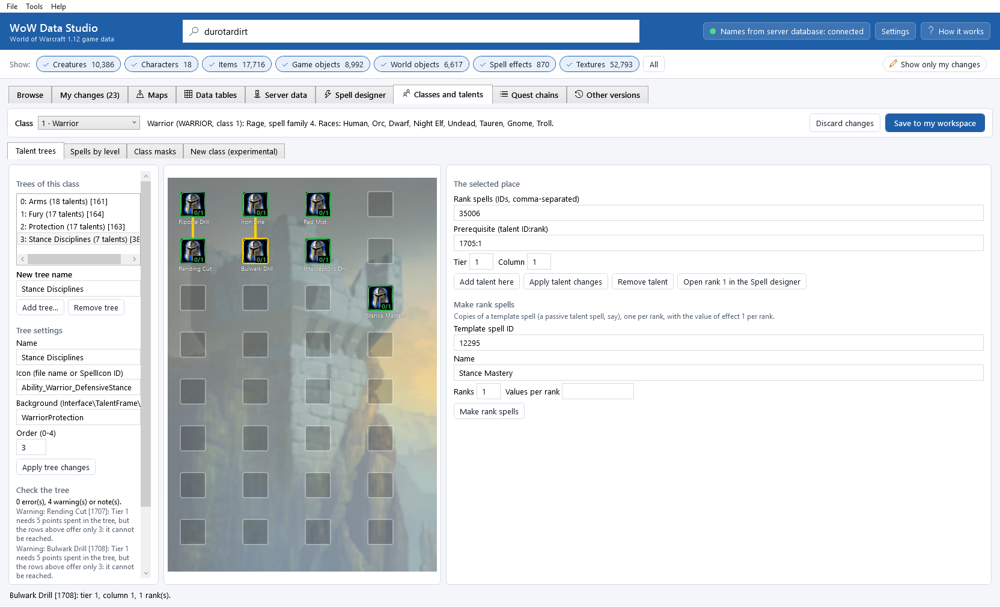

# The class and talent designer

The **Classes and talents** tab shows a class the way a player meets it: its talent trees, its spells by level and its
skill lines. You can edit the trees on the same grid as the game's talent frame, move spells to other levels and
trainers, give rows of other tables to a class (class masks) and, as an *experimental* step, make the data of a new
class, together with an honest list of what the game and the server still need in code for it.

It works with the [Spell designer](spell-designer.md): the spells a talent teaches (its *rank spells*) are made and
edited there, and one save writes everything into your workspace as one change ([My changes](my-changes.md)).

## Open it

**Tools > Classes and talents**, or the **Classes and talents** tab. Pick the class at the top (**Class**); the line
next to it shows its power, spell family and races. The tab has four parts: **Talent trees**, **Spells by level**,
**Class masks** and **New class (experimental)**. **Save to my workspace** and **Discard changes** are at the top right
and work for all four (and for the Spell designer's unsaved edits too).

## Talent trees



On the left are the **Trees of this class**, in their order. Select one to see it on the grid in the middle: 8 rows
(*tiers*) and 4 columns, as the 1.12 talent frame has them, with the tree's background, each talent's icon and its ranks
(*0/5*), and yellow arrows from a talent to the talents that need it. Hold the mouse over a talent for its ranks and
prerequisites.

### Add, change and remove trees

* **Add tree...**: type the **New tree name**, then click it. The tree gets the next free place (order 0-4) for this
  class. The 1.12 talent frame shows at most 5 trees per class (its `MAX_TALENT_TABS`), so a sixth is refused.
* **Tree settings**: **Name**, **Icon** (an icon file name or a `SpellIcon` ID), **Background** (a picture set in
  `Interface\TalentFrame\`, for example `WarriorProtection`: the game loads `<name>-TopLeft.blp`, `-TopRight`,
  `-BottomLeft` and `-BottomRight`) and **Order**. Click **Apply tree changes**.
* **Remove tree** removes the tree and its talents from your workspace's tables (their rank spells stay).

### Place and change talents

1. Click a place on the grid. **The selected place** on the right shows it.
2. For an empty place, give the **Rank spells** (spell IDs, comma-separated, one per rank: 1 to 5) and click **Add
   talent here**.
3. To make the rank spells, use **Make rank spells**: a **Template spell ID** (a spell to copy, for example a passive
   talent spell of the class), a **Name**, the number of **Ranks** and the **Values per rank** (`1,2,3,4,5`: the value
   of effect 1 in each rank). Click **Make rank spells**: the spells *Name (Rank 1)* ... are made with free IDs of your
   spell ID range (35000-39999 by default; the server casts no spell above 40000) and their IDs are filled in. Then **Add talent here**.
   The new talent's row goes into `Talent.dbc` right after the other talents of its tree: the 1.12 game reads each
   tree as **one group of rows** that follow each other, and starts the tree again at every row where the tree changes,
   so it shows only the last group (version 0.13.1 and older put a new talent at the end of the file, and the game then
   showed only that talent in its tree). **Save to my workspace** puts the rows of every tree together again, also in a
   `Talent.dbc` saved by an older version or edited row by row in the Data tables tab.
4. For a talent, change its **Rank spells**, its **Prerequisite (talent ID:rank)** (for example `1705:1`: talent 1705
   at rank 1 must be learned first; empty = none), or its **Tier** and **Column** to move it, and click **Apply talent
   changes**. **Remove talent** removes it. **Open rank 1 in the Spell designer** opens its first rank spell to edit its
   effects and tooltip.

### Check the tree

**Check the tree** lists what the 1.12 talent frame or the server cannot show or use (errors) and what is probably a
mistake (warnings). The limits come from the game's own talent frame (`Blizzard_TalentUI.lua`: 5 trees, 20 talents per
tree, 8 tiers, 4 columns, 30 arrow pieces) and from VMaNGOS (it reads only 5 rank spells, `MAX_TALENT_RANK`; a tier
needs 5 points spent in the tree per row above it; trainers may not teach talent spells):

* a talent outside the grid, two talents in one place, more than 20 talents, more than 5 trees for a class;
* no rank spell, more than 5 ranks, a gap in the ranks, a rank spell that does not exist (in the game's table, or on the
  server: an error for your new spells, a warning for spells of the game's own file), a spell used by two talents;
* a prerequisite in another tree, in a lower row, with a rank it does not have, or prerequisites that go in a circle;
* an arrow that passes under another talent, a bent arrow (prerequisite in another column), too many arrow pieces;
* a tier that cannot be reached (the rows above offer fewer than 5 points per row);
* a missing icon or background picture;
* a tree whose rows in `Talent.dbc` are in separate groups (a warning: the game shows only the last group; **Save to my
  workspace** puts them together).

The 27 trees of the game itself pass the check without errors.

## Spells by level



**Spells by level** lists every spell the class gets, by level, and how:

| How | Where it comes from |
|---|---|
| trainer | the server's trainer lists (`npc_trainer`, `npc_trainer_template`) of the class's trainers (`creature_template` with `trainer_class` = the class): the taught spell of each *learn* spell, at the row's level, with the price |
| learned automatically | `SkillLineAbility` rows of the class with *learned on getting the skill* |
| known from the start | the server's `playercreateinfo_spell` |
| talent | the class's talent trees (each rank) |
| taught (trainer data needs the server) | without the server database: the class's `SkillLineAbility` spells at their spell level |

* Select a spell, type a **Level** (and a **Cost**, optional) and click **Assign level**: the class's trainer rows that
  teach it get the new level (and price), and the spell's own level follows. Tick **Add it to every trainer of the
  class** to add it to each class trainer that does not teach it yet (with its *learn* spell, as the Spell designer's
  **Add to trainer** does).
* **Open in the Spell designer** (or a double-click) opens the spell there.
* **Skill lines** lists the class's skill lines (weapons, armor, languages, its talent-tree tabs...) by category.

## Class masks

Many rows say which classes they are for with a *class mask*: one bit per class (bit n-1 for class n: Warrior 1,
Paladin 2, Hunter 4, Rogue 8, Priest 16, Shaman 64, Mage 128, Warlock 256, Druid 1024). In **Class masks**, choose the
**Table and column** (`SkillLineAbility.ClassMask`, `SkillRaceClassInfo.ClassMask`, `TalentTab.ClassMask`, the server's
`item_template.allowable_class`, `quest_template.RequiredClasses`, `skill_line_ability.class_mask`), type the **Row IDs**
and click **Add the class** or **Remove the class** to set or clear the selected class's bit. A mask of 0 means every
class (removing one class from it gives every other class). `SkillLineAbility` rows are mirrored to the server's
`skill_line_ability` when you save.

## A new class (experimental)



**New class (experimental)** makes the *data* of a new class by copying a template class:

1. Type the **Name** and the **Token** (the class's internal name in capitals, `KNIGHT`), choose **Copy from class**
   and tick the **Races** that can be it.
2. Click **Create the class data**. It makes:
   * a `ChrClasses` row with the first free class ID (6 and 10 are free in 1.12 and below the server's class limit,
     then 12 and up), the name, the token, the template's power and its *own spell family* (so the other classes'
     talents do not change its spells);
   * `CharBaseInfo` rows: the race / class pairs of the character-creation screen;
   * the template's *shared* skill lines for the new class (`SkillRaceClassInfo`: weapons, armor, languages,
     professions; the template's own class skill lines are not shared: give the new class its own trees and tabs);
   * `CharStartOutfit` rows (what the creation screen shows the character wearing);
   * on the server: `playercreateinfo` (start position), `playercreateinfo_spell`, `_action`, `_item`,
     `player_classlevelstats` (health and mana per level) and `player_levelstats` (stats per level), copied from the
     template's rows.
3. **Save to my workspace**. The server reads its own `ChrClasses.dbc` and `SkillRaceClassInfo.dbc`: copy them with
   **Tools > Copy tables to the server...**.

### What a new class still needs

The tables are not enough. The 1.12 game and the server know the classes by number in their code; **What a new class
still needs** lists every place found so far, each marked *data* (the designers make it) or *code* (a change in the
client project or the server source is needed). `wds classes engine-report` prints the same list.

The server (VMaNGOS source):

* `src\game\SharedDefines.h`: the `Classes` list (IDs 1-11; 6 and 10 unused) and `CLASSMASK_ALL_PLAYABLE` (the nine
  classes). A class with an ID of 12 or more also needs `MAX_CLASSES` (12) raised.
* `src\game\ObjectMgr.cpp`: the loader of `playercreateinfo`, its `_spell`, `_action` and `_item` tables,
  `player_classlevelstats` and `player_levelstats` skips every row of a class outside `CLASSMASK_ALL_PLAYABLE`
  ("Wrong class"). *Without this code change the new rows are ignored and the class cannot be created.* Item and quest
  class masks are checked against the same list (also `Conditions.cpp` and `Guild\Guild.cpp`).
* `src\game\Objects\Player.cpp` and `src\game\StatSystem.cpp`: per-class formulas (critical chance from Agility and
  Intellect, attack power, mana regeneration), `Unit.cpp` and `Creature.cpp` class handling.
* `src\game\Handlers\CharacterHandler.cpp`: character creation needs the class in the server's `ChrClasses.dbc` and a
  `playercreateinfo` row.
* A new kind of power (rage-like, energy-like or a new rule) needs its own regeneration and decay code.

The game client (our decompile of `WoW.exe`, and its interface files):

* The character-creation screen (`Interface\GlueXML\CharacterCreate.lua` and `.xml`) has 8 class buttons
  (`MAX_CLASSES_PER_RACE = 8`, "Too many classes!") and class icons for the 9 tokens in `CLASS_ICON_TCOORDS`: a 9th class
  for a race, and an icon for the new token, need interface changes, and the game checks the signature of Blizzard's
  interface files, so the project's client must allow the changed files.
* The class list per race comes from `CharBaseInfo` (data), but the code (`@004706b0`) skips the dwarf mage by hand.
* The pet interface is shown only for hunters' pets (`@006116e0`) and the soul shard count is the warlock's
  (`@0072b0b0`): a new class with a pet or a shard-like reagent needs these changed.
* The power bar colours come from `ManaBarColor[0-4]` (`Interface\FrameXML\UnitFrame.lua`): a new power type needs
  interface and client code.
* `ChrClasses` must keep its 17 fields (the designer keeps them; `@00542360`); the spell family of the player comes from
  it (`@006e6ca0`, data).

This list is not complete: it is what was found in the client's code and the server source so far. Check it before
you plan a playable class.

## Worked example: a talent tree for a class

1. Choose **Class** *1 · Warrior*. **Trees of this class** shows Arms, Fury and Protection.
2. **New tree name** `Stance Disciplines`, then **Add tree...**. It becomes the fourth tree (order 3).
3. In **Tree settings**: **Icon** `Ability_Warrior_DefensiveStance`, **Background** `WarriorProtection`, then **Apply
   tree changes**.
4. Click the first place of the grid (tier 0, column 0). Under **Make rank spells**: **Template spell ID** `12295` (a
   passive Warrior talent spell), **Name** `Riposte Drill`, **Ranks** `1`. Click **Make rank spells**, then **Add talent
   here**.
5. Repeat for the other places. To make a talent need another one, select it, type the other's ID and rank in
   **Prerequisite (talent ID:rank)** (`1704:1`) and click **Apply talent changes**: the arrow appears.
6. Read **Check the tree**, then **Save to my workspace**. Copy `Talent.dbc` and `TalentTab.dbc` to the server
   (**Tools > Copy tables to the server...**) and apply the rank spells' server rows (**Tools > Apply to server...**).

The same on the command line:

```
wds talents add-tree warrior "Stance Disciplines" --icon Ability_Warrior_DefensiveStance --background WarriorProtection
wds talents add 384 --tier 0 --column 0 --make-ranks 12295 --name "Riposte Drill" --count 1
wds talents set 1707 --prereq 1704:1
wds talents show 384
```

(The tree and talent IDs are the ones the commands print: the next free IDs of the tables.)

## Worked example: the Warrior's Stance Disciplines



The project's design for the Warrior's progression (*Stance Disciplines*: the Warrior earns disciplines, each belonging to
one stance, and sets one discipline into each stance's position) maps onto the tables like this:

| The design | In the tables |
|---|---|
| A discipline works only in its stance | a **passive** spell (**Attributes** `+Passive`) whose **Needs form or stance** has the stance's bit: Battle Stance (form 17) `0x10000`, Defensive Stance (18) `0x20000`, Berserker Stance (19) `0x40000`. The server casts such a passive spell when the stance starts and removes it when it ends (VMaNGOS `SpellEntry::IsNeedCastSpellAtFormApply`). |
| Its effect ("Shield Block blocks one more attack", "Whirlwind hits one more target", "Intercept cooldown -5 sec") | effect 1 *Apply aura* with *Add flat modifier* (or *Add pct modifier*): its **Misc value** says what changes (charges, targets, cooldown, damage...) and its family mask points at the Warrior spell it changes |
| Positions: Battle, Defensive (level 20), Berserker (level 40), Stance Mastery (level 60) | a tree with one column per position (columns 0-2) and the capstone in column 3, rows by the level they open at; or no tree at all (see below) |
| Earned in the world, not with talent points | the discipline spell as a quest reward (`quest_template.RewSpell` / `RewSpellCast` in the Server data tab), taught by the quest givers at the outposts the design names |
| One discipline per position, swapped at a trainer | **code**: neither the tables nor the 1.12 talent frame have "one of these at a time"; the server needs a rule that unlearns the other disciplines of the position (a script on the swap spell) |
| Stance Mastery: the left stance's discipline keeps working for 6 sec | **code**: an aura that outlives a stance change is a server script (a *Dummy* aura with script code) |
| Medals and trophies on the chest and belt | **code** and models: not tables |

Two ways to build it:

* *As a talent tree* (the picture above; quick to try): the disciplines sit on the grid, one column per stance, and
  the capstone needs the earlier ones (arrows). The talent frame and the server handle it as it is, but players then
  spend talent points on disciplines, which the design does not want.
* *As earned spells* (closer to the design): make each discipline with the Spell designer (clone a passive Warrior
  talent spell, set **Needs form or stance** and the effect), give it as a quest reward in the Server data tab, and
  leave the swapping rule and Stance Mastery to the server's code.

Either way, the stance gating and the spell effects are pure table work; only "one at a time" and the 6-second linger
need code.

## Command line

`wds talents trees`, `show`, `add-tree`, `set-tree`, `remove-tree`, `add`, `set`, `remove`, `check` and `wds classes
list`, `show`, `assign`, `mask`, `new`, `engine-report` do everything this tab does; see
[The command line](command-line.md#the-talent-designer).
