# Data tables (the DBC editor)

Much of World of Warcraft is not in models and textures but in *data tables*: the list of spells with their icons and
cast times, the looks of items and creatures, the races and classes, the maps and zones, the flight points and routes,
the talents, the skills, the sounds... The game keeps them in `.dbc` files (`DBFilesClient\Spell.dbc` and 153 more).
The **Data tables** tab shows every one of them as a table you can search, follow and edit, with checks, undo and a
comparison with the game's original. Your edits go into your workspace like your texture edits, so **My changes**,
**Test in game** and **Build release patch** work the same way.

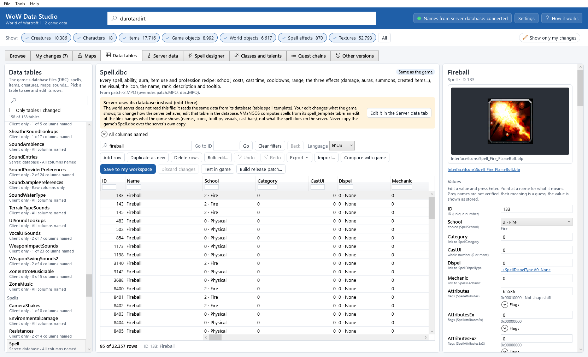

## Open the tab

Click the **Data tables** tab (or **Tools > Data tables (DBC editor)**). The first time, the app lists the tables (a
second) and opens the one you used last (the first time: Spell). Press <kbd>F1</kbd> in the tab to open this chapter.

The tab has three parts: the list of tables (left), the table (middle) and the selected row (right). Drag the gaps
between them to make a part wider.

## The list of tables

The tables are grouped by what they are about: *Characters*, *Creatures and models*, *Factions and reputation*,
*Interface and text*, *Items*, *Lighting and sky*, *Skills and talents*, *Sounds and music*, *Spells*,
*World and maps*, *Other*. Under each name:

* what the server does with it: *Client only*, *Server too* or *Server: database* (see
  [Which tables the server reads](#which-tables-the-server-reads));
* how much of it is named: *All columns named*, *6 of 9 columns named* or *Raw columns only* (see
  [Unknown columns](#unknown-columns));
* a **Modified** badge when the table is in your workspace.

Point at a table to read what it controls in the game. Type in the box above the list to find a table by its name or
by what it is for (*icon*, *mount*, *flight*, *talent*...). **Only tables I changed** lists only the tables in your
workspace.

Four tables are listed as *Server only · deleted by patch.MPQ* (for example `SpellAuraNames`): the game's own patch
deletes them, so the game cannot load them; only the server uses them. They cannot be opened.

## The table

At the top: the table's name, what it controls, and where the file comes from, for example
*From patch-2.MPQ (overrides patch.MPQ, dbc.MPQ).* The archives are read in the game's order, so this is the copy the
game really uses. When your workspace has an edit of the table, or a loose copy is in the game folder, the line says so
(*Your edit is in your workspace.*, *Installed as a loose file in the game folder (Test in game).*). The badge on the
right says whether the table has **Unsaved changes**, is *Saved in your workspace*, or is the *Same as the game*.

The coloured box says what the server does with the table (see
[Which tables the server reads](#which-tables-the-server-reads)), and the line below it how much of the table is named;
open it to read where the layout comes from.

### The grid

One row per row of the table, one column per value. The ID and the name of the row stay on the left while you scroll
sideways. The cells show:

* numbers as they are; decimal numbers with their decimals (`24.5`);
* *choices* with their name: `2 · Fire`, `1 · Magic`;
* *links* to another table with the name of the row they point at: `185 · Interface\Icons\Spell_Fire_FlameBolt`, and
  `(missing)` when that row does not exist;
* *flags* (a number whose bits each mean something) as a hexadecimal number, for example `0x10000`; the right panel
  names each bit;
* texts in the language chosen in **Language** (see [Texts in several languages](#texts-in-several-languages)).

Rows you changed (they differ from the game's file) have an orange background. Point at a column title for its type
and what it means. A grey, italic title is a column whose meaning is not verified (see [Unknown columns](#unknown-columns)).

The bottom line shows how many rows are shown (*95 of 22,357 rows*), the sorting, and the result of your last action.
Messages in red say why an edit was refused.

### Find rows

* **Search all text...**: type words; a row is shown when all of them appear somewhere in it (its name, its numbers,
  its paths...). The first search in a big table takes a second.
* *Column filters*: the small box under each column title filters that column. For texts: part of the text
  (`sword`), `=` for the exact text (`=INV_Sword_04`), `!` for "does not contain". For numbers:

  | Filter | Shows the rows whose value is |
  |---|---|
  | `5` | 5 (for flags: has those bits) |
  | `>5`, `>=5`, `<10`, `<=10` | above / at least / below / at most |
  | `5-10` | between 5 and 10 |
  | `!0` | anything but 0 |
  | `fire` | in a choice or link column: the rows whose shown name contains the text |

* *Sort*: click a column title to sort by it; click again for the other direction, a third time for the file's order.
* **Go to ID**: type an ID and click **Go** (or press <kbd>Enter</kbd>; <kbd>Ctrl</kbd>+<kbd>G</kbd>). Filters that
  hide the row are cleared.
* **Clear filters** shows every row again.

### The selected row

The right panel shows the selected row: its name, the table and its ID, a picture when the row names one, and every
value.

* *Picture*: an icon (a spell's icon through its **SpellIconID**, an item's inventory icon, a SpellIcon row's file) or a
  texture (a creature display's skin, an item's texture). Below it, the game files the row names; click one to show it
  (a model opens in the **Browse** tab).
* **Show in 3D** (for creature displays, item displays, game object displays, spell effects and races that have
  an entry in the **Browse** list) opens that entry in the **Browse** tab, with the 3D viewer.
* **Values**: one line per column, with its name and type. Point at a name to read what it means and where it comes
  from. Under the value:
  * a link: *→ SpellIcon #185: Interface\Icons\Spell_Fire_FlameBolt*; click it to open that row (**Back** returns);
  * for a choice, a list of the known values; for a yes / no value, a tick box;
  * for flags, **Flags**: open it to tick or untick each named bit;
  * for a text in several languages, **Other languages** lists the texts of the other languages;
  * for a file name, the game file it means, or *No such file in the game.*
* **Used by**: the rows of other tables that link to this row, for example the spells that use an icon, or the
  displays that use a model. Click one to open it. *Nothing links to this row* names the columns that were checked.

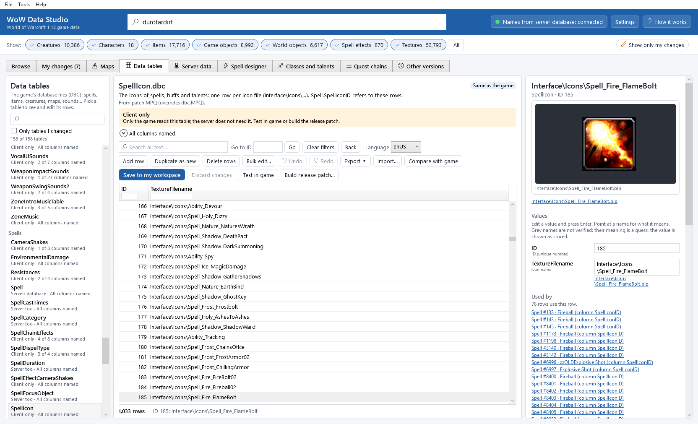

## Edit values

You can change a value in two places:

* *In the grid*: double-click a cell (or select it and press <kbd>F2</kbd>), type, press <kbd>Enter</kbd>.
  <kbd>Esc</kbd> cancels.
* *In the right panel*: type in the value's box and press <kbd>Enter</kbd> (or click elsewhere); pick a choice from the
  list; tick a flag or the yes / no box.

Every value is checked before it is taken:

| Check | Example of a refused value |
|---|---|
| The value fits the column: a whole number, 0 or more, 0-255, a decimal number... | `-5` in a column that cannot be negative, `abc` in a number column |
| A link points at a row that exists (0 means "none") | *There is no SpellIcon with ID 999999. Pick an existing one (or add that row to SpellIcon first); 0 means none.* |
| An ID stays unique | *ID 116 is already used by Frostbolt. Each row needs its own ID (the next free one is 33393).* |
| A yes / no value is 0 or 1 | `2` |
| A text has no zero character and is not huge; a file path has at most 259 characters | a path of 300 characters |

Warnings do not stop the edit: a choice that is not one of the known values, a path with `/` instead of `\`, an icon
name written with `.blp`. A refused value is not stored; the message says why (in red at the bottom, and under the
value in the right panel).

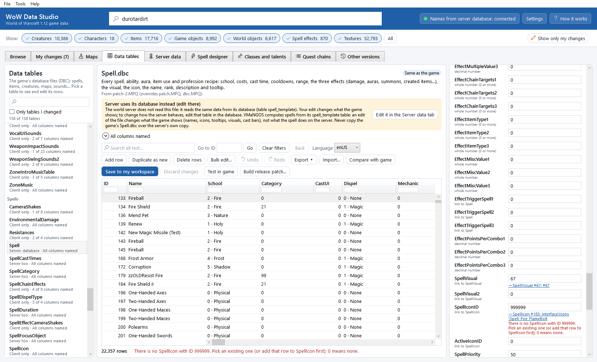

**Undo** (<kbd>Ctrl</kbd>+<kbd>Z</kbd>) and **Redo** (<kbd>Ctrl</kbd>+<kbd>Y</kbd>) go back and forward through your
edits of the open table; point at them to see what they undo. A bulk edit or an import is one step.

### Add, duplicate and delete rows

* **Add row**: a new row with the next free ID (one more than the highest), every value 0 and every text empty. Fill
  in its values on the right.
* **Duplicate as new**: a copy of the selected row with the next free ID. The quickest way to make a new spell, item
  look, creature look or flight point from an existing one.
* **Delete rows**: deletes the selected rows (select several with <kbd>Ctrl</kbd>+click or <kbd>Shift</kbd>+click).
  When other rows link to them, the question lists them first: those links would point at nothing.

New rows are put in ID order. They exist only in your edit: the game sees them once you install the table.

### Bulk edit

Change one column of many rows at once:

1. Select the rows (filter first, then <kbd>Ctrl</kbd>+<kbd>A</kbd> selects all rows shown).
2. Click **Bulk edit...**.
3. Pick the **Column** and **What to do**: **Set to** a value, **Add** a number, or **Multiply by** a number (decimal
   numbers are allowed: `0.5` halves).
4. Type the **Value** and click **Apply to** *N* **rows**.

Every new value is checked first; if one is not allowed, nothing is changed and the window lists the rows. The whole
bulk edit is one **Undo** step.

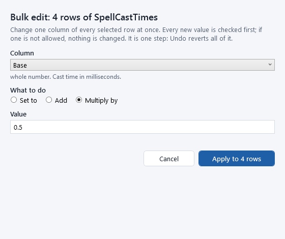

### Texts in several languages

Names and descriptions are *localized texts*: one text for each of the eight languages of the game (enUS, koKR, frFR,
deDE, zhCN, zhTW, esES, esMX) and a flags value. An English game only fills enUS. **Language** chooses the language you
see and edit (the app starts with your game's language from `WTF\Config.wtf`, else enUS, and remembers your choice).
Editing changes that language only; the other languages and the flags are kept.

## Save, compare, test and release

Your edits are first only in the editor: the badge says **Unsaved changes**.

* **Save to my workspace** (<kbd>Ctrl</kbd>+<kbd>S</kbd>) shows every change compared with the game's file (rows
  changed, added and removed, and for each row the values before and after), then saves the table into your
  workspace. It is then listed in **My changes**.
* **Discard changes** throws away the unsaved changes and loads the table again.
* When you open another table with unsaved changes, the app asks: **Save to my workspace**, **Discard my changes** or
  **Cancel**.

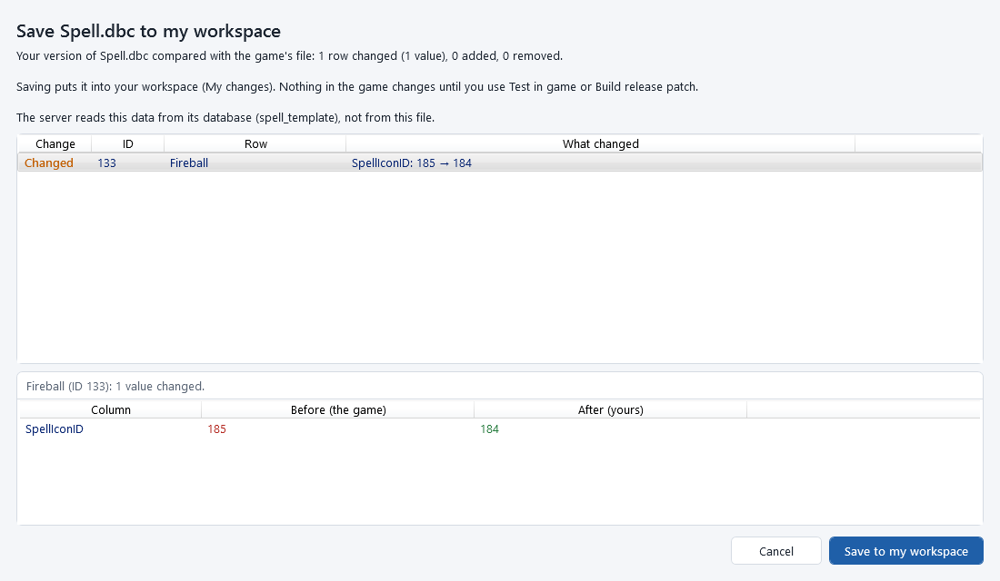

A saved table is one entry in [My changes](my-changes.md), with the format *DBC, 22,357 rows*. There:

* **Compare** opens the table row by row: your version and the game's;
* **Show** opens the table in the **Data tables** tab;
* **Revert** removes your edit: the game's file is used again.

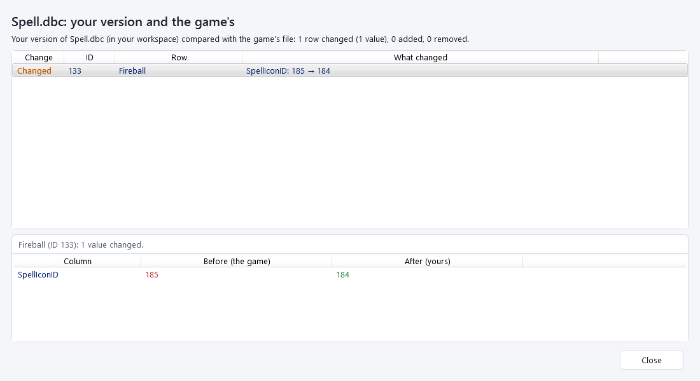

**Compare with game** in the tab shows the same comparison for the table you are editing (with the unsaved changes).

Saving a table that is identical to the game's file again removes your edit from the workspace.

To see your change in the game:

* **Test in game** installs the table as a loose file (`Data\DBFilesClient\<table>.dbc`), as for textures
  ([Testing changes in the game](testing-in-game.md)). Unsaved changes are saved first.
* **Build release patch...** puts every change, tables included, into `patch-3.MPQ` ([Releasing](releasing.md)).

The game reads its tables when it starts: restart the game to see the change.

## Export and import (CSV and JSON)

Use a spreadsheet program (LibreOffice Calc, Excel) for big changes, or keep a table in a file.

*Export*: click **Export** and pick **Export all rows...**, **Export the rows shown...** (the search and the filters)
or **Export the selected rows...**. Choose the file type: *CSV* for spreadsheets (comma-separated, UTF-8) or *JSON*.
The first line (CSV) holds the column names. A text in several languages becomes nine columns: `Name_enUS` ...
`Name_esMX` and `Name_flags`. An exported file holds every value exactly, so importing it unchanged changes nothing.

*Import*:

1. Click **Import...** and pick the CSV or JSON file.
2. The import window shows what the file would change, before anything changes: *8 rows read. 1 row changed
   (1 value), 1 added, 0 removed.*, every row with its change, and for the selected row the values
   **Now (in the editor)** and **From the file**.
3. Choose what happens to the rows of the table that the file does not have:
   **Keep them (the file only changes and adds rows)** (a file with a few rows changes only those) or
   **Remove them (the file is the whole table)**.
4. *Errors* (for example *line 9: ID must be a whole number ("abc" is not).*, a link to a row that does not exist, an
   ID twice in the file) block the import: fix the file and import again. *Warnings* (columns the table does not
   have, columns the file does not have) do not.
5. Click **Apply import**. It is one **Undo** step; **Save to my workspace** keeps it.

Rows are matched by their ID. A row with an ID the table does not have is added; a column missing from the file keeps
its values (new rows get 0 or an empty text).

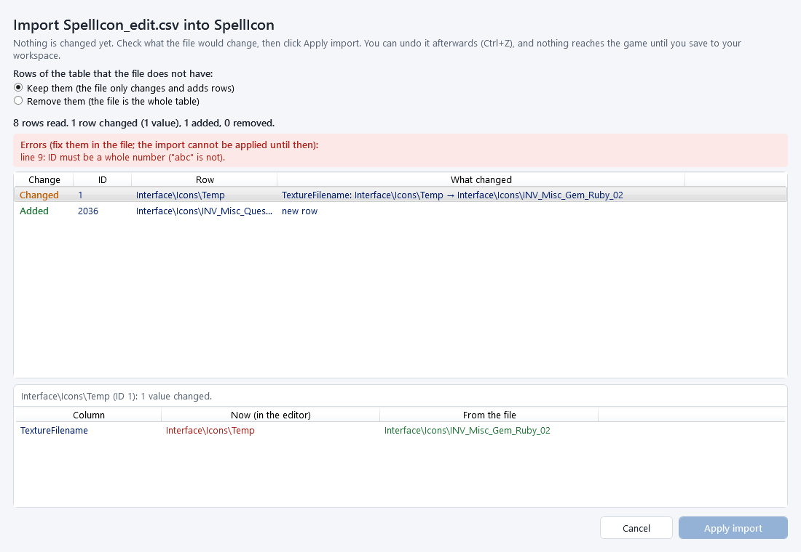

## Which tables the server reads

The game and your server each have their own copy of many tables. What the box above the grid says:

| Box | Meaning | What to do after an edit |
|---|---|---|
| **Client only** | Only the game reads the table (icons, item and spell looks, sounds, lights, interface texts...). | Test in game or build the release patch. Nothing on the server. |
| **Server also needs this file** | The world server (VMaNGOS `mangosd`) reads its own copy from its `dbc` folder (`Server\data\5875\dbc`) when it starts: 46 tables, for example CreatureDisplayInfo, ChrRaces, Talent, TaxiPath, TaxiPathNode, SpellItemEnchantment, SkillLine, Lock. | Also copy it to the server: **Copy to server...** (below), then restart the world server. |
| **Server uses its database instead (edit there)** | The server reads the same data from its SQL database, not from the file: Spell (`spell_template`), Map (`map_template`), AreaTable (`area_template`), Faction (`faction`), FactionTemplate (`faction_template`), TaxiNodes (`taxi_nodes`), SkillLineAbility (`skill_line_ability`), SoundEntries (`sound_entries`), AreaTrigger (`areatrigger_template`), MailTemplate, CreatureSpellData. | Your edit changes what the game *shows* (names, icons, tooltips, visuals). To change what the server *does*, edit that database table: **Edit it in the Server data tab** opens it in the [Server data](server-data.md) tab, where **Check client and server...** compares both sides and makes them match. |

Items and creatures themselves (their names, stats, which display they use, loot) are not in the game's tables at all:
they are in the server's database (`item_template`, `creature_template`), which the [Server data](server-data.md) tab
edits. The tables only hold their *looks* (ItemDisplayInfo, CreatureDisplayInfo).

Two tables are also read by the server's *map extractor*: Map and AreaTable. After changing them, build the release
patch and run **Update server maps...** ([Maps and terrain](maps-and-terrain.md#update-server-maps)).

### Copy to server

For the tables the server reads from its `dbc` folder:

1. Save the table to your workspace.
2. Stop the world server (close the `mangosd` window).
3. Click **Copy to server...** (above the grid, or **Tools > Copy tables to the server...**).
4. The window **Copy tables to the server** shows the server's dbc folder, whether the world server is running, and
   for each of your edited tables what happens: *Will replace the server's copy (it is backed up first).*,
   *The server already has your version.*, or why it is not copied (*Not copied: the server reads this from its
   database.*, *Not copied: the server does not use this table.*).
5. Click **Copy to server**. Each server file is backed up first and checked; then your files are copied.
6. Start the world server again.

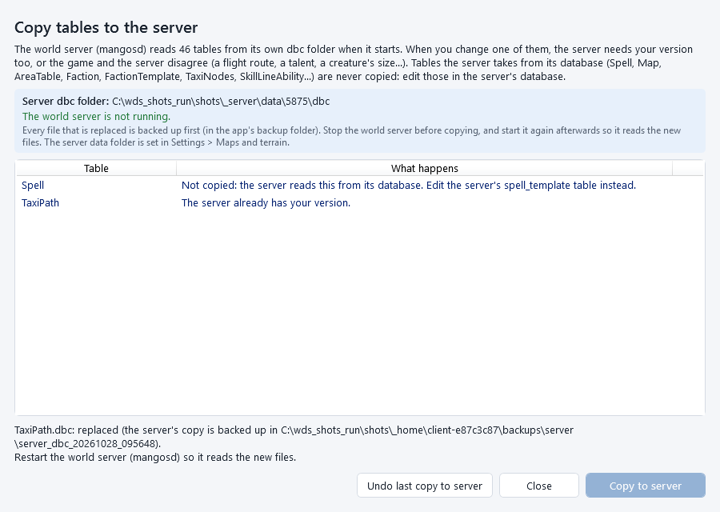

Safety:

* the copy is refused while the world server runs, and checked again just before writing;
* tables the server takes from its database are never copied (the server's own `Spell.dbc` is the server's edit and
  must stay);
* every replaced file is kept in the app's backup folder (`backups\server\server_dbc_<date>_<time>`);
* **Undo last copy to server** puts the server's previous files back (also only while the world server is stopped); a
  file that changed since the copy is left alone.

The server's data folder is the one set in [Settings](settings.md#maps-and-terrain) (by default the `Server\data`
folder next to your game folder); its tables are in `5875\dbc`.

## Examples

### Change a spell's icon

Give Fireball (spell 133) another icon.

1. Open **Data tables**, pick *Spell*, type `133` in **Go to ID** and click **Go**.
2. The right panel shows Fireball with its icon. Under **SpellIconID** the link says
   *→ SpellIcon #185: Interface\Icons\Spell_Fire_FlameBolt*.
3. To find the new icon: click the link (it opens SpellIcon), type `fireball` in **Search all text...**, and note the ID
   of the icon you want (for example 184, `Spell_Fire_Fireball02`). **Back** returns to Fireball.
4. Type `184` into **SpellIconID** and press <kbd>Enter</kbd>. The picture changes.
5. Fireball has twelve ranks (spells 143, 145, 3140...), and creatures cast spells of the same name: filter the **Name**
   column with `=Fireball` and the **NameSubtext** column with `Rank` (28 rows, the players' twelve ranks among them),
   select the rows you want, and use **Bulk edit...** with **Set to** `184` on **SpellIconID**.
6. **Save to my workspace**, then **Test in game** or **Build release patch...**; restart the game.

The spell book, the action bar and the tooltips use the new icon. Spell is a *Server uses its database instead* table:
the server does not care about icons, so nothing is needed on the server.

### Rename an item display's files

Make all swords that show `INV_Sword_04` use another icon, or point a display at another model texture.

1. Pick *ItemDisplayInfo*. Its rows are item *looks*: the item itself (name, stats) is in the server's `item_template`,
   which names a display ID.
2. In the filter box of **InventoryIcon**, type `INV_Sword_04`: 122 displays use it.
3. Select one: the right panel shows the icon, the model and its texture files, and **Show in 3D: Shadow Sword (Item)**
   to see it on the **Browse** tab.
4. Change **InventoryIcon** (for example to `INV_Sword_05`), or **ModelTexture1** to another texture name of the same
   model (the panel shows the file it finds, or *No such file in the game.*).
5. To change all 122 at once: select them all and **Bulk edit...** (**Set to**).
6. Save, then test or release. ItemDisplayInfo is *Client only*.

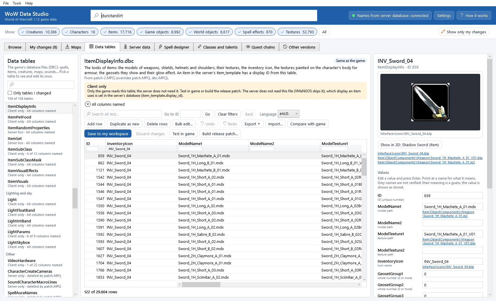

### Add a new flight point

1. Pick *TaxiNodes*, go to a flight point near the new place (for example ID 2, Stormwind) and click
   **Duplicate as new**. The copy gets the next free ID (88).
2. Change **Name** (*Stormwind, Old Town*), **ContinentID** (the map, 0 = Eastern Kingdoms) and **X**, **Y**, **Z**
   (the position; `.gps` on your server gives the coordinates where you stand). **MountCreatureID1** and
   **MountCreatureID2** are the flying mounts of the Horde and the Alliance.
3. To fly there, add a route: in *TaxiPath*, **Duplicate as new** a route and set **FromTaxiNode**, **ToTaxiNode** and
   **Cost**; in *TaxiPathNode* add the points of the route (one row per point, **PathID** = the new route,
   **NodeIndex** 0, 1, 2...).
4. Save all three tables.
5. The server: TaxiNodes comes from its database (`taxi_nodes`): in the [Server data](server-data.md) tab,
   **Check client and server...**, check *flight-paths*, select the new node and **Make the server match the game**
   (then save and apply). TaxiPath and TaxiPathNode are read from its dbc folder: **Copy to server...**. A flight master
   NPC must also exist on the server at that place.
6. Test in game; restart the game and the world server.

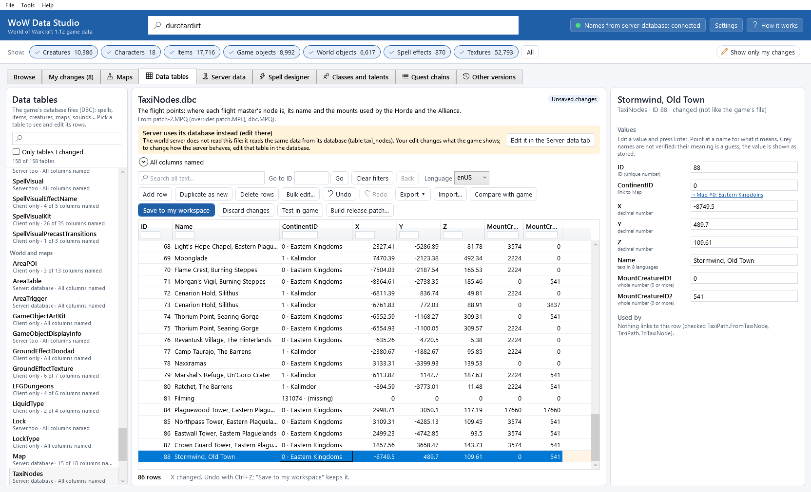

### Copy a creature display

Make a bigger version of the Mottled Boar's look for a new creature.

1. Pick *CreatureDisplayInfo*, go to ID 503 (the Mottled Boar): the right panel shows its skin.
2. **Duplicate as new**: the copy gets the next free ID (17549).
3. Change **CreatureModelScale** to `1.5`, or **TextureVariation1** to another skin of the boar model (a texture name
   next to the model, for example `BoarSkinBrown`).
4. Save. CreatureDisplayInfo is a *Server also needs this file* table: **Copy to server...** (the server uses the size
   of the display too).
5. On the server, give your creature that display: in the [Server data](server-data.md) tab, set its **display_id1**
   to `17549`, and **Check client and server...** (check *creatures*) adds the server's facts about the new look.
6. Test in game; restart the game and the world server.

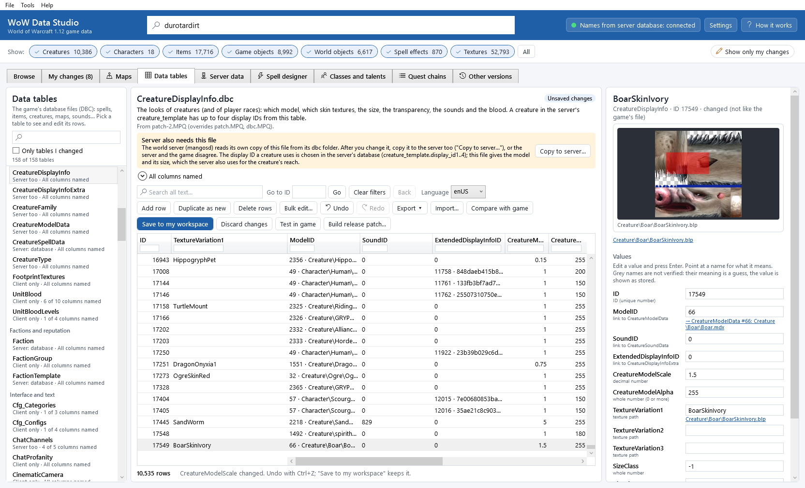

## Unknown columns

Not every column of every table is known. The layouts come from the game itself (the code of `WoW.exe` that reads
each table: how many values, which are texts, and for many columns what the game does with them), from the server's
reader (VMaNGOS), and from public documentation checked against the files. A column is *named* when one of these
proves its meaning; otherwise it is shown as stored, with a grey, italic name:

* `~` names (shown without the `~`, grey) are best guesses;
* `col_N` columns are unknown (N is the position in the file).

You can still edit them, and links in unverified columns only give warnings. The line under the coloured box says how
many columns of the table are named; open it for the sources. 107 of the 154 tables are fully named, among them every
table of spells, items, creatures, races, factions, maps, flights, talents, skills, locks, emotes and sounds that
modders use most; the list of the columns that are not verified in those is in [Known issues](known-issues.md).

## Good to know

* For spells, talents and classes there are guided editors: the [Spell designer](spell-designer.md) (a form with the
  tooltip preview and checks, writing `Spell.dbc` and the server's `spell_template` together) and the
  [Classes and talents](class-and-talent-designer.md) tab (talent trees on the game's grid). Their edits are ordinary
  table edits: they show here and in **My changes** like yours.

* The app writes a table back exactly as the game's file is made: every one of the 154 tables, saved without a change,
  comes out byte for byte the same. Texts are stored once each, in the order the rows use them.
* The game's own archives are never changed. **Test in game** writes only `Data\DBFilesClient\<table>.dbc`, the
  release patch only `Data\patch-3.MPQ`.
* A table you edit is checked again when you save it and when you build the patch: a file the game would refuse (wrong
  number of columns, an ID used twice, a text outside the file) is not saved.
* See also [Known issues](known-issues.md) and [Troubleshooting](troubleshooting.md#a-table-change-does-not-show-in-the-game).

## Command line

`wds dbc tables`, `wds dbc rows`, `wds dbc get`, `wds dbc set`, `wds dbc add`, `wds dbc duplicate`, `wds dbc delete`, `wds dbc bulk`, `wds dbc export`, `wds dbc import` (a preview, `--apply` to import), `wds dbc used-by`, `wds dbc diff`, `wds dbc copy-to-server` and `wds dbc undo-server-copy`. Every change is checked like in the tab and saved into your workspace at once. See [The command line](command-line.md#data-tables-dbc).
