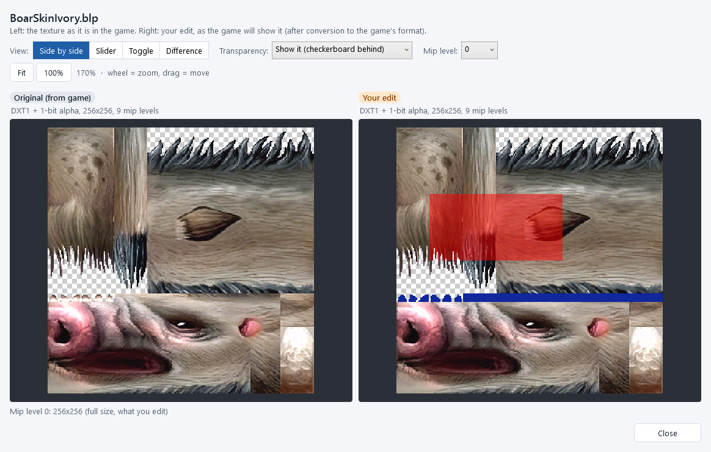
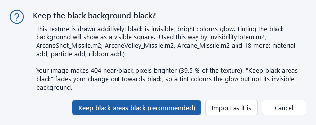

# Editing textures

Repaint any texture: export it as a PNG picture, edit it in any image editor, import it back, check the result
against the original, and keep it. This chapter follows the Mottled Boar's skin, *BoarSkinIvory.blp*, from start to
end. Nothing in the game changes during these steps: your edit goes into your own workspace, and you decide later
whether to [test it in the game](testing-in-game.md) or [release it](releasing.md).

## Step 1: export the texture as a PNG

1. Find the creature, item or texture (see [Finding things](finding-things.md)) and click it.
2. In **TEXTURES IT USES**, click the texture you want to change. It opens in the
   [texture viewer](texture-viewer.md) and the action bar appears at the bottom of the panel.
3. Click **1. Export texture as PNG...**.
4. Choose where to save it. The app suggests `Documents\WoW Data Studio\Exports\` followed by the texture's game path,
   for example `...\Exports\Creature\Boar\BoarSkinIvory.png`. Click *Save*.

The app saves two files and opens the folder:

* `BoarSkinIvory.png`: the picture to edit;
* `BoarSkinIvory.blp.json`: a small note that remembers which game texture the PNG came from and its exact format.
  *Keep it next to the PNG.* You never need to open it.

If you already changed this texture and the viewer shows **Your edit**, the export saves your edited version (with
`_edited` in the suggested file name). Switch the viewer to **Original** to export the game's original instead.

## Step 2: edit the PNG

Open the PNG in any image editor: GIMP, Krita, Paint.NET, Photoshop, Affinity Photo...

Rules that keep the game happy:

* *Keep the size* (for example 256 x 256). The game only loads textures whose width and height are powers of two
  (2, 4, 8, 16, 32, 64, 128, 256, 512), at most 512. The app offers to resize a picture that does not fit (see below).
* *Keep transparent parts transparent.* Fur edges, bristles and leaves use transparency. If you paint over them, keep
  them transparent; if your editor has a "remove alpha channel" or "flatten" option, do not use it.
* *Do not move things around.* The model's surfaces are mapped to fixed places of the picture (the head here, the legs
  there). Paint over what is there; moving parts makes them land on the wrong place of the model.
* *Save as PNG*, under the same name, next to the `.blp.json` file. In GIMP use *File > Overwrite BoarSkinIvory.png*
  or *Export As*; in Photoshop *Save a Copy* as PNG.

## Step 3: import your edit

1. Select the same texture again (if you moved away).
2. Click **2. Import edited PNG...** and pick your PNG. The file picker opens in the folder you last used.

The app reads your PNG and checks it. Depending on what it finds, it asks a question first:

| Question | What it means and what to choose |
|---|---|
| **Which texture should this replace?** | The PNG was exported from another texture than the one selected. Usually choose the first button, *Replace ... (where it came from)*. |
| **The image size does not match** | Your picture is not the size of the game's texture, or not a power of two. **Resize to** *the original size* is the safe choice. *Keep* (only offered for power-of-two sizes) keeps your size; the file gets bigger or smaller. For the sharpest result, resize in your image editor yourself and import again. |
| **Your PNG has transparency** | The game's texture has none, but your PNG has transparent pixels. **Keep the original format** (the safe choice: the transparent parts are shown solid in the game) or **Save as DXT5 (keeps transparency)** (only useful if the model really draws this texture with transparency). |
| **Nothing to import** | Your PNG is identical to the game's texture. Nothing changes. |
| **A ground texture has two files** | A ground texture (a `Tileset\...` file the maps paint on the ground) has a second file, its `_s` variant, and the game draws one or the other depending on its settings. **Edit both (recommended)** gives the other file your colours too, so your change shows whatever the settings are. See [Ground textures and specular files](#ground-textures-and-specular-files). |
| **Keep the shine map?** | Only for a `_s` file whose alpha channel your PNG changed (image editors often do). **Keep the original shine map (recommended)** uses only your colours; **Use the alpha of my PNG** makes your alpha the new shine map. |
| **Keep the black background black?** | The texture is a glow that the game draws *additively* and your picture brightened its black background. **Keep black areas black (recommended)** fades your change out towards black; **Import as it is** keeps your picture as it is. See [Glowing (additive) textures](#glowing-additive-textures). |

Then the app converts your picture to the game's format, exactly like the original: same format, same mip levels.
Only the parts you changed are converted again; everything else stays byte for byte as it was. An unchanged picture
gives an identical file.

## Step 4: check the result, then keep it or cancel

The last step of every import is the check window, *Import edited PNG - check the result*:

* Left: **Original (from game)**, the texture as the game has it now.
* Right: **Your edit**, *as the game will show it*, after conversion to the game's format. Most game textures use a
  compressed format (DXT), so tiny colour differences against your PNG are normal.
* Below: what the app found, in plain words, for example:
  * *Will be saved as DXT1 + 1-bit alpha, 256x256, 9 mip levels (same format as the original).*
  * *Only the parts you changed were re-encoded: 512 of 5,461 blocks/pixels; the rest is kept byte for byte.*
  * how many pixels changed, counted for the colour and the alpha separately: *Colour changed in 37 % of pixels;
    alpha changed in 0 %.* (see [the Difference view](#the-four-views));
  * *This texture is shared: ... All of them change.* when other creatures or models use it too;
  * warnings, for example about transparency that the format cannot keep.

Look at it in all four views (next section). Then:

* **Keep this change** saves your edit into your workspace. The texture gets a **Modified** badge, the 3D view shows
  your edit on the model right away, and the change appears in [My changes](my-changes.md). The game itself is still
  unchanged.
* **Cancel** saves nothing. Your PNG stays where it is; edit it again and import again whenever you like.

## The compare window

You can compare the original and your edit at any time later: select the texture and click
**Compare original vs. edited**, or click **Compare** in [My changes](my-changes.md). The same window opens, with a
**Close** button instead of Keep / Cancel.

Every view shares the same zoom and position: zoom in on one detail and switch views to look at the same spot.
Mouse wheel = zoom, drag = move, double-click = fit, as in the [texture viewer](texture-viewer.md).

### The four views

Choose the view at the top left, after **View:**.

**Side by side**: the original on the left, your edit on the right.

**Slider**: one picture, the original on the left of a divider and your edit on the right. Drag the round handle
across to wipe between them.

**Toggle**: one picture that switches between the two in the same place, so small changes jump out.

* the big button switches (**Show the original** / **Show your edit**);
* **Switch automatically** switches every 0.6 seconds;
* hold the <kbd>Space</kbd> bar to see the original while it is held.

The label at the top says which one you are seeing (*Now showing: Original (from game)*).

**Difference**: a heat map of what changed. Grey = unchanged, yellow = a small change, red = a big change, blue = only
the alpha (transparency or shine) changed. Above it: the colour and the alpha changes counted separately (for example
*Colour changed in 4.2 % of pixels; alpha changed in 0 %.*) and a summary.

Colour changes are always counted, also where a pixel is fully transparent (alpha 0). In many textures the alpha is
*not* transparency: it is the shine of a ground `_s` texture, or it is ignored by a solid (opaque) model or building
material, so the game shows that colour. The summary says how many of the changed pixels have alpha 0; they are
invisible only where the game really uses the alpha as transparency (leaves, fur edges).

A tinted `_s` ground texture: every pixel changed colour, the shine map (alpha) did not change.

### The options

* **Transparency:** choose **Show it (checkerboard behind)**, **Ignore it (colour only)** or
  **Show the alpha channel only (white = opaque)**. The last one shows whether you changed the transparency by mistake.
* **Mip level:** compare the smaller copies the game shows at a distance (see [The texture viewer](texture-viewer.md#mip-level)).
* **Fit** and **100%**: fit the picture, or show it at its real size.

The line at the bottom gives the size and format of the level you are looking at.

## Ground textures and specular files

The ground of the maps is painted with the textures of the `Tileset` folder, for example
`Tileset\Durotar\DurotarDirt.blp`. Most of them have a second file with `_s` before the extension:
`DurotarDirt_s.blp`. *Which one the game draws depends on its settings:*

* with *terrain specular* on, the game draws the `_s` file *instead of* the file the map names. Terrain specular is on
  when both of these lines are in the game's `WTF\Config.wtf`: `SET specular "1"` and `SET pixelShaders "1"` (and the
  graphics card has pixel shaders);
* otherwise it draws the file the map names (`DurotarDirt.blp`).

The game never falls back: with terrain specular on it does not read `DurotarDirt.blp` at all. That is why an edit of
`DurotarDirt.blp` alone can show no change in the game. The app reads your game's `Config.wtf` (it never changes it)
and tells you which file your game draws.

The two files have the same colours. The `_s` file keeps one more thing in its alpha channel: *the shine* (specular
strength) of the ground, from black (matt) to white (shiny). It is not transparency, even though image editors show it
as see-through. Keep it as it is unless you mean to change how the ground shines.

Everywhere the app shows a ground texture, it shows both files: in the details panel (**TEXTURES IT USES** lists both),
in the search list (the *Info* says *ground texture* or *specular variant*), in **Used in game** (*GROUND (MAP TERRAIN)*,
with a link to the other file), in the [tile breakdown](maps-and-terrain.md#break-down-a-tile) and in the terrain
package for Blender.

*The easy way to edit a ground texture:*

1. Select the base file (`DurotarDirt.blp`, no alpha) and export it (**1. Export texture as PNG...**).
2. Paint the PNG.
3. Import it (**2. Import edited PNG...**). The app asks *A ground texture has two files*: click
   **Edit both (recommended)**. `DurotarDirt_s.blp` gets your colours and keeps its shine map; both files are saved as
   one change (one line set in [My changes](my-changes.md)).

You can also edit the `_s` file itself: export it, paint the colours, import it. If your image editor changed the
alpha channel (many do when they save), the app asks **Keep the shine map?**: **Keep the original shine map (recommended)**.
With *Edit both*, the base file gets your colours too.

Choosing only one file works too, but the app warns when your game will not draw the file you edited.

## Glowing (additive) textures

Spell glows, fire, magic missiles and light beams are usually drawn *additively*: the game adds the texture's colour
to what is behind it. Black adds nothing, so *black is invisible and bright colours glow*. If you tint the whole
picture, its black background becomes coloured, and the game shows it as a visible square around the glow.

The app knows how every model and building draws each texture (its blend mode). When you import a texture that one of
them draws additively (or as a "multiply" layer), the check window says so in plain words, and, when your picture
brightened the black background, it asks **Keep the black background black?**:

* **Keep black areas black (recommended)**: your change is faded out towards black, so the glow takes your colour and
  the background stays invisible;
* **Import as it is**: your picture unchanged.

The same note is listed in the texture's facts in the details panel. Tip: in your image editor, tint with a "multiply"
or "colour" layer mode, or select only the bright part, so black stays black.

## Common questions

### My ground texture edit does not show in the game.

The game draws the `_s` file when terrain specular is on: edit both files (see
[Ground textures and specular files](#ground-textures-and-specular-files)). The details panel says which file your
game draws.

### My edit looks a bit blocky or the colours shifted slightly.

Most textures use DXT compression, which stores
4 x 4 pixel blocks with a few colours each. Fine detail and smooth gradients lose a little; the game shows exactly what
the right side of the check window shows.

### I changed a texture used by many creatures.

That is how the game works: the facts and the **Used by** list tell
you who shares it. Revert it in [My changes](my-changes.md) if that was not what you wanted.

### I want to change it again.

Edit the same PNG and import again. The new import replaces your previous edit (it is
listed as a new import in [My changes](my-changes.md)).

### Can I add a completely new texture?

Not yet: an import always replaces the texture you selected.

Next: [test your change in the game](testing-in-game.md).

## Command line

`wds textures export <texture> --out file.png` and `wds textures import file.png` (with `--dry-run` for the check only; `--only-this`, `--use-png-alpha`, `--as-is`, `--keep-size` and `--format` answer the questions above differently from the recommended answers); `wds textures compare <texture>` gives the colour and alpha figures. See [The command line](command-line.md#textures).
