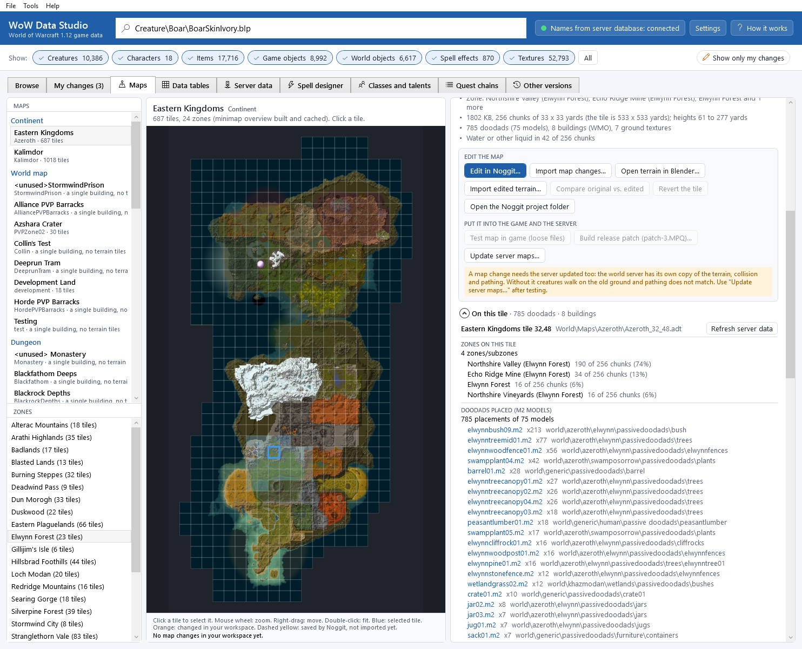
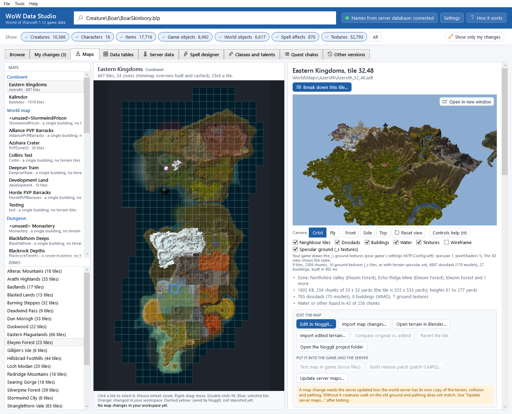
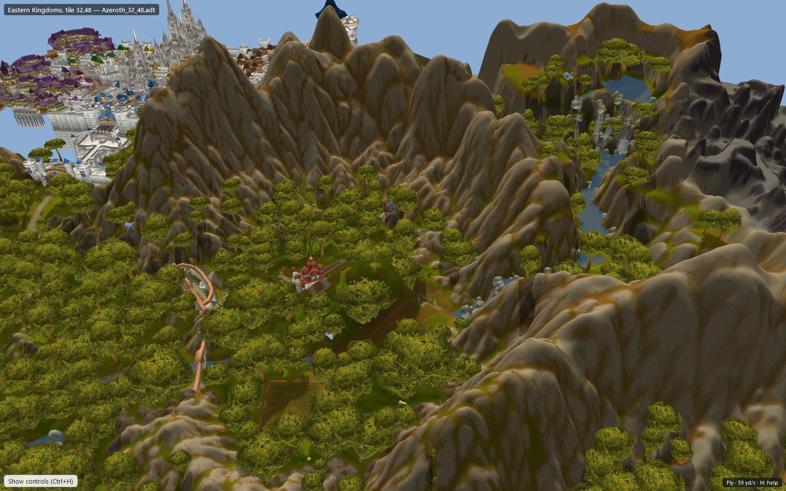
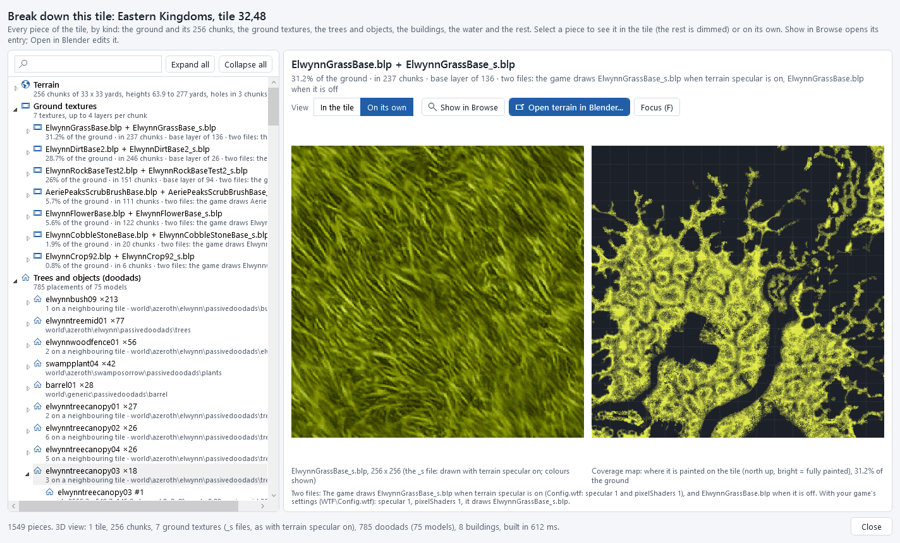
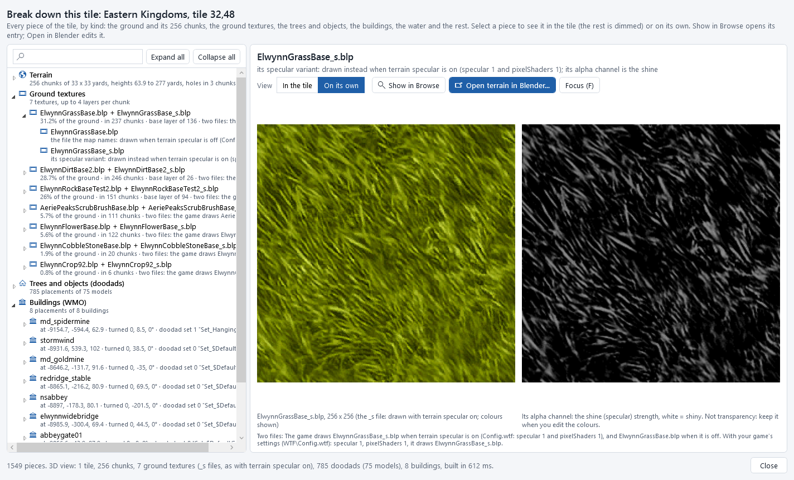
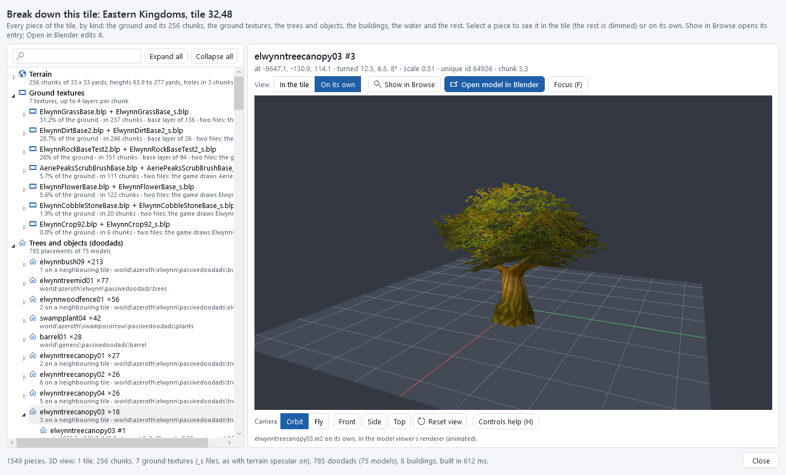
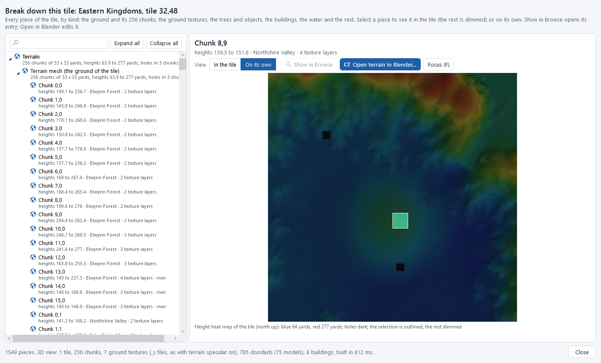
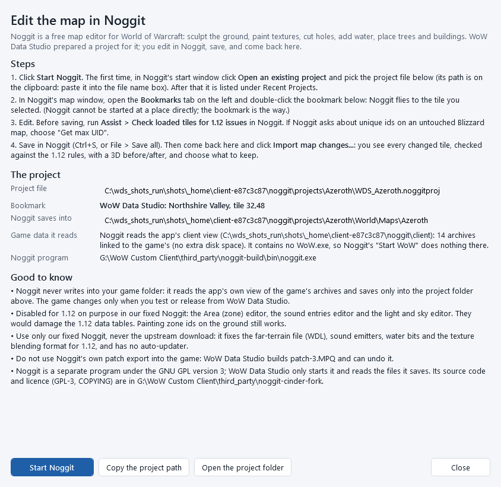
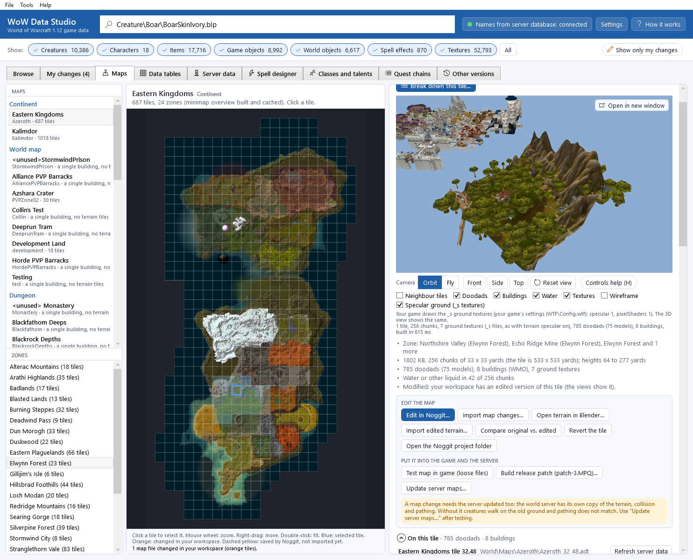

# Maps and terrain

The **Maps** tab shows the game's maps: continents, dungeons, raids and battlegrounds, their zones, a minimap you can
click, and any map tile in 3D with its trees, rocks, buildings and water. **Break down this tile...** lists every piece
of a tile (the ground and its chunks, ground textures, trees, buildings, water...) and shows each on its own. From there
you edit the ground in **Noggit** (a separate map editor) or its heights in Blender
([Terrain in Blender](terrain-in-blender.md)), bring your changes back with a check and a before/after comparison, test
them in the game, release them, and update your server so that it matches.

The whole workflow:

```
 Maps tab: pick a tile  ->  Edit in Noggit  ->  edit, save in Noggit  ->  Import map changes (check + compare)
           |                                                                  |
           +-> Open terrain in Blender -> edit heights, sync edges, export -> Import edited terrain (seams + compare)
                                                                              |
     Test map in game (loose files) / Build release patch (patch-3.MPQ)  <----+
                                                                              |
     Update server maps (extract into staging -> stop the server -> install -> start the server)
```

Nothing in this chapter changes your game or your server until you click an install button, and every step can be
undone.

## The Maps tab

Click the **Maps** tab (next to **My changes**), or **Tools > Maps and terrain**. Press <kbd>F1</kbd> on it to open this
chapter.


The tab has three parts:

1. **MAPS** (left, top): every map of the game, grouped as *Continent* (Eastern Kingdoms, Kalimdor), *World map* (small
   test and special maps), *Dungeon*, *Raid* and *Battleground*. Each shows its folder name and how many tiles it has.
   Some maps are a single building (for example the Deeprun Tram); they have no terrain to show or edit here.
2. **ZONES** (left, bottom): the zones of the selected map, with how many tiles each covers. Click one: its tiles light up
   on the minimap and the tile nearest its middle is selected.
3. The *minimap* (middle): the map as the game's minimap shows it, cut into its tiles. The first time you open a map the
   app builds this picture from the game's minimap textures (a second or two) and keeps it for next time.
   * Click a tile to select it (blue frame).
   * Mouse wheel: zoom. Drag with the right mouse button: move. Double-click: fit the whole map.
   * Orange frames: tiles you changed (in your workspace). Dashed yellow frames: tiles Noggit saved that you have not
     imported yet.

A *tile* is one square of the map: 533 x 533 yards, stored in one file (`World\Maps\<map>\<map>_<x>_<y>.adt`). A tile
is made of 256 *chunks* of 33 x 33 yards.

## A tile: its details

When you select a tile, the right side shows:

* its name (*Eastern Kingdoms, tile 32,48*) and its file;
* **Break down this tile...**: every piece of the tile in a list, each viewable on its own (see
  [Break down a tile](#break-down-a-tile));
* a **3D view** of the tile (see below);
* a few facts: the zones on it, the file size and the height range, how many doodads (trees, rocks...), buildings and
  ground textures it has, and whether it has water;
* **Modified** when your workspace has an edited version of the tile;
* the buttons to edit it (see below);
* **On this tile**: like [Used in game](used-in-game.md), what is on the tile: the zones and subzones with their share
  of the 256 chunks, every doodad model placed on it (how many times), the buildings (WMO) with their doodad set, the
  ground textures, the terrain (heights, water, holes), and, with the server database connected, the creatures and
  objects that spawn there. Click a name to open it in the **Browse** tab.



## The 3D view of a tile

The tile is shown with its ground textures blended as in the game, its shadows, its water (blue; lava orange, slime
green), the holes in the ground (cave and building entrances), the doodads and the buildings around.

Moving around works as in the [3D model viewer](model-viewer.md#moving-around). The camera bar under the view has:

* **Orbit** (the start mode here): drag with the left mouse button to turn, with the right button to move, mouse wheel to
  zoom;
* **Fly**: fly over and through the tile like a free camera in a game. <kbd>W</kbd> <kbd>A</kbd> <kbd>S</kbd>
  <kbd>D</kbd> (or the arrow keys) fly forward, left, back and right, <kbd>Q</kbd> / <kbd>E</kbd> go down / up, hold
  <kbd>Shift</kbd> to go 4 times faster (<kbd>Ctrl</kbd>: 4 times slower), hold the right mouse button and move the
  mouse to look around, and the mouse wheel sets the speed (shown in the bottom-right corner, in yards per second);
* **Front** (from the south, looking north), **Side** (from the east), **Top** (from above, north up), and **Reset view**
  (the start view, from the south-east, from above; also <kbd>Home</kbd>, <kbd>R</kbd> or a double-click);
* **Controls help (H)**: every key and mouse control over the view.

<kbd>F</kbd> (*focus on the selection*) brings the selected tile back into view; <kbd>1</kbd>, <kbd>2</kbd>,
<kbd>3</kbd> are the front, side and top views. Click the view first so it gets the keys.

Under the camera bar:

* **Neighbour tiles**: also show the 8 tiles around this one (slower to load, a few seconds);
* **Doodads**, **Buildings**, **Water**: show or hide them;
* **Textures**: untick to see the shape of the ground only;
* **Wireframe**: draw the triangles of the ground;
* **Specular ground (_s textures)**: draw the ground with the `_s` files of the ground textures, as the game does with
  terrain specular on (see [Ground textures and specular files](editing-textures.md#ground-textures-and-specular-files)).
  It starts as your game's own setting (read from its `WTF\Config.wtf`), so the preview shows what your game shows; the
  line under it says which files your game draws. Untick or tick it to see the other files; the app remembers your
  choice (in the 3D views, the pop-out window and the terrain package for Blender).

The line under the options says what was loaded and how long it took, and how many models were not found.




## Open in a new window

The small 3D view under the tile is a preview. To look around properly, click **Open in new window** in its top-right
corner, or press <kbd>Ctrl</kbd>+<kbd>Shift</kbd>+<kbd>O</kbd> in the **Maps** tab (also **Tools > Open the 3D view in a
new window**). A window opens with the tile, in **Fly** mode. Its title names the tile and its file, for example
*Eastern Kingdoms, tile 32,48 — Azeroth_32_48.adt*.


* Resize it, maximize it, drag it to another monitor, or press <kbd>F11</kbd> (**Full screen (F11)**) for the whole
  monitor; <kbd>Esc</kbd> leaves full screen.
* **Follow selection** (on by default): when you click another tile in the **Maps** tab, the window shows it. Switch it
  off to *pin* the window to its tile (*Pinned: keeps showing this one*; the title ends with *(pinned)*). Open more
  windows to compare tiles side by side.
* The side panel has **Neighbour tiles**, **Doodads**, **Buildings**, **Water**, **Textures** and **Wireframe**, for this
  window only, and the line that says what was loaded. **Hide side panel** closes it; **Hide controls**
  (<kbd>Ctrl</kbd>+<kbd>H</kbd>) leaves only the 3D view (**Show controls (Ctrl+H)** brings the controls back).
* The camera bar and all the keys are the same as under the docked view. Start in **Fly**: hold the right mouse button to
  look, <kbd>W</kbd> <kbd>A</kbd> <kbd>S</kbd> <kbd>D</kbd> to move, the wheel for the speed, <kbd>F</kbd> to come back
  to the tile.
* <kbd>F1</kbd> opens this chapter.



A window that follows the selection shows the same 3D preview as the **Maps** tab (it is built only once). When you tick
**Neighbour tiles** in the window but not in the tab, the window builds its own (a few seconds). The docked preview only
redraws when something changes, so it costs nothing while a window is open.

The app remembers where the window was (size, position, monitor, side panel, camera mode) separately from the model
windows, and moves it to the main monitor when that monitor is no longer connected.

*How it is drawn* (a preview, not the game's renderer):
* the ground: up to 4 texture layers per chunk, repeated 8 times per chunk, blended with the tile's 4-bit alpha maps and
  darkened where the tile's shadow map says so, lit with the tile's own normals; a light from the south-east;
* doodads: the model viewer's models in their rest pose (no animation, no particles; glowing additive parts are left
  out);
* buildings (WMO): every group of the building with the first texture of each part; no portals, lights, vertex colours
  or the building's own furniture. Large buildings next to the tile (such as Stormwind next to Northshire) show up when
  part of them stands on the tile.

## Break down a tile

**Break down this tile...** (under the tile's name in the **Maps** tab, in the tool bar of the tile's pop-out window, or
**Tools > Break down this tile...**) opens a window with every piece of the tile, grouped by kind:

* **Terrain**: the tile's ground (*Terrain mesh*), with its 256 chunks: for each, its height range, its zone, how many
  texture layers it has, its holes and its water;
* **Ground textures**: each texture painted on the tile, with how much of the ground it covers and in how many chunks.
  A texture with a specular `_s` file is listed with both names (*ElwynnGrassBase.blp + ElwynnGrassBase_s.blp*); open it
  to see the two files: the one the map names (drawn when terrain specular is off) and the `_s` file (drawn instead when
  it is on). Edit both (see [Editing textures](editing-textures.md#ground-textures-and-specular-files));
* **Trees and objects (doodads)**: grouped by model (*elwynnbush09 ×213*); open a group to see every placement with its
  position, rotation, scale and unique id. A placement that stands on a neighbouring tile says so (the file lists it
  because it reaches into this tile);
* **Buildings (WMO)**: each building placed, with its parts (groups, indoor or outdoor) and its doodad sets (which set is
  always shown, which one this placement shows);
* **Water (MCLQ)**: the water, lava or slime of each chunk, with its surface height;
* **Other**: the ambient sound emitters, the baked shadow map and the zones of the chunks.

Type in the search box to filter the list (*palm*, *river*, *hole*, a file name...). **Expand all** and **Collapse
all** open or close the groups. Hold the mouse over a line to read all of it.


Select a piece to look at it:

* **In the tile** (the start): the tile in 3D with the piece highlighted in yellow and everything else dimmed. A model
  group lights up all its placements; a chunk, the water or a zone lights up its chunks; a ground texture lights up the
  ground where it is painted. The camera moves to the piece; **Focus (F)** brings it back, and the camera bar works as
  in the [3D view](#the-3d-view-of-a-tile).
* **On its own**: only the piece. A tree or other doodad in the model viewer's renderer (animated, as in the Browse
  tab); a building alone; a ground texture as the game stores it next to its *coverage map* (where it is painted on the
  tile); the ground, a chunk, water or a zone as a *height heat map* of the tile (blue low, red high, holes dark) with the
  selected chunks outlined.



A ground texture's `_s` file on its own shows its colours and, on the right, its alpha channel: the *shine* (specular)
strength of the ground, not transparency. The line below says which of the two files your game draws.







Two buttons work on the selected piece:

* **Show in Browse**: opens the model, building or texture in the **Browse** tab, with its details and its
  [Used in game](used-in-game.md) panel open, so you see where else it is used before you change it. Chunks, water,
  sounds and zones have no entry there.
* **Open in Blender**: a doodad: **Open model in Blender** exports the model and starts Blender with it (as in
  [Models and Blender](model-export-import.md)). A building: **Open building in Blender** opens its shape to look at
  (buildings cannot be imported back yet). The ground, a chunk, a texture, water or a zone: **Open terrain in Blender...**
  opens this tile's terrain with the tile picker (a chunk on the tile's border suggests the 3 x 3 neighbourhood); see
  [Terrain in Blender](terrain-in-blender.md). Sound emitters have nothing to edit in Blender.

The breakdown shows the tile as the app has it now: your imported edit when the tile is **Modified**, else the game's.
It is a separate window: resize it, maximize it or press <kbd>F11</kbd> for full screen; <kbd>F1</kbd> opens this
chapter.

## Edit in Noggit

*Noggit* is a free map editor for World of Warcraft: you sculpt the ground, paint textures, cut holes, add water and
place trees and buildings. The app works with *our fixed version* of Noggit for 1.12 (the "noggit-cinder" fork with the
1.12 fixes). Noggit is a separate program under the GNU General Public License (GPL) version 3: WoW Data Studio only
starts it and reads the files it saves.

1. In the **Maps** tab, select the tile you want to edit.
2. Click **Edit in Noggit...**. The app prepares, in its own data folder:
   * a *client view* for Noggit: links to your game's archives (no extra disk space), so Noggit sees the game but can
     never write into your game folder. (If the app's data folder is on another drive than the game, the archives can
     be copied instead, about 5 GB; the app asks first. Or choose a copy of the game folder in [Settings](settings.md).)
   * a *Noggit project* for this map, `WDS_<map>.noggitproj`, with a *bookmark* at the selected tile;
   * the folder where Noggit saves your edits.
3. A window explains the steps and shows the project. Click **Start Noggit**. The project file's path is put on the
   clipboard.

   

4. *The first time only*, in Noggit's start window click *Open an existing project* and pick the project file (paste the
   path into the file name box). Next time it is in Noggit's *Recent Projects*.
5. In Noggit's map window, open the *Bookmarks* tab on the left and double-click the bookmark (*WoW Data Studio:
   Northshire Valley, tile 32,48*): Noggit flies to your tile. Noggit cannot be started directly at a place; the
   bookmark is the way to get there.
6. Edit. Before saving, run *Assist > Check loaded tiles for 1.12 issues* in Noggit. If Noggit asks about unique ids on a
   map you have not changed yet, choose *Get max UID*.
7. Save in Noggit (<kbd>Ctrl</kbd>+<kbd>S</kbd>). Then come back to WoW Data Studio and click **Import map changes...**.

Other buttons of the window: **Copy the project path**, **Open the project folder**. If Noggit was not found, the window
says so: set the path to `noggit.exe` in [Settings](settings.md#maps-and-terrain).

Good to know about Noggit:
* *Disabled for 1.12 on purpose* in our fixed Noggit: the Area (zone) editor, the sound entries editor and the light and
  sky editor. They would damage the 1.12 data tables. Painting zone ids on the ground still works.
* Use only our fixed Noggit, never the upstream download (it writes the far-distance terrain, sound emitters, water and
  texture blending in a way 1.12 cannot read, and it has an auto-updater).
* Do not use Noggit's own patch export: WoW Data Studio builds `patch-3.MPQ` and can undo it.
* Map files you imported before are copied into the Noggit project, so Noggit continues from your version.

## Import map changes

Click **Import map changes...** (or **Tools > Import map changes...**). The app looks at every file Noggit saved for the
selected map and compares each with what the app has now: your earlier import of that file, or the game's file.


Each file is one row:

* its name and kind: *ADT terrain tile* (one tile), *WDT map tile list* (which tiles the map has), *WDL far terrain*
  (the low-detail terrain on the horizon);
* what changed, in plain words: *Heights changed in 78 chunks (up to 70 yards), holes changed in 1 chunk, 3 doodads
  moved.* (also texture layers added or replaced, texture painting, water, zone ids, shadows, buildings added, moved or
  turned...);
* the *1.12 check*: the app checks every file against what the 1.12 game reads (written from the game's own loading
  code). A file the game would read wrongly cannot be imported; the reason is given in words, for example
  *The texture blending is saved in a later game version's format...*. Fix it in Noggit, save, and import again;
* *Unchanged*: Noggit saves some files again even when nothing in them changed (often the WDT). These are left out;
* **Details (every change, chunk by chunk)**: the complete list;
* **Compare**: the tile before and after (see below).

Tick what to keep and click **Save into my workspace**. The selected files are saved as one import: **Revert this
import** in [My changes](my-changes.md) undoes all of them. **Cancel** saves nothing. The game is not changed yet.

If nothing changed, the app says so and saves nothing.

## Compare before and after

**Compare** in the review, **Compare original vs. edited** under the tile (when it is **Modified**), and **Compare** in
**My changes** open the comparison:

* two 3D views of the tile, before (left) and after (right), sharing one camera: turn, move or zoom either one;
* **Height difference**: the tile from above, north up. Grey = unchanged, red = raised, blue = lowered; the stronger the
  colour, the bigger the change;
* the change in words, and **Every change** listed chunk by chunk;
* **Doodads and buildings**, **Water**: show or hide them; **Reset view**;
* **Full screen (F11)**: the comparison on the whole monitor (<kbd>Esc</kbd> leaves it). The window can also be maximized
  or moved to another monitor, and the keys of the 3D views work in it (<kbd>1</kbd> <kbd>2</kbd> <kbd>3</kbd>,
  <kbd>F</kbd>, <kbd>H</kbd>...).


## Test it in the game and release it

After the import, the tile has an orange frame on the minimap and a **Modified** badge.



* **Test map in game (loose files)** copies the map's changed files into the game's `Data` folder as loose files, as for
  textures ([Testing changes in the game](testing-in-game.md)). The game reads them only with its loose-file mode on.
  Restart the game to see the change (the game reads loose files and archives when it starts).
* **Build release patch (patch-3.MPQ)...** packs *all* your changes (textures, models and maps) into `patch-3.MPQ`
  ([Releasing](releasing.md)).
* **Revert the tile** deletes your edited tile; the game's tile is used again. (The identical copy in the Noggit project
  is removed too, so Noggit shows the game's tile again.)

*Your server must be updated too.* The world server has its own copy of the map data (terrain, collision, pathing).
Until you update it, creatures walk on the old ground (floating over your new valley, or inside your new hill), line of
sight goes through new walls, and pathing does not match what you see.

## Update server maps

Click **Update server maps...** (under the tile, or **Tools > Update server maps...**). A guided window takes you
through it. It uses the project's server tools (the `server` folder of WoWDataTool) and needs Python.


What the server uses, in plain words:
* *maps*: the ground heights, the zones and the water of every tile;
* *vmaps*: collision: what blocks movement and line of sight (buildings, big rocks and trees);
* *mmaps*: pathing: a navigation mesh that tells creatures where they can walk.

**1. Your map changes**: The maps you changed. The server tools read the game's *archives*, not loose files, so your map
changes must be in the installed `patch-3.MPQ`. If they are not, the window says so: click **Build release patch
(patch-3.MPQ)...** (with *Install into the game* ticked), then **Check again**.

**2. Extract into the staging folder**: Tick what to rebuild: **Terrain (maps, about 20 s)**, **Collision (vmaps, about
1 min)**, **Pathing (mmaps, 1-3 min per tile)**, and click **Extract into staging**. The extractors write only into the
*staging folder* and compare the result with the server's data (which is only read); you can do this while the server
runs. A progress bar and the log show what runs; at the end the report says how many files differ, which come from
your changes, and which tiles need new pathing. **Open the full report** opens the complete list; **Cancel** stops.

*About pathing (mmaps):* the navigation mesh is rebuilt only for the tiles you changed plus their 8 neighbours. The
rebuilt tiles join the old ones at their borders, which can connect a little less perfectly where the two meet; the ring
of neighbours keeps that seam away from your edit. Rebuilding a whole continent once makes it uniform, but takes hours
(see the server tools' README, **Server tools README**). Without new mmaps, creatures keep walking along the old ground.

**3. Install into the server**:
1. *Stop the world server.* Switch to its console window (*mangosd*) and close it, or type `server shutdown 1` there
   and wait until it has quit. Leave the database (mysqld) and the login server (realmd) running. The app never stops
   or starts the server itself. The window shows whether the world server is running (**Check again**).
2. **Show what would change** lists what the install would replace, add or remove (allowed while the server runs).
3. **Install into the server** copies only the files that differ, after a verified backup of every file it replaces.
   It refuses while the world server runs. When it is done, the window shows the backup folder (**Open the backup
   folder**).
4. *Start the world server again* (`Server\Start mangosd 16bit.bat`). It loads the new data when an area is first
   visited.

**Undo**: **Undo server update** puts the server's data back as it was before the last update done through the app
(from its backup) and removes the files the update added. It also needs the world server stopped.

## Where the files are

| What | Where |
|---|---|
| Noggit's client view (links to the game's archives) | `%APPDATA%\WoWDataStudio\<game folder>-<code>\noggit\client\` |
| The Noggit project of a map | `...\noggit\projects\<map>\WDS_<map>.noggitproj` |
| Where Noggit saves your edits | `...\noggit\projects\<map>\World\Maps\<map>\` |
| Your imported map files | your workspace, `...\workspace\World\Maps\<map>\` |
| The minimap pictures the app built | `...\cache\minimap\` (safe to delete) |
| The server update history | `...\server_updates.json` |
| The staging folder and the server backups | `server\staging\` and `server\backups\` of the server tools |

## What is not possible yet

* Noggit cannot be started directly at a tile: use the bookmark (step 5 above).
* The app imports the map files Noggit saves (ADT, WDT, WDL). Minimap pictures Noggit generates are not imported.
* New maps (a new entry in the map table) and zone names (the area table) need a data-table editor that does not exist
  yet; painting existing zone ids works.
* From Blender only the ground heights come back ([Terrain in Blender](terrain-in-blender.md)); texture painting, holes,
  water and moving doodads or buildings are done in Noggit.
* The 3D view is a preview: no animation, particles, sky or the game's lighting (the shine of the `_s` ground textures
  is not drawn either; only their colours). In **Fly** mode you can fly through the
  ground (there is no collision).

## Command line

`wds maps list`, `wds maps zones`, `wds maps tiles`, `wds maps tile`, `wds maps breakdown`, `wds maps render` and `wds maps minimap` (previews as PNG), `wds maps noggit`, `wds maps import-noggit`, `wds maps compare`, `wds maps test-in-game` and `wds maps revert`; the server update is `wds server-maps status`, `wds server-maps extract`, `wds server-maps install` and `wds server-maps undo`. See [The command line](command-line.md#maps-and-terrain).
