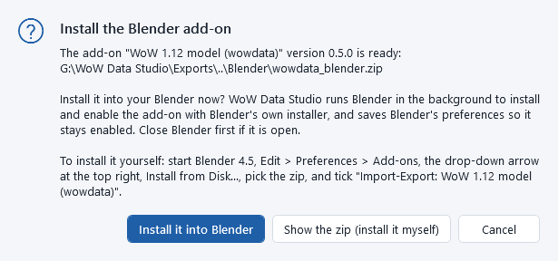
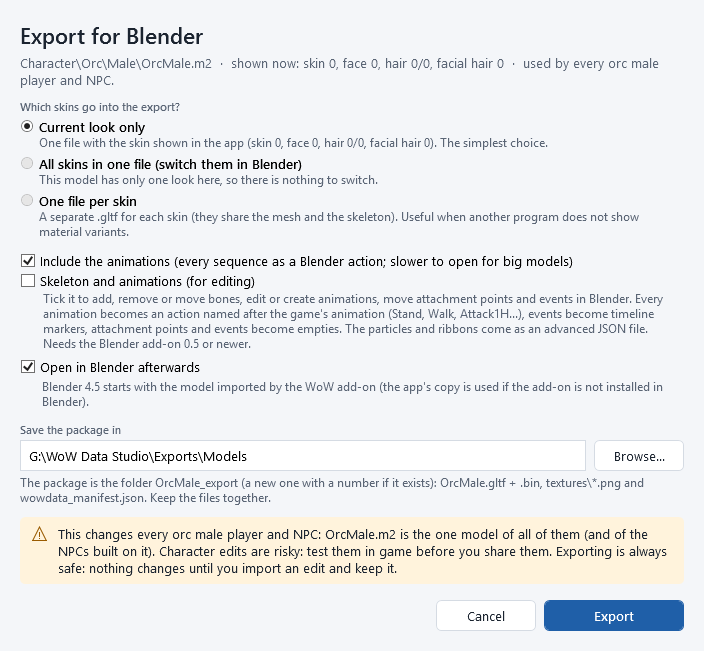
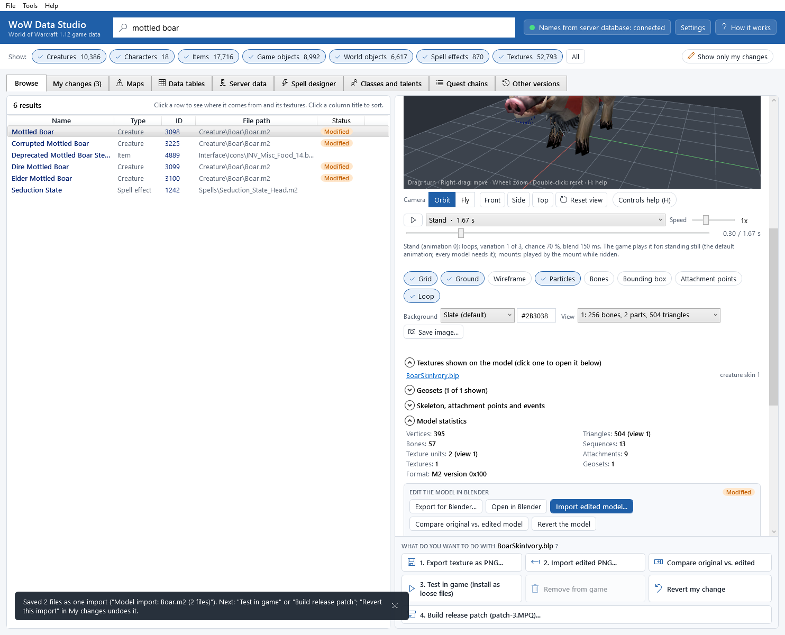
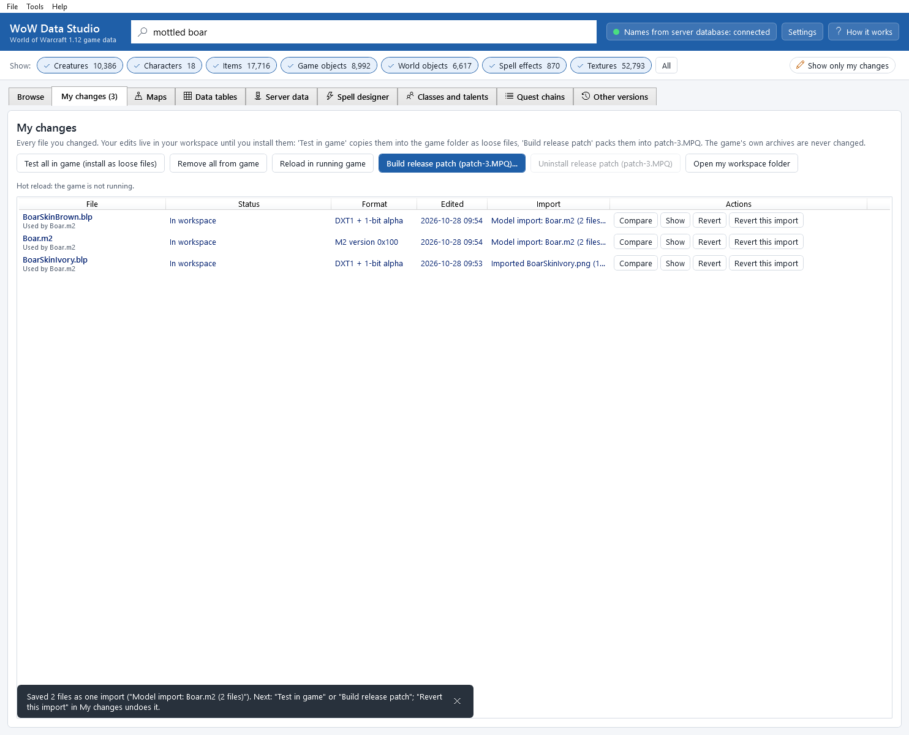

# Models and Blender

This chapter shows how to take a model (a creature, a tree, an item, a character) into Blender, change its mesh or
paint its textures there, and bring the result back into the game as one change you can compare, test, release and
undo.

What you can change this way:

* the *mesh*: move, add or delete vertices and faces of the model's existing parts, paint bone weights;
* the *textures*: paint them in Blender (Texture Paint) or in any image editor;
* the *skeleton*, the *animations*, the *attachment points* and the *events*: export with **Skeleton and animations
  (for editing)**, see [Skeleton and animations](skeleton-and-animation.md).

What stays as it is (it is copied unchanged from the game's model): the particle and ribbon effects (their numbers can
be edited as a JSON file, see [Skeleton and animations](skeleton-and-animation.md#particles-and-ribbons-advanced)), the
lights, the cameras and the collision mesh. Without the skeleton option, the bones, the animations and the attachment
points are also copied unchanged.

## Before you start: Blender and the WoW add-on

You need *Blender 4.5 LTS* (free, from blender.org or the Microsoft Store) and the app's Blender add-on
*WoW 1.12 model (wowdata)*. The add-on reads the files the app writes, sets up the materials, and exports your work
back with the ids the app needs to match it.

### Install the Blender add-on

1. In the app: **Tools > Install the Blender add-on...**. The app writes `wowdata_blender.zip` into
   `Documents\WoW Data Studio\Blender`.
2. Choose one:
   * **Install it into Blender**: the app runs Blender in the background, installs the add-on with Blender's own
     installer, enables it and saves Blender's preferences. Close Blender first. A message confirms the version and
     where it was installed.
   * **Show the zip (install it myself)**: opens the folder. In Blender: *Edit > Preferences > Add-ons*, the drop-down
     arrow at the top right, *Install from Disk...*, pick the zip, and tick *Import-Export: WoW 1.12 model (wowdata)*.

   

You do not have to install it for **Open in Blender**: when Blender has no (or an older) WoW add-on, the app loads its
own copy for that Blender session.

The same add-on (version 0.4.0 and newer) also brings map terrain into Blender, with its *WoW Terrain* tools: see
[Terrain in Blender](terrain-in-blender.md).

Version 0.5.0 and newer adds the *WoW* tab for skeletons and animations (with **Skeleton and animations (for
editing)**): see [Skeleton and animations](skeleton-and-animation.md). The add-on of this version of the app is 0.5.0;
reinstall it after updating the app.

## Export a model for Blender

1. Find the model and select it, for example the *Mottled Boar* (see [Finding things](finding-things.md)). The 3D view
   shows it; under it is the box *EDIT THE MODEL IN BLENDER*.
2. Pick the skin you want to start from in the 3D view (for a character: skin colour, face, hair...).
3. Click **Export for Blender...**.

   

4. Choose which skins go into the export:
   * **Current look only** (the default): one file with the skin shown in the app.
   * **All skins in one file (switch them in Blender)**: every skin of the model in one file, as glTF *material
     variants*. In Blender, press <kbd>N</kbd> in the 3D view, open the tab *glTF Variants*, select a skin and click
     *Display Variant*. You can paint any of them.
   * **One file per skin**: a separate `.gltf` for each skin (they share the mesh and the skeleton).
5. Leave **Include the animations (every sequence as a Blender action; slower to open for big models)** ticked to get
   every animation as a Blender action (Dope Sheet > Action Editor). Untick it for a faster import when you only
   change textures.
6. Tick **Skeleton and animations (for editing)** to edit the bones, the animations, the attachment points and the
   events too: see [Skeleton and animations](skeleton-and-animation.md).
7. **Open in Blender afterwards** starts Blender with the model already imported.
8. Click **Export**.

The app writes one *package folder*, `Documents\WoW Data Studio\Exports\Models\Boar_export` (a new folder with a number
when it exists already, so an older package is never overwritten):

| File | What it is |
|---|---|
| `Boar.gltf` + `Boar.bin` | the model: one mesh per part, the skeleton, the animations, attachment points (empties named `ATT_...`), the collision mesh (hidden, `COL_...`) |
| `textures\*.png` | every texture the model uses, named like the game file (`BoarSkinIvory.png`) |
| `wowdata_manifest.json` | which PNG is which game texture, the original formats, a fingerprint of every PNG and of the model, and the ids of every part (with the skeleton option, also the bones, animations, attachment points and events). *Keep it in the folder.* |
| `wowdata_effects.json` | only with **Skeleton and animations (for editing)** and a model with particles or ribbons: their numbers, for advanced edits |

**Open in Blender** (in the box under the 3D view) does the same in one click: it exports the look shown now (with
the animations) and starts Blender with it.

A warning in the dialog tells you who else is affected by a change of this model: the Mottled Boar's `Boar.m2` is
used by 27 creature displays, a tree by every place it stands in the world. For a character the warning is stronger:

*This changes every orc male player and NPC*: there is only one orc male model in the game. Character edits are
risky: always test them in the game before you share them.

## Edit in Blender

In Blender the model looks like in the game: Z up, 1 Blender unit = 1 yard, the model faces the front view.

* *Mesh*: edit the parts (objects named like `Boar_g0000_s01`). Each part is a *geoset* of the model. You may move,
  add or delete vertices and faces, and paint weights. Keep the *Armature* modifier.
* *Textures*: switch to *Texture Paint* and paint, or edit the PNGs in `textures\` with any image editor.
* *Keep the names you see in custom properties*: the app finds every part by the ids the add-on stores on the
  objects, materials, images and bones (custom properties `wow_submesh`, `wow_material_id`, `wow_texture_id`,
  `wow_bone`). You can rename objects freely; do not delete those properties.
* *New objects* are not part of the game model. To add geometry to the model, either join the new object into an
  existing part (select the new object, then the part, <kbd>Ctrl</kbd>+<kbd>J</kbd>), or give it one of the model's
  materials: then it belongs to that part.
* *Bones*: weight vertices to the model's own bones (`bone_000`, `bone_015_Root`...). To add bones, export with
  **Skeleton and animations (for editing)** ([Skeleton and animations](skeleton-and-animation.md)); without it, a bone
  that is not in the game's skeleton cannot be imported.

When you are done: *File > Export > WoW 1.12 model for WoW Data Studio (.gltf)*. It suggests
`Boar_export\blender_export\Boar.gltf`; keep that. It writes the glTF, the textures as PNG and two small files the
app reads (`wowdata_manifest.json` and `wowdata_blender.json`).

Only textures? You do not need Blender at all: edit the PNGs in the package's `textures` folder with any image editor
and import the package folder.

## Import your edited model

1. Click **Import edited model...** (under the 3D view, or **File > Import edited model...**).
2. Choose **Pick the folder...** and select the package folder (`Boar_export`; the app finds the Blender export in its
   `blender_export` folder, or your edited PNGs), or **Pick a .gltf / .glb file...** and select the file Blender
   exported.
3. The review screen lists everything the app found:

   

   * one row for the *mesh* (all the model's parts), with what changed in each part;
   * one row for *each texture*: changed, or *Unchanged*;
   * rows for pictures that are *not* one of the model's textures (new textures, see below).

   Each row says **Will be saved**, **Unchanged**, **Left out** or **Cannot be imported**, with the checks below it.
   Tick or untick a row to include it or leave it out.
4. Click **Compare** on a row to look before you decide:
   * on a texture: the texture compare (side by side, slider, toggle, difference) of
     [Editing textures](editing-textures.md);
   * on the mesh: two 3D views, the game's model on the left and your edited model on the right, with one shared
     camera and the same animation playing on both (**Same animation on both**). The right side also shows the edited
     textures of this import.

   

5. Click **Save into my workspace**. The included files are converted to the game's formats and saved together as
   *one import*. **Cancel** saves nothing.

Nothing in the game changes yet: test it with **3. Test in game (install as loose files)** (see
[Testing changes in the game](testing-in-game.md)) or put it into a release with
**4. Build release patch (patch-3.MPQ)...** (see [Releasing](releasing.md)), as for textures.

After the import the model shows a **Modified** badge, the 3D view shows your version, and
**Compare original vs. edited model** opens the 3D comparison at any time.

### No changes found

If you export and import again without changing anything, the review says *No changes found* and nothing is written.
Blender stores numbers slightly differently and splits some vertices along sharp edges; the app does not count that as
a change.

## What the import checks (and does for you)

*Mesh*

* *Who is affected*: "A mesh change affects 27 creature displays ...": every creature, item or character that uses
  this model file gets the new mesh.
* *Bone weights*: the game stores at most 4 bones per vertex, 8 bits each, summing to 255. Vertices with more weights
  keep the 4 strongest, rescaled.
* *The bone limit per view*: the game keeps four versions ("views") of every model for graphics cards that can use
  256, 75, 53 or 21 bones per draw. The app rebuilds all four; a part that uses too many bones for a view is split into
  pieces automatically, and the review says so.
* *Vertex limit*: one model can have at most 65,535 vertices (and about 21,845 triangles).
* *Bones that are not in the game's skeleton*: without the skeleton option the mesh change *cannot be imported* (the
  row says which bones). Weight those vertices to the model's own bones, or export with **Skeleton and animations (for
  editing)** and import the new bones with the mesh.
* *Parts*: every part of your file is matched to the game model's part by its id (its material, the object's custom
  property, or its name). A new object that matches no part is not imported (the review explains how to attach it). A
  part missing from your file is kept as it was.
* *Untouched data*: vertices you did not change keep their exact original data; the bounds of the model and of each
  animation are recomputed; the bones, animations, attachments, events, particles, ribbons and the collision mesh are
  copied unchanged (unless you exported the skeleton and changed them: then the row *Skeleton and animations* lists
  those changes, and both are saved together as one model file). The model validator must find no errors.

*Textures*

* *Size*: the game only loads textures whose sides are powers of two (2, 4, 8 ... 256, 512). Another size is resized to
  the original's (choose under **Size:**).
* *Transparency added to a texture without it* (DXT1): choose under **Transparency:** to keep the original format
  (the transparency is ignored) or to save as DXT3 or DXT5.
* *Shared textures*: "Shared: this texture has 6 uses (...)": every listed creature or item changes.
* Only the parts of the texture you changed are re-encoded; the rest of the file is kept byte for byte.
* *New textures* are not supported yet: the model has a fixed list of textures. Paint onto one of its existing textures
  instead.
* *Composite skins* (a character's body texture is made by the game from several files) cannot be imported as a whole:
  edit the single files in the texture list instead ([Editing textures](editing-textures.md)).

## Undo an import

In **My changes**, the model and its textures appear with the same entry in the *Import* column. **Revert this import**
undoes all of them at once; **Revert** undoes one file. Under the 3D view, **Revert the model** removes your edited
mesh only.

## Good to know

* Exporting is always safe: nothing changes until you import an edit and click **Save into my workspace**.
* The package remembers the exact model it was made from. If you changed the model in between (another import), the
  mesh part of an older package cannot be matched: export again. Its texture changes can still be imported.
* Big models with many animations (characters) take a few seconds to open in Blender; untick the animations in the
  export dialog if you only paint textures.
* Particles, ribbons and lights are not shown in Blender (they are kept unchanged in the model; the particles' and
  ribbons' numbers can be edited in `wowdata_effects.json`).

## Command line

`wds models export <model> --out <folder>` (`--mode all` for every skin, `--with-skeleton` for the skeleton and the
animations), `wds models open <model>`, `wds models import <package>` (`--dry-run` for the review only), `wds models compare <model>`, `wds models validate <model>` and `wds models addon --install --yes`. See [The command line](command-line.md#models-and-blender).
