# The 3D model viewer

Every creature, character, item, game object, world object and spell effect that has a 3D model is shown in 3D in the
details panel, with its textures, skins and animations. This chapter explains every control, from top to bottom.

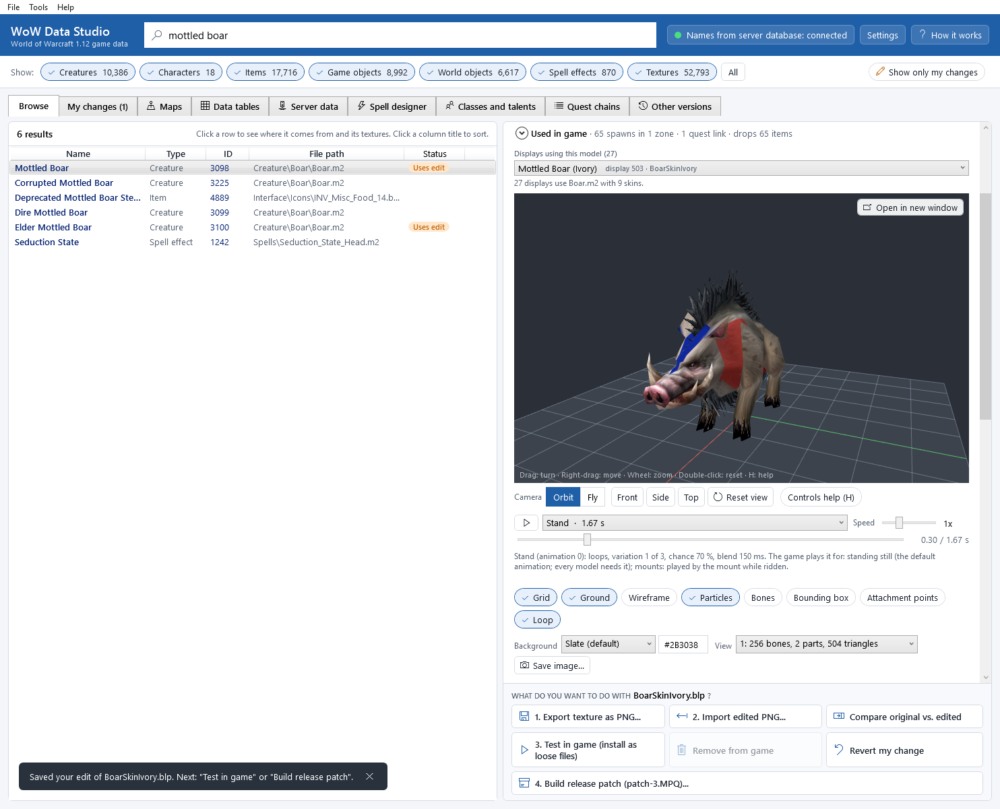

The model loads in the background (a typical creature takes a few hundredths of a second); while it loads, the view
says **Loading the model...** and the rest of the window keeps working.

## Moving around

Click the view once so it receives the keyboard keys. Under the view, the camera bar has:

* **Camera**: **Orbit** or **Fly**, the two ways to move (see the tables below). Models start in **Orbit**.
* **Front**, **Side**, **Top**: look at the model from the front, from its left side, or from above
  (keys <kbd>1</kbd>, <kbd>2</kbd>, <kbd>3</kbd>).
* **Reset view**: back to the start view (<kbd>Home</kbd> or <kbd>R</kbd>, or double-click the view).
* **Controls help (H)**: shows every key and mouse control over the view (<kbd>H</kbd> does the same).

**Orbit** turns around the model, like a turntable:

| Do | Mouse | Keyboard |
|---|---|---|
| Turn around the model | drag with the left button | arrow keys |
| Move (pan) | drag with the right or middle button, or <kbd>Shift</kbd> + left button | <kbd>Shift</kbd> + arrow keys |
| Zoom | mouse wheel | <kbd>+</kbd> / <kbd>-</kbd>, or <kbd>Page Up</kbd> / <kbd>Page Down</kbd> |

**Fly** moves you through the scene like a free camera in a game (most useful for [terrain](maps-and-terrain.md)):

| Do | Mouse | Keyboard |
|---|---|---|
| Fly forward / back / left / right | | <kbd>W</kbd> <kbd>S</kbd> <kbd>A</kbd> <kbd>D</kbd>, or the arrow keys |
| Go down / up | | <kbd>Q</kbd> / <kbd>E</kbd> |
| Faster / slower | | hold <kbd>Shift</kbd> (4 times faster) / <kbd>Ctrl</kbd> (4 times slower) |
| Look around | drag with the right (or left) button | |
| Slide sideways or up and down | drag with the middle button | |
| Change the flying speed | mouse wheel | <kbd>+</kbd> / <kbd>-</kbd> |

In **Fly** mode the bottom-right corner of the view shows the speed, for example *Fly · 57 yd/s · H: help*.

In both modes:

| Do | Key |
|---|---|
| Front / side / top view | <kbd>1</kbd> / <kbd>2</kbd> / <kbd>3</kbd> |
| Focus on the selection (bring the model back into view, keeping the direction you look from) | <kbd>F</kbd> |
| Back to the start view | <kbd>Home</kbd> or <kbd>R</kbd>, or double-click the view |
| Play / pause the animation | <kbd>Space</kbd> |
| Show / hide the help overlay | <kbd>H</kbd> |

A reminder is printed in the bottom-left corner of the view: *Drag: turn · Right-drag: move · Wheel: zoom ·
Double-click: reset · H: help*.

## Open in a new window

To look at a model bigger, on another monitor or full screen, click **Open in new window** in the top-right corner of
the 3D view, or press <kbd>Ctrl</kbd>+<kbd>Shift</kbd>+<kbd>O</kbd> (also **Tools > Open the 3D view in a new window**).
A window opens with the same model, skin, animation and camera angle. Its title says what it shows, for example
*Mottled Boar — Boar.m2*.

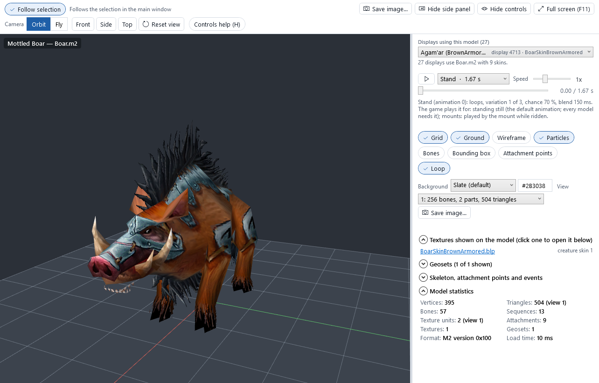

The window works like any window: drag its edges to resize it, maximize it, or drag it to another monitor. Inside:

* **Follow selection** (on by default): the window shows what you select in the main window. Switch it off to *pin*
  the window: it says *Pinned: keeps showing this one*, its title ends with *(pinned)*, and it keeps its model while you
  select other things. Open a second window to see two models side by side, for example two creatures or two looks.
* The camera bar (**Orbit** / **Fly**, **Front**, **Side**, **Top**, **Reset view**, **Controls help (H)**), as under
  the docked view.
* The side panel on the right has all the controls of the docked view: the skin or display picker, the animation list,
  play, **Speed** and the timeline, the display options, **Background**, **View**, **Save image...**, the character
  choices, the textures, the geosets and the statistics. Its sections fold up, and the edge between the view and the
  panel can be dragged. **Hide side panel** closes it (**Show side panel** opens it again).
* **Hide controls** (<kbd>Ctrl</kbd>+<kbd>H</kbd>) hides the tool bar and the side panel: only the 3D view is left.
  **Show controls (Ctrl+H)** in the bottom-left corner brings them back.
* **Full screen (F11)**: the whole monitor for the view, without the window frame. Press <kbd>Esc</kbd> or
  <kbd>F11</kbd>, or click **Leave full screen (Esc)**, to go back.
* **Save image...** in the tool bar saves the view as a PNG, at the window's size.
* <kbd>F1</kbd> opens this chapter.

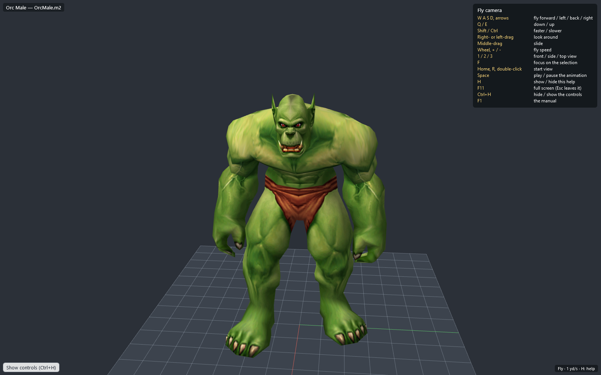

While a window that follows the selection is open, the docked view in the main window stops redrawing every frame, to
spare the graphics card: the animation plays in the window. The docked view still works (you can turn it, change the
skin...) and says *Also shown in a pop-out window that follows the selection*; **Bring it to front** shows the window.
Pinned windows do not pause the docked view.

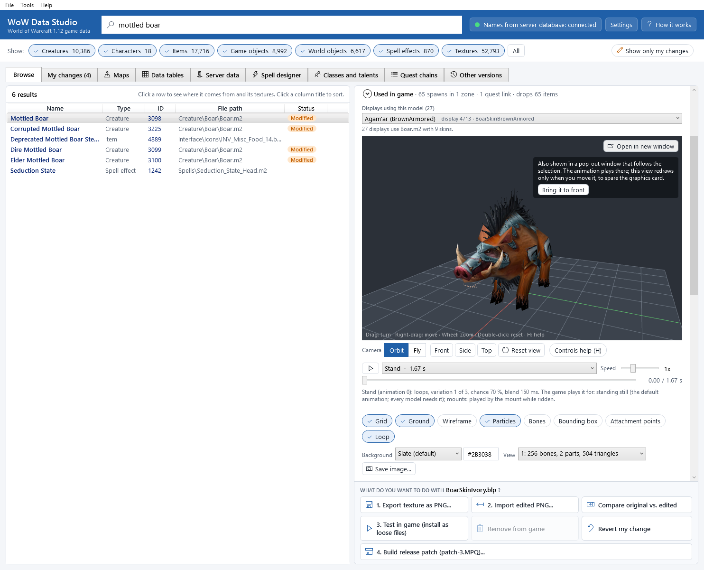

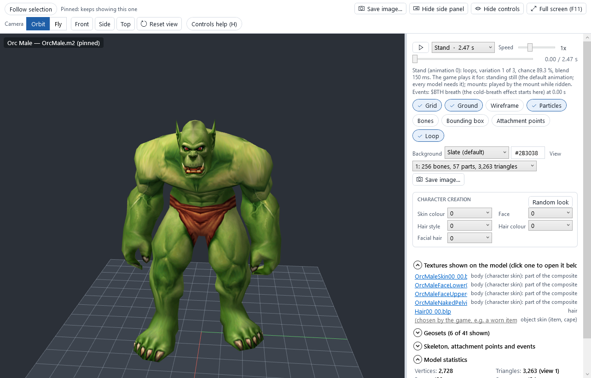

The app remembers the window's last size, position and monitor (and whether the side panel was open and which camera
mode you used) and opens the next one there. If that monitor is no longer connected, the window opens on the main
monitor instead, and it is always made to fit on the screen. Model windows and [terrain windows](maps-and-terrain.md#open-in-a-new-window)
remember their places separately. Closing a window changes nothing else; you can open and close them as often as you
like.

## Skins and looks (above the view)

### Creatures: "Displays using this model"

Many creatures share one model and differ only by their skin. The drop-down **Displays using this model** lists every
display (look) that uses the model, by the creature's name when the server database is connected, for example
*Mottled Boar (Ivory)* or *Agam'ar (BrownArmored)*; otherwise *Display 503 (Ivory)*. The display number and skin file
are shown on the right of each entry. The line below says how many displays and skins there are, for example
*27 displays use Boar.m2 with 9 skins.*

Pick one: the model switches to that skin at once.

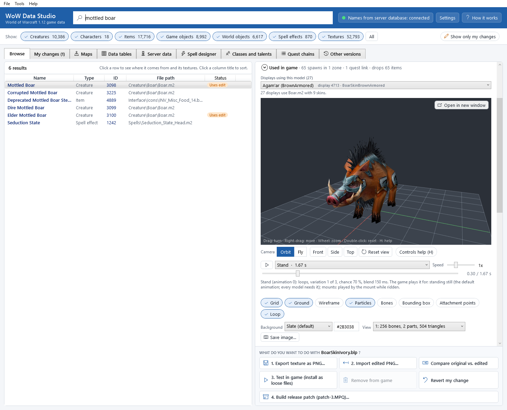

Humanoid NPCs (creatures built on a player-race model) show their own baked skin, hair and beard.

### Items: "Item displays using this model"

The same for items: every item look that uses the model, for example *Worn Battleaxe (Axe_2H_Battle_A_01)*.

### Characters: "CHARACTER CREATION"

For player races, a box with the choices of the game's character creation screen:

| Choice | What changes |
|---|---|
| **Skin colour** | the body colour |
| **Face** | the face (the faces available depend on the skin colour) |
| **Hair style** | the hair model and the scalp |
| **Hair colour** | the hair colour |
| **Facial hair** | beard, tusks, piercings... depending on the race |

**Random look** picks every choice at random. The body texture is put together the way the game does it (skin, face,
facial hair, scalp, underwear), and the hair and beard parts of the mesh follow the game's own tables.

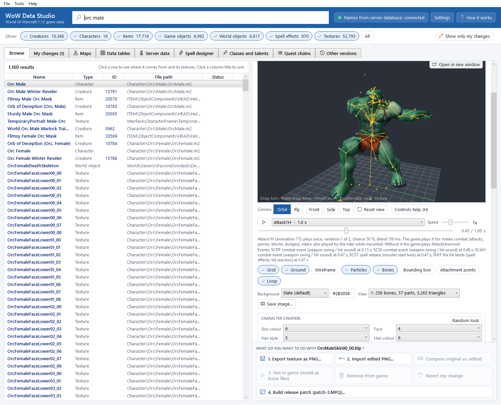

## The view

The model is lit by a simple light from the upper left (not the zone's lighting of the game). Materials follow the
game: solid, cut-out (fur edges, leaves), see-through, glowing (additive) and darkening (modulate) parts; colour and
transparency animation; scrolling textures; the shine on weapons; parts that always face the camera.

Particles and ribbons (fire, smoke, sparks, glows, trails) are drawn too: see
[Particles and ribbons](#particles-and-ribbons). Buildings (`.wmo` files) are not shown in 3D: the view says *this is
a WMO building; the 3D view shows M2 models only*.

Your edited textures appear on the model as soon as you keep an import ([Editing textures](editing-textures.md)).

## Animation

The row under the view:

* *The play button* starts and pauses the animation (<kbd>Space</kbd> in the view does the same).
* *The animation list* holds every animation of the model, with the game's names: *Stand*, *Walk*, *Run*,
  *Attack1H*, *Death*... A number in brackets marks a variation of the same animation, for example *Stand [2]* (the
  game picks one of them at random each time). The length is shown after the name, for example *Stand · 1.67 s*.
* **Speed**: from 0.1x (slow motion) to 3x.
* *The timeline*: drag it to go to any moment of the animation (this pauses it). The time is shown on the right,
  for example *0.30 / 1.67 s*.

Under the timeline, two lines describe the animation that plays: its number in the game's AnimationData table, whether
it loops or plays once, its blend time and move speed, what the game plays it for (moving, fighting, casting, emotes,
dying, mounts) and what the game plays instead when a model does not have it; then its *events* with their times (a
footstep sound, the moment a spell leaves the hand).

Some parts move on their own clock, as in the game: glowing runes, swaying leaves, flickering flames.

## Display options

Buttons that switch an aid on or off (a tick means on):

| Button | What it shows |
|---|---|
| **Grid** | a grid on the ground. The red line points to the model's front, the green line to its left. |
| **Ground** | a light ground plane at height 0 |
| **Wireframe** | the triangle edges over the model |
| **Particles** | on (the default): the model's particles and ribbons (fire, smoke, glows, trails). Off: the model alone |
| **Bones** | the skeleton, moving with the animation (the important "key" bones in red) |
| **Attachment points** | where the game attaches weapons, shields, helmets, spell effects and the name plate (cyan crosses), moving with the animation |
| **Loop** | on (the default): the animation repeats. Off: it plays once and stops on its last frame, as the game plays a death or an emote; press play to start again |
| **Bounding box** | the box the game uses for the model's size |

Below them:

* **Background**: a colour behind the model. Pick a preset (*Slate (default)*, *Mid grey*, *Light grey*, *Black*,
  *White*, *Sky blue*, *Green (for keying)*) or type any colour as `#RRGGBB` in the box next to it.
* **View**: the model's four views. They all have the same triangles but split the model into parts for 256, 75, 53 or
  21 bones per draw, for example *1: 256 bones, 2 parts, 504 triangles*. The game uses the first one on any modern
  graphics card. You only need the others to check an edited model.
* **Save image...**: saves what the view shows as a PNG picture. The app suggests the folder
  `Documents\WoW Data Studio\Exports\Images`.

**Reset view** is in the camera bar under the view (see [Moving around](#moving-around)).

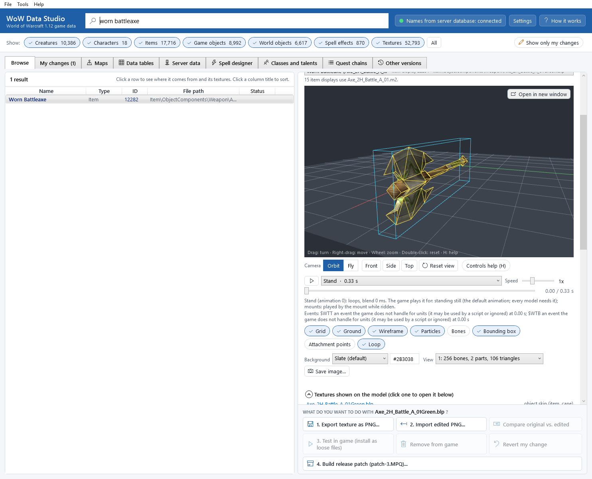

## Textures shown on the model

The list **Textures shown on the model (click one to open it below)** names every texture the model uses right now,
with its slot (for example *creature skin 1*). Click a name: the texture opens in the [texture viewer](texture-viewer.md)
below, with the usual Export / Import / Compare actions. For characters, every part of the put-together body texture
is listed on its own (skin, face, facial hair, scalp...), so you can edit each.

A slot shown as *(chosen by the game, e.g. a worn item)* is filled in the game by something else (a cape, worn armour);
the viewer draws it grey.

## Geosets

Models are made of parts called *geosets* that the game switches on and off: hair styles, beards, ears, gloves,
boots, capes... The header says how many are shown, for example *Geosets (12 of 57 shown)*. Click it to open the list.

* Tick or untick a part to show or hide it. Characters list the parts by name (hair style, facial hair, ears...).
* **Default** shows what the game shows for this look with no items worn.
* **Show all** shows every part at once (useful to see what a model contains; it looks odd, because the game never
  shows them all together).

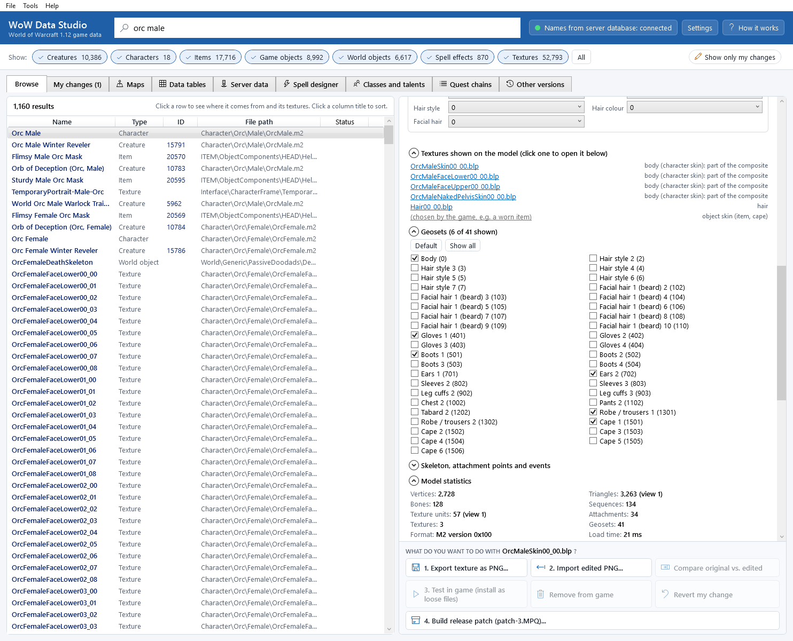

## Skeleton, attachment points and events

The section **Skeleton, attachment points and events** (click it to open it) lists the model's bones (how many move
vertices or are animated), its *key bones* (the bones the game's code finds by name: *Head = bone_021_Head*...), its
attachment points with their bones, and its events. To change them, see
[Skeleton and animations](skeleton-and-animation.md).

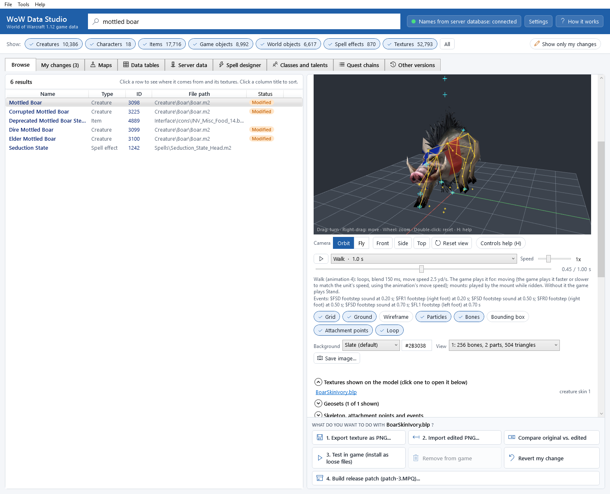

## Particles and ribbons

Many creatures and almost every spell effect are partly made of *particles* (small pictures the model sends out by the
dozen: flames, smoke puffs, sparks, glows, light rays) and *ribbons* (bands that trail behind a moving part). The view
draws them with its own simulation of the game's rules for 1.12 models, read from the game's own code: how many
particles a second, where they start (a rectangle, a sphere or a line of points), their speed and direction, gravity,
wind, their life, their colour, size and picture over their life, flicker (*twinkling*), spin, the trail some leave
behind them (*tails*), and the bone they follow. They look close to the game's, not exactly the same: the
[known issues](known-issues.md#particles-and-ribbons-of-your-game-are-drawn-approximately) say what differs.

* They move with the animation and stop when it is paused. A model is shown with its effect already running (two
  seconds of it), so a still picture (**Save image...**, `wds models render`) shows the effect, not an empty start.
* Some effects only switch on at a moment of their animation: drag the timeline or let the animation play.
* **Particles** (under the view) switches them off and on.
* A spell effect that is only particles and ribbons (no mesh) is framed around where its particles fly.

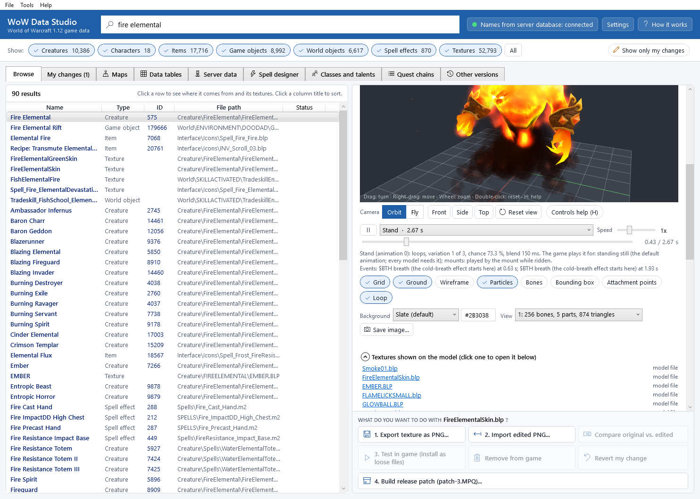

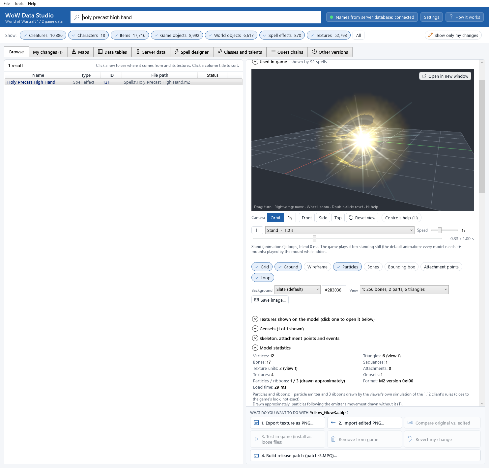

## Model statistics

**Model statistics** lists the model's numbers: vertices, triangles, bones, animations (sequences), texture units,
attachment points, textures, geosets, particle emitters and ribbons, and how long it took to load. For a model with
particles, **Particles / ribbons** says how many are drawn (*1 / 3 (drawn approximately)*, and how many were left out
when the model names a bone or texture it does not have), and the lines under the numbers say what is drawn
approximately for that model, for example *particles that are models drawn as quads (2)*.

## Compare two skins

**Tools > Compare two skins of this model (3D)** opens two 3D views side by side that share one camera:
turning, moving or zooming one moves the other the same way. For a creature it compares the selected skin with another
one; for a character, your current look with the default look.

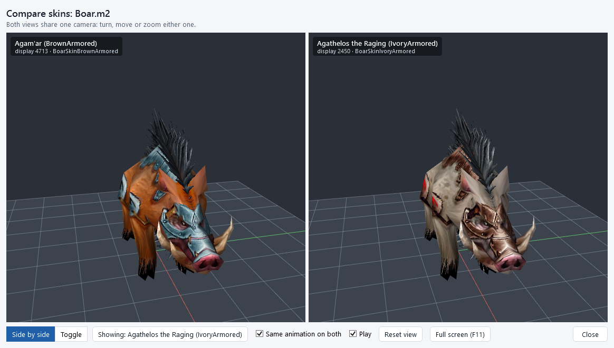

At the bottom of the window:

* **Side by side** or **Toggle**: both views next to each other, or one view that switches between the two in place.
  In toggle mode the button next to it (*Showing: ...*) switches.
* **Same animation on both**: the right view plays the same animation at the same time as the left one.
* **Animation** (when you compare an original model with your edit): pick any animation to play it on both sides (an
  animation new in your edit plays on the right only); drag the time slider next to it to look at one moment. See
  [Skeleton and animations](skeleton-and-animation.md).
* **Play**: start or stop the animation.
* **Reset view**: back to the start view.
* **Full screen (F11)**: both views on the whole monitor (<kbd>Esc</kbd> leaves full screen). The window can also be
  maximized or moved to another monitor. The keys of [Moving around](#moving-around) work in the views.
* **Close**: closes the window.

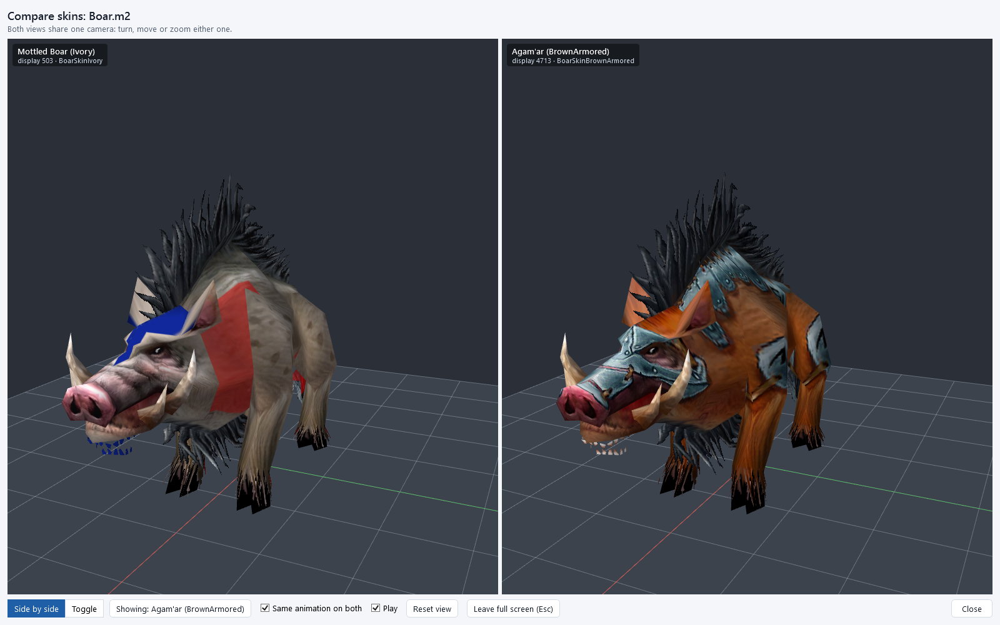

Select a model with at least two skins first (for example the Mottled Boar), or a character race. Otherwise the app
says so.

## If the 3D view stays empty

* *3D view not available: OpenGL 3.3 could not be started ...*: the graphics driver is too old or missing. Update it
  from your graphics card maker's site. Remote-desktop sessions may also lack 3D support.
* *Could not show this model:* and a reason: the model file could not be read. The rest of the app keeps working.

See [Troubleshooting](troubleshooting.md) for more.

## Edit the model in Blender

Under the 3D view, the box *EDIT THE MODEL IN BLENDER* has **Export for Blender...**, **Open in Blender**,
**Import edited model...**, **Compare original vs. edited model** and **Revert the model**. They are described in
[Models and Blender](model-export-import.md).

## Command line

The 3D viewer is in the app only; `wds models info <model>` lists a model's statistics, displays and animations, and `wds models render <model> image.png` saves a picture with the same renderer (`--sequence Walk --time 400` for one moment of an animation, `--no-particles` for the model without its particles and ribbons). `wds models anims <model>` lists the animations and what the game plays them for, `wds models skeleton <model>` the bones, key bones, attachment points and events. See [The command line](command-line.md#models-and-blender).
