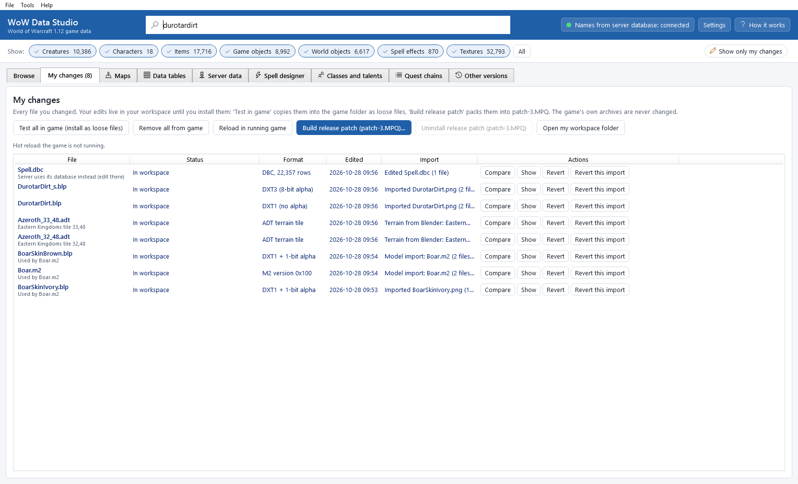
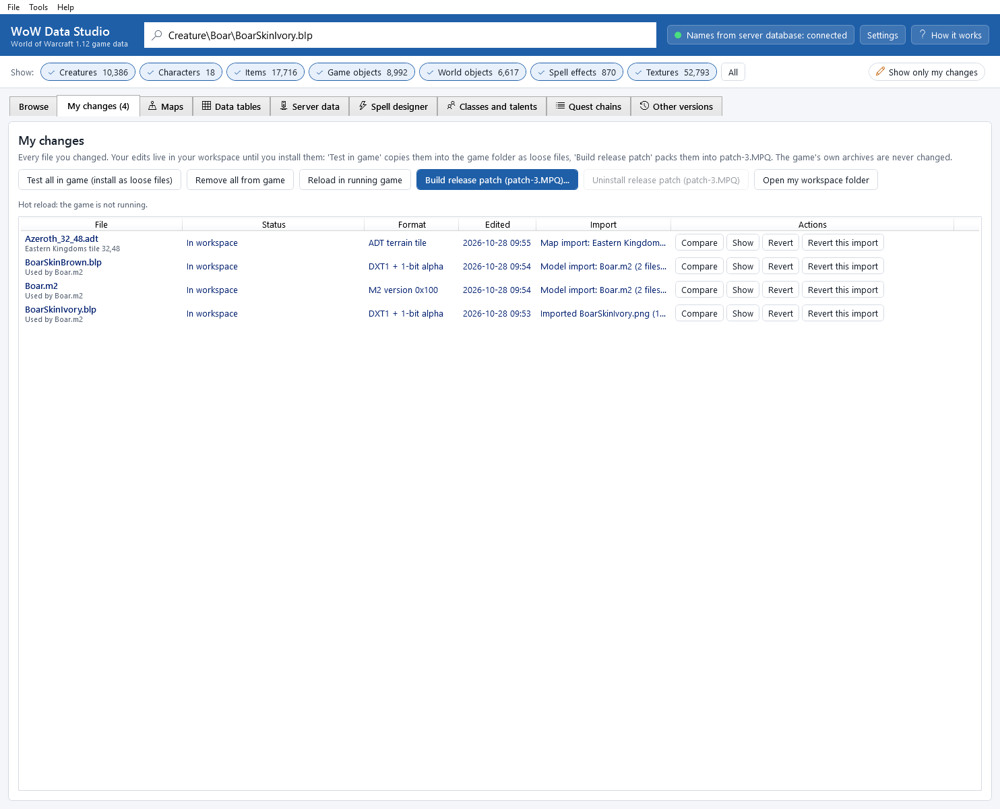

# My changes

The **My changes** tab lists every file you changed, where each one is (only in your workspace, installed in the game,
packed into `patch-3.MPQ`), and lets you undo one file or a whole import. The tab title shows how many changes you
have, for example *My changes (3)*.

## Where your changes live

When you click **Keep this change** after an import, the edited file is saved in your *workspace*: a folder of the app
that mirrors the game's paths (see [where the app keeps its files](troubleshooting.md#where-the-app-keeps-its-files)).
From there:

* **Test in game** copies it into the game folder as a loose file ([Testing in the game](testing-in-game.md));
* **Build release patch** packs all of them into `patch-3.MPQ` ([Releasing](releasing.md)).

The game's own archives are never changed.

## The buttons at the top

| Button | What it does |
|---|---|
| **Test all in game (install as loose files)** | copies every edited file into the game folder |
| **Remove all from game** | deletes every loose file this app installed in the game folder (your edits stay in the workspace) |
| **Reload in running game** | *hot reload*: the game that is running reads your installed changes again, without a restart, and you see what is live now and what needs a relog or a restart ([Testing in the game](testing-in-game.md#reload-in-the-running-game-hot-reload)). The line under the buttons says whether the running game takes reloads (*Hot reload: the game is running ... and takes reloads.*, *Hot reload is off for this game folder (Settings).* ...); it is checked every few seconds |
| **Build release patch (patch-3.MPQ)...** | packs all your changes into one archive |
| **Uninstall release patch (patch-3.MPQ)** | takes the installed release patch out of the game and puts back the `patch-3.MPQ` that was there before (see [Releasing](releasing.md#removing-your-patch-from-the-game)); the line under the buttons says what is installed |
| **Open my workspace folder** | opens the workspace folder in Windows Explorer |

## The list

| Column | What it shows |
|---|---|
| **File** | the file name, and below it the models that use it (*Used by Boar.m2*), or for a map file its tile (*Eastern Kingdoms tile 32,48*). Hover for the full game path. |
| **Status** | where your change is (see below) |
| **Format** | the game format of the file, for example *DXT1 + 1-bit alpha* |
| **Edited** | when you kept the change |
| **Import** | the import (change set) the file came with, for example *Imported BoarSkinIvory.png (1 file)*. Hover for a summary. |
| **Actions** | the buttons of this row (see below) |

### Status

The status lists every place your change is, separated by dots:

| Status | Meaning |
|---|---|
| **In workspace** | kept in the app, not in the game yet |
| **installed as loose file** | copied into the game folder with **Test in game** |
| **installed loose (older version - reinstall)** | you imported a newer version since; install again to update the game folder |
| **in patch-3.MPQ** | included in the last `patch-3.MPQ` you built |
| **in patch-3.MPQ (older version - rebuild)** | you changed it since the last build; build the patch again |
| **not applied to the server yet** | server edits ([Server data](server-data.md)): in your workspace only |
| **applied to the server** (and the date) | server edits written into the server's database with **Apply to server...** |
| **applied to the server (older version - apply again)** | you changed the server edits since the last apply; apply again |

### The buttons of a row

| Button | What it does |
|---|---|
| **Compare** | opens the comparison of the original and your edit ([Editing textures](editing-textures.md#the-compare-window)); for a model the two 3D views ([Models and Blender](model-export-import.md)); for a map tile the before/after terrain views with the height difference ([Maps and terrain](maps-and-terrain.md#compare-before-and-after)); for a data table the rows changed, added and removed, with every value before and after ([Data tables](dbc-editor.md#save-compare-test-and-release)); for server edits the rows as the server has them and as you edited them ([Server data](server-data.md#save-into-your-workspace)) |
| **Show** | jumps to the texture in the **Browse** tab, with the texture viewer open; a map file opens its map and tile in the **Maps** tab; a data table opens in the **Data tables** tab; server edits open in the **Server data** tab |
| **Revert** | undoes this one file |
| **Revert this import** | undoes every file that came with the same import |

## Change sets: one import, one undo

Every import is one *change set*. Importing a texture gives a change set with one file. Importing a whole edited model
(see [Models and Blender](model-export-import.md)) can bring several textures (and the model) at once: they all share one
change set, so **Revert this import** takes the whole import back in one click, while **Revert** takes back a single
file of it.

## Undo one file

1. Click **Revert** in the file's row (or select the texture in **Browse** and click **Revert my change**).
2. The dialog **Revert my change** explains what happens. Click **Revert**, or **Keep my change** to stop.

What revert does:

* your edited copy is deleted from the workspace: the game's original is used again;
* if it was installed as a loose file, that copy is removed from the game folder too (and a file that was there before
  is put back);
* your exported PNG files are *not* touched: you can import them again later.

What revert does *not* do: change an installed `patch-3.MPQ`. If the file was in your release patch, the message says
*rebuild patch-3.MPQ to drop it from the archive too*. Build the patch again (or click **Uninstall release patch (patch-3.MPQ)** when no
changes are left; see [Releasing](releasing.md#removing-your-patch-from-the-game)).

Restart the game after a revert that touched the game folder. When the game runs with hot reload, the app offers
**Reload in running game** instead: the running game goes back to the original at once
([Testing in the game](testing-in-game.md#reload-in-the-running-game-hot-reload)).

## Undo a whole import

Click **Revert this import** in any row of that import. The dialog names the import and its number of files, for example
*all 3 file(s) of "Imported ..."*. Click **Revert**.

## Find your changes in the Browse tab

* **Show only my changes** (next to the filters) lists only your changed textures (**Modified**) and everything that uses
  them (**Uses edit**).
* **Show** in a row of **My changes** jumps to that texture.

When you have no changes, the tab says *No changes yet. Find a texture, export it, edit the PNG and import it again:
it will be listed here.*

## Table changes

Data tables you saved in the **Data tables** tab ([Data tables](dbc-editor.md)) are listed with the format
*DBC, 22,357 rows* and the import *Edited Spell.dbc*. Under the name, the line says what the server does with the table
(*Server also needs this file*, *Server uses its database instead (edit there)* or *Client only*).

**Revert** puts the game's table back. A table you also copied to the server stays on the server until you use
**Undo last copy to server** in **Copy tables to the server** ([Data tables](dbc-editor.md#copy-to-server)).

## Server edits

Edits of your server's world database, saved in the **Server data** tab ([Server data](server-data.md)), are listed
one file per table (`item_template.json`, `creature_template.json`...) with the format *server table*, the rows under
the name (*Changed entry=25;patch=0*) and the import *Server data: ...*. They are never installed into the game or
packed into `patch-3.MPQ` (the build window and the release patch leave them out): they go to the server with
**Export SQL patch...** or **Apply to server...**.

**Revert** throws the edits of that table away in your workspace. It does not change the server: if you already
applied them, use **Undo last apply** in the **Server data** tab (or run the patch's revert script).

## Map changes

Map files you imported from Noggit ([Maps and terrain](maps-and-terrain.md#import-map-changes)) are listed like any
other change, with the format *ADT terrain tile*, *WDT map tile list* or *WDL far terrain* and the import
*Map import: Eastern Kingdoms (tile 32,48)*.

Reverting a map file also removes the identical copy from the map's Noggit project, so Noggit shows the game's version
again. Reverting does not change your server: if you already updated the server's maps with that change, update them
again (or use **Undo server update**, see [Maps and terrain](maps-and-terrain.md#update-server-maps)).

## Command line

`wds changes list`, `wds changes sets`, `wds changes diff <path>`, `wds changes revert <path> --yes` and `wds changes revert-set <change-set> --yes`. See [The command line](command-line.md#my-changes-testing-and-releasing).
