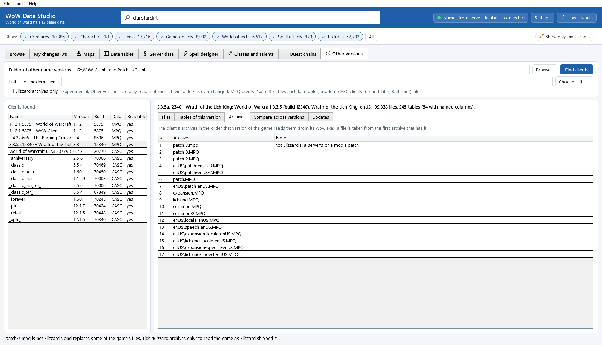
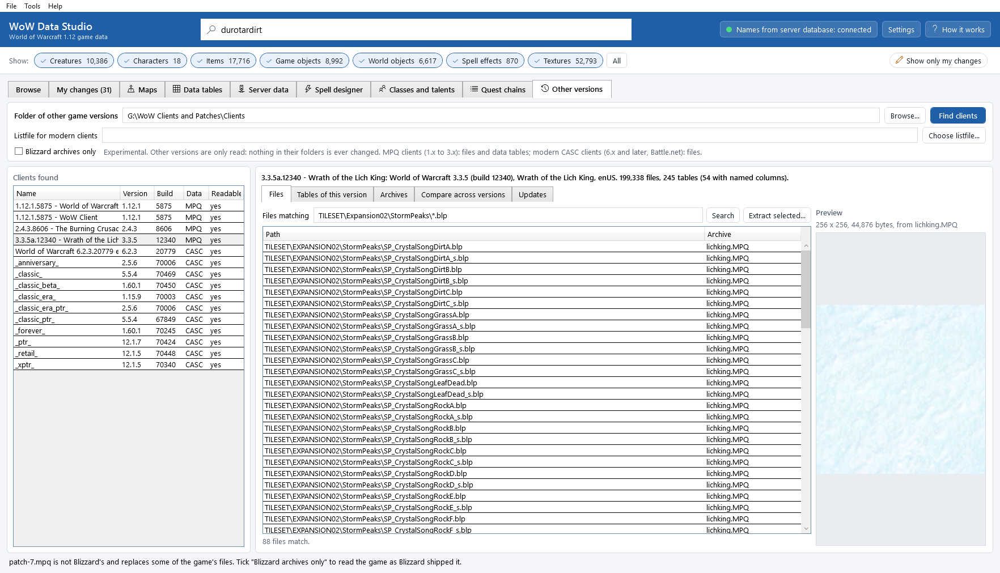
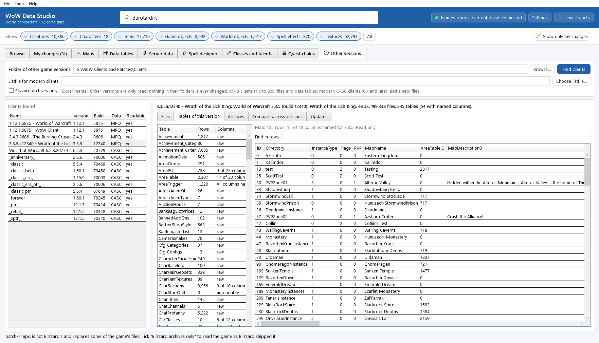
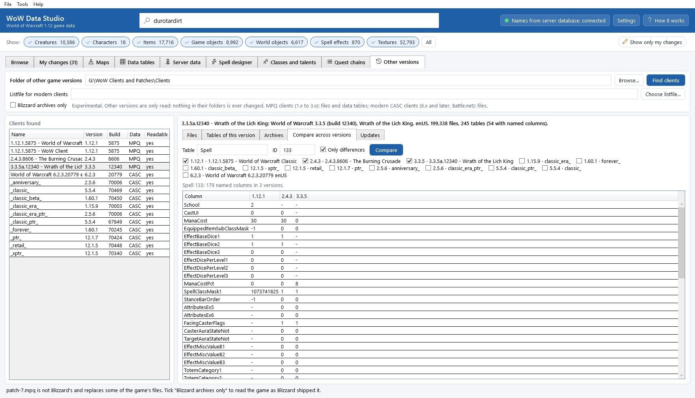

# Other versions (experimental)

The **Other versions** tab reads the data of other World of Warcraft versions: The Burning Crusade (2.4.3), Wrath of
the Lich King (3.3.5a), other 1.12 copies, and any other client that stores its data in MPQ archives. You need no
server for them: everything comes from the client's own files. Use it to look things up and compare them with 1.12 (how
a spell, a map or a creature's display changed), and to copy files out for reference.

It is **experimental**: it is new, it may change, and later versions will add more (see *Not yet* below). It only ever
*reads* those clients. Nothing in their folders is changed, and your 1.12 game and your changes are not involved.

## Before you start: a folder of client copies

Put the clients you want to read into one folder, each in its own subfolder (the folder with its `Wow.exe` and `Data`
folder). Copies are best: a game that Battle.net keeps up to date may change while you read it.

For example:

```
G:\WoW Clients\
    2.4.3.8606 - The Burning Crusade\      (Wow.exe, Data\...)
    3.3.5a.12340 - Wrath of the Lich King\ (Wow.exe, Data\...)
    1.12.1.5875 - WoW Client\              (WoW.exe, Data\...)
```

## Finding the clients

1. Open the tab: **Tools > Other versions (experimental)**, or click **Other versions** at the top.
2. Next to **Folder of other game versions**, click **Browse...** and pick the folder. The app remembers it.
3. Click **Find clients**. The list **Clients found** shows every client in the folder and its subfolders: its
   folder name, the **Version** and **Build** from its `Wow.exe`, how it stores its data (**Data**: MPQ or CASC) and
   whether the app can read it (**Readable**).

Clients from 6.x (Warlords of Draenor) on, and every client that Battle.net installs today (Retail, Classic Era, the
other Classic flavours), store their data in *CASC* (see the [Glossary](glossary.md)). They are found and listed, but
cannot be read yet.



## Looking at a client

Click a readable client in the list. The line above the tabs says what it is (version, release, language) and how many
files and data tables it has.

### Files

Type a path with `*` and `?` into **Files matching** and press <kbd>Enter</kbd> (or click **Search**), for example
`World\Maps\Northrend\*.adt` or `Interface\Icons\INV_Sword_*`. The list shows each file and the archive it is read
from.

* Click a texture (`.blp`) to see it under **Preview**, with its size.
* Select one or more files and click **Extract selected...** to copy them out as they are, into a folder you pick.
  Their folders are kept (`World\Maps\Northrend\Northrend_30_20.adt` lands in `<your folder>\World\Maps\Northrend\`).
  The app refuses a folder inside the client.



### Tables of this version

The client's data tables (its DBC files: spells, maps, areas, creature displays...), with their rows. Click a table to
see its rows; type into **Find in rows** to show only the rows with that text in any column.

Each version has its own columns: a table of 2.4.3 has other columns than the same table of 1.12. The **Columns** list
says for each table whether the app knows this version's columns:

* *named*: the columns have names (the same kind of layout as the [Data tables](dbc-editor.md) tab uses for 1.12),
  checked against the version's own files. For 2.4.3, 73 tables are named, for 3.3.5a 54: the tables of maps and areas,
  lights, sounds, liquids, the world map, flight paths, creature, item and object displays, characters, classes, races,
  factions, skills, talents and spells. A column keeps the name it has in 1.12 when it holds the same thing, so
  **Compare across versions** lines them up;
* *raw*: the app does not know this version's columns yet. Every field is shown as a number named `col_0`, `col_1`...,
  and a text shows as a number too (its place in the file).

The tables of other versions are read only: to change data, use the **Data tables** tab of your 1.12 game.



### Archives

The client's archives in the order that version of the game reads them: a file is taken from the first archive that
has it. The order was read from each version's own `Wow.exe` (TBC and WotLK read their patch archives, their language
archives and their base archives in a different order than 1.12).

### Compare across versions

One row of a data table side by side in several versions:

1. Type the table's name into **Table** (for example `Spell`, `Map`, `AreaTable`, `CreatureDisplayInfo`) and the row's
   **ID**.
2. Tick the versions to compare (one of each readable version found).
3. Click **Compare**. Each line is a column (matched by its name), with its value in each version; `-` means the
   version has no such column or no such row. Tick **Only differences** to see only the columns that changed.



Columns that are not named for a version (*raw*) are left out of the comparison, because the same position means
different things in different versions. The note above the result says so.

## Blizzard archives only

Some client copies contain archives that Blizzard did not ship: a private server's or a mod's patch, such as a
`patch-7.mpq` in a 3.3.5a copy. Such a patch is read first and replaces some of the game's files (that one replaces 19
data tables, `Spell.dbc` among them). The **Archives** list marks these archives *not Blizzard's*.

Tick **Blizzard archives only** to leave them out and read the game as Blizzard released it. The app knows the patch
archives Blizzard shipped with 1.12.1, 2.4.3 and 3.3.5a; for other versions every archive is read.

## Not yet

* Clients that store their data in CASC (6.x and later, and every Battle.net client) cannot be read yet.
* 3D views of TBC and WotLK models, and bringing maps, models or textures of other versions into your 1.12 game, are
  planned, not there yet.
* Many tables of other versions show raw columns ([Known issues](known-issues.md#other-versions)).

## Command line

`wds versions find`, `info`, `files`, `extract`, `tables`, `rows` and `compare` do everything this tab does, and
`wds settings set other-clients <folder>` sets the folder; see [The command line](command-line.md#other-versions-experimental).
