# Other versions (experimental)

The **Other versions** tab reads the data of other World of Warcraft versions: The Burning Crusade (2.4.3), Wrath of
the Lich King (3.3.5a), other 1.12 copies and any other client that stores its data in MPQ archives, and the files of
modern clients (Warlords of Draenor 6.x, and the clients Battle.net installs today: Classic Era, the "1.60" Classic
branch, MoP Classic, Retail). You need no server for them: everything comes from the client's own files. Use it to look things up and compare them with 1.12 (how
a spell, a map or a creature's display changed), and to copy files out for reference.

It is **experimental**: it is new, it may change, and later versions will add more (see *Not yet* below). It only ever
*reads* those clients. Nothing in their folders is changed, and your 1.12 game and your changes are not involved.

## Before you start: a folder of client copies

Put the clients you want to read into one folder, each in its own subfolder (the folder with its `Wow.exe` and `Data`
folder). Copies are best: a game that Battle.net keeps up to date may change while you read it.

For example:

```
G:\WoW Clients\
    2.4.3.8606 - The Burning Crusade\      (Wow.exe, Data\...)
    3.3.5a.12340 - Wrath of the Lich King\ (Wow.exe, Data\...)
    1.12.1.5875 - WoW Client\              (WoW.exe, Data\...)
```

## Finding the clients

1. Open the tab: **Tools > Other versions (experimental)**, or click **Other versions** at the top.
2. Next to **Folder of other game versions**, click **Browse...** and pick the folder. The app remembers it.
3. Click **Find clients**. The list **Clients found** shows every client in the folder and its subfolders: its
   folder name, the **Version** and **Build** from its `Wow.exe`, how it stores its data (**Data**: MPQ or CASC) and
   whether the app can read it (**Readable**).

Clients from 6.x (Warlords of Draenor) on, and every client that Battle.net installs today (Retail, Classic Era, the
other Classic flavours), store their data in *CASC* (see the [Glossary](glossary.md)). Each Battle.net flavour (its
`_classic_beta_`, `_retail_`... folder) is listed as a client of its own. Their files and their data tables can be read
(see *Modern clients* below).


## Looking at a client

Click a readable client in the list. The line above the tabs says what it is (version, release, language) and how many
files and data tables it has.

### Files

Type a path with `*` and `?` into **Files matching** and press <kbd>Enter</kbd> (or click **Search**), for example
`World\Maps\Northrend\*.adt` or `Interface\Icons\INV_Sword_*`. The list shows each file and the archive it is read
from.

* Click a texture (`.blp`) to see it under **Preview**, with its size.
* Select one or more files and click **Extract selected...** to copy them out as they are, into a folder you pick.
  Their folders are kept (`World\Maps\Northrend\Northrend_30_20.adt` lands in `<your folder>\World\Maps\Northrend\`).
  The app refuses a folder inside the client.


### Tables of this version

The client's data tables (its DBC files: spells, maps, areas, creature displays...), with their rows. Click a table to
see its rows; type into **Find in rows** to show only the rows with that text in any column.

Each version has its own columns: a table of 2.4.3 has other columns than the same table of 1.12. The **Columns** list
says for each table whether the app knows this version's columns:

* *named*: the columns have names (the same kind of layout as the [Data tables](dbc-editor.md) tab uses for 1.12),
  checked against the version's own files. For 2.4.3, 73 tables are named, for 3.3.5a 54: the tables of maps and areas,
  lights, sounds, liquids, the world map, flight paths, creature, item and object displays, characters, classes, races,
  factions, skills, talents and spells. A column keeps the name it has in 1.12 when it holds the same thing, so
  **Compare across versions** lines them up;
* *raw*: the app does not know this version's columns yet. Every field is shown as a number named `col_0`, `col_1`...,
  and a text shows as a number too (its place in the file).

The tables of other versions are read only: to change data, use the **Data tables** tab of your 1.12 game.


### Archives

The client's archives in the order that version of the game reads them: a file is taken from the first archive that
has it. The order was read from each version's own `Wow.exe` (TBC and WotLK read their patch archives, their language
archives and their base archives in a different order than 1.12).

### Compare across versions

One row of a data table side by side in several versions:

1. Type the table's name into **Table** (for example `Spell`, `Map`, `AreaTable`, `CreatureDisplayInfo`) and the row's
   **ID**.
2. Tick the versions to compare (one of each readable version found).
3. Click **Compare**. Each line is a column (matched by its name), with its value in each version; `-` means the
   version has no such column or no such row. Tick **Only differences** to see only the columns that changed.


Columns that are not named for a version (*raw*) are left out of the comparison, because the same position means
different things in different versions. The note above the result says so.

## Modern clients (CASC)

A modern client finds its files by number (the *FileDataID*), and many of its files have no name inside the client.
In **Files matching**, type:

* a full path, for example `World\Maps\Azeroth\Azeroth.wdt`: found when the client knows that name (Warlords of
  Draenor knows nearly all of them, the newer clients only some);
* a file number with `#`, for example `#775971` (that is the Azeroth map file in every modern client);
* a wildcard such as `World\Maps\Azeroth\*`, only with a listfile (below).

The list shows where the file stands: *local* (on this computer), *not downloaded* (Battle.net fetches it when the game
needs it) or *encrypted* (cannot be read). **Preview** and **Extract selected...** work as for the other clients; a file
known only by its number is copied as `<number>.<type>`, with the type taken from its first bytes (`.blp`, `.m2`,
`.adt`, `.wdt`, `.db2`...).

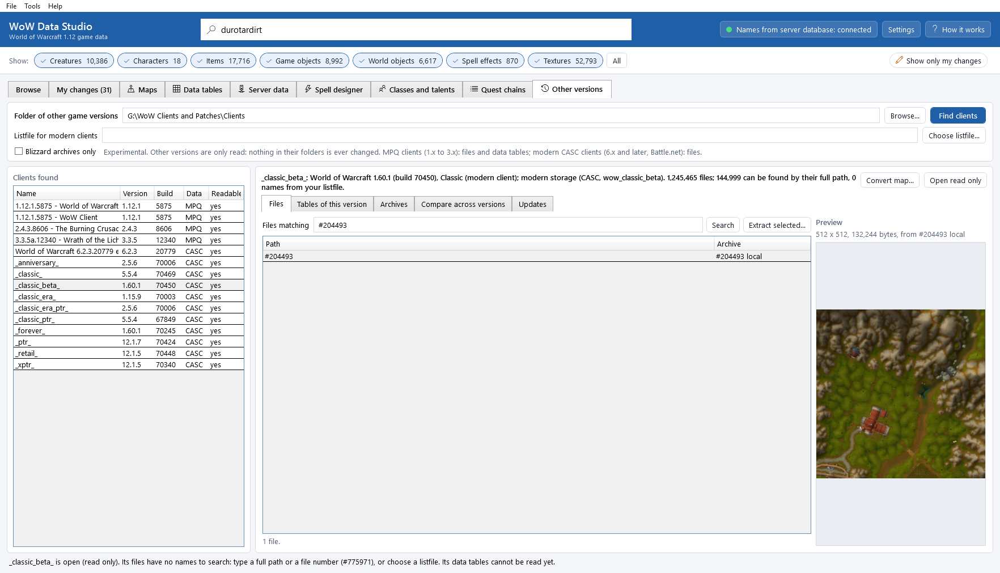

*Their data tables* (DB2 files) are listed in **Tables of this version** by name, from the client's own program file:
more than a thousand of them. A table is read when you click it. Most of their columns are raw (`col_N`); for 1.60.1
(build 70450) the tables that maps need have names (Map, AreaTable, the liquid tables, Light, WMOAreaTable, the ground
effects, ZoneMusic). Records that are encrypted in the client are left out, and the note above the rows says how many.
In **Compare across versions** the modern clients are listed too, not ticked at first.

**Listfile for modern clients** (optional): a listfile is a text file that names the files (lines `FileDataID;path`).
The app does not come with one and never downloads one; if you have one, click **Choose listfile...** and pick it.
Then the files have their names, and wildcards work.

## Opening another version (read only)

A modern client, such as the "1.60" Classic client (`_classic_beta_`, build 1.60.1.70450), opens in the main window
the way your 1.12 game opens, with the same tabs: **Browse** (its creatures, items, game objects, spell effects,
textures and world models, the details of each, the texture viewer, the 3D view of its models and buildings),
**Maps**, **Data tables** (its own tables, read only), **Used in game**, the exports, and the **Other versions** tab.
It opens *read only*: every button and menu item that would write something is greyed out and says why (see
[What is greyed out, and why](#what-is-greyed-out-and-why)). Nothing in the client's folder is changed, and your 1.12
game and your changes are kept as they are.

1. Open it in one of three ways:
   * in the **Other versions** tab, click the client in **Clients found**, then **Open read only**;
   * **File > Open another version (read only)...**;
   * on the welcome screen, **Open another version (read only)...** (your game does not need to be open).

   The last two look in your folder of other versions (they ask for it when it is not set yet); when it holds several
   modern clients, pick one (the newest 1.60 build is selected).
2. The first time, the window shows *Organizing game data...* while the app reads that version's tables and file names:
   about 8 seconds for the 1.60 client, about 13 seconds with a listfile. The result (its index) is kept in the app's
   folder, so the next time it opens in about a second. **File > Rebuild the index** reads the client again (after you
   chose another listfile, for example).
3. Search as for your game: type words into the search box, tick the types to show, click a result.
4. **File > Back to your 1.12 game** (or the button **Back to your 1.12 game** in the yellow bar) opens your game
   again, with your changes. The app always starts with your game.


While another version is open:

* the window title and the top bar name it (*World of Warcraft 1.60.1.70450 · Classic (modern client) · read only*);
* a yellow bar under the top bar says **Read only:** and why, with **Back to your 1.12 game**;
* the line at the bottom shows the locked records and where the file names come from (see
  [Locked records and names](#locked-records-and-names));
* the server button says *No server connected for 1.60.1.70450* (see [No server for another version](#no-server-for-another-version)).

### What is greyed out, and why

Everything that writes is greyed out: **Import edited PNG...**, **Test in game**, **Remove from game**, **Revert my
change**, **Build release patch (patch-3.MPQ)...**, **Import edited model...**, the map's **Edit in Noggit...**,
imports and server update, **Save to my workspace** and **Copy to server...** of the data tables, **Reload in running
game**, **Uninstall release patch (patch-3.MPQ)**... Hover over one (it shows its tooltip even greyed out) or read the
line next to the buttons for the reason:

*1.60.1.70450 is open read only. Nothing is written into another version's client until the standalone C client
exists, and writing its CASC storage is not supported.*

The command line refuses the same commands with the same reason (exit code 4, see
[the command line](command-line.md#another-version-read-only)).

What still works is everything that reads or exports to a folder you choose: **Export texture as PNG...** (a PNG, no
`.blp.json` note), **Export for Blender...** and **Open in Blender** (the package goes to a folder of your exports;
it cannot be imported back into that version), **Save image...** of the 3D views, **Export rows...** of the data
tables, and the [command line](command-line.md#another-version-read-only)'s exports and pictures. The app refuses a
folder inside the client.

### No server for another version

A world server gives the names of most creatures, their spawns, loot, vendors and quests. The app has one for your
1.12 game (your VMaNGOS or CMaNGOS database); for another version none can be connected yet, so:

* the server button in the top bar says *No server connected for 1.60.1.70450*;
* **Used in game** shows what the client itself says (the displays that share a model, the models that draw a
  texture) and the note *No server is connected for 1.60.1.70450...*; nothing is made up in place of the server's
  rows;
* the **Server data** tab shows **No server connected** with the reason, and the designer tabs (**Spell designer**,
  **Classes and talents**, **Quest chains**) show why they are not there for another version: they change your 1.12
  game's tables and its server.

The app is ready for a server of another version (a *server provider* per version); when one exists, these parts
show its data.

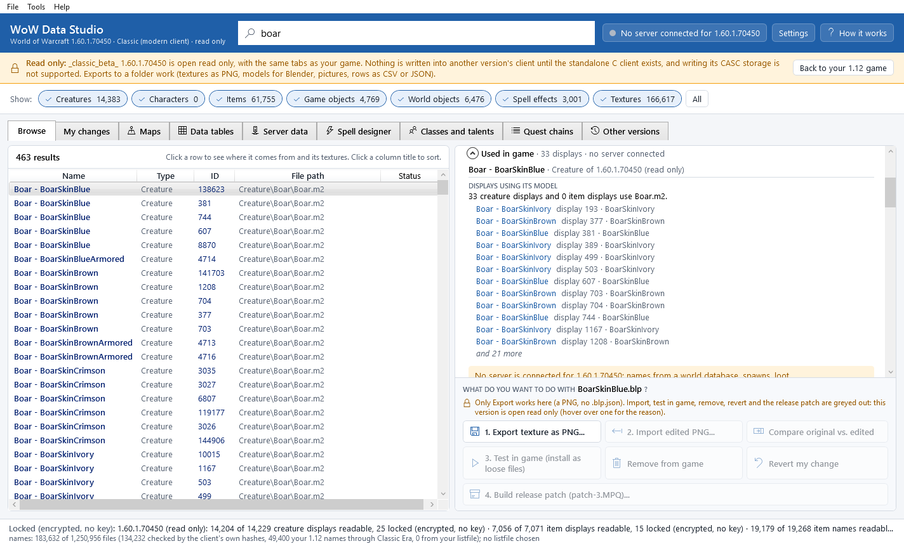

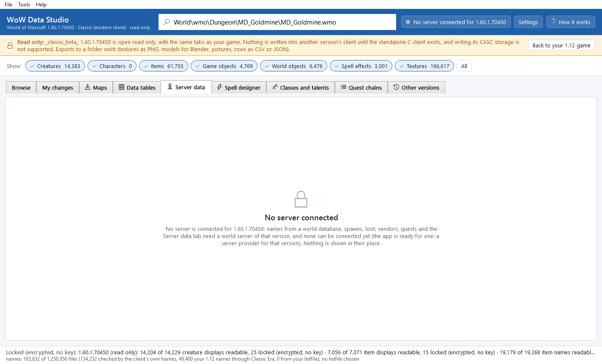

### My changes

Another version has no workspace and no changes: **My changes** is empty and its buttons are greyed out with the
reason. Your 1.12 changes are kept; **File > Back to your 1.12 game** shows them again.

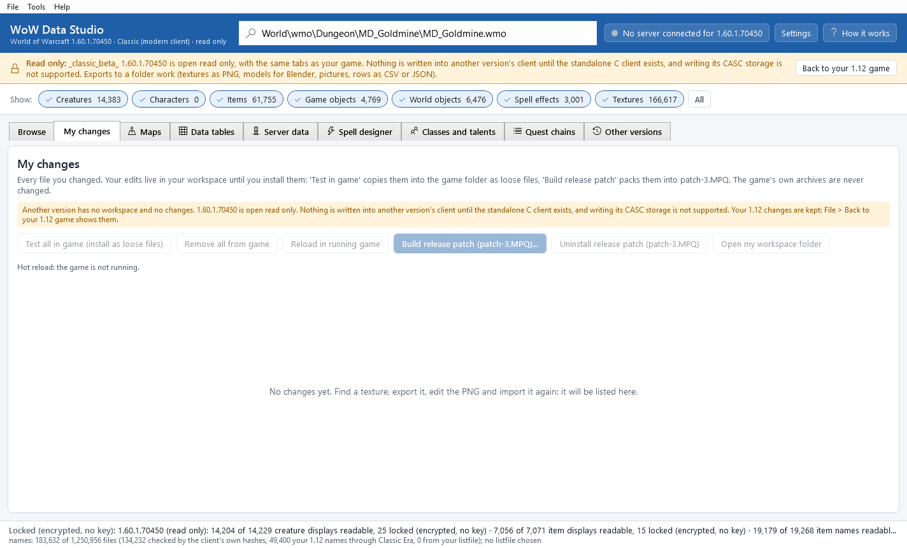

### Data tables

The **Data tables** tab shows the version's own data tables (its DB2 files, more than a thousand), read only: pick a
table on the left (a table is read when you click it), type words into the search box above the rows, and **Export
rows...** saves the rows shown as CSV (for spreadsheets) or JSON. The columns have names where the app knows them for
that build (for 1.60.1.70450 the tables of maps, displays, models, textures, items, spells and spell effects), else
they are called `col_0`, `col_1`... Encrypted rows are left out, and the note above the rows says how many.
**Save to my workspace** and **Copy to server...** are greyed out with the reason.

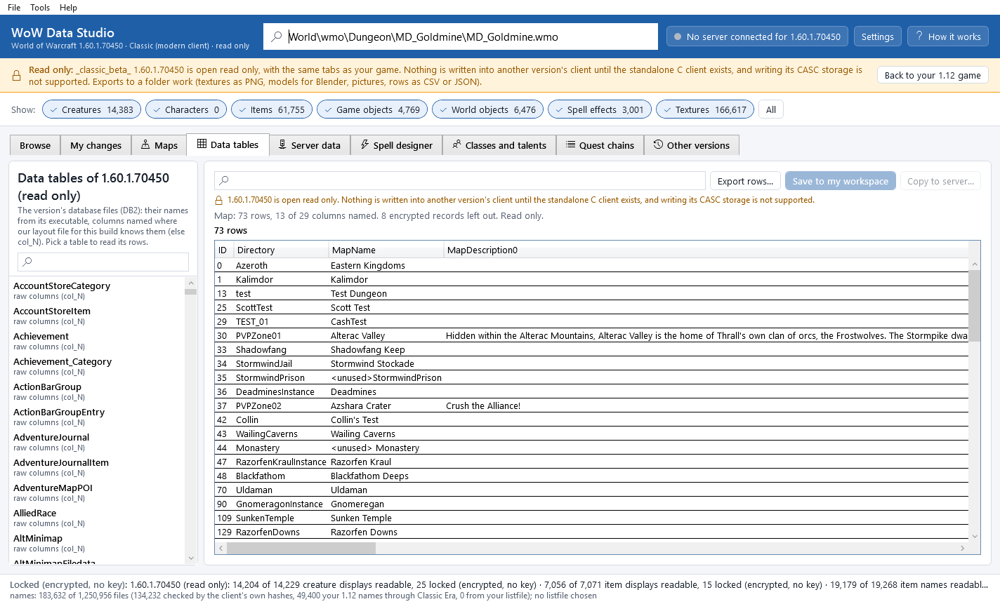

### What is listed

* *Creatures*: every creature display of the client, named by its model and skins (as your game is without the server
  database), and the few creatures the client names itself (companion pets, a few bosses). The names of the other
  creatures are on the server, which another version does not have here.
* *Items*: the items the client names (more than 19,000 in 1.60), and every item display.
* *Game objects*: every game object display, and the objects the client places itself (signposts, mailboxes...).
* *Spell effects*: the spell effect models and the spells that show them.
* *Textures* and *World objects*: the textures and the models under `World\` that have a name (see below).

### The details

**WHERE IT COMES FROM**, the facts and **TEXTURES IT USES** work as in your game. **FILES** lists every file of the
entry with:

* its *FileDataID*, the number the client finds the file by;
* where its name comes from: *verified* (the client's own name hash confirms it, also for the names in the client's
  own list of its interface files), *1.12 name (Era)* (a name of your 1.12 game, found through a Classic Era copy next
  to the 1.60 client: both use the same numbers), *listfile* (your listfile; the client cannot confirm it) or *no name*
  (the file is shown as `#123456.blp`);
* its state: *local*, *encrypted* (the client cannot be read without a key the app does not have; the details name
  the key) or *not downloaded* (Battle.net fetches it when the game needs it).

A model's own textures are read when you click the entry. Textures the game chooses at run time (the display's skins)
are counted in the facts.

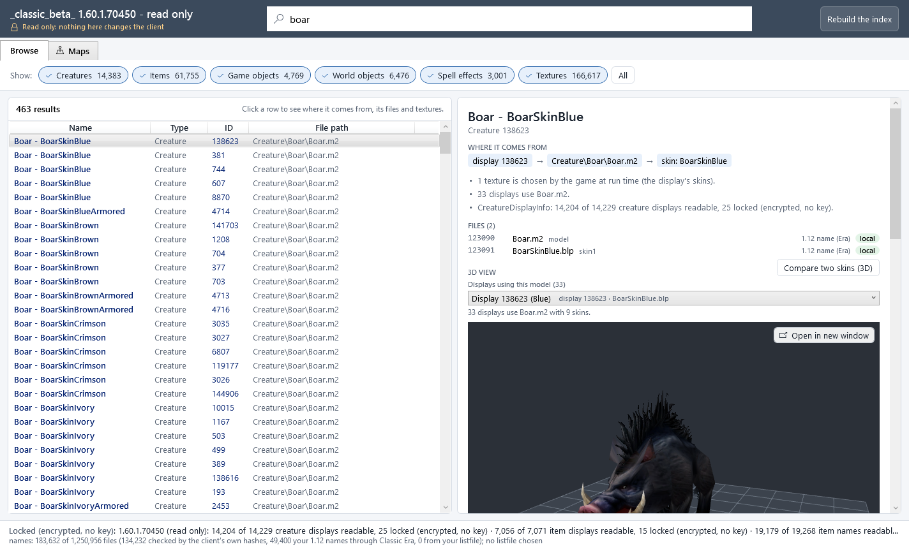

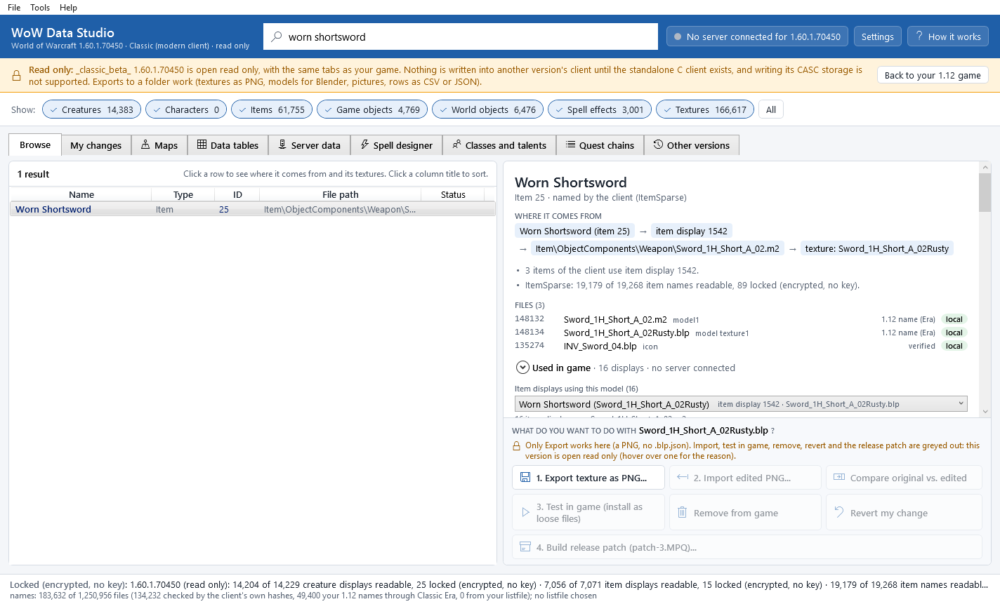

### Textures

Click a texture in **TEXTURES IT USES** to see it in the texture viewer (mip levels, transparency, zoom, as in your
game). **Export texture as PNG...** saves it as a PNG image, outside the client's folder. No `.blp.json` note is written
next to it: a texture of another version is not imported back into your game this way (the
[update catalog](#the-update-catalog-picking-1.60-updates-for-your-game) brings 1.60 textures into your game).

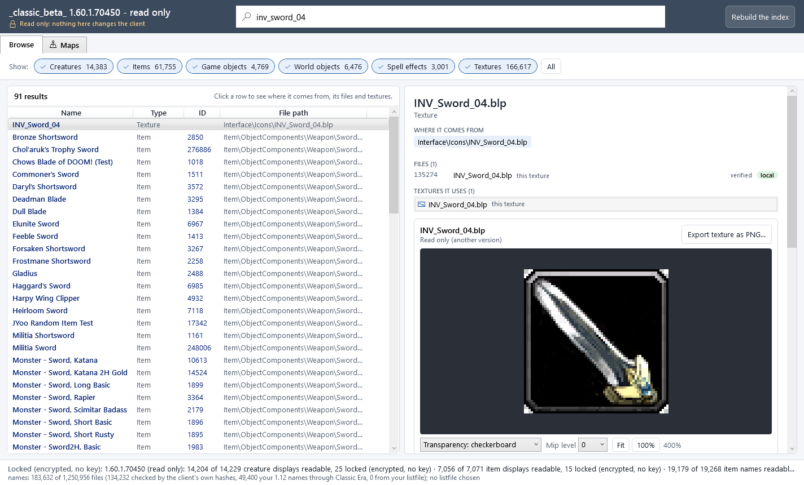

### 3D models

When the entry has a model (a creature display, an item, a game object, a spell effect, a model under `World\`), the
details show it in the 3D view, with the controls of your game's [3D model viewer](model-viewer.md): turn and zoom
with the mouse, the animations, the level of detail, the geosets, the background, **Save image...**.

* *Creatures*: **Displays using this model (33)** lists every display of the model with its skin; pick one to see the
  model with that skin. A humanoid NPC shows its baked texture.
* *Items*: **Item displays using this model (16)** lists the item displays with their texture. An item with a model
  per race and sex shows its first model.
* **Open in new window** shows the model in a window of its own, as for your game: it follows what you click in the
  Browse tab, or keeps its model when pinned.
* **Tools > Compare two skins of this model (3D)** shows two displays of the model side by side, with the same
  animation.
* **Export for Blender...** (under the view, and in the **Tools** menu) saves the model as a glTF package with its
  textures as PNG, the look shown or every display's look; **Open in Blender** exports the look shown and starts
  Blender with it. The animations kept in `.anim` files are read for the export. The package is for Blender and other
  programs: **Import edited model...** is greyed out, nothing goes back into that version.
* The animations have the names of your 1.12 game for the same animation numbers (*Stand*, *Walk*...); the others are
  called *Anim* and their number. Without a 1.12 game set, every animation is called that way.
* **Model statistics** say which format was read (1.60 models are a newer kind of model file than 1.12's: they keep
  their parts in separate files, found by FileDataID) and, under the numbers, what the app left out or drew
  approximately.

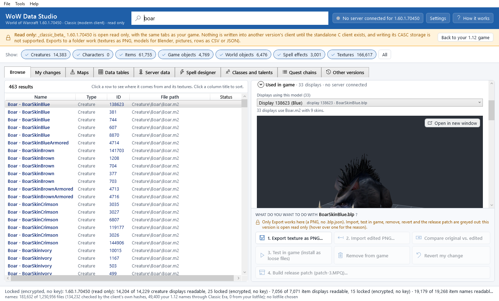

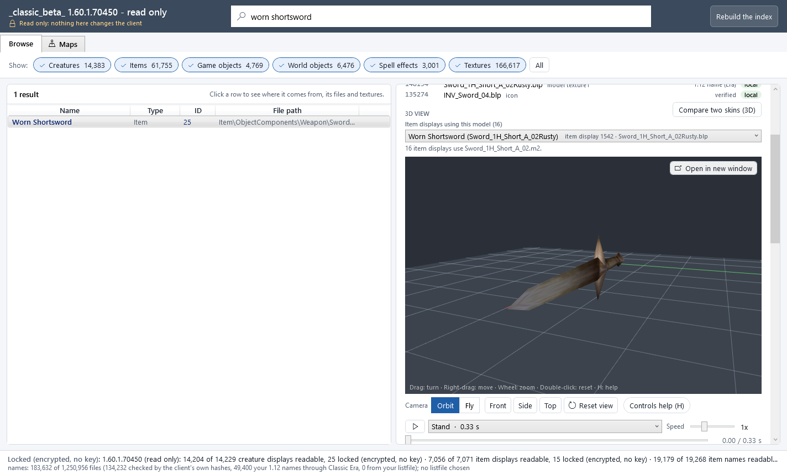

#### Animations in separate files

A 1.60 model keeps some of its animations in separate `.anim` files (usually the rarer ones: emotes, sleeping, special
attacks; *Stand*, *Walk*, *Run* are mostly in the model). They play like the others: when you pick one, the app reads
its file (a moment the first time) and the model moves. The line under the animation list says where the keys of the
chosen animation are, for example *Its keys are in .anim file #474116, read when you chose it.* Measured on the 1.60
client: 6,523 of the 6,529 creature animations kept that way play; 2 name no file and 4 name a file without keys, and
those stand still (the line says so).

The app keeps the animations you chose in memory, up to about 8 MB per model; when you pick more, the ones you chose
longest ago are let go and read again if you pick them again.

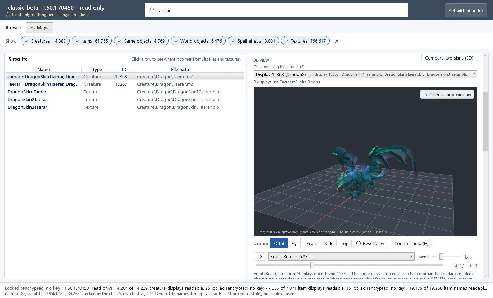

Character-style models (the new player-race models that 1.60 uses for some NPCs) keep their bones, animations and
attachment points in a *skeleton file* (`.skel`), sometimes with a parent skeleton that adds the shared animations. The
app reads both: the notes under the statistics name them (*Skeleton: #1838699, its parent #1838505 (359 animations
from the parent)*). When the parent is not in the client, only the skeleton's own animations are listed (the notes
say so). Measured on the 1.60 client: 22 creature models have a skeleton file, all are read; 4 of their 13 parent
skeletons are in the client.

#### Particles and ribbons

Particle effects (sparks, smoke, glows) and ribbons (trails) of 1.60 models are drawn: the app runs its own simulation
of what the model describes (how many particles a second, their speed, direction, life, colour, size and texture over
their life, the bone they follow), so they look close to the game's, not exactly the same. When the view is paused,
the effect stops too; a model is shown with its effect already running (two seconds of it). **Model statistics**
count them (**Particles / ribbons**) and, under the numbers, say what is drawn approximately for that model (for
example *particles with several textures drawn with their first one*). **Particles** under the view switches them off
and on. Your 1.12 game's particles and ribbons are drawn too, by the 1.12 client's own rules (with tails and
twinkling): see [Particles and ribbons](model-viewer.md#particles-and-ribbons).

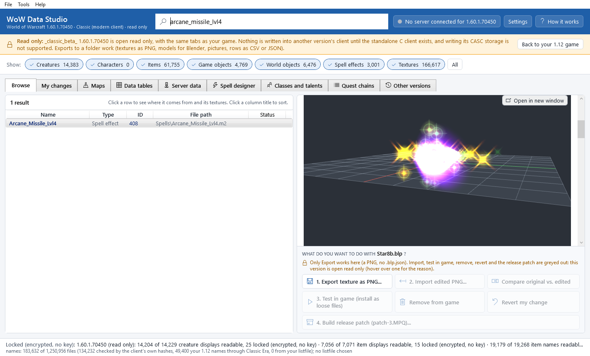

Shine and reflection layers: the commonest kinds (a reflection on armour and weapons, a glow added on top) are drawn
with the app's version of how the newer clients combine them; the rarer kinds show their first texture only. The
statistics say which, per model. The newer blend mode *blend add* (7) is drawn with its own blending.

Not shown (the statistics say it for each model):

* Particle tails, twinkling, wind, particles that are models, and the second and third textures of multi-texture
  particles; the models' lights.
* Player characters and the hair, faces and clothes of humanoid NPCs (they show their baked texture and their default
  parts).

### Buildings

When the entry is a building (a world object or a game object whose model is a `.wmo`), the details show it under
**BUILDING (3D)**: every part of the building (its *groups*) with the first texture of each of its surfaces, as the
tile breakdown of your game shows a building on its own. Turn and zoom with the mouse; **Reset view** goes back to the
start. The line under the view says how many groups, triangles and textures were read, and how many furniture models
(the building's own doodads) it lists; those are not drawn, as in your game. **TEXTURES IT USES** lists the building's
textures: click one to see it in the texture viewer.

A 1.60 building names its parts and textures by FileDataID instead of by name (the line says *groups and textures by
FileDataID*). Measured on the 1.60 client: 131 buildings placed on Eastern Kingdoms and Kalimdor and the 21 maps that
are one building, with 1,298 groups and 2,091 textures, all read.

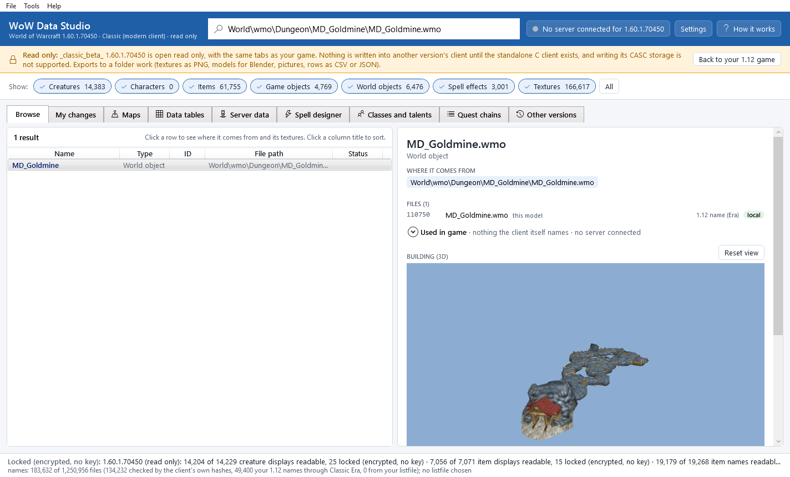

### Maps

The **Maps** tab works like your game's [Maps tab](maps-and-terrain.md), with every button that edits greyed out:
pick a map on the left, a zone to light up its tiles, click a tile on the minimap.

* **MAPS**: the maps of the version's Map table, in the same groups as your game (continents, world maps, dungeons,
  raids, battlegrounds). The line above the minimap says how many rows of the Map and AreaTable tables are locked; a
  map whose map file (WDT) is encrypted or not in the client is listed with the reason and shows no tiles; a map that
  is one building says so (find it in **Browse** to see the building). Measured on the 1.60 client: 71 maps (73 of
  the Map table's 81 rows can be read, 8 are locked; 2 maps' files are not in the copy; 21 maps are one building),
  3,322 tiles; Eastern Kingdoms has 736 tiles and 28 zones.
* **ZONES**: from the version's AreaTable (1,375 readable rows in 1.60, 46 locked) and the area of each ground square
  of every tile. The first time you pick a map, the app reads every tile's ground file for that (about 1 to 2 seconds
  for Eastern Kingdoms) and keeps the result in the app's folder of that client.
* *The minimap*: the version's own minimap pictures (512 x 512 per tile in 1.60), scaled down; built in about 1 to 2
  seconds the first time and kept in the app's folder.
* *The tile*: its zones, size, heights, doodads, buildings and water, the 3D view with **Neighbour tiles**,
  **Doodads**, **Buildings**, **Water**, **Textures**, **Wireframe**, the camera bar and **Open in new window** (a
  window of its own that follows the tile you click, or stays on its tile when pinned), and **On this tile**: the
  zones, the doodads, buildings and ground textures placed on it, and the terrain. A doodad or building that is in the
  Browse list is a link: click it to see it there (a building in the building preview). There is no server here, so
  no spawns are listed.

What the 3D view of a 1.60 tile shows:

* the ground with up to 8 texture layers per square (1.12 has 4; measured on 1,466 tiles of 47 maps of the 1.60
  client: 2,822 of 375,296 squares have more than 4 layers, up to 8) and their fine alpha maps (256 levels, where
  1.12 has 16). The 1.60 continents store how much of each texture shows; the app draws exactly that share;
* the finer holes of 1.60 (8 x 8 per square instead of 4 x 4);
* water, ocean, lava and slime from the tile's liquid data, by the kind of each liquid (63,067 of those squares
  have one);
* the doodads (read like the 1.60 models of the 3D view) and buildings (read by FileDataID), also a building's scale.

The buttons that change a map (**Edit in Noggit...**, **Import map changes...**, **Open terrain in Blender...**,
**Import edited terrain...**, **Test map in game (loose files)**, **Build release patch (patch-3.MPQ)...**, **Update
server maps...**) are greyed out, with the reason on hover and on the line under **EDIT THE MAP**. **Break down this
tile...** is greyed out too: it reads the tiles of your 1.12 game, and for other versions it comes later. The
**Specular ground (_s textures)** choice is not shown: the 1.60 tiles name the textures they are drawn with.

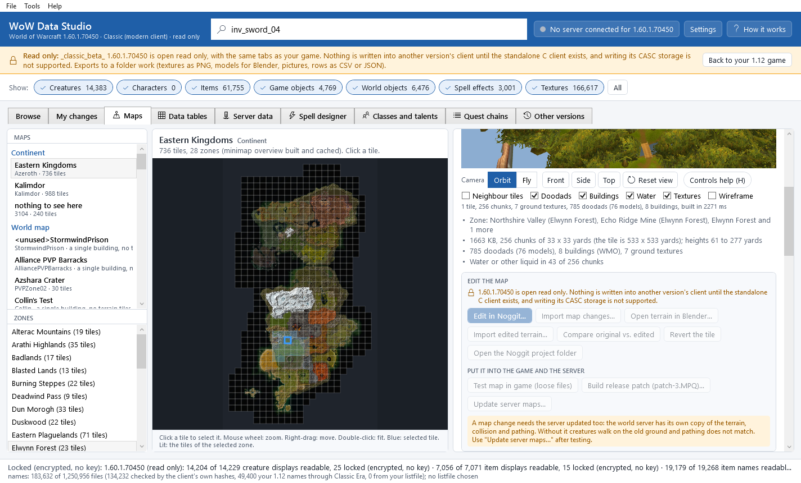

When a file of a tile cannot be read (encrypted, or not in the client), the tile still shows what can be read and the
facts say what is missing, for example *The placement (obj0) file (#123456) is encrypted: its doodads and buildings
are not shown.* Measured on the 1.60 client: none of the 1,466 tiles sampled has such a file.

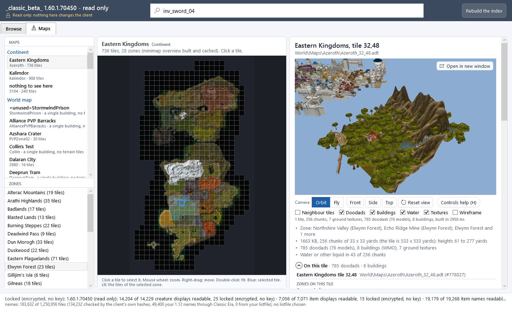

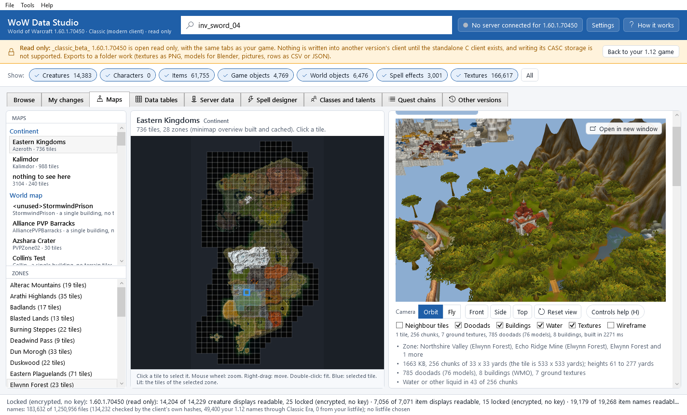

Also on the [command line](command-line.md#another-version-read-only): `wds maps list`, `zones`, `tiles`, `minimap`,
`tile` and `render` with `--version <client>`.

### Locked records and names

Some rows of a modern client's data tables are encrypted (unreleased content); the app never guesses them. The line at
the bottom of the main window, **Locked (encrypted, no key)**, says how many rows of the tables the list comes from can be
read, for the 1.60 client: 14,204 of 14,229 creature displays (25 locked), 7,056 of 7,071 item displays (15 locked),
19,179 of 19,268 item names (89 locked), 3,223 of 3,234 game object displays (11 locked), 2,719 of 2,732 spell effects
(13 locked). The line below it says how many files have a name and where the names come from.

Without a listfile, about 184,000 of the 1.25 million files of the 1.60 client have a name: 134,000 confirmed by the
client itself, 49,000 names of your 1.12 game. With a listfile (**Choose listfile...** in the **Other versions** tab),
nearly every file has one; the list then shows at most 200,000 named textures and models (the others are found with
`wds find files <pattern> --version <client>`).

## Blizzard archives only

Some client copies contain archives that Blizzard did not ship: a private server's or a mod's patch, such as a
`patch-7.mpq` in a 3.3.5a copy. Such a patch is read first and replaces some of the game's files (that one replaces 19
data tables, `Spell.dbc` among them). The **Archives** list marks these archives *not Blizzard's*.

Tick **Blizzard archives only** to leave them out and read the game as Blizzard released it. The app knows the patch
archives Blizzard shipped with 1.12.1, 2.4.3 and 3.3.5a; for other versions every archive is read.

## Converting a map to 1.12

**Convert map...** brings a map of the "1.60" Classic client (the modern `_classic_beta_`, build 1.60.1.70450) into
your 1.12 game: a zone with its subzones, some tiles, or a whole map, also a map 1.12 does not have (for example
Zephras Isle). The converted files go into your *workspace* as one change, like an import: your game folder is not
changed, **Revert this import** in [My changes](my-changes.md) takes it all back, and **Test all in game (install as
loose files)** and the release patch work as for any other change.

1. In the list of clients, click the 1.60 client (`_classic_beta_`). The button **Convert map...** appears next to its
   name. Click it.
2. Pick the **Map** (name, ID and folder; for example *Eastern Kingdoms (0, Azeroth)*).
3. Choose what to convert:
   * **A zone and its subzones**: type or pick the zone, for example *Elwynn Forest*. Every tile with ground of that zone
     is converted. A tile is converted whole, so the zones next to it change too (the report names them);
   * **These tiles**: tiles as `x_y`, separated by commas, for example `32_48,33_48`;
   * **The whole map**.
4. Click **Preview**. The app converts everything in memory and shows the **Conversion report**; nothing is written.
   It takes a few seconds (the whole of Eastern Kingdoms: about 10 seconds; **Stop** stops it).
5. Read the report, then click **Convert**. The files are checked with the 1.12 checks first (nothing is written when
   one fails) and saved as one change set.

What the conversion does:

* *Ground*: heights, holes, texture layers and their blending, water, lava and slime, zones. 1.12 shows at most 4
  texture layers per chunk: the 4 most visible are kept and the rest blended in. The 1.60 vertex colours are dropped.
  Water types become 1.12's four kinds (river, ocean, magma, slime) from the 1.60 client's own liquid table. Grass and
  small plants (ground effects) stay as in your 1.12 tile where the chunk keeps its texture.
* *Shadows*: where the ground is the same as in your 1.12 tile, your 1.12 shadow is kept; re-sculpted ground gets no
  shadow (1.60 has almost none of its own).
* *Ground textures*: a texture your game has (by its name) is used as it is. A new one is converted from the 1.60 file
  (at most 512 x 512, the largest the 1.12 game loads) and saved with its `_s` file.
* *Trees, rocks and buildings*: kept when your game has the model. Where 1.60 put a new model at the same place
  (many Elwynn trees, some city buildings), your 1.12 model stays. Models and buildings 1.12 does not have are left out
  and listed (converting them comes later).
* *Zones*: a zone your AreaTable has keeps its ID; a 1.60 zone gets a new AreaTable row (its 1.60 ID, its name, a free
  exploration bit).
* *Map files*: the tile list (WDT), the far terrain on the horizon (WDL, rebuilt from the new heights) and the minimap
  (1.60's 512 x 512 pictures made 256 x 256, with their entries in `md5translate.trs`). A map 1.12 does not have gets a
  new Map row (its folder is the map's name, for example `ZephrasIsle`), a loading screen your game has, and a default
  light.
* *Names*: only from your own files. The names of your 1.12 game's files are found by their hashes in a Classic Era
  copy (`_classic_era_`) next to the 1.60 client, plus the listfile you chose (**Choose listfile...**). A new texture
  without a name is saved as `World\Converted\<number>.blp`. Without a Classic Era copy far fewer names are known, and
  more models are left out.

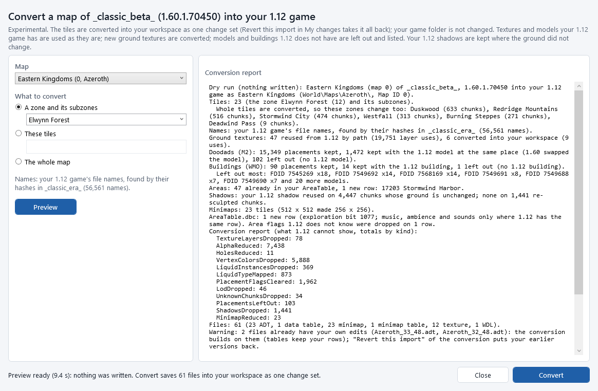

*Your server.* The server keeps its own copy of the zones and maps, and its own terrain files:

1. New zones (and a new map): in the [Server data](server-data.md) tab, **Check client and server...**, check *areas*
   (and *maps*), select the new rows and click **Make the server match the game**; save and apply.
2. Build the release patch (**Build release patch (patch-3.MPQ)...**, installed into the game), then **Update server
   maps...** ([Maps and terrain](maps-and-terrain.md#update-server-maps)).

The report lists these steps with the IDs.

## The update catalog: picking 1.60 updates for your game

The **Updates** tab lists *every* difference between the "1.60" Classic client and your 1.12 game, grouped into updates
you can pick and bring into your game one at a time: a zone's terrain, a new map, the re-lit light zones of a zone, the
repainted textures of a folder, new interface art, a data table, an engine feature. Each update says what it would
change in your game, what it needs, and what it takes to bring it over (its class). The differences that only the
modern engine or a server can use are listed too, so you know them.

1. In **Clients found**, click the 1.60 client (`_classic_beta_`), then the **Updates** tab.
2. Click **Scan for updates**. The first scan compares both sides, which takes a minute or two: every file of your game
   against the client (the changed textures pixel by pixel), every tile of every map chunk by chunk, every data table.
   The result is kept in the app's folder and used again until the client or your game changes; **Scan again** scans
   anyway, **Stop** stops.
3. The list shows each update with its **Kind**, its **Class**, the number of files (tiles for terrain, rows for a
   table), its size in the 1.60 client and whether it can be imported now. Narrow it with **Kind**, **Class**,
   **Zone or folder** (for example `Elwynn` or `Creature`) and **Search**. **Hide differences without a visible change**
   (ticked at first) leaves out the files that were only re-encoded or re-saved; **Only what can be imported** shows
   what the app can bring over today.
4. Click an update: **About this update** shows what it changes in your game, what it needs, why it has its class, what
   was measured and its files.
5. Pick one or several updates (<kbd>Ctrl</kbd> or <kbd>Shift</kbd> and click) and click **Preview import**. The app
   converts everything in memory and shows the **Import report**; nothing is written. Then click
   **Import picked updates**: all picks go into your workspace as *one* change set (**Revert this import** in
   [My changes](my-changes.md) takes it all back), after the 1.12 checks. Picks that cannot be imported yet are listed
   in the report with why; the others are imported.

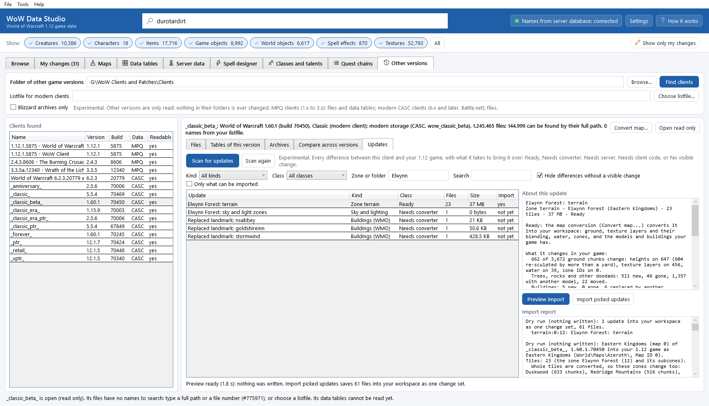

The classes:

| Class | Meaning |
|---|---|
| **Ready** | 1.12 loads it as it is, or after a conversion the app already does. Most of these can be imported now. |
| **Needs converter** | It needs a converter that does not exist yet: modern models (M2) and buildings (WMO), OGG sounds, the light colours, data tables (DB2 to DBC). |
| **Needs server** | It only matters with server data: hotfixed rows, spells and items, encrypted content. |
| **Needs client code** | A feature of the modern engine or interface (volumetric fog, ambient occlusion, the modern interface API, character customization...): it needs work on the 1.12 client itself. Listed so you know; it cannot be imported. |
| **No visible change** | The files differ, but nothing changes on screen (a texture only re-encoded, a model re-saved in the modern format, a sound stored as OGG like Classic Era's). Nothing to bring. |

The kinds:

* **Zone terrain**: one update per zone (a zone and its subzones), per dungeon or battleground, and one for the open sea:
  how many ground chunks change (heights, texture layers, water, zone IDs), the trees, rocks and buildings that are new,
  gone, replaced or moved, the new tiles. The import is the map conversion of [Converting a map to 1.12](#converting-a-map-to-1.12):
  all picked zones of one map are converted together.
* **New map**: a map 1.12 does not have (Zephras Isle, Hyjal Crater...), converted as a whole new map.
* **Sky and lighting**: per zone, the light zones 1.60 added, removed or resized and its polygon-shaped zone lights; the
  modern lighting tables (light colours per time of day, volumetric fog, sun shafts, ambient occlusion, colour grading).
  The colours themselves were not compared yet (their table's columns are not decoded).
* **Skyboxes**: the sky models 1.60 has and your LightSkybox table does not, and the sky textures of your game that
  changed.
* **Weather**: the modern weather types and particle volumes.
* **Ground textures** and **Textures**: per folder, the textures that were repainted or lightly edited, the ones 1.60
  made larger (the same picture with more detail), their high-resolution versions (usually four times as wide), and the
  ones only re-encoded (*No visible change*). 1.12 loads at most 512 x 512, so larger pictures are made 512 x 512: still
  sharper where yours are smaller. Character skins, faces, hair and armour pieces are put together at a fixed size by
  1.12, so larger ones need client code.
* **Models** and **Buildings (WMO)**: the high-resolution player models, the new models and buildings placed in the 1.60
  world, the landmarks 1.60 replaced (Stormwind, Ironforge, Orgrimmar...), and your models re-saved in the modern format.
* **Interface art**: the 1.60 interface textures your game does not have, by folder. They show only where your
  interface code or tables name them.
* **Interface strings**: the interface texts 1.60 changed, added or removed (GlobalStrings).
* **Fonts**: the fonts that changed, and the new ones (Cyrillic, Chinese, Korean).
* **Sounds and music**: changed sounds (OGG, not playable by 1.12 without a converter), changed MP3 music, and your WAV
  sounds stored as OGG.
* **Data tables**: per table of your game, the rows 1.60 added and changed (counted row by row where both sides' columns
  are named, by number of rows otherwise), the tables only 1.60 has (by system), and the rows Blizzard's server hotfixed
  (from the 1.60 client's cache).
* **Engine and UI features**: the modern renderer and its effects, the modern interface API, the sound engine, found in
  the 1.60 program file (and not in yours).
* **Other files**: movies, the 1.60 files without a name, encrypted files.

What an import writes:

* *Textures and interface art*: a file 1.12 loads (palette or DXT1, DXT3, DXT5, a power of two up to 512 x 512, all its
  mip levels) is saved as it is. A larger one with mip levels keeps its own smaller pictures (nothing is encoded again);
  any other is made a power of two of at most 512 x 512 and encoded again in its format. The checks of every saved
  texture run before anything is written.
* *Fonts* and *MP3 music*: as they are.
* *Zone terrain* and *New map*: the map conversion (the same report as **Convert map...**).
* *Names*: as for the map conversion, only your own 1.12 game's file names (found by their hashes in a Classic Era copy
  next to the 1.60 client) and the listfile you chose; the 1.60 interface files are also named by the client's own list
  of them (ManifestInterfaceData), each name checked against the client's name hash. With a listfile (**Choose
  listfile...**) the catalog also lists the 1.60 files without another name by folder.

## Not yet

* Another version opens in the main window with the same tabs, read only. Its player characters, the tile breakdown,
  a world server for it (spawns, loot, quests, names) and the placements in "Used in game" are planned, not there yet;
  2.4.3 and 3.3.5a (MPQ clients) open in this tab only. Writing into another version comes only after the standalone C
  client exists.
* Most columns of the modern clients' data tables have no names yet.
* Maps convert from 1.60 to 1.12 only: 1.12 to 1.60, and maps of 2.x and 3.x, are planned. The models and buildings
  1.12 does not have are left out (their conversion is planned), see [Known issues](known-issues.md#other-versions).
* 3D views of TBC and WotLK models, and bringing models of other versions into your 1.12 game, are planned, not there
  yet. Textures, interface art, fonts and MP3 music of the 1.60 client can be imported through the update catalog.
* The update catalog compares the 1.60 client only. Its models, buildings, OGG sounds, light colours, data tables and
  interface texts cannot be imported yet (each update says why), see [Known issues](known-issues.md#other-versions).
* Many tables of other versions show raw columns ([Known issues](known-issues.md#other-versions)).

## Command line

`wds versions find`, `info`, `files`, `extract`, `tables`, `rows`, `compare`, `convert-map`, `updates`, `update-info` and
`import-updates` do everything this tab does, and `wds settings set other-clients <folder>` sets the folder; see
[The command line](command-line.md#other-versions-experimental). `wds versions open <client>` opens another version
read only, and the commands that read or export take `--version <client>`, as the main window works on it:
`wds find search boar --version _classic_beta_`, `wds find used cdisplay:503 --version _classic_beta_`,
`wds models render cdisplay:503 boar.png --version _classic_beta_`, `wds models export cdisplay:503 --version _classic_beta_`,
`wds dbc rows Map --version _classic_beta_`, `wds dbc export Map --out map.csv --version _classic_beta_`. The commands
that write refuse `--version` with the reason the app shows on its greyed-out buttons; see
[Another version, read only](command-line.md#another-version-read-only).
