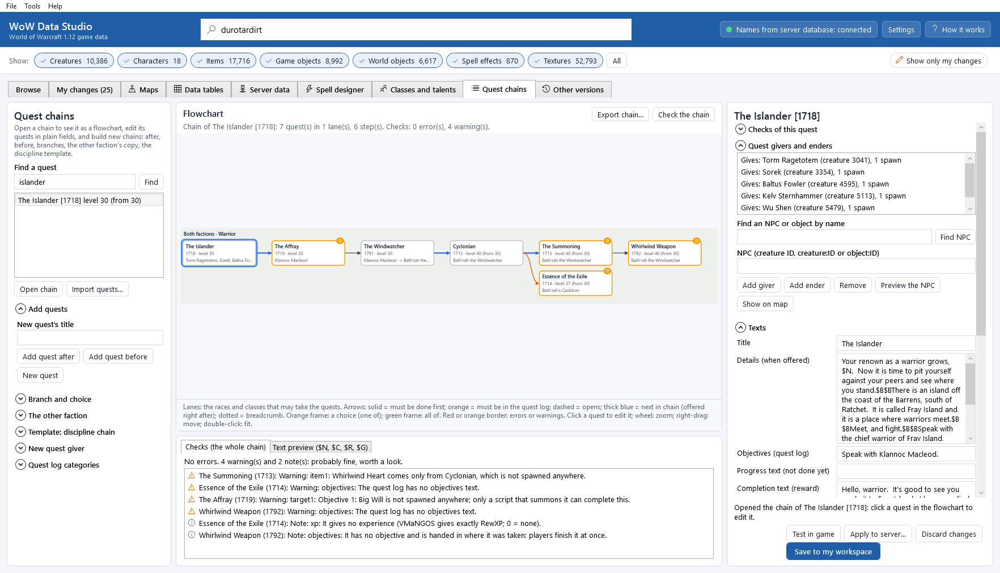
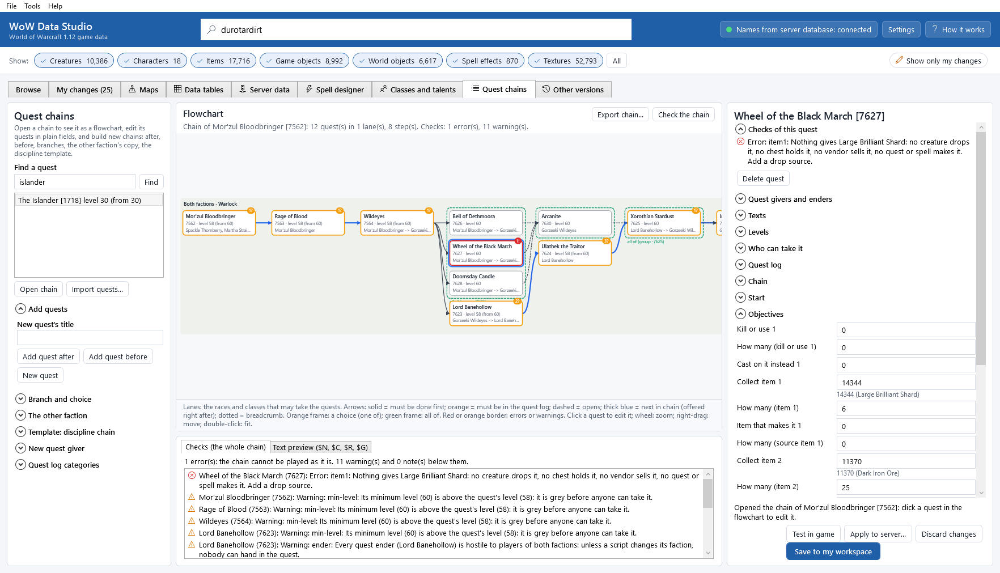
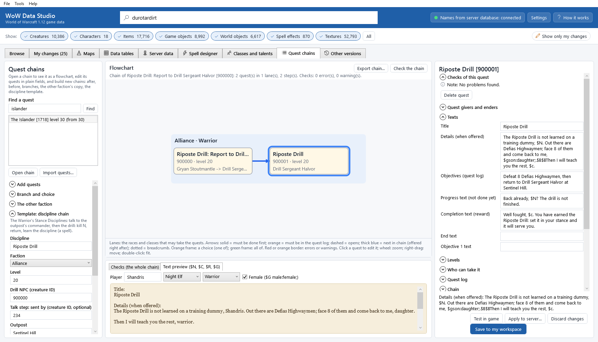
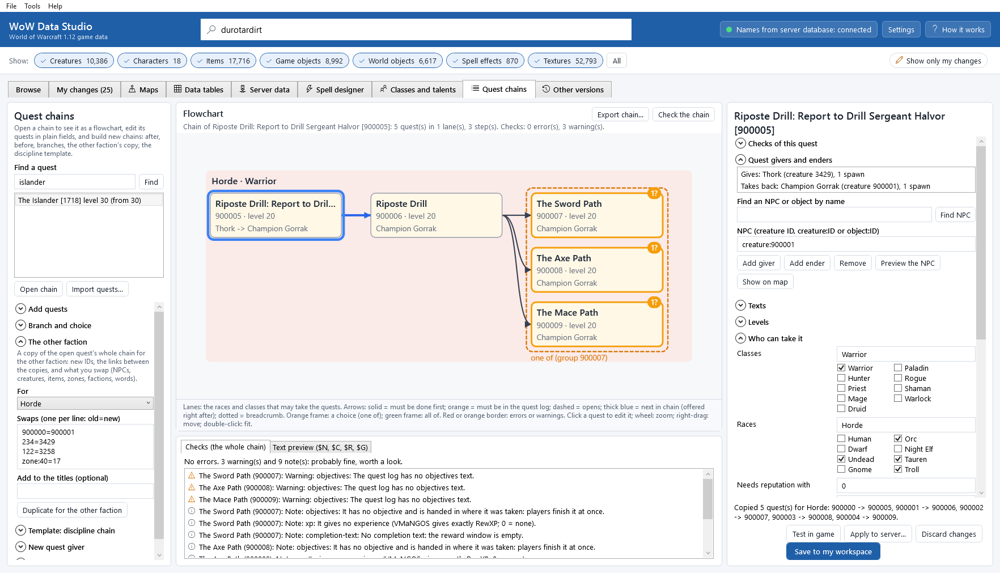
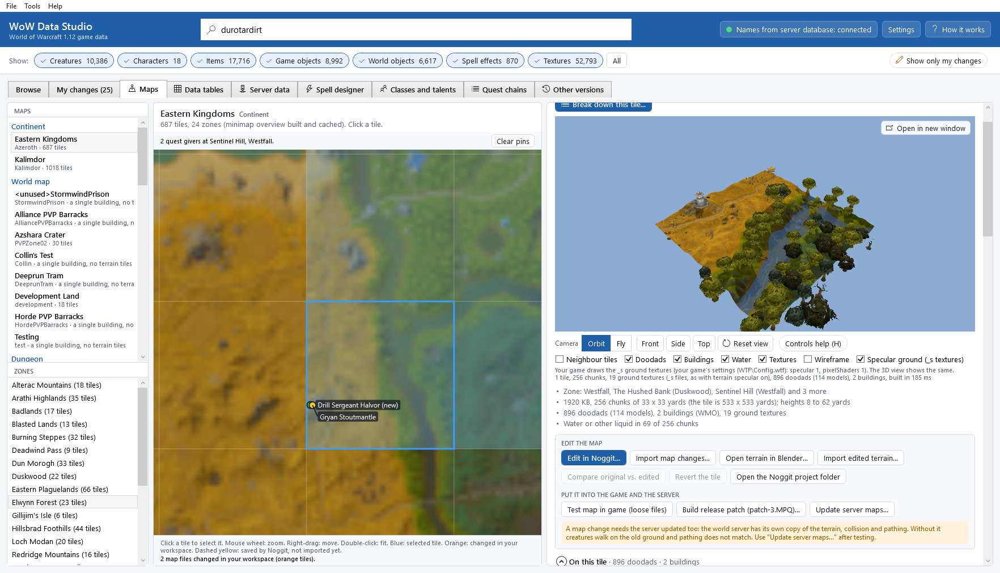
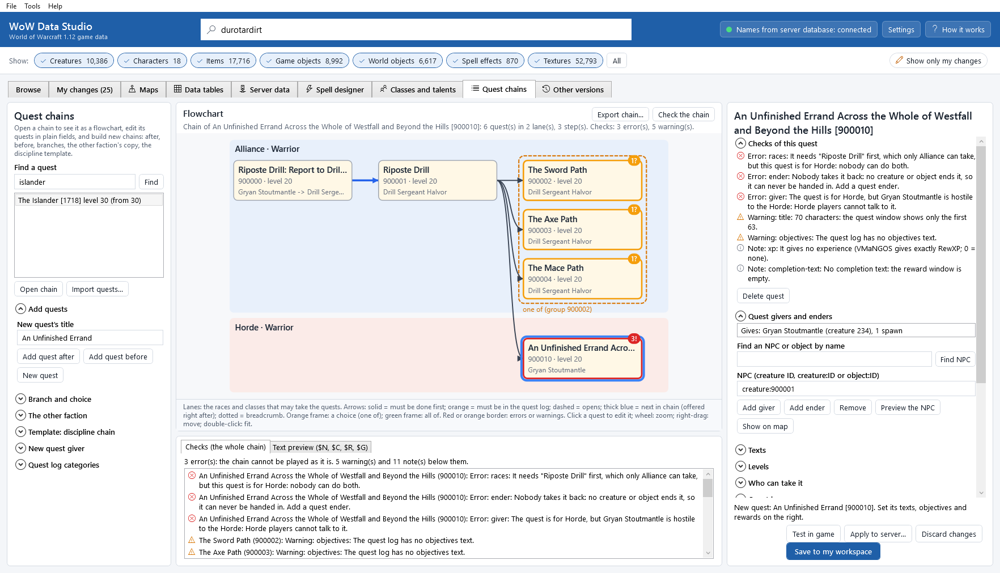
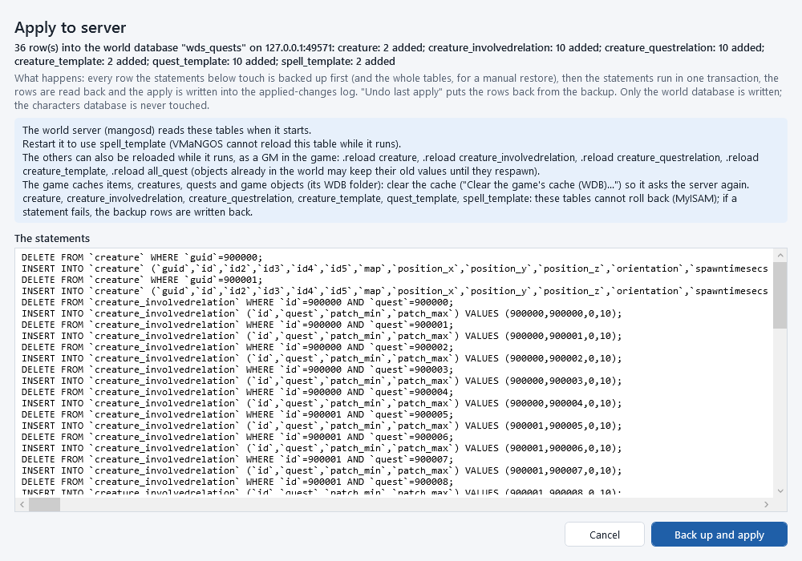
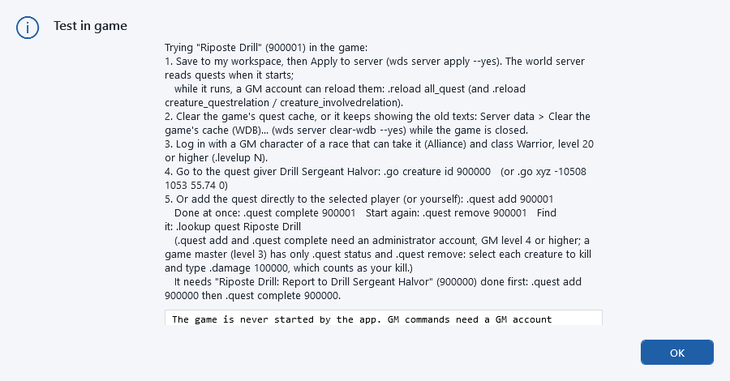
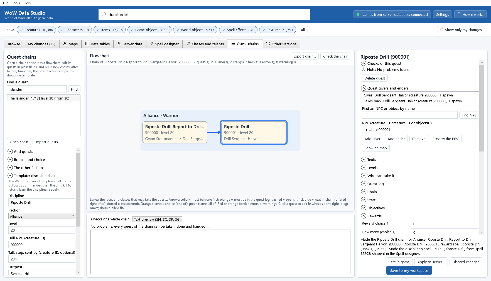
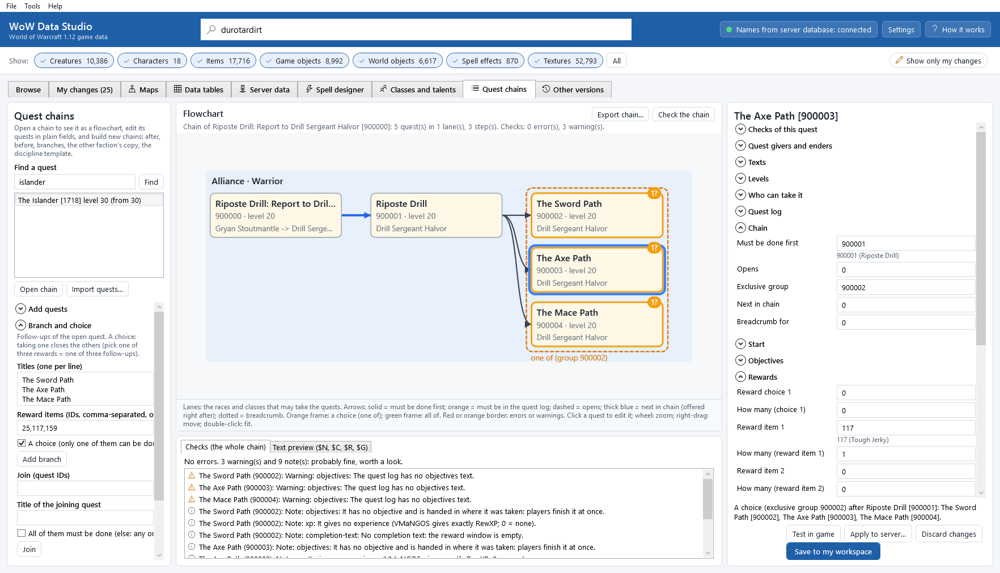

# The quest-chain designer

The **Quest chains** tab shows a quest chain as a flowchart and lets you build new chains without writing a database
row by hand: the quests in order, who gives and takes them, what they ask, what they give, the choices between them,
and the same chain for the other faction. A check tells you in plain words what would stop a player: a quest nobody
offers, a circle of quests that wait for each other, an item nothing drops, an NPC the faction cannot talk to, a text
too long for the game.

Quests live on your server (VMaNGOS's `quest_template` and the tables around it): the game only keeps a copy of what
the server told it (`WDB\questcache.wdb`). So the designer needs the **server database** (see
[Settings](settings.md)); everything it makes goes into your workspace as **one change** that you apply to the server
when you are ready, as every [Server data](server-data.md) edit. The few game tables a quest chain can need (quest log
categories, exploration points, reward spells) are saved in the same change.



## Open it

* **Tools > Quest chains**, or the **Quest chains** tab.
* Without the server database the tab says so in red under **Flowchart**: turn it on and test it in
  [Settings](settings.md) (Server database).

The tab has three parts: on the left you find quests and build chains; in the middle is the **Flowchart** with
**Checks (the whole chain)** and **Text preview ($N, $C, $R, $G)** under it; on the right is the quest editor.

## Open an existing chain

1. Under **Find a quest**, type words of a title (`islander`, `whirlwind`, `dreadsteed`) or a quest ID (`1718`) and
   press <kbd>Enter</kbd> or **Find**.
2. Select the quest and click **Open chain** (or double-click it).

The designer follows every link between quests, both ways, and draws the whole chain:

* *Lanes*: one band per group of players who may take the quests: *Alliance · Warrior*, *Horde*, *Both factions ·
  Warlock*, *Orc · Warrior*... (blue for the Alliance, red for the Horde, grey for both).
* *Steps*: left to right in the order the quests are done; a quest is one step after the quests it needs.
* *Arrows*:

| Arrow | Means | Column of `quest_template` |
|---|---|---|
| solid dark | must be done (handed in) first | **Must be done first** (`PrevQuestId`) |
| solid orange | must be in the quest log (taken, not done) | a negative **Must be done first** |
| dashed | this quest opens the next one | **Opens** (`NextQuestId`) |
| thick blue | the NPC offers the next quest right after you hand this one in | **Next in chain** (`NextQuestInChain`) |
| dotted violet | a breadcrumb: it only leads to that quest and closes when that one is taken | **Breadcrumb for** (`BreadcrumbForQuestId`) |

* *Frames*: an orange dashed frame is a choice, *one of* (an **Exclusive group** with a positive number: taking one
  closes the others); a green dashed frame is *all of* (a negative group: every one must be done before the quest
  they open).
* *Boxes*: the title, the ID, the level, who gives and who takes it back. A red border (and a badge with "!") means
  errors, an orange one ("?") warnings, a pale yellow box a quest you changed.

Click a quest to edit it on the right. The mouse wheel zooms, dragging with the right mouse button moves the chart,
a double-click on the background fits the whole chain.

*Examples in the game's own data:*

* *The Islander* (1718): the Warrior's Whirlwind weapon. Klannoc Macleod, Bath'rah the Windwatcher, Cyclonian; the
  orange arrow shows that *Essence of the Exile* needs *Cyclonian* in the quest log.
* *Speak with Ruga* (1823): the Horde warrior's Brutal armour chain, with its three breadcrumbs to Ula'elek, Orm
  Stonehoof and Velora Nitely.
* *Mor'zul Bloodbringer* (7562): the Warlock's Dreadsteed. Three quests in an *all of* group (*Bell of Dethmoora*,
  *Wheel of the Black March*, *Doomsday Candle*) open *Arcanite*.



## The quest editor

The right side shows the selected quest: its **Checks of this quest** first, then **Quest givers and enders**, then
the quest's fields in groups (click a group's name to open it), then **Objectives in words**, **Drop sources**,
**Speak to an NPC**, **Explore a place** and **Reward spell**.

Type a value and click elsewhere (or press <kbd>Ctrl</kbd>+<kbd>Enter</kbd>); a choice or a checkbox takes effect at
once. A value the server cannot take is refused with the reason in the status line, and nothing changes. Every field
has a tooltip with what it does, the column it edits and its name on the command line.

| Group | What is in it |
|---|---|
| **Texts** | **Title**, **Details (when offered)**, **Objectives (quest log)**, **Progress text (not done yet)**, **Completion text (reward)**, **End text**, **Objective 1 text** ... (the line of an objective in the log instead of "<creature> slain") |
| **Levels** | **Quest level** (its colour and experience), **Minimum level**, **Maximum level** |
| **Who can take it** | **Classes** and **Races** as checkboxes (or typed: `Warrior`, `Alliance`, `Horde`, `Orc, Troll`, `any`), reputation needed, a skill, an extra condition |
| **Quest log** | **Quest log category** (a zone, or a category: `sort:Warrior`), **Kind** (Group, Raid...), **Quest flags** (*Sharable*, *Party accept*...), **Repeatable / completed by an event**, **Method**, **Time limit** |
| **Chain** | **Must be done first**, **Opens**, **Exclusive group**, **Next in chain**, **Breadcrumb for** |
| **Start** | an item or a spell given when the quest is accepted, the scripts at the start and the end |
| **Objectives** | **Kill or use 1** ... 4 (`creature:122` or `object:1618`) with how many and a spell to cast on it instead, **Collect item 1** ... 4 with how many, a reputation to reach |
| **Rewards** | **Reward choice 1** ... 6 (pick one), **Reward item 1** ... 4, **Money** (`1g 50s`), **Experience**, reputation 1-5, **Reward spell (shown)** and **Spell cast on the player** |

Numbered slots show the used ones and the first empty one; a slot appears when you fill the one before it. Under an
ID field the name of what it points at is shown (*122 (Defias Highwayman)*).

*Experience:* VMaNGOS gives exactly **Experience** (`RewXP`): 0 means no experience at all (less for players 6 or more
levels above the quest). *Titles:* the 1.12 game and VMaNGOS have no quest title rewards; the hero titles of the
design documents are a game feature still to come.

### Quest givers and enders

**Quest givers and enders** lists who offers the quest (*Gives*) and who takes it back (*Takes back*), with how often
each is placed in the world. To pick an NPC, type a name under **Find an NPC or object by name** (`thork`, `gryan`) and
click **Find NPC**: creatures that are quest givers come first, then the others and game objects, each with how often it
is placed in the world; select one. Or type it (`234`, `creature:234` or `object:1618`). Then click **Add giver** or
**Add ender**; select one in the list and click **Remove**. A creature that becomes a quest giver gets the *Quest giver* flag
(`npc_flags` 0x2): without it players cannot talk to it about quests.

* **Preview the NPC** shows the selected creature's model in 3D.
* **Show on map** switches to the [Maps](maps-and-terrain.md) tab and marks where the selected NPC (or every giver and
  ender) stands; **Clear pins** removes the marks.

### Objectives: kill, collect, speak, explore

* **Kill or use**: a creature to kill, or an object to use (`object:<ID>`), and how many. With **Cast on it instead**
  the player casts that spell on it.
* **Collect item**: the item and how many. **Drop sources** tells where it comes from: type the item's ID and click
  **Show drop sources** (creatures' loot, chests, containers, pickpocketing, skinning, fishing, vendors, quests that
  give it, spells that make it). To make a creature drop it, type the creature and the chance and click **Add drop
  source**; with **Only while on the quest (quest drop)** it drops only for players who need it. A creature without a
  loot table gets one. **Open in the loot editor** shows the selected source's loot rows in the [Server
  data](server-data.md) tab (save first).
* **Speak to an NPC**: type the NPC, the objective slot and the option's text, then **Add speak-to objective**. The NPC
  gets a talk option that is only shown while the quest is in the player's log; choosing it completes the objective
  (VMaNGOS gives the "talked to" credit when such an option closes the window). An NPC without a talk menu gets one
  with a greeting.
* **Explore a place**: an existing area trigger (its ID), or a new one: type the map, x, y and radius (or **Pick on
  the map**) and click **Add explore objective**. A new trigger is added to the game's `AreaTrigger.dbc` (the game
  tells the server when you enter it) and to the server's `areatrigger_template`; the quest gets the *Explore or event*
  flag. A trigger completes one quest only.
* *Escorts and events:* *Party accept* (in **Quest flags**) and *Explore or event* (in **Repeatable / completed by an
  event**) are the flags VMaNGOS uses; the escort itself needs a creature script on the server.

**Objectives in words** sums them up ("Defias Highwayman slain: 8", "Speak with Captain Danuvin").

### Rewards and the reward spell

Items, choices, money, experience and reputation are fields of **Rewards**. A **Reward spell** the player learns: type
its ID, keep **The player learns it (else: it is cast on the player)** ticked and click **Set reward spell**. The
quest window shows the spell; the quest casts its *learn* spell, which the designer makes with the
[Spell designer](spell-designer.md) when the spell has none (in the game's `Spell.dbc` and the server's
`spell_template`, in step). **Open in the Spell designer** opens the spell there to shape it. The spell and its learn
spell must have IDs of at most 40000: the VMaNGOS server casts no spell above 40000, so the quest would teach nothing.
**Set reward spell** refuses such a spell and **Check the chain** shows an error (fix it with **Change ID** in the
[Spell designer](spell-designer.md#spell-ids-what-the-game-and-the-server-accept)).

### The text preview

**Text preview ($N, $C, $R, $G)** (under the flowchart) shows the quest's texts as the game shows them to a player:
type a name, pick a race and a class, tick **Female ($G male:female;)**. The tokens are filled in exactly as the 1.12
client does (its own code, read in our decompile: `ChatText_ExpandDollarTokens`):

| Token | Becomes |
|---|---|
| `$N` | the player's name |
| `$R` / `$r` | the race (`$r` in lower case) |
| `$C` / `$c` | the class (`$c` in lower case) |
| `$Gbrother:sister;` | the word for the character's sex (spaces around the words are dropped) |
| `$B` | a new line |

Any other letter after a `$` is printed as it is (the checks warn about it).



## Build a chain

All new quests get the first free ID of your **Custom ID range** ([Settings](settings.md); 900000-999999 by default);
spells made for them (a reward spell, its learn spell) get IDs of the **Spell ID range** (35000-39999 by default).

* **Add quests**: type the **New quest's title**, then
  * **Add quest after**: the new quest needs the open one done; the NPC that takes the open one back offers it next
    (**Next in chain**) and takes it back too. A quest that came after the open one now comes after the new one.
  * **Add quest before**: the open quest now needs the new one first; the NPC that offers the open quest offers the
    new one before it.
  * **New quest**: a quest on its own, with the open quest's levels, races and classes.
* **Branch and choice**: follow-ups of the open quest. Type the **Titles (one per line)** and, if you like, their
  reward items. With **A choice (only one of them can be done)** they get one exclusive group: taking one closes the
  others. Click **Add branch**.
* **Join**: a quest after several others. Type their IDs (**Join (quest IDs)**) and the **Title of the joining
  quest**; with **All of them must be done (else: any one)** it waits for all of them (an *all of* group), else any one
  is enough (the branches of a choice). Click **Join**.
* **Delete quest** (under the quest's checks) removes the quest with its givers, enders and links; the quests around
  it are linked to each other.

### The same chain for the other faction

**The other faction** copies the open quest's whole chain, with new IDs and the links between the copies:

1. Choose **For** (*Horde* or *Alliance*).
2. Type the **Swaps (one per line: old=new)**: `900000=900001` swaps creature 900000 for 900001 (as giver, ender or
   objective); `object:a=b`, `item:a=b`, `zone:40=17` (the quest log's zone), `faction:72=76` (reputation),
   `spell:a=b`, and `text:Sentinel Hill=the Crossroads` swaps words of the texts.
3. Click **Duplicate for the other faction**.

What is not swapped stays as it is; the checks tell you when the new faction cannot talk to an NPC that stayed.
Exclusive groups get new numbers. An explore objective is not copied (a trigger completes one quest only).



### The discipline template

**Template: discipline chain** makes the chain the Warrior's Stance Disciplines use (VANILLA_HERO_PROGRESSION.md, W.3
and W.4): *talk -> kill N -> return -> learn the discipline*:

* a talk step (**Talk step: sent by**): the outpost's commander sends the player to the drill NPC;
* the drill: given and taken back by the **Drill NPC**, fight the creature N times, return;
* the reward: the discipline's spell, learned (an existing spell, or a clone of the second box's spell made with the
  Spell designer), in the quest log under *Warrior*.

The texts are filled in with the names and `$N` / `$c`; change them in **Texts**.

### New quest givers

**New quest giver** makes an NPC that looks like an existing creature (**Look like (creature ID)**: its model,
faction and level) with its own name and title, the *Quest giver* flag and none of the copied creature's vendor,
trainer, loot or script parts, with a custom ID. Type the map, x and y, or click **Pick on the map** and click the
place on the Maps tab's map (**Cancel picking** stops); the height comes from the terrain. Click **Make the quest
giver**: the NPC box of the editor now holds it, ready for **Add giver** / **Add ender**. **Place here** places another
spawn of that NPC.



### Quest log categories

The quest log lists class quests under a category (*Warrior*, *Warlock*...: the game's `QuestSort.dbc`). **New quest
log category** adds one; use it as `sort:<name>` in **Quest log category**. The server reads its own copy of
`QuestSort.dbc`: copy it with **Tools > Copy tables to the server...** after testing (the save reminds you).

## The checks

**Checks (the whole chain)** (under the flowchart) and **Checks of this quest** say in plain words what would stop a
player (errors) and what is probably a mistake (warnings, notes). Click a problem to open its quest. **Check the
chain** lays the chain out again and checks it.

| Check | Examples |
|---|---|
| *Unreachable quests and cycles* | nobody offers the quest; a quest it needs first does not exist, can only be taken by the other faction or class, is in the same choice group, is a breadcrumb, or cannot be done itself; quests that each wait for the other (a circle) |
| *Level gaps* | the minimum level is more than 5 above the level of the quest before it; the minimum level is above the quest's level (it is grey before anyone can take it); levels above 60; a maximum level below the minimum |
| *Missing NPC relations* | nobody takes it back; a giver without the *Quest giver* flag; a giver or ender that is not placed anywhere; an object that is not a quest-giver object |
| *Objectives that can't be completed* | an item nothing gives (no loot, chest, vendor, quest or spell); an item only from creatures that are not placed; a creature or object that does not exist or is not placed (only a script could summon it); a target the faction cannot attack (friendly); an *Explore or event* quest nothing completes; counts of 0; more of a unique item than a player can carry; a "speak to" on a quest with the event flag |
| *Faction mismatches* | the quest is for the Horde but every giver is hostile to the Horde; a Horde Paladin or an Alliance Shaman (no such race and class in the game); a quest that needs a quest only the other faction can take |
| *The game's text limits* | the quest window shows 63 characters of a title and 1023 of a text (after `$N`, `$C`, `$R` are filled in); the game's quest cache keeps 511 bytes of a title, 2047 of the objectives and the details, 255 of an objective's text: a longer text overwrites the rest of the quest in the game's memory, so the designer refuses to save it |

Hostility comes from the server's faction templates; an NPC of a faction with reputation (Stormwind, Orgrimmar...) is
hostile when a faction's races start at *Hostile* or *Hated* with it. Quests the game itself has (with races "any")
often have givers of one faction: that is only a note ("Only the Horde can take it").



## Save, apply, test

1. Click **Save to my workspace** (<kbd>Ctrl</kbd>+<kbd>S</kbd>). Everything goes into [My changes](my-changes.md) as
   one change: the server rows (`quest_template`, `creature_questrelation`, `creature_involvedrelation`, the NPCs, their
   spawns, loot rows, talk menus, area triggers) and the game tables (`Spell.dbc`, `QuestSort.dbc`,
   `AreaTrigger.dbc`). **Discard changes** throws away what you have not saved.
2. **Apply to server...** writes the server rows into the world database, backed up and logged; **Undo last apply** in
   the [Server data](server-data.md) tab puts them back. **Export SQL patch...** there writes the same as an SQL file.
   The world server reads quests when it starts; while it runs a GM can type `.reload all_quest`.
3. The game keeps old quest texts in its cache: **Clear the game's cache (WDB)...** (Server data tab) with the game
   closed.
4. The game tables go into the game with **Test all in game (install as loose files)** or the release patch
   ([Testing changes in the game](testing-in-game.md)); copy `QuestSort.dbc` to the server when the save said so.
5. **Test in game** explains how to try the quest: log in with a GM character, `.go creature id <giver>` (or `.go xyz`
   to its spawn) to stand next to the giver, `.quest add <quest>` to take it at once, `.quest complete <quest>` to
   finish it, `.quest remove <quest>` to start again. The app never starts the game.
   On VMaNGOS `.quest add` and `.quest complete` need an administrator account (GM level 4 or higher); a game
   master (level 3) has only `.quest status` and `.quest remove`: select each creature the quest asks for and type
   `.damage 100000` (it counts as your kill).





## Worked example: open the Whirlwind weapon chain

1. **Find a quest**: `islander`, **Find**, then **Open chain**.
2. The flowchart shows one lane, *Both factions · Warrior*, and six steps: *The Islander* -> *The Affray* -> *The
   Windwatcher* -> *Cyclonian* -> *The Summoning* -> *Whirlwind Weapon*, with *Essence of the Exile* under *The
   Summoning* (its orange arrow: it needs *Cyclonian* in the quest log).
3. Click *The Affray*: **Checks of this quest** warns that *Big Will is not spawned anywhere*: he is summoned by a
   script when the fight starts, so this warning is expected.
4. **Text preview ($N, $C, $R, $G)**: type your character's name to read the texts as you will see them.

## Worked example: the Warrior's "Riposte Drill" for both factions

The Riposte Drill is a Battle-stance discipline earned at level 20: for the Alliance in a drill at Sentinel Hill
(Westfall), for the Horde in a challenge at the Crossroads (The Barrens) (VANILLA_HERO_PROGRESSION.md, W.4).

1. **New quest giver**: **Name** `Drill Sergeant Halvor`, title `Drill Sergeant`, **Look like (creature ID)** `821`
   (Captain Danuvin of Sentinel Hill), **Map, x, y** `0`, `-10508`, `1053` (or **Pick on the map** in Westfall), then
   **Make the quest giver**: creature 900000, next to Gryan Stoutmantle.
2. The same for the Horde: `Champion Gorrak`, title `Crossroads Champion`, looks like `3429` (Thork), map `1`, `-470`,
   `-2620`: creature 900001.
3. **Template: discipline chain**: **Discipline** `Riposte Drill`, **Faction** *Alliance*, **Level** `20`, **Drill NPC
   (creature ID)** `900000`, **Talk step: sent by (creature ID, optional)** `234` (Gryan Stoutmantle), **Outpost**
   `Sentinel Hill`, **Fight (creature ID) and how many** `122` (Defias Highwayman) and `8`, the spell: clone from
   `12295`, **Experience** `1450`. Click **Make the chain**: *Riposte Drill: Report to Drill Sergeant Halvor* (900000)
   -> *Riposte Drill* (900001), and the spell *Riposte Drill* with its learn spell. The checks find no problem.
4. Shape the spell in the Spell designer (**Open in the Spell designer** under **Reward spell**): its effect, its
   description ("A dodged attack also makes your next Overpower cost no rage").
5. Select the talk step (900000) in the flowchart. **The other faction**: **For** *Horde*, **Swaps (one per line:
   old=new)**:

   ```
   900000=900001
   234=3429
   122=3258
   text:Sentinel Hill=the Crossroads
   text:Gryan Stoutmantle=Thork
   text:Defias Highwaymen=Bristleback Hunters
   ```

   then **Duplicate for the other faction**: a second chain (900002, 900003) in the *Horde · Warrior* lane, offered by
   Thork, with Champion Gorrak and Bristleback Hunters (The Barrens). No problems.
6. **Save to my workspace**.



The same on the command line:

```
wds quests npc "Drill Sergeant Halvor" --copy-from 821 --subname "Drill Sergeant" --map 0 --x -10508 --y 1053
wds quests npc "Champion Gorrak" --copy-from 3429 --subname "Crossroads Champion" --map 1 --x -470 --y -2620
wds quests template "Riposte Drill" --faction Alliance --giver 900000 --intro-from 234 --outpost "Sentinel Hill" --kill 122:8 --clone-spell 12295 --xp 1450
wds quests duplicate 900000 --faction Horde --swap 900000=900001 --swap 234=3429 --swap 122=3258 --swap "text:Sentinel Hill=the Crossroads"
wds quests chain 900000
wds quests check 900002
```

## Worked example: a reward choice that branches

Let the player choose the weapon path after the drill: three follow-ups, only one of which can be done.

1. Select *Riposte Drill* (900001) in the flowchart.
2. **Branch and choice**: **Titles (one per line)** `The Sword Path`, `The Axe Path`, `The Mace Path`; **Reward items
   (IDs, comma-separated, optional)** `25,117,159` (one item each); keep **A choice (only one of them can be done)**;
   **Add branch**.
3. The three quests share one step in an orange *one of* frame (exclusive group 900002, the first one's ID): taking one
   closes the other two.
4. To bring the paths together again: **Join (quest IDs)** `900002, 900003, 900004`, **Title of the joining quest**
   `Report Back`, leave **All of them must be done (else: any one)** unticked (only one path can be done), **Join**.



```
wds quests branch 900001 --titles "The Sword Path|The Axe Path|The Mace Path" --rewards 25,117,159
wds quests join 900002,900003,900004 --title "Report Back" --any
```

## Worked example: apply to the server and undo

1. **Save to my workspace**.
2. **Apply to server...**: the window lists every row that goes in (the quests, their givers and enders, the NPCs and
   their spawns, the spells); the server's tables are backed up first. Close the world server first, or `.reload
   all_quest` and `.reload creature_questrelation` after applying.
3. **Test in game**: the GM commands for the drill.
4. Not happy? **Undo last apply** in the [Server data](server-data.md) tab puts the server's rows back as they were.
   The edits stay in your workspace (revert them in [My changes](my-changes.md) to drop them).

```
wds server apply --yes
wds quests test-in-game 900001
wds server undo-apply --yes
```

## Good to know

* The checks follow what VMaNGOS does with the rows (`ObjectMgr::LoadQuests`, the prerequisite and exclusive-group
  rules of `Player::SatisfyQuest...`, the quest relations, `TalkedToCreature`) and what the 1.12 client can show
  (`QuestCache_Read`, `QuestFrame_*`).
* Several quests may name the same quest in **Opens**: any one of them done is enough, unless they share a negative
  exclusive group (then all of them).
* Translations (`locales_quest`) are not changed with the English texts; the designer reminds you when a quest you
  edit has them.
* Limits: [Known issues](known-issues.md#quest-chain-designer).

## Command line

`wds quests find`, `show`, `fields`, `chain`, `check`, `new`, `set`, `branch`, `join`, `giver`, `ender`, `objective`,
`talk`, `explore`, `reward`, `drops`, `npcs`, `npc`, `place`, `duplicate`, `template`, `preview`, `categories`, `export`,
`import`, `delete` and `test-in-game` do everything this tab does; see
[The command line](command-line.md#the-quest-chain-designer).
