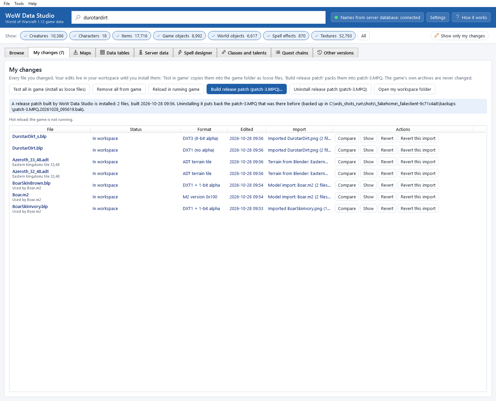
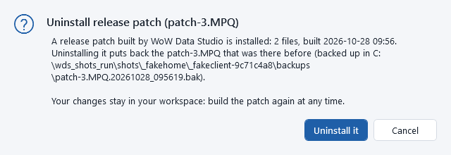

# Releasing your changes

When you are happy with your changes, pack them into one archive file, `patch-3.MPQ`. The game loads it on top of
its own archives, so this one file carries all your changes. It is the file you keep, share with other players, or put
on your server's download page. The game's own archives are never changed.

## Build the release patch

1. Close the game (it keeps `patch-3.MPQ` open while it runs, so the file could not be replaced).
2. Click **4. Build release patch (patch-3.MPQ)...** in the action bar, or **Build release patch (patch-3.MPQ)...** in
   the **My changes** tab or the **File** menu.
3. The window **Build release patch (patch-3.MPQ)** lists what will go in: *Included: 3 files*, with each file's game
   path, format and the time you edited it. Every change in your workspace is included.

   

4. **Also install it into the game:** is ticked by default, with the destination, for example
   `C:\...\Client\Data\patch-3.MPQ`. Untick it to build the file only (for example to share it without changing your
   own game). The line below says what is in the game now: nothing yet, your earlier release patch, or a `patch-3.MPQ`
   that WoW Data Studio did not create (it is backed up first, and "Uninstall release patch" puts it back).
5. Click **Build patch-3.MPQ** (or **Cancel**).

The app builds the archive, reads it back to check every file in it, and then (if ticked) copies it into the game's
`Data` folder. **Release patch built** says:

* how many files it holds;
* *Saved at:* where the built file is kept (always, even when it is also installed): the `build` folder of your app
  data, see [where the app keeps its files](troubleshooting.md#where-the-app-keeps-its-files);
* *Installed into the game:* where it was installed;
* *The previous patch-3.MPQ was backed up to:* when there was one already (see [Backups](#backups)).

Windows Explorer then opens with the file selected. Restart the game to load it.

*While the game runs:* with hot reload switched on for the game folder (see
[Testing in the game](testing-in-game.md#reload-in-the-running-game-hot-reload)), the running game lets go of its
`patch-3.MPQ`, the new one is installed, and the game opens it again and reloads the changed files: the message then says
*The running game was updated (hot reload)* and what is live now. Without hot reload, a running game keeps the file
locked and the install fails (*Is the game running?*): close the game first.

If you also have loose files installed, the message reminds you that loose files win over every archive: click
**Remove all from game** in **My changes** to test the archive on its own.

## What is in patch-3.MPQ

Server edits ([Server data](server-data.md)) are not game files: the release patch leaves them out. They go to your
server with **Export SQL patch...** (an SQL file you can also give to other server owners) or **Apply to server...**.

* every file of your workspace (your kept edits), each under its game path, for example
  `Creature\Boar\BoarSkinIvory.blp`, in the same format the game's original has;
* a list of the file names (the archive's `(listfile)`) and the standard check data (`(attributes)`).

Nothing else: no original game files, no settings, nothing from your computer. A change you reverted is not included
the next time you build.

*Data tables* (`DBFilesClient\...dbc` files you saved in the **Data tables** tab) go into the same archive. The window
**Build release patch (patch-3.MPQ)** reminds you which of them your server reads too: copy those with
**Copy to server...**, and edit the database tables of the ones the server takes from its database (see
[Data tables](dbc-editor.md#which-tables-the-server-reads)). A player with your patch only needs the patch; your server
needs the server side.

*Map changes* (`World\Maps\...` files) go into the same archive. Anyone who plays with your patch on a server also
needs that server's map data updated, or creatures walk on the old ground: see
[Maps and terrain](maps-and-terrain.md#update-server-maps). The server tools read your installed `patch-3.MPQ`, so build
and install it before updating the server.

## After more changes

Build again. In **My changes**, a file whose newest edit is not in the built archive yet says
**in patch-3.MPQ (older version - rebuild)**. Every build makes a complete new `patch-3.MPQ` with all current changes.

## Sharing it

1. Give the other player your `patch-3.MPQ` (from the *Saved at* folder, or from your game's `Data` folder).
2. They close their game, copy it into their game's `Data` folder (next to `patch.MPQ` and `patch-2.MPQ`), and start
   the game.
3. To remove it, they delete `Data\patch-3.MPQ`.

Things to know:

* It needs the same game version, 1.12.1 (build 5875).
* Texture changes only affect what players see; the game server does not need any change. Table changes can need a
  server change too (see [Data tables](dbc-editor.md#which-tables-the-server-reads)).
* A player has only one `patch-3.MPQ`. If they already use another mod with that name, the two cannot be used together
  as they are.
* The loose-file mode is *not* needed for a patch archive: every 1.12.1 client loads `Data\patch-3.MPQ`.

## Backups

When the app installs a `patch-3.MPQ` and one is already in the game's `Data` folder, it first copies the old one to
its `backups` folder, as `patch-3.MPQ.<date>_<time>.bak` (an older backup is never overwritten). The app remembers
which backup holds the `patch-3.MPQ` that was there *before its first install* (another mod's, for example): that is
the one **Uninstall release patch (patch-3.MPQ)** puts back. To restore any backup by hand, close the game and copy it
over `Data\patch-3.MPQ` (renamed back to `patch-3.MPQ`).

## Removing your patch from the game

**My changes** shows what is installed, for example *A release patch built by WoW Data Studio is installed: 2 files,
built 2026-10-11 01:17.*, and has the button **Uninstall release patch (patch-3.MPQ)**:

1. Close the game.
2. Click **Uninstall release patch (patch-3.MPQ)**. The question says what will happen:

   

   * a release patch the app built (it checks the file's checksum): **Uninstall it** removes it from `Data`, and puts
     back the `patch-3.MPQ` that was there before the app's first install, if there was one;
   * a `patch-3.MPQ` the app did *not* create, or one it cannot prove it built (built by version 0.6.0 or older and
     changed since): the question is a warning, *This patch-3.MPQ may not be yours*. It may belong to another mod or to
     your server. **Move it out of the game** does not delete it: it is moved into the `backups` folder, from where you
     can put it back. **Cancel** leaves it alone.
3. Restart the game (with hot reload, the running game lets go of the patch first and reloads its files afterwards, as
   when you install it).

Your changes stay in your workspace: build the patch again at any time. Reverting a change in the app does *not*
change an installed `patch-3.MPQ`: build it again, or uninstall it. **Remove all from game** removes loose files only;
it reminds you of the installed patch. See [Safety and undoing everything](safety.md).

## If the build fails

| Message | What to do |
|---|---|
| *Could not write ...patch-3.MPQ. Is the game running? Close it and try again.* | Close the game completely and build again (or switch on hot reload for the game folder: then the running game lets go of the file itself). |
| *The running game could not let go of patch-3.MPQ: ...* | Hot reload: the game was reading a file of the patch at that moment. Nothing was changed; try again in a moment, or close the game. |
| *The workspace copy of ... is missing; revert it and import it again.* | A file was deleted from the workspace folder by hand. Revert that change in **My changes** and import the PNG again. |
| *... would not load in the game: ...* | A workspace file is broken. Revert it and import it again. |
| **Nothing to build** | You have no changes yet. |

## Command line

`wds changes build-patch` builds `patch-3.MPQ`, `wds changes build-patch --install --yes` also installs it (into a running game too, with hot reload), `wds changes patch-state` says what is installed and `wds changes uninstall-patch --yes` uninstalls it (`--force` for a `patch-3.MPQ` the app did not create: it is moved to the backups). See [The command line](command-line.md#my-changes-testing-and-releasing).
