# Server data (the world database)

Items, creatures, quests, loot, vendors, trainers and most spell numbers are not in the game's files: your server
keeps them in its *world database* (VMaNGOS: the MySQL database `mangos`). The game only shows what the server sends it.
The **Server data** tab shows that database in friendly views (an item with its vendors and where it drops, a creature
with its spawns and loot, a quest with the NPCs that start and end it...), lets you edit it with checks and undo, puts
both sides next to each other where the game has the same data, and delivers your edits to the server: as an SQL file,
or applied directly, backed up and undoable.

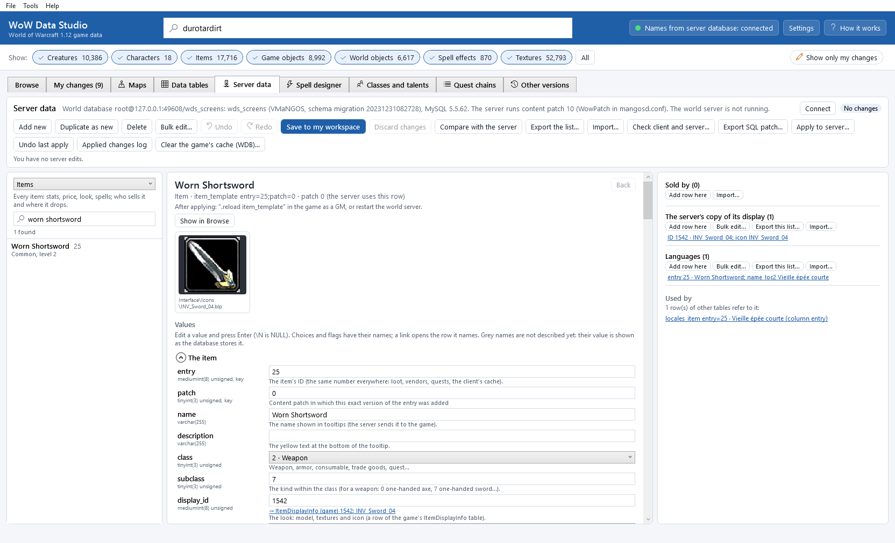

## Before you start

* The server's database must be running (in the VMaNGOS repack: *Start MySQL.bat*). The world server itself (`mangosd`)
  does not need to run.
* The connection is the one in **File > Settings...** (*Names from the server database*): **Server**, **Port**,
  **User**, **Password**, **World database** (usually `mangos`). The same connection gives the names in the Browse tab.
* **Content patch of the server** (Settings): VMaNGOS keeps several versions of many rows, one per content patch (1.2
  to 1.12). The app shows which row your server uses. Empty means: as the server's `mangosd.conf` says (`WowPatch`),
  else 10 (1.12).
* **Custom ID range** (Settings): new items, creatures, quests... get the first free ID of this range (by default
  900000-999999), far from the IDs of the game's own content.

Click the **Server data** tab (or **Tools > Server data (world database)**). The top line says what it is connected to
(*World database root@127.0.0.1:3306/mangos: mangos (VMaNGOS, schema migration ...)*), which content patch the server
runs and whether the world server is running. **Connect** connects again (after you changed the settings or started
the database). Press <kbd>F1</kbd> in the tab to open this chapter.

The tab has three parts: the list (left), the values of what you picked (middle), and what belongs to it (right).

## Find things

Pick a view in the list at the top left:

| View | What it shows |
|---|---|
| Items | every item (`item_template`): stats, price, look, spells; who sells it and where it drops |
| Creatures (NPCs) | every creature and NPC (`creature_template`): level, faction, looks, spawns, loot, what it sells and trains, its quests and gossip |
| Quests | every quest (`quest_template`): texts, levels, objectives, rewards, who starts and ends it, its chain |
| Game objects | chests, doors, herbs, ore, signs, mailboxes (`gameobject_template`): spawns, loot, quests |
| Spells | every spell as the server computes it (`spell_template`), next to the game's Spell.dbc row |
| Loot tables | creature, game object, item, pickpocketing, skinning, fishing, disenchanting, mail and reference loot |
| Vendors | creatures that sell items, with their lists (`npc_vendor` and the shared vendor templates) |
| Trainers | creatures that teach spells, with their lists (`npc_trainer` and the shared trainer templates) |
| Areas, Maps, Flight paths, Factions, Faction templates | the server's own copies of the game's tables (AreaTable, Map, TaxiNodes, Faction, FactionTemplate) |
| Languages (locales) | names and texts in the other languages of the game |
| All tables | every table of the world database, row by row |

For **Loot tables**, **Languages (locales)** and **All tables**, the **Table** box below picks the table. Type in
**Search by name or ID...**: a name (all words must appear) or an ID. The list shows one line per thing; when VMaNGOS
has several versions of it, the line says so (*2 versions*) and the row the server uses is the one opened.

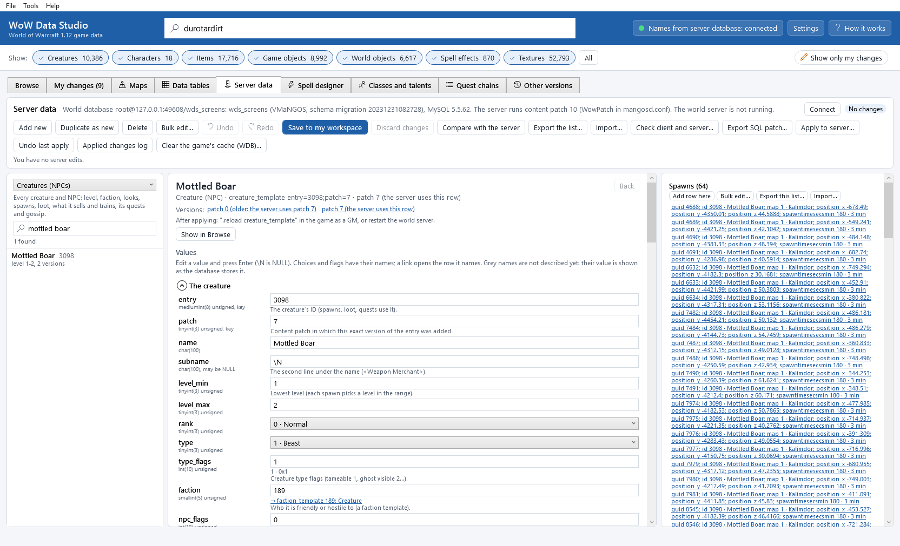

## What you see

*The values* (middle): every column of the row, grouped (for an item: *The item*, *Price*, *Requirements*, *Stats*,
*Weapon*, *Spells*...). Under each name: its SQL type (`tinyint(3) unsigned`, `varchar(255)`...). Next to it:

* a box with the value; *choices* as a list with their names (**quality**: *3 · Rare (blue)*); *flags* with a tick box
  per bit (**npc_flags**: *Vendor*, *Quest giver*...); *money* also as gold, silver and copper; times in seconds;
* *links* as a blue line that opens what they name: an item, a creature, a quest, a spell, a faction... on the server,
  or a row of the game's tables (*→ ItemDisplayInfo (game) 1542: INV_Sword_04*) in the **Data tables** tab. A red link
  names something that does not exist;
* a hint saying what the value does;
* columns WoW Data Studio does not describe yet are shown as the database stores them, with a grey name and the hint
  *WoW Data Studio does not describe this column yet*.

The top of the values says what it is, its table and key (*item_template entry=25;patch=0*) and which version of the
row it is (*patch 0 (the server uses this row)*); **Versions** lists the other versions. Below: what the server needs
after you change this table (*".reload item_template" in the game as a GM, or restart the world server*). Items and
spells show their icon (from the game's tables). **Show in Browse** opens an item, creature or game object in the
**Browse** tab, with its 3D model, textures and Used in game.

*What belongs to it* (right): the lists of related rows: *Spawns*, *Loot when killed*, *Skinning loot*, *Sells*,
*Trains*, *Starts quests*, *Ends quests*, *Equipment*, *Gossip*, *The server's facts about its looks*, *Languages* for a
creature; *Sold by*, *Drops from: ... loot*, *Contents when opened*, *The server's copy of its display* for an item;
*Started by creatures*, *Ended by creatures*, *Comes before this one*, *Opened by this one* for a quest... Click a row to
open it (**Back** returns). A list shows a note when something does not fit: *It has no Vendor flag (npc_flags 0x4):
players cannot open its shop.*

**Used by** lists every row of every table that refers to it (for an item: vendors, loot, quests, creature equipment,
spells that create it...).

**In the game (client)**: for a spell, an area, a map, a flight point, a faction or a faction template, the game's row
of the same data next to the server's (server value, game value), the different ones first and marked. See
[Client and server](#client-and-server).

## Edit

Change a value in its box and press <kbd>Enter</kbd> (or pick a choice, tick a flag). Every value is checked first:

* its SQL type: whole numbers in the column's range (*300 does not fit in required_level (tinyint(3) unsigned: 0 to
  255).*), decimal numbers with a dot, texts not longer than the column, NULL only where it is allowed (`\N` means
  NULL), characters the column can store;
* choices and flags can be typed by name (`Rare`, `Vendor|Repairs items`), money as `1g 20s 5c`;
* links must point at something that exists (*Spell 16777000 does not exist on the server.*); a choice that is not a
  known value is accepted with a warning;
* the rules VMaNGOS applies when it loads the data: levels (*level_min is above level_max*), looks the game does not
  have (*Display ... is not in the game's CreatureDisplayInfo: VMaNGOS removes it at start ("can crash client")*), loot
  chances (-100 to 100) and counts (*mincountOrRef 0: VMaNGOS skips the row*), quest objectives without a count, patch
  ranges (0 to 10)... Rules that need two values (a level range) are warnings while you edit and are checked when you
  save.

A refused value is not stored; the bottom line says why in red. **Undo** / **Redo** (<kbd>Ctrl</kbd>+<kbd>Z</kbd> /
<kbd>Ctrl</kbd>+<kbd>Y</kbd>) take back every edit, one step each. The badge at the top right says whether you have
*Unsaved changes*, which are *Saved in your workspace*, or *No changes*. A row you changed says *You changed this row*.

* **Add new**: a new row of the view's table with the first free ID of your custom ID range; fill in its values.
* **Add row here** (in a list on the right): a new row of that list with its link already set (a new vendor item
  already has the vendor; a new spawn the creature).
* **Duplicate as new**: a copy of the shown row with a free ID of your custom ID range.
* **Delete**: deletes the shown row; you are told first what refers to it and would point at nothing.
* **Bulk edit...**: set, add to or multiply one column of every row of the list (on the left, or of a list on the
  right). Every new value is checked first; if one is not allowed, nothing changes. One undo step.

Changing a value of a row's key (an item's patch, a loot row's item) moves the row to the new key.

## Save into your workspace

**Save to my workspace** (<kbd>Ctrl</kbd>+<kbd>S</kbd>) shows every row you changed, the server's value next to yours,
and then saves. Your server edits are kept like your other edits: one file per table
(`ServerData\mangos\item_template.json` in your workspace), listed in **My changes** with the format *server table* and
the status *not applied to the server yet*. There **Compare** shows the rows (the server's and yours), **Show** opens
the table here, **Revert** throws the edits of the table away. Saving a row back to the server's values removes it from
your edits. **Discard changes** throws away what you have not saved. **Compare with the server** shows every row you
changed, saved or not.

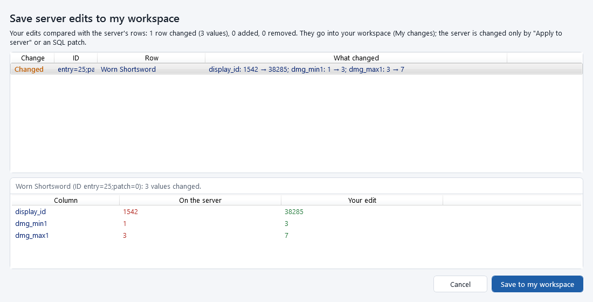

Nothing reaches the server yet. Server edits are never put into `patch-3.MPQ` or the game folder: they go to the server
in one of the two ways below.

## Deliver to the server

### Export an SQL patch

**Export SQL patch...** writes your saved server edits as an `.sql` file, plus its revert script next to it
(`<name>.revert.sql`). The header says what it is, when it was made, for which database and schema, which rows it
changes, and what the server needs afterwards. The patch can be run more than once: every row is first deleted by its
key and then written as it should be (an added row is added, a deleted one deleted), so running it twice gives the same
database. The revert script puts the rows back exactly as they were on the server before your edits. No host, user or
password is ever written into these files.

Run it on the *world* database with any MySQL tool, for example `mysql -u root -p mangos < my_patch.sql`, or give it to
the owner of another server.

### Apply to server

1. Save your edits (the app offers it when you have unsaved ones).
2. Click **Apply to server...**. The window shows:
   * how many rows go into which database, and how many of them are already as you want them;
   * when the world server is running: that applying is safe, but it keeps the old data until it restarts or reloads;
   * the rows that changed on the server since you started editing them (somebody else, a script, the server itself):
     applying would replace them; tick **Overwrite them with my edits** to do it anyway;
   * what the server needs afterwards (below);
   * *The statements*: exactly what will run.
3. Click **Back up and apply**. First every row the statements touch is saved (`backup_rows.sql`) and every affected
   table is dumped whole (`backup_tables.sql`), and both files are read back; then the statements run in one
   transaction; then every row is read back and compared with your edit. The result says where the backup is.

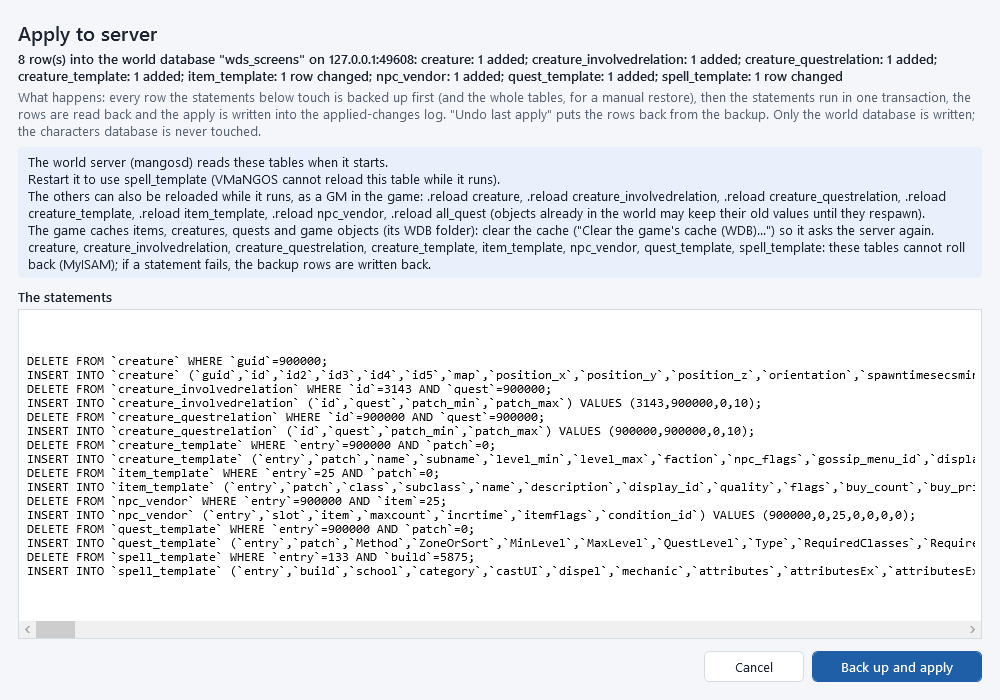

Every apply is written into the applied-changes log (**Applied changes log**; the files are in the game folder's app
folder: `server_db_applies.json`, `applied_changes.log`, and the backups in `backups\server_db\apply_<date>_<time>`).
**My changes** then says *applied to the server* and the date (*older version - apply again* after a later edit).

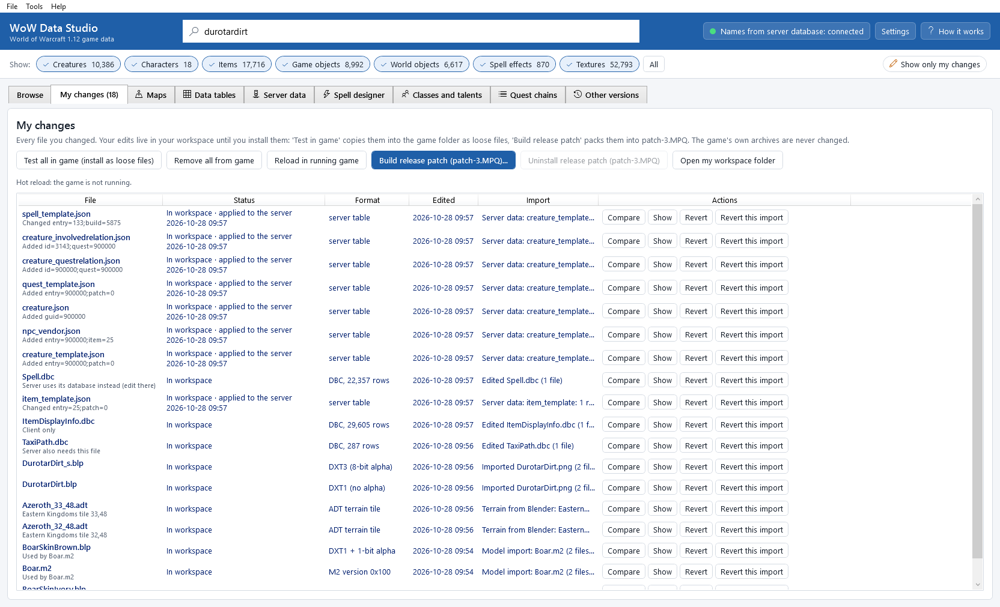

**Undo last apply** puts the rows of the last apply back as they were before it, from its backup (the rows as they are
then are backed up again first). When rows changed on the server since the apply, you are asked before they are
overwritten. Your edits stay in your workspace: apply them again at any time, or revert them in My changes.

Safety rules: only the world database is ever written, never the characters or realm database (the app refuses a
database that looks like one). Reading uses SELECT only. Most VMaNGOS tables use MySQL's MyISAM storage, which cannot
roll a transaction back: if a statement fails in the middle, the app writes the backup rows back itself and says so.

### After applying: restart or reload, and the game's cache

The world server (`mangosd`) reads these tables when it starts. Restart it. Many tables can also be reloaded while it
runs, as a GM in the game: `.reload item_template`, `.reload creature_template`, `.reload gameobject_template`,
`.reload all_quest`, `.reload npc_vendor`, `.reload npc_trainer`, `.reload all_loot`, `.reload creature`,
`.reload all_locales`... (the values and the apply window say which command a table needs). Spells
(`spell_template`), areas, factions, faction templates, flight points and skills cannot be reloaded: restart. Creatures
and objects already in the world keep their old values until they respawn.

The game keeps what the server told it about items, creatures, quests, objects and texts in its cache (the `WDB`
folder of the game) and does not ask again. After an edit of a name, a stat or a text, clear it:
**Clear the game's cache (WDB)...** (close the game first). The cache files are moved into the app's backup folder, not
deleted; choose **Choose another game folder...** to clear the cache of another copy of the game.

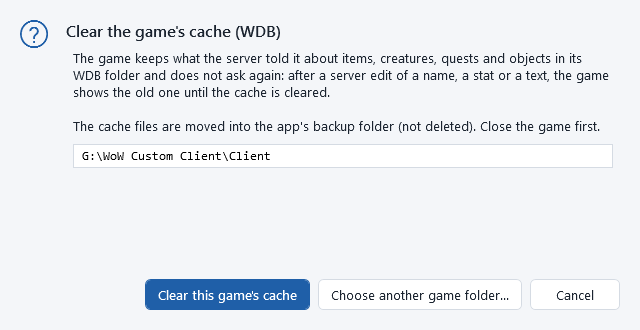

## Client and server

The game and the server keep some data twice: the server reads spells, maps, areas, factions, faction templates,
flight points and skills from its database, the game from its data tables; items and creatures name their looks in the
game's tables (ItemDisplayInfo, CreatureDisplayInfo). **Check client and server...** compares them:

| Check | The server | The game | What differs |
|---|---|---|---|
| spells | `spell_template` (the row the server uses) | Spell.dbc | every value both have (name, rank, tooltip, costs, effects...) |
| items | `item_template.display_id`, `item_display_info` | ItemDisplayInfo | a look the game does not have; the server copy's icon |
| creatures | `creature_template.display_id1-4`, `creature_display_info_addon` | CreatureDisplayInfo | a look the game does not have; the server's facts missing for a look |
| maps, areas, factions, faction-templates, flight-paths, skills | `map_template`, `area_template`, `faction`, `faction_template`, `taxi_nodes`, `skill_line_ability` | Map, AreaTable, Faction, FactionTemplate, TaxiNodes, SkillLineAbility | every value both have; rows only one side has |

Pick what to check (or *everything*), optionally the IDs, and click **Run the check**. Select a difference (or
several) to see both sides, then:

* **Make the server match the game**: the server's row takes the game's values (an edit in the Server data tab; save it,
  then apply). For a creature look without the server's facts, it adds a `creature_display_info_addon` row.
* **Make the game match the server**: the game's table takes the server's values. That edit goes into your workspace at
  once, like a **Data tables** edit: test it in the game or build the release patch.

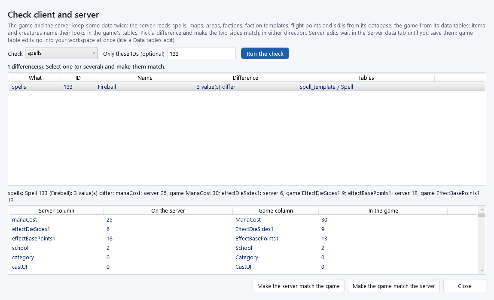

The *In the game (client)* box of a spell, area, map, flight point or faction shows the same comparison for one row.
In the **Data tables** tab, a table the server keeps in its database (Spell, Map, AreaTable, Faction,
FactionTemplate, TaxiNodes, SkillLineAbility...) has the button **Edit it in the Server data tab**.

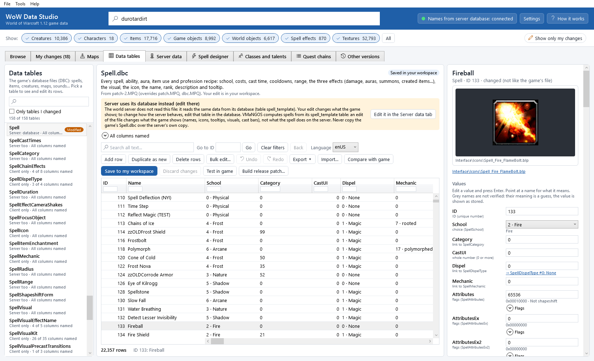

A few values are not compared on purpose: the server's own spell values without a game counterpart
(`effectBonusCoefficient`, `customFlags`), the *flags* of localized texts, a map's player limit (the server's own
setting), and positions closer than 0.05 yards.

## Export and import (CSV and JSON)

**Export the list...** saves the rows of the list on the left as CSV (for spreadsheets) or JSON (pick the type in the
save window); **Export this list...** (right) saves the rows of one list, for example a vendor's items. Every column is
saved with its exact value (NULL is `\N` in CSV, `null` in JSON), so a file imported unchanged changes nothing.

**Import...** (top: into the view's table; right: into one list) reads a CSV or JSON file and shows every row it would
change, add and (with **Remove the rows the file does not have**) remove, the errors that block it (a value that does
not fit, a link to nothing, a key twice) and the warnings. **Apply import** makes it one undo step of your edits; save
it like any edit.

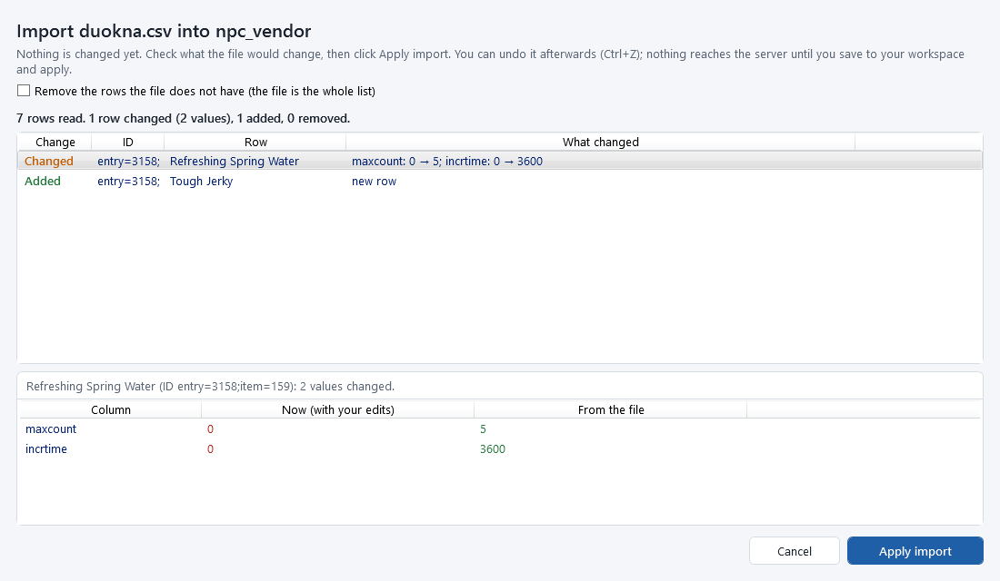

## Examples

### Change an item's stats and its look, on both sides

The Worn Shortsword hits a little harder and gets its own icon.

1. **Server data** tab, view **Items**, search `worn shortsword`, click it.
2. *Weapon* group: **dmg_min1** `3`, **dmg_max1** `7` (<kbd>Enter</kbd> after each).
3. The look and the icon are in the game's tables: **display_id** links to ItemDisplayInfo 1542, which other swords
   use too. To give this sword its own icon: click the link (it opens the **Data tables** tab at that row), click
   **Duplicate as new**, set **InventoryIcon** to `INV_Sword_05`, **Save to my workspace**. Note the new row's ID.
4. Back in **Server data**: set **display_id** to the new ID. (An ID the game does not have is refused.)
5. **Save to my workspace**: the window shows *dmg_min1*, *dmg_max1* and *display_id*, the server's values and yours.
6. **Check client and server...**, check *items*: nothing should be listed.
7. Deliver: the game needs the new display (**Test in game** or **Build release patch...** in **My changes**), the
   server needs the item (**Apply to server...**, then `.reload item_template` or a restart), and the game must forget
   its cached copy (**Clear the game's cache (WDB)...**).

### Add a new NPC vendor selling an item

1. View **Creatures (NPCs)**, search `duokna` (a general goods vendor of the Valley of Trials), click it.
2. **Duplicate as new**: a copy with the first free ID of your custom ID range (for example 900000).
3. **name** `Grokk`, **subname** `Weapon Merchant`. **npc_flags** already has *Vendor* (tick *Repairs items* too if
   you like).
4. In *Sells* on the right: **Add row here**, then set **item** `25` (the Worn Shortsword), **Back**.
5. Give it a place in the world: open one of Duokna's *Spawns*, **Duplicate as new**, set **id** to the new creature and
   **position_x** / **position_y** a few yards away (`.gps` in the game tells you where you stand), **Back**.
6. **Save to my workspace**, **Apply to server...**, restart the world server (or `.reload creature_template`,
   `.reload npc_vendor` and `.reload creature`).

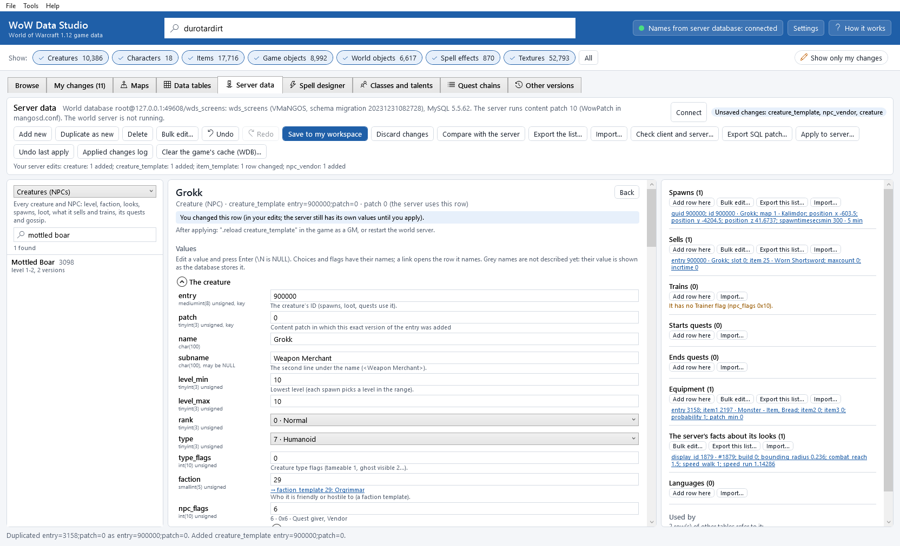

### Write a small quest with a starter and an ender NPC

1. View **Quests**, **Add new**: a new quest with the first free ID.
2. **Title** `A Sharp Gift`, **Details** (the text when it is offered), **Objectives** (the quest log's summary),
   **RequestItemsText**, **OfferRewardText**; **MinLevel** `1`, **QuestLevel** `3`; **ZoneOrSort** `363` (Valley of
   Trials, listed under it in the quest log).
3. The objective: **ReqItemId1** `117` (Tough Jerky, dropped by boars), **ReqItemCount1** `5`. The reward:
   **RewItemId1** `25`, **RewItemCount1** `1`.
4. Who starts and ends it: in *Started by creatures*, **Add row here**, **id** = your vendor from the example above;
   in *Ended by creatures*, **Add row here**, **id** `3143` (Gornek).
5. The starter needs the *Quest giver* flag: open it (link) and tick *Quest giver* in **npc_flags**.
6. **Save to my workspace**, **Apply to server...**, then `.reload all_quest` and `.reload creature_template` (or
   restart), and clear the game's cache: the game caches quests too.

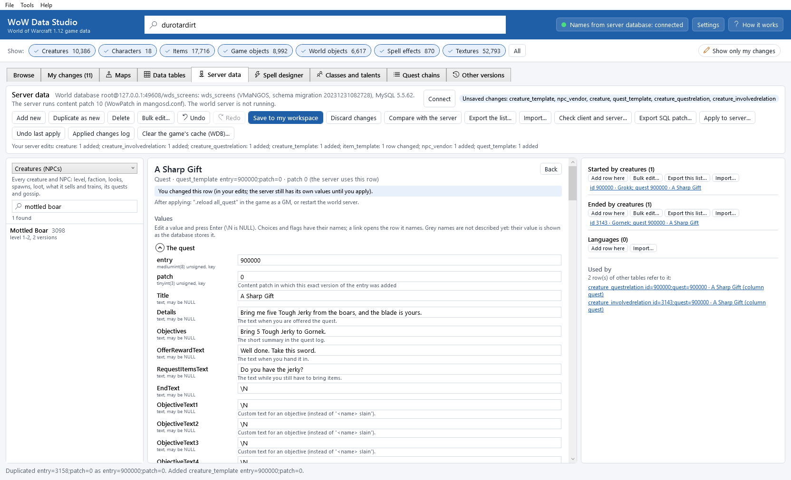

### Edit a spell's numbers on both sides

The server decides what Fireball does; the game shows its cost and tooltip from Spell.dbc.

1. View **Spells**, search `133`. *In the game (client)* says *The game's Spell.dbc has the same values.*
2. **manaCost** `25`; damage: **effectBasePoints1** `18` and **effectDieSides1** `6` (the damage is base points + 1 up
   to base points + die sides: 19 to 24).
3. *In the game (client)* now marks the three values that differ.
4. **Check client and server...**, check *spells*, IDs `133`, **Run the check**, select Fireball, **Make the game
   match the server**: Spell.dbc in your workspace gets the same numbers (the tooltip uses them).
5. **Save to my workspace**, **Apply to server...**, restart the world server (spells cannot be reloaded), and test the
   game's Spell.dbc (**Test in game** or the release patch).

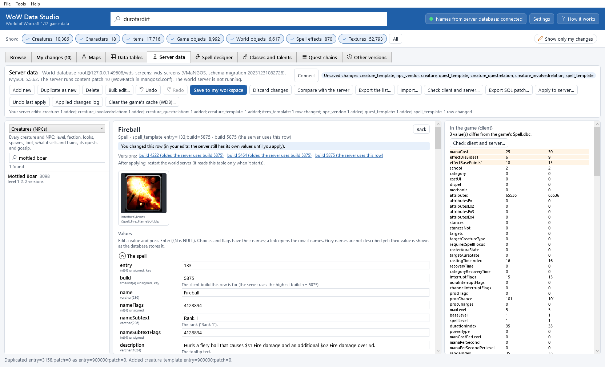

### Apply to a server and undo

1. **Apply to server...**: read *The statements*, check the notes, **Back up and apply**.
2. The result says where the backup is and what to do next (restart, `.reload`, clear the cache).
3. Changed your mind? **Undo last apply** puts every row back as it was before the apply (and backs up the rows as they
   are first). Then restart or reload again.
4. **Applied changes log** lists every apply and undo with its backup folder. An SQL patch exported instead comes with
   its revert script, which does the same for a server you do not apply to yourself.

## Good to know

* The [Spell designer](spell-designer.md) writes `spell_template`, `npc_trainer` and `skill_line_ability` rows in step
  with the game's tables, and the [Classes and talents](class-and-talent-designer.md) tab writes `playercreateinfo` and
  the level stats of a new class, and the [Quest chains](quest-chain-designer.md) tab writes quests with their givers
  and enders, new quest-giver NPCs and their spawns, loot rows, talk menus and area triggers (0.13.0). They are ordinary
  server edits: they show here and are delivered with **Apply to server...**.
* The *Quests* view shows one quest's rows; to see and build whole chains (the links between quests, who gives them, the
  checks), use the [Quest chains](quest-chain-designer.md) tab.
* `RewXP` of `quest_template` is the experience VMaNGOS gives; 0 means none (0.13.0: the hint said "computed from the
  level", which VMaNGOS does not do).
* `effectItemType1`-3 of `spell_template` name an item only for a *Create item* effect; for an aura they hold the spell
  family mask the aura changes, and are not checked as items (0.12.0).
* Edits are saved per database: with another **World database** in the settings, the app shows that database's edits.
* The app reads only the one line `WowPatch` of `mangosd.conf` (next to the server's data folder), never the
  passwords in it.
* The world server is detected by its program name (`mangosd.exe`) on this computer.
* The tests of the app never use your server: they start a throwaway MySQL server of their own, with its own data
  folder and port (see `docs\ARCHITECTURE.md` in the source).
* What is not supported yet: see [Known issues](known-issues.md#server-data).

## Command line

Every action of this tab is a `wds server` command (see [The command line](command-line.md#server-data-the-world-database)):
`wds server find items shortsword`, `wds server show creature_template 3098`,
`wds server set item_template 25 dmg_max1 12`, `wds server check spells --ids 133`,
`wds server export-sql --out my_changes.sql`, `wds server apply --yes`, `wds server undo-apply --yes`,
`wds server clear-wdb --yes`.
