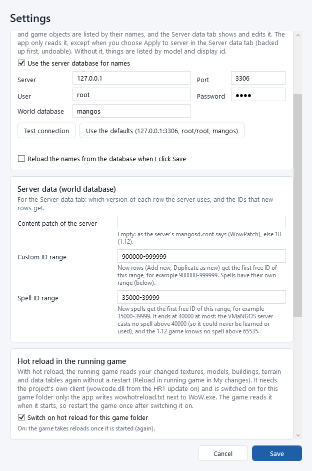
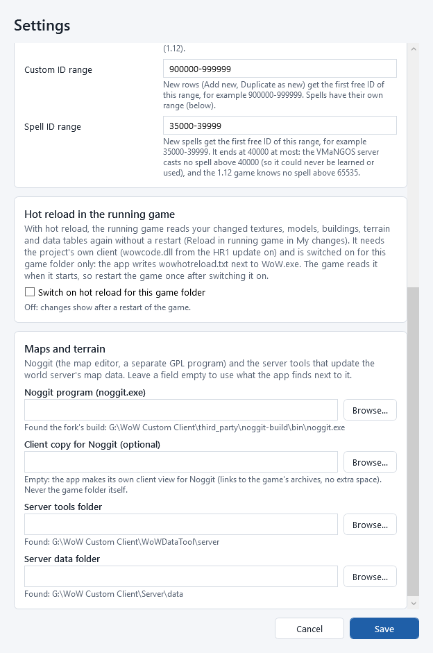

# Settings

Open the settings with **File > Settings...**, the **Settings** button at the top right, or by clicking
**Names from server database: connected** / **Names from server database: not connected** in the top bar.

Changes take effect when you click **Save**. **Cancel** (or <kbd>Esc</kbd>) closes the window without changing
anything.

## World of Warcraft folder

The game folder the app works with: the folder with `WoW.exe` and the `Data` folder, version 1.12.1 (build 5875).

* Type or paste the path, or click **Browse...**.
* Below the box, the app checks the folder at once: green *World of Warcraft 1.12.1 (build 5875) found.*, or in red
  what is wrong (the messages are listed in [Getting started](getting-started.md#first-start-choose-your-world-of-warcraft-folder)).
* When you save a different folder, the app opens it: the first time it organizes its data, as at the first start.

Each game folder has its own index and its own changes. Switching back to an earlier folder brings back its changes.
If you have loose files installed in the current game folder, **File > Change World of Warcraft folder...** reminds you
that they stay installed.

## Names from the server database (optional)

Creature, item and game-object names live in your game server's *world database*. With it, the app lists them by name
(*Mottled Boar*); without it, by model and id (*Boar - BoarSkinIvory*, *creature display 503*). Everything else works the
same either way.

| Setting | What to enter | Default |
|---|---|---|
| **Use the server database for names** | tick it to use the database | ticked |
| **Server** | the computer the database runs on; `127.0.0.1` is this computer | `127.0.0.1` |
| **Port** | the MySQL port | `3306` |
| **User** | the database user name | `root` |
| **Password** | that user's password | `root` |
| **World database** | the name of the world database (the one with `creature_template`), usually `mangos` | `mangos` |

* **Use the defaults (127.0.0.1:3306, root/root, mangos)** fills in the usual values of a local test server.
* **Test connection** tries to connect now and says *Connected: ...* in green or *Not connected: ...* and the reason in
  red. The usual reasons: the database is not running, the password is wrong, or the database name is different.
* **Reload the names from the database when I click Save**: tick it to read the names again right after saving.
  The names are also read again automatically when you change any of the fields above.

The app works with the CMaNGOS and VMaNGOS database layouts (it detects which one). It only reads from the database,
except when you choose **Apply to server...** in the [Server data](server-data.md) tab (backed up first, undoable).
The same connection is used there.

## Server data (world database)

For the [Server data](server-data.md) tab.

| Setting | What it is | When empty |
|---|---|---|
| **Content patch of the server** | the content patch your server runs, 0 (1.2) to 10 (1.12): VMaNGOS keeps a version of many rows per patch, and this decides which version the app shows as *the server uses this row* | `WowPatch` of the server's `mangosd.conf` (only that line is read), else 10 |
| **Custom ID range** | the IDs new rows get (**Add new**, **Duplicate as new**): the first free one of the range, for example `900000-999999` (not spells: see the next line) | `900000-999999` |
| **Spell ID range** | the IDs new spells get (the spell, talent, class and quest designers, **Add new** in `spell_template`): the first free one of the range, at most 40000, for example `35000-39999`. The VMaNGOS server casts no spell above 40000 and the 1.12 game knows none above 65535, so a spell above it could never be learned or used ([The spell designer](spell-designer.md#spell-ids-what-the-game-and-the-server-accept)) | `35000-39999` |

*Your password* is saved encrypted for your Windows user (Windows' own data protection): another Windows user, or
another computer, cannot read it from the settings file. A password saved as plain text by an old version of the app is
encrypted automatically the next time the app starts.

## Hot reload in the running game

With *hot reload*, a running game reads your installed changes again without a restart (**Reload in running game** in
[My changes](my-changes.md); how it works and what reloads: [Testing in the game](testing-in-game.md#reload-in-the-running-game-hot-reload)).

* **Switch on hot reload for this game folder** switches it on or off *for the game folder above*: the app writes (or
  deletes) the file `wowhotreload.txt` next to `WoW.exe` when you click **Save**. Every game folder has its own switch.
* The game reads the switch when it starts: start (or restart) the game once after switching it on. A game that is
  already running keeps what it started with.
* The line below says what the app sees in the game folder: no `wowcode.dll` (a normal client: hot reload is not
  possible), a `wowcode.dll` older than the hot-reload update (the project's client has it since 2026-10-14), or whether it is on.

It is off by default, and a normal player never has it: the file exists only where you switch it on.

## Maps and terrain

The programs the [Maps tab](maps-and-terrain.md) works with. Leave a field empty to use what the app finds by itself; the
line under each field says what it found.

| Setting | What it is | When empty |
|---|---|---|
| **Noggit program (noggit.exe)** | the map editor: our fixed Noggit fork's `noggit.exe` (never the upstream download) | the fork's build next to the app (`third_party\noggit-build\bin\noggit.exe`) |
| **Client copy for Noggit (optional)** | a *copy* of the game folder for Noggit to read. Never the game folder itself (the app refuses it) | the app's own client view: links to the game's archives, no extra space |
| **Server tools folder** | the folder with `reextract.ps1` and `swap_in.ps1` (WoWDataTool's `server` folder) | found next to the app or the game folder |
| **Server data folder** | the world server's data folder, with `maps`, `vmaps` and `mmaps`, and the tables it reads in `5875\dbc` (**Copy to server...** in the [Data tables](dbc-editor.md#copy-to-server) tab copies there) | `Server\data` next to the game folder |

**Browse...** next to each field picks the file or folder.

## Settings that are not in the window

| What | Where it is set |
|---|---|
| The export folder | **1. Export texture as PNG...** always suggests `Documents\WoW Data Studio\Exports\<game path>`; pick any other folder in its save dialog. **2. Import edited PNG...** opens in the folder you last used. |
| Where the app keeps its data | `%APPDATA%\WoWDataStudio` (see [Troubleshooting](troubleshooting.md#where-the-app-keeps-its-files)) |

## Starting the app with options (advanced)

The program `WoWDataStudio.exe` (in the `bin` folder of the installation) accepts a few options, for example in a
shortcut's *Target* box:

| Option | What it does |
|---|---|
| `--client "<game folder>"` | opens that game folder (skips the welcome screen when it is valid) |
| `--home "<folder>"` | keeps settings, index and edits in that folder instead of `%APPDATA%\WoWDataStudio` (for example a second, separate set of changes) |
| `--screenshot "<folder>"` | runs through every screen with the real game data, saves pictures of them into the folder, and closes. It uses a temporary data folder and never installs anything into the game folder. Useful to check that everything works on a computer. |

## Command line

`wds settings list`, `wds settings get <key>`, `wds settings set <key> <value>` (the password with `--stdin`; `wds settings set hot-reload on --yes` switches hot reload on for the game folder), `wds serverdb test`, `wds serverdb defaults` and `wds serverdb reload`. `wds` takes `--home` too. See [The command line](command-line.md#settings).
