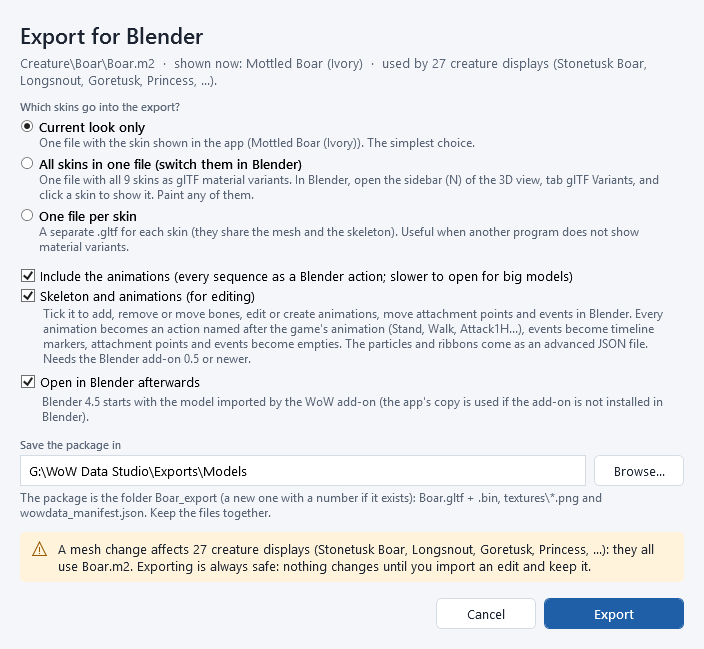
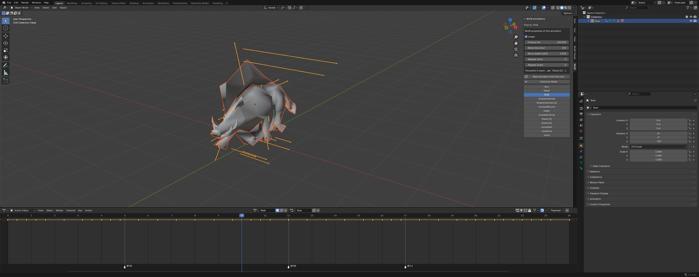
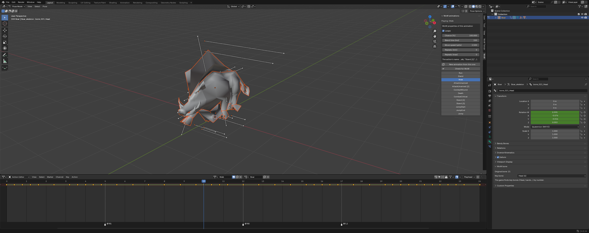
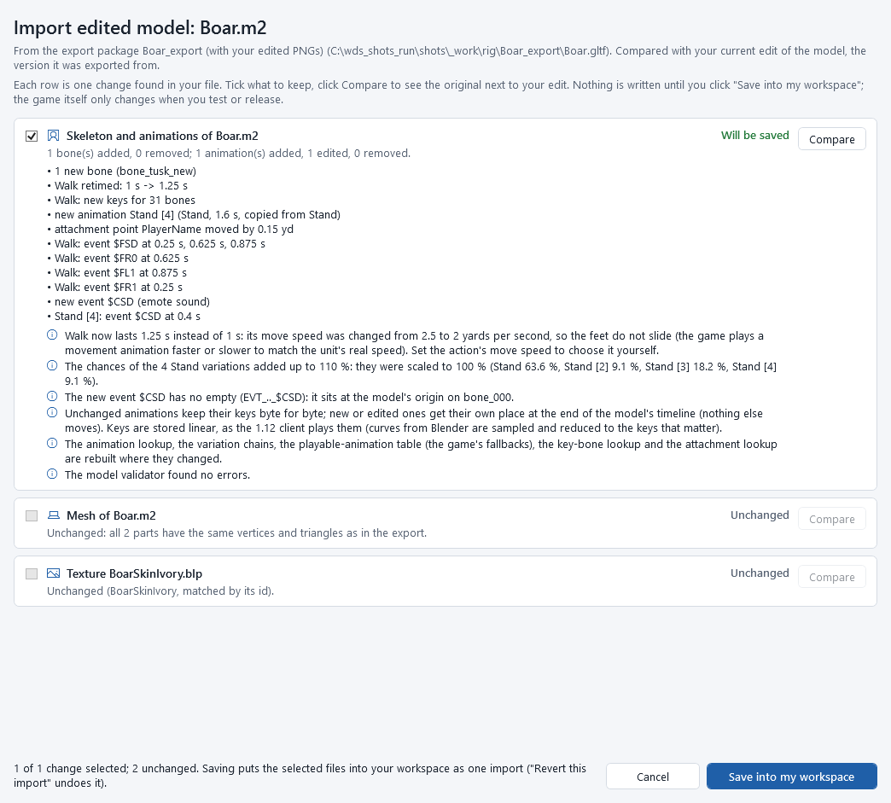
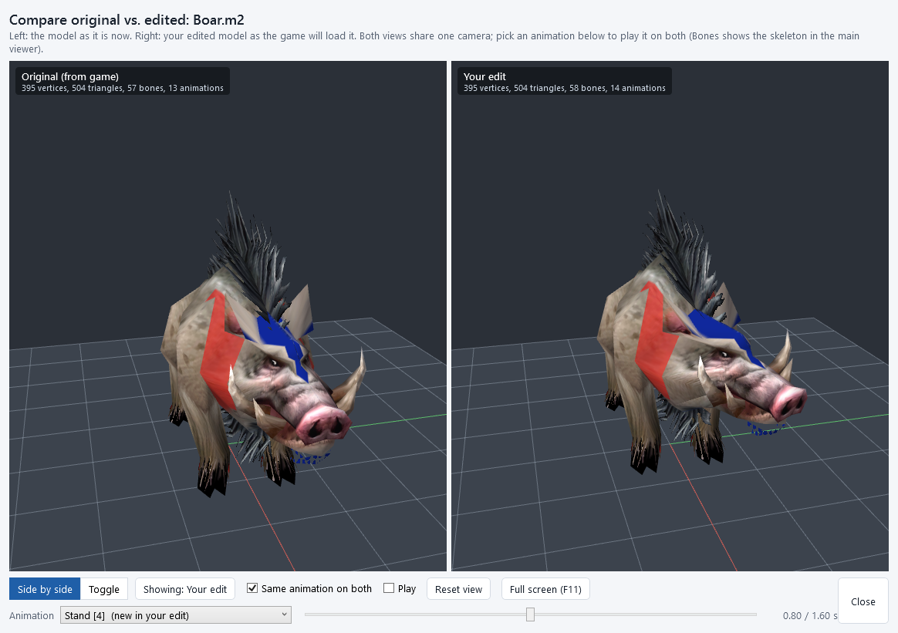
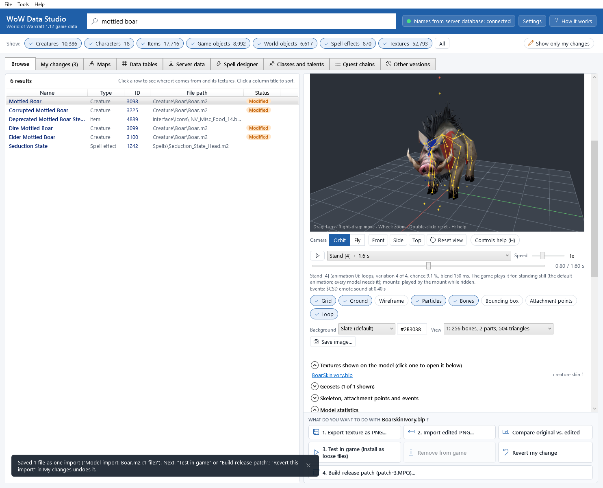

# Skeleton and animations

This chapter shows how to change a model's *skeleton* (its bones), its *animations* (Stand, Walk, Attack1H...), its
*attachment points* (where the game puts weapons, shields, helmets and spell effects) and its *events* (footstep
sounds, the moment a spell leaves the hand) in Blender, and bring them back into the game. It builds on
[Models and Blender](model-export-import.md): read that first if you have never exported a model.

What you can do:

* *Skeleton*: add, remove, move or re-parent bones, give a bone a *key bone* name (Head, a hand...), weight vertices to
  new bones.
* *Animations*: edit any animation, make it longer or shorter, create new ones (a new idle, an emote), change how it
  plays (loops or once, the chance of a variation, the blend time, the move speed), edit the *global sequences* (the
  loops that run on their own clock, such as a flag waving).
* *Attachment points and events*: move them, put them on another bone, add new ones; move event markers in time.
* *Particles and ribbons*: they stay exactly as they are. Advanced users can edit their numbers in a JSON file, which
  the app checks.

Everything goes through the usual flow: **Import edited model...** shows every change in words with its checks,
**Compare** plays the animations of the original and your edit side by side, and the result is one import in your
workspace that you test in the game, release and undo like any other change.

## Before you start

* Blender 4.5 LTS and the app's Blender add-on *WoW 1.12 model (wowdata)* version 0.5.0 or newer
  (**Tools > Install the Blender add-on...**, see [Models and Blender](model-export-import.md)).
* Export the model with **Skeleton and animations (for editing)** ticked. Without it the skeleton and the animations
  are not imported back (only the mesh and the textures).

## Export the skeleton and the animations

1. Select the model (for example the *Mottled Boar*) and click **Export for Blender...**.
2. Tick **Skeleton and animations (for editing)**. (This also ticks the animations.)

   

3. Click **Export**. The package folder holds the same files as a normal export, plus:
   * every animation as an action named after the game's animation: *Stand*, *Walk*, *AttackUnarmed*... A model with
     several versions of one animation (*variations*) gets *Stand*, *Stand [2]*, *Stand [3]*;
   * every *global sequence* as an action of its own: *Global sequence 1 (2.00 s)*;
   * the attachment points as empties `ATT_<id>_<name>` (`ATT_01_HandRight`, `ATT_11_Helm`...) and the events as
     empties `EVT_<number>_<code>` (`EVT_09_$FSD`), each under its bone;
   * the events of each animation as *markers* of its action (named by their code: `$FSD`, `$CSL`...);
   * `wowdata_effects.json`: the particle emitters and ribbons as numbers (only when the model has some).

In Blender, the add-on removes the importer's NLA tracks (so only one animation plays at a time) and plays *Stand*.
Press <kbd>N</kbd> in the 3D view and open the *WoW* tab:

* the list of animations: click one to play it (the scene's frame range follows it);
* *WoW properties of this animation*: *Loops*, *Chance (%)* (for a variation), *Blend time (ms)*, *Move speed
  (yd/s)*, *Repeats*;
* *New animation from this one*: a copy of the playing animation with a new name (for example *Stand [4]*);
* *Check for WoW*: checks names, markers and weights before you export (the app checks everything again).

The *Action Editor* (the Dope Sheet) shows the keys of the playing animation and its event markers. In
*Bone properties* the add-on's *WoW bone* panel shows the original bone and its *key bone*:

### The rules of the 1.12 client, in short

* *The action's name decides the animation.* *Walk* is played when the creature walks; *Stand [2]* is a second
  standing variation; *EmoteDance* is played by `/dance`. A name the game does not know cannot be imported. The names
  are those of the game's AnimationData table (the WoW panel lists them; **Used in game** says what the game plays each
  one for).
* *Key bones* are how the game's code finds bones by name: the head (the camera, helmets, the name plate), the hands
  and fingers (weapons), the jaw, the root... Keep them. To move the job of a key bone to another bone, set the key
  bone in *Bone properties > WoW bone* first.
* *Attachment points* are where the game attaches weapons (*HandRight*, *HandLeft*), the shield, the helmet, shoulder
  armour, spell effects (*SpellLeftHand*, *SpellRightHand*, *Breath*), the name plate (*PlayerName*) and a rider
  (*PlayerNameMounted* on mounts).
* A vertex can use *4 bones* at most; a vertex can only use the *first 256 bones*.
* The game plays keys *linearly* (no curves): the app samples Blender's curves and keeps the keys that matter.

## Import the edited skeleton and animations

When you are done in Blender: *File > Export > WoW 1.12 model for WoW Data Studio* (into the package's
`blender_export` folder, as suggested). The add-on also writes `wowdata_rig.json` there: the bones, every animation you
changed (the ones you did not touch are only named, so they come back exactly as they were), the markers and the
empties.

1. Click **Import edited model...** and pick the package folder.
2. The review has a row *Skeleton and animations of Boar.m2* with every change in words:

   

3. Click **Compare** on it: the game's model on the left, your edit on the right. Pick an animation in the
   **Animation** list to play it on both (a new animation plays on the right only), drag the time slider to look at
   one moment, **Same animation on both** keeps them in step.

   

4. Click **Save into my workspace**. The mesh, the skeleton and the animations, and the particles file are one model
   file: they are saved together, as one import.

## What the import checks (and does for you)

*Skeleton*

* *Bones* you added, removed, moved or re-parented are listed. A removed bone's vertices, attachment points, events,
  particles and ribbons move to its nearest remaining parent bone; every bone number in the model follows the new
  order (a parent always comes before its children).
* *Key bones*: removing a key bone is refused ("the game finds it by that name"); a key bone number the 1.12 client
  does not know (it knows 27: ArmL ... Root) is refused; two bones with the same key bone get a warning.
* *Weights*: at most 4 bones per vertex (the strongest 4 are kept), bone numbers 0-255 for vertices, and the views'
  bone limits (256 / 75 / 53 / 21 bones per draw: parts are split automatically), as for a mesh edit.

*Animations*

* *Unchanged animations keep their keys byte for byte* (the add-on marks the actions you did not touch; the app also
  compares every sampled pose with the original). An edited or new animation gets its own place at the end of the
  model's one timeline, so nothing else moves.
* *A retimed movement animation* (Walk, Run...) gets a new move speed so the feet do not slide: the game plays a
  movement animation faster or slower to match the unit's speed. Set *Move speed* yourself to choose another one.
* *Variations*: their chances must add up to 100 %; when they add up to more, the app scales them and says so.
* *Stand* (animation 0) must stay: it is every model's default. On a character model, removing any animation the game
  plays (walking, fighting, casting, emotes, dying, jumping) is refused.
* *Lookups*: the app rebuilds the animation lookup, the variation chains, the *playable-animation table* (what the game
  plays when the model does not have an animation, from AnimationData's fallbacks, computed exactly like the client),
  the key-bone lookup and the attachment lookup where they changed.
* *Events*: markers named by a known code become that event; a new code (`$CSD`...) creates a new event at its empty
  `EVT_.._$CSD` (or at the model's origin). Unchanged markers of a retimed animation stretch with it.
* *Global sequences*: an edited one is written again on its own clock; changing its length changes the speed of
  everything that runs on it.

*Character models* (the race skeletons) get extra warnings: every player and NPC of that race and sex uses them, and
the game's code finds the head, hands, weapons, shield, spell hands and the camera through their key bones and
attachment points. Test them in the game (several emotes, weapons, a mount, a few spells) before you share them.

The model validator must find no errors before anything can be saved.

## Worked examples

### Give a creature a new idle animation

1. Export the *Mottled Boar* with **Skeleton and animations (for editing)** and open it in Blender.
2. In the *WoW* tab, click *Stand* to play it, then *New animation from this one*. Name it *Stand [4]*: a fourth
   standing variation.
3. Change it: in *Pose Mode*, turn the head bone (`bone_021_Head`) in the middle of the animation and insert a key
   (<kbd>I</kbd>). Set its *Chance (%)* in the WoW tab, for example 10.
4. Optional: add a sound at 0.4 s: in the Action Editor, *Marker > Add Marker* at that frame and rename it `$CSD`
   (an emote sound).
5. *File > Export > WoW 1.12 model for WoW Data Studio*, then **Import edited model...** in the app. The row lists
   *new animation Stand [4]* and that the Stand chances were scaled to 100 %. **Compare**, pick *Stand [4] (new in your
   edit)*, then **Save into my workspace**.
6. In the 3D viewer the new animation is in the list:

   

7. **3. Test in game (install as loose files)**: the boar now sometimes plays your idle while it stands.

### Retime a walk cycle

1. Export with the skeleton and play *Walk* in the WoW tab.
2. In the Action Editor select all keys (<kbd>A</kbd>) and scale them in time (<kbd>S</kbd>, for example 1.25), with
   the markers if you want the footsteps to follow (*Marker > Scale*), or leave them: unchanged markers stretch with
   the animation.
3. Export and import: the review says *Walk retimed: 1 s -> 1.25 s* and that the move speed went from 2.5 to 2 yards
   per second, so the walk does not slide in the game.

### Add a bone and weight a new part to it

1. Export with the skeleton. In Blender, select the armature, *Edit Mode*, add a bone (<kbd>Shift</kbd>+<kbd>A</kbd>)
   or extrude one (<kbd>E</kbd>) where the new part goes, and make it a child of the bone it should follow
   (*Bone properties > Relations > Parent*).
2. Model the new part inside one of the model's parts (or join it into one, <kbd>Ctrl</kbd>+<kbd>J</kbd>), and weight
   its vertices to the new bone (a vertex group with the bone's name, weight 1).
3. Animate the new bone in the animations where it should move (new keys on it).
4. Export and import: the review lists *1 new bone* in the skeleton row and the changed part in the mesh row; both are
   saved together. A bone that should be found by the game (a new hand, a head) needs its key bone set in
   *Bone properties > WoW bone*.

### Move a weapon attachment point

1. Export a model with the skeleton (for a weapon held too low, a creature's `ATT_01_HandRight`).
2. In Blender, select the empty `ATT_01_HandRight` and move it (<kbd>G</kbd>) at the rest pose. To put it on another
   bone: *Object properties > Relations > Parent* with the armature and the bone.
3. Export and import: the review says *attachment point HandRight moved by ... yd*. In the 3D viewer, the
   **Attachment points** toggle shows where the game will put the weapon.

### Preview and compare

* In the 3D viewer, pick any animation in the list, drag the timeline, set the speed, **Loop** (on: repeats; off:
  plays once and stops), **Bones** shows the skeleton (key bones in red) and **Attachment points** where the game
  attaches things (cyan). Under the timeline: the animation's properties, what the game plays it for, and its events.
  **Skeleton, attachment points and events** lists the key bones and the attachment points.

  

* **Compare** in the review, or **Compare original vs. edited model** under the 3D view after the import, plays the
  same animation on the original and your edit (see above).
* On the command line, `wds models render <model> <png> --sequence Walk --time 400` draws one moment of an animation,
  and `wds models compare <model> --images <prefix> --sequence Walk` draws both sides.

## Particles and ribbons (advanced)

By default the particle emitters and ribbons of a model are kept exactly as they are (byte for byte; only their bone
numbers follow a skeleton edit, and a new or edited animation gets their values from the animation it was made from).

To change their numbers (colours, gravity, emission speed, textures...), edit `wowdata_effects.json` in the package
folder with a text editor and import the package (or the Blender export) as usual. The review shows a row
*Particles and ribbons of ... (advanced)* with every changed value. The app checks every value: the numbers fit their
fields, textures, materials and bones exist, key times increase and lie inside their animation, and the number of
emitters and ribbons stays the same (adding or removing them is not supported). Only the emitters and ribbons you
edited are written. After saving, the 3D view draws the edited particles and ribbons ([Particles and
ribbons](model-viewer.md#particles-and-ribbons)).

## Used in game

**Used in game** of a creature, character or model has a section **Animations and what the game plays them for**:
each animation, its variations and length, whether it loops, what the game's own code plays it for (moving, fighting,
casting, emotes, dying, mounts), which chat emotes play it (`/dance`) and which spells (while casting, at the cast, on
the target), and the animations the model lacks with what the game plays instead.

## Command line

`wds models export <model> --with-skeleton`, `wds models import <package>` (`--exclude skeleton` / `--exclude particles`
to leave a part out), `wds models anims <model>` (the animations and what the game plays them for; `--sequence Walk`
for one with its events), `wds models skeleton <model>` (bones, key bones, attachment points, events and the limits),
`wds models render <model> <png> --sequence Walk --time 400` and `wds models compare <model> --images <prefix>`. See
[The command line](command-line.md#models-and-blender).
