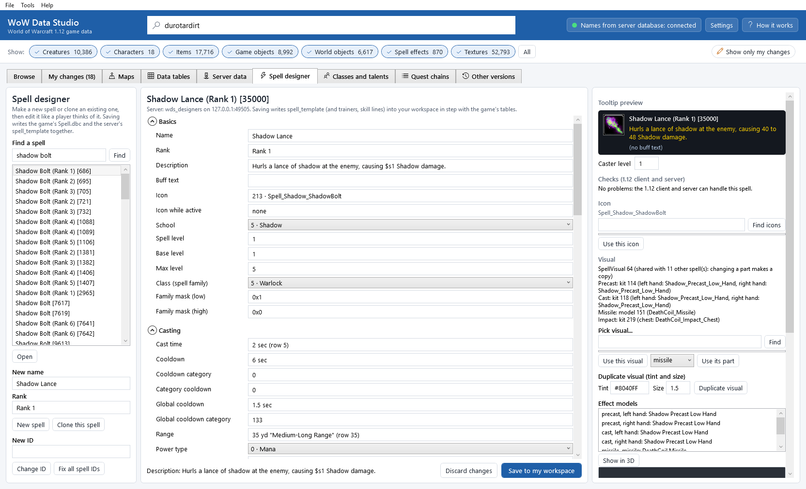
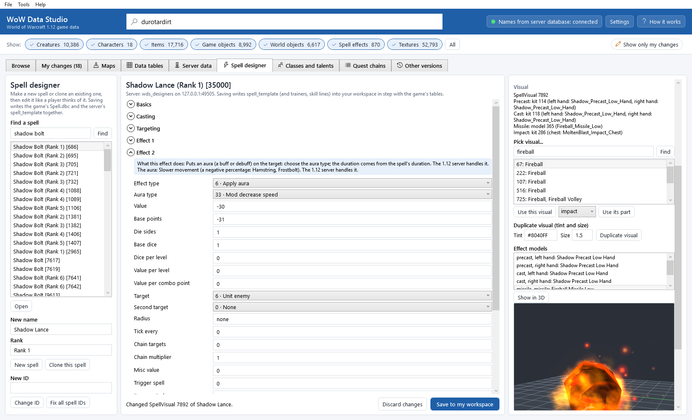
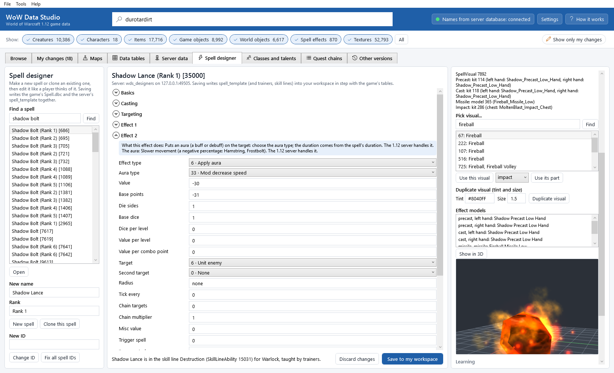
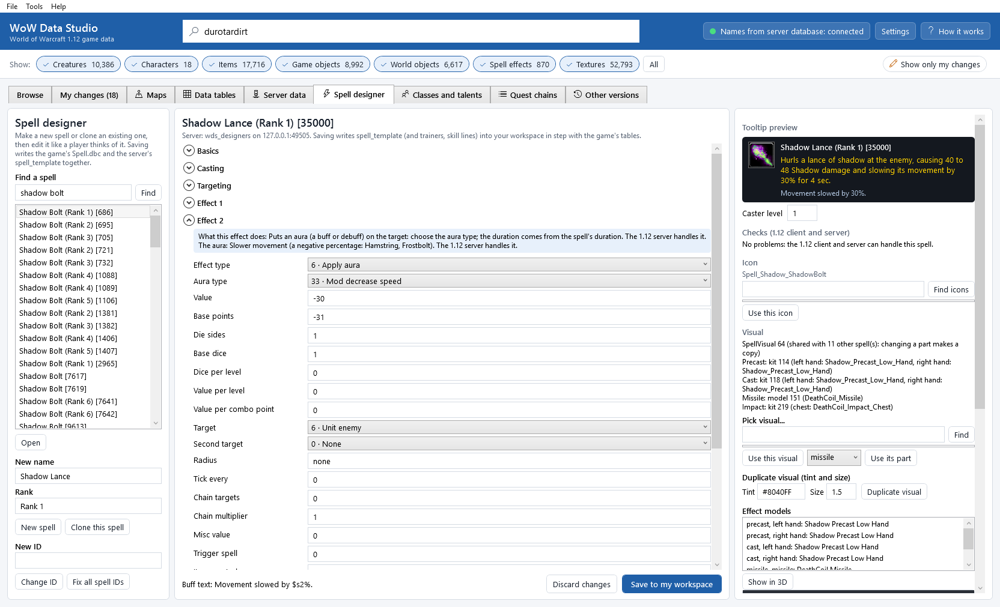

# The spell designer

The **Spell designer** tab makes a new spell, or a copy of an existing one ("a spell like Shadow Bolt"), with a form
that is grouped the way a player thinks about a spell: what it is called and looks like, how it is cast, whom it hits,
what its three effects do. While you type you see the tooltip as the game will write it, and a check tells you in plain
words what the 1.12 game or its server cannot handle.

When you save, the designer writes *both sides together*: the game's `Spell.dbc` (and the small helper tables it
needed: icons, cast times, durations, ranges, radiuses, visuals) and your server's `spell_template` row, field by field
in step. Trainer entries and skill lines are written the same way. Everything goes into your workspace as **one
change**: you find it in [My changes](my-changes.md), compare it, test it in the game, put it in the release patch and
apply it to the server, as every other edit.

The [Data tables](dbc-editor.md) and [Server data](server-data.md) tabs can already change every column of these rows;
the designer is the guided, checked and faster way for spells.



## Open it

* **Tools > Spell designer**, or the **Spell designer** tab.
* The line under the spell's name says whether the server database is connected. When it is, saving writes the server's
  rows too. When it is not (or turned off in [Settings](settings.md)), only the game's tables are edited; **Sync with
  the server** (or `wds spells sync`) brings the server in line later.

The tab has three parts: on the left you find, make or clone a spell; in the middle is the form; on the right are the
**Tooltip preview**, the **Checks (1.12 client and server)**, the **Icon**, the **Visual** with a 3D view of its effect
models, and **Learning** (trainers and skill lines).

## Find, make or clone a spell

1. Under **Find a spell**, type a name (`shadow bolt`) or a spell ID (`686`) and press <kbd>Enter</kbd> or **Find**.
   Every rank of every spell with that name is listed with its ID.
2. To edit an existing spell, select it and click **Open** (or double-click it).
3. To make a new spell, type its **New name** and **Rank** and click **New spell**. It starts as an instant, self-cast
   spell that costs mana and starts the global cooldown, with no effect yet.
4. To copy a spell, select it, type the **New name** and **Rank**, and click **Clone this spell**. Every value is
   copied: costs, cast time, range, the three effects, the icon, the visual. The server-only values (the spell power
   coefficient, VMaNGOS's own flags) come from the server's row of the original.

*New spells get their ID from your custom ID range* (**Custom ID range** in [Settings](settings.md); 900000-999999
by default): the first ID that neither the game's `Spell.dbc` nor the server's `spell_template` uses. The helper rows a
spell needs (a new cast time, a new range...) get the next free ID of their own small table.

## The form

The form has one group per part of the spell. Click a group's name to open or close it. Every field has a tooltip that
says what it does. Type a value and press <kbd>Enter</kbd>; a choice (school, effect type, target...) takes effect as
soon as you pick it. A value that is not allowed is refused with the reason in the status line, and nothing changes.

| Group | What is in it |
|---|---|
| **Basics** | **Name**, **Rank**, **Description** (the spell book tooltip), **Buff text** (the tooltip of the buff or debuff), **Icon**, **School**, the levels, the class it belongs to (**Class (spell family)**) and the family mask talents use |
| **Casting** | **Cast time**, **Cooldown**, **Global cooldown**, **Range**, **Power type**, **Cost**, reagents and tools, **Missile speed**, what interrupts it |
| **Targeting** | **Target flags**, **Creature types**, **Max targets**, forms and stances it needs |
| **Effect 1**, **Effect 2**, **Effect 3** | **Effect type**, **Aura type**, **Value**, **Target**, **Radius**, **Tick every**, **Chain targets**, **Trigger spell**, **Misc value**... and, in a blue box, **What this effect does** in plain words |
| **Mechanics and flags** | **Mechanic**, **Dispel type**, **Defense type**, the attribute flags (**Attributes** ... **Attributes (5)**: *Passive*, *Is ability*, *Is channeled*...), what removes the aura (**Aura removed by**) |
| **Procs** | **Proc on**, **Proc chance**, **Proc charges** |
| **Duration and stacks** | **Duration**, **Stacks up to** |
| **Visuals** | **Spell visual** (the parts are on the right, see below) |
| **Server only** | **Spell power coefficient 1**-3 and **VMaNGOS custom flags**: columns of `spell_template` that the game's table does not have |

### Friendly values

You type values the way a player thinks of them; the designer stores what the tables need:

| You type | What is stored |
|---|---|
| **Cast time** `2.5`, `instant`, `1500ms` | the `SpellCastTimes` row with exactly that time; a new row when none has it |
| **Cooldown** `8`, `1.5 min` | milliseconds (`RecoveryTime`) |
| **Range** `30`, `8-30`, `self`, `melee` | the `SpellRange` row with that range (a new one, with its name, when none has it) |
| **Duration** `18`, `until cancelled`, `none` | the `SpellDuration` row with that duration |
| **Radius** `8` | the `SpellRadius` row |
| **Icon** `Spell_Shadow_ShadowBolt` or `213` | the `SpellIcon` row of that icon file (added when the file exists and no row names it yet) |
| **Cost** `15` with **Power type** Rage | `150`: the game keeps rage costs ten times larger |
| **Value** `10` or `10-20` | base points, base dice and die sides (the game rolls between the two numbers) |
| flags: tick them under **Choose flags**, or type `+Passive`, `-Passive`, `Passive, Is ability`, `0x50` | adds, removes or sets named bits (bits without a name are kept) |
| a choice by name or number: `Shadow`, `5` | the number |

When a helper row is added, the status line says so. Some of these tables (`SpellCastTimes`, `SpellDuration`,
`SpellRange`, `SpellRadius`, `SpellVisual`) are read by the server from its own copy of the file: after testing, copy
them to the server with **Tools > Copy tables to the server...** (the save reminds you).

## The tooltip preview

**Tooltip preview** shows the spell as the game's tooltip shows it: the name, the description with every `$` variable
filled in, and the buff text. **Caster level** shows it for a caster of another level (values and durations that grow
per level follow).

The variables are filled in exactly as the 1.12 client does (its own code, read in our decompile:
`SpellText_ExpandDescription` and `SpellText_ExpandVariable`):

| Variable | Means |
|---|---|
| `$s1` `$s2` `$s3` | the effect's value: "12 to 16", or one number |
| `$m1` / `$M1` | the lowest / highest value |
| `$o1` | the value over the whole duration (damage or healing over time) |
| `$d` | the duration ("30 sec", "2 min", "until cancelled") |
| `$t1` | seconds between ticks |
| `$a1` | the radius in yards |
| `$r` | the range in yards ("30.0": the game prints one decimal) |
| `$h` `$n` `$u` `$x1` `$i` `$v` | proc chance, proc charges, stacks, chain targets, max targets, max target level |
| `$e1` `$f1` `$b1` `$q1` `$c` `$p` | multiple value, chain multiplier, value per combo point, misc value, cost, cost per second |
| `$12345s1` | the same variable of another spell (here spell 12345) |
| `$/10;s1` `$*2;s1` | divided or multiplied |
| `$ghis:her;` `$lpoint:points;` | the word for the character's sex, singular or plural of the last number |

A variable the game cannot fill in is printed by the game as a bare `$`; the preview does the same and the checks list
it. The preview cannot know the player's talents and items, so in the game a talented player may see bigger numbers.

## The checks

**Checks (1.12 client and server)** lists, in plain words, what the 1.12 game or the server cannot handle (errors: the
designer refuses to save them) and what is probably a mistake (warnings). They come from the client's code in our
decompile and from VMaNGOS's spell handlers:

* an effect or aura type the 1.12 server leaves empty (VMaNGOS marks them unused, for example *Stealth* and *Detect*
  as effects, *Mod parry skill* as an aura) or does not know at all (effects above 130, auras above 192);
* effects and auras that need a server script to do anything (*Dummy*, *Script effect*, *Send event*, the *Dummy* aura,
  *Override class scripts*): a warning, because the server source must have code for this spell;
* *Apply aura* without an aura type; a ticking aura (*Periodic damage*, *Periodic heal*...) with **Tick every** 0; a
  proc aura with no **Proc on** events; a trigger, learn or missile effect without its **Trigger spell**, or with one
  that does not exist (on the server too);
* a summon without the creature, *Create item* without the item, an area target without a **Radius**, a channelled
  spell without a duration;
* items, creatures and trigger spells that do not exist on the server (when it is connected);
* rage or energy costs above 100, a family mask without a class, tooltip variables the game cannot fill in.

Under each effect group, **What this effect does** explains the effect and its aura, what its **Misc value** holds (a
creature to summon, a stat, a school mask...) and whether the 1.12 server handles it. `wds spells explain` lists all of
them.

## The icon

The icon is shown next to the tooltip. To change it, type words of the icon's file name next to **Find icons**
(`shadow`, `frost bolt`, `sword`), click **Find**, select one and click **Use this icon**. You can also type the file
name or a `SpellIcon` ID straight into the **Icon** field of **Basics**.

## The visual

**Visual** lists the parts of the spell's visual: what plays while casting (*Precast*), when the cast finishes
(*Cast*), the *Missile*, the *Impact* on the target, the *Aura* while it lasts, the *Channel*, the *Ground area*, with
the effect models each part spawns (on the caster's hands, chest, feet...).

* **Pick visual...**: type the name of a spell whose look you want (`fireball`, `frostbolt`) and click **Find**. Then
  **Use this visual** takes its whole visual, or choose a part (`missile`, `impact`...) and click **Use its part** to
  take only that part. When other spells share your spell's visual, the designer first makes a copy for your spell, so
  the other spells keep their look.
* **Duplicate visual (tint and size)**: makes the spell its own copy of the visual, with its own kits and its own copies
  of the effect models (under `Spells\WDS\`), with a **Tint** (`#8040FF`: the colours of the models, their particles
  and ribbons and their textures are multiplied by it) and a **Size** (`1.5`: the models, their particle sizes and
  speeds and their bones are scaled). Click **Duplicate visual**. The original models are not changed.
* **Effect models** lists the models; select one and click **Show in 3D** to see it in the 3D view below (with its
  animation). A duplicated copy shows after you have saved it.



## Learning: trainers and skill lines

**Learning** shows how the spell is learned and lets you add it to a trainer and to a skill line.

* **Add to trainer**: type the trainer's creature entry (for example `3156`, Nartok in the Valley of Trials), the
  **Level** and the **Cost** (copper, or `25s`, `1g 50s`), and click **Add to trainer**.
  * The 1.12 server only accepts trainer entries whose spell is a *learn* spell (its first effect is *Learn spell* and
    teaches your spell). The designer reuses the spell's learn spell or makes one (with the same name, rank and icon) in
    both the game's table and `spell_template`.
  * A trainer with a shared trainer list (`trainer_id` in `creature_template`) gets the entry in that list
    (`npc_trainer_template`); the server refuses a spell that is in both. `list:N` puts it in list N directly.
  * The trainer needs the Trainer flag; the status line says when it does not have it.
* **Add to skill line**: the skill line (`SkillLine` ID: a class's talent-tree tab like *Destruction* 593, a profession,
  a weapon skill...) and the **Classes** (names or IDs, comma-separated; empty = every class). It makes the
  `SkillLineAbility` row in the game's table and the same row, with the same ID, in the server's `skill_line_ability`.
  Class trainers show a player only the spells of his class's skill lines, so a class spell needs both.
* **Sync with the server**: when you changed the game's side of a spell in the Data tables tab, the server's row follows
  it on the next save.



## Save, test and deliver

1. Click **Save to my workspace** (<kbd>Ctrl</kbd>+<kbd>S</kbd>). It is refused while the checks list an error.
   **Discard changes** throws away what you have not saved.
2. The spell is now one change in [My changes](my-changes.md): `Spell.dbc` and the helper tables, the copied models and
   textures, and the server tables (`spell_template`, `npc_trainer`, `skill_line_ability`). **Compare** shows every
   changed row.
3. Test it: **Test all in game (install as loose files)** or **File > Build release patch (patch-3.MPQ)...**
   ([Testing changes in the game](testing-in-game.md)).
4. Put the server's rows into the server: **Tools > Apply to server...** ([Server data](server-data.md)); the world
   server reads spells at start, so restart it. Copy the server's own tables with **Tools > Copy tables to the server...**
   when the save said so.
5. Clear the game's cache if the game shows old texts ([Server data](server-data.md#after-applying-restart-or-reload-and-the-games-cache)).

## Worked example: Shadow Lance, a stronger Shadow Bolt that slows

1. In **Find a spell**, type `shadow bolt` and press <kbd>Enter</kbd>. Select *Shadow Bolt (Rank 1) [686]*.
2. **New name** `Shadow Lance`, **Rank** `Rank 1`, then **Clone this spell**. The form shows *Shadow Lance (Rank 1)
   [900000]*.
3. In **Casting**: **Cast time** `2`, **Cooldown** `6`, **Range** `35`.
4. In **Effect 1**: **Value** `40-48`. The preview says *causing 40 to 48 Shadow damage*.
5. Open **Effect 2**: **Effect type** *6 · Apply aura*. The checks show an error: *"Apply aura" needs an aura type*.
   Choose **Aura type** *33 · Mod decrease speed*, **Value** `-30`, **Target** *6 · Unit enemy*.
6. In **Duration and stacks**: **Duration** `4`.
7. In **Basics**: **Description** `Hurls a lance of shadow at the enemy, causing $s1 Shadow damage and slowing its
   movement by $s2% for $d.` and **Buff text** `Movement slowed by $s2%.`. The preview now reads *causing 40 to 48
   Shadow damage and slowing its movement by 30% for 4 sec.*
8. Under **Pick visual...**, find `fireball`, select it, choose `missile` and **Use its part**, then `impact` and **Use
   its part**: a Fireball missile and impact on Shadow Bolt's casting hands. Select the missile under **Effect models**
   and **Show in 3D**.
9. **Save to my workspace**.



The same on the command line:

```
wds spells clone 686 --name "Shadow Lance" --rank "Rank 1" --set cast-time=2 --set cooldown=6 --set range=35 --set effect1-value=40-48
wds spells set 900000 --set effect2=6 --set effect2-aura=33 --set effect2-value=-30 --set effect2-target-a=6 --set duration=4
wds spells visual 900000 --missile spell:133 --impact spell:133
wds spells tooltip 900000
```

## Worked example: a new spell at a trainer at level 20

1. Open the spell (or make it as above).
2. Under **Learning**, **Trainer** `3156`, **Level** `20`, **Cost** `25s`, then **Add to trainer**. The status line says
   *Made the learn spell 900001* and *Shadow Lance is taught by Nartok at level 20 for 25s*.
3. **Skill line** `593`, **Classes** `Warlock`, then **Add to skill line**.
4. **Save to my workspace**, then **Tools > Apply to server...** and restart the world server.
5. In the game, a warlock of level 20 sees *Shadow Lance* at Nartok (after the game's cache is cleared).

```
wds spells learn 900000 --trainer 3156 --level 20 --cost 25s
wds spells learn 900000 --skill-line 593 --class Warlock
```

A quest can teach a spell too: **Reward spell** in the [Quest chains](quest-chain-designer.md) tab sets the spell and
makes its learn spell the same way (the Warrior's disciplines are learned like that).

The [Classes and talents](class-and-talent-designer.md) tab shows the class's whole spell list by level, and moves a
spell to another level or to every trainer of the class.

## Good to know

* The designer edits the *game's* row first and makes the server's row follow it, field by field, with the same mapping
  as **Check client and server...** ([Server data](server-data.md)). After a save that check finds no difference for
  the designed spells.
* Talents that change a spell (`Add flat modifier`, ...) find it through **Class (spell family)** and the family mask.
  A new class should have its own spell family (the class designer gives a new class one).
* Spell IDs up to 999999 work in 1.12 (the game keeps an index the size of the highest ID: a very high ID costs memory).
* Limits: [Known issues](known-issues.md#spell-and-class-designers).

## Command line

`wds spells find`, `show`, `fields`, `new`, `clone`, `set`, `check`, `tooltip`, `explain`, `icons`, `visual`, `learn`
and `sync` do everything this tab does; see [The command line](command-line.md#the-spell-designer).
