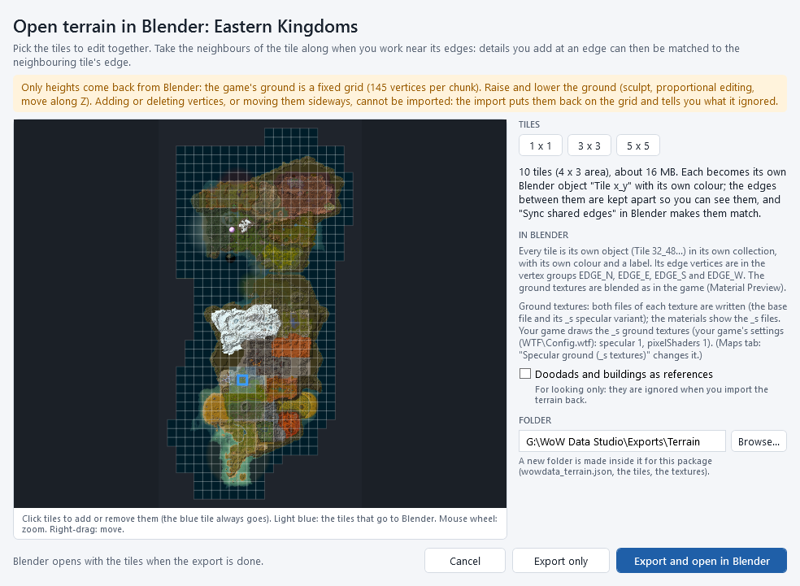
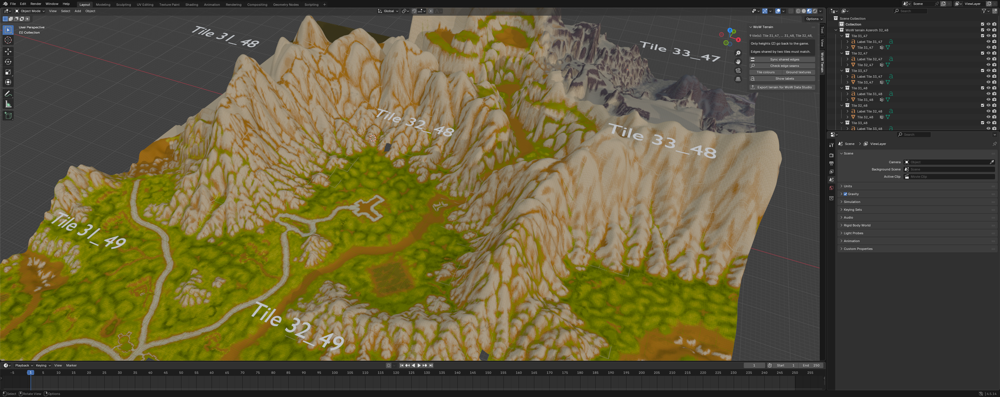
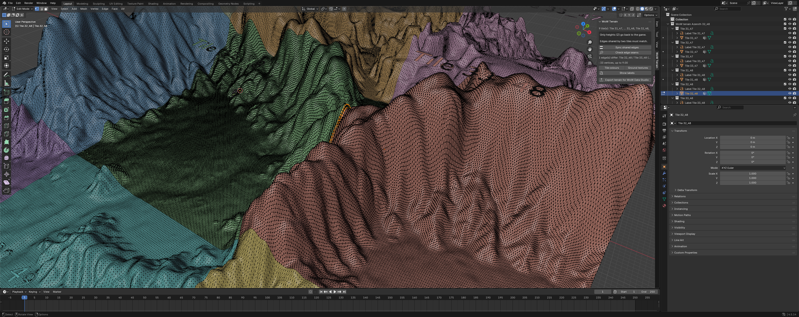
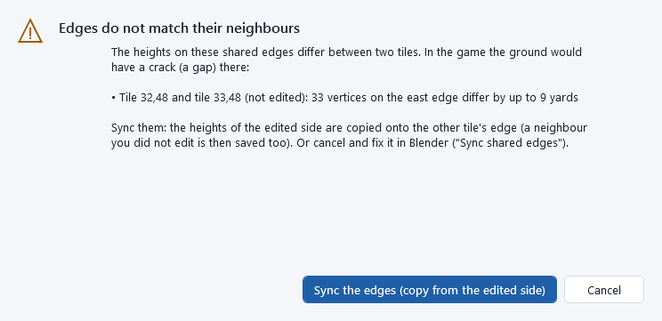
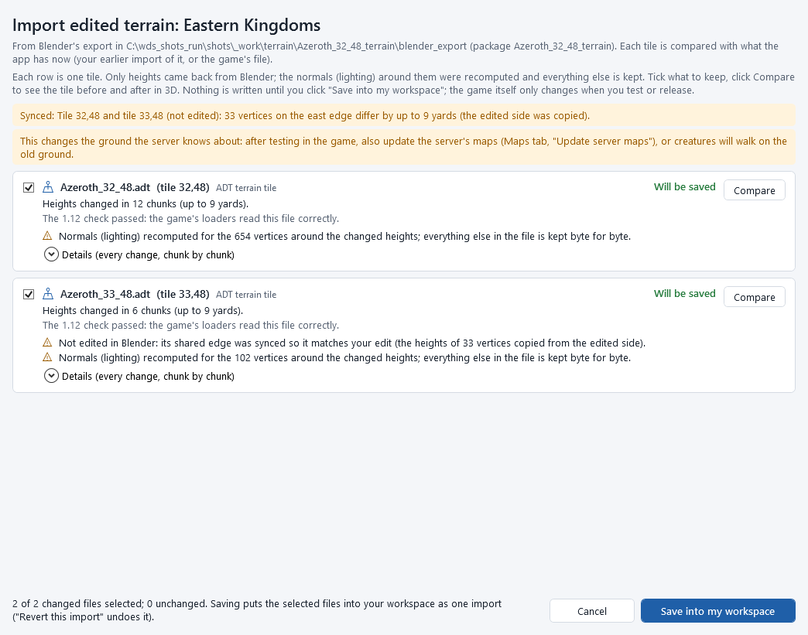
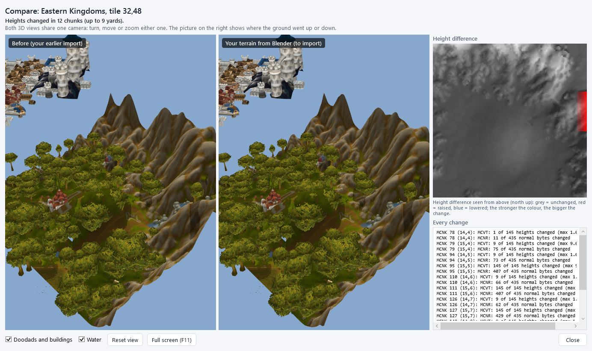

# Terrain in Blender

Raise a hill, dig a valley or smooth a slope in *Blender* (a free 3D program), with as many neighbouring tiles as you
need, and bring the new heights back into your map. Each tile comes into Blender as its own object, so you always see
where one tile ends and the next begins, and Blender can make the edges you share with a neighbour match exactly.

```
 Maps tab: select a tile -> Open terrain in Blender... (pick the tiles) -> Blender opens with the tiles
     -> edit the heights -> Sync shared edges -> Check edge seams -> Export terrain for WoW Data Studio
 -> Import edited terrain... (edges checked, review, compare) -> Save into my workspace -> test / release / server
```

Nothing changes in the game until you test or release, and **Revert this import** in [My changes](my-changes.md) undoes
an import.

## What comes back, and what does not

The game's ground is a fixed grid: every chunk (33 x 33 yards) has exactly 145 points, 9 x 9 on a regular grid plus
8 x 8 in the middle of each square. So:

* *Heights come back.* Move points up and down as much as you like: sculpt, proportional editing, move along Z,
  modifiers.
* *Adding or deleting points, or moving them sideways, cannot come back.* The import puts sideways-moved points back on
  the grid (keeping only their new height), ignores added points and keeps the old height of deleted ones, and tells you
  how many of each it found. Do not subdivide, decimate or remesh the tiles.
* Ground textures, holes, water and placed objects are shown in Blender for reference only. Paint textures, cut holes,
  add water and move doodads or buildings in [Noggit](maps-and-terrain.md#edit-in-noggit).

The app recomputes the lighting of the ground (the *normals*) around every point whose height changed, and keeps every
other byte of the tile as it was.

## Open terrain in Blender

You need Blender 4.5 LTS. The app's WoW add-on is loaded for you (version 0.4.0 or newer has the terrain tools; install
or update it with **Tools > Install the Blender add-on...**, see [Models and Blender](model-export-import.md)).

1. In the **Maps** tab, select a tile on the minimap.
2. Click **Open terrain in Blender...** (in *EDIT THE MAP* under the tile; also **Tools > Open terrain in Blender...**, or
   **Open terrain in Blender...** in the [tile breakdown](maps-and-terrain.md#break-down-a-tile)).
3. Pick the tiles:
   * **1 x 1**: only the selected tile;
   * **3 x 3**: the tile and the 8 around it;
   * **5 x 5**: two rings of neighbours (25 tiles; Blender gets slower);
   * or click tiles on the map to add or remove them (the selected tile, framed in blue, always goes). The light blue
     tiles go to Blender.

   Take the neighbours along whenever you work near a tile's edge: what you build at the edge can then continue into the
   neighbouring tile, and its edge can be made to match.
4. Optionally tick **Doodads and buildings as references**: the trees, rocks and buildings as simple grey shapes, so you
   see where they stand while you shape the ground. They are for looking only: they are ignored when you import.
5. Click **Export and open in Blender**. The app writes the package (a folder in `Documents\WoW Data Studio\Exports\Terrain`
   by default) and starts Blender with it. **Export only** writes the package without starting Blender.



## In Blender: the tiles

Every tile is its own object, named *Tile 32_48* (the tile's x and y), in its own collection, with:

* *its own colour*: the Solid view shows each tile in a different colour, so the edges between them are obvious;
* *a label*: the tile's name floating above it;
* *four vertex groups*, *EDGE_N*, *EDGE_E*, *EDGE_S* and *EDGE_W*: the points on its north, east, south and west edge
  (select a group in Blender's *Object Data* properties to see or select an edge);
* *its ground textures*, blended as in the game, in Blender's Material Preview. The package holds *both* files of each
  ground texture: the one the map names and its specular `_s` file (in the `textures` folder, colours only). The
  materials show the files your game draws: the `_s` files when terrain specular is on in your game (or when you ticked
  **Specular ground (_s textures)** in the Maps tab), else the base files; the export window says which. See
  [Ground textures and specular files](editing-textures.md#ground-textures-and-specular-files).

The sidebar of the 3D view (press <kbd>N</kbd>) has a *WoW Terrain* tab with the tools:


* *Sync shared edges*, *Check edge seams* (see below);
* *Tile colours* / *Ground textures*: switch between the Solid view in tile colours and the Material Preview with the
  ground textures;
* *Show labels*: hide or show the tile labels;
* *Export terrain for WoW Data Studio*.



## Edit the heights and keep the edges matched

Two neighbouring tiles share the points along their common edge: in the game they must have exactly the same height on
both tiles, or the ground has a crack there. In Blender those points are two separate points (one in each object), so
edit, then sync:

1. Edit the ground of one tile. Change the heights only (for example the *Sculpt* workspace, or *Edit Mode* with
   proportional editing and moving along Z). Work right up to the edge if you like.
2. Click *Check edge seams* in the *WoW Terrain* tab. It lists every shared edge whose heights differ (*Tile 32_48 /
   Tile 33_48 (east): 33 vertices, up to 9.00*) and selects those points, so you see where.

   

3. Click *Sync shared edges*. For every shared point that differs, the height of the side you edited is copied onto the
   neighbour's point (the side that still has its original height follows the edited one). When you edited both sides
   of an edge, the active tile wins.
4. Click *Check edge seams* again: *All shared edges match.*

   

5. If you want the neighbour to blend in further than its edge, sculpt into it too and sync again.

The edges of the outer tiles (shared with tiles you did not take to Blender) cannot be checked in Blender: the app
checks them when you import (next section).

## Export from Blender

When you are done: *Export terrain for WoW Data Studio* (the *WoW Terrain* tab, or *File > Export > WoW 1.12 terrain for
WoW Data Studio*). It writes `wowdata_terrain_edit.json` and one file per tile into the package's `blender_export`
folder (the file dialog opens there). Keep the Blender file too (*File > Save*) if you want to continue later.

## Import edited terrain

1. In the app: **Import edited terrain...** (in the **Maps** tab under *EDIT THE MAP*, or **Tools > Import edited
   terrain...**), then pick the package folder.
2. The app reads every tile Blender exported, maps each point back to its place on the grid by the id it got on export,
   and checks the shared edges: between the tiles you imported, *and* with the existing neighbours you did not take to
   Blender.
3. If an edge disagrees with its neighbour, the app tells you which and by how much:

   

   * **Sync the edges (copy from the edited side)**: the heights of the side you edited are copied onto the neighbour's
     edge. A neighbour you did not edit is then saved too (its row says *Not edited in Blender: its shared edge was
     synced...*).
   * **Cancel**: nothing is imported; fix it in Blender (*Sync shared edges*) and export again.
4. The review shows one row per tile: what changed (*Heights changed in 12 chunks (up to 9 yards)*), the 1.12 check,
   what was ignored (points moved sideways, added or deleted), and that the normals were recomputed. Unchanged tiles are
   left out. **Compare** shows the tile before and after in two 3D views with the height difference (red = raised, blue =
   lowered).

   

   

5. Tick what to keep and click **Save into my workspace**. All tiles of the import are one change set (**Revert this
   import** in [My changes](my-changes.md) undoes them together).
6. Then, as for any map change: **Test map in game (loose files)**, **Build release patch (patch-3.MPQ)...**, and
   **Update server maps...** so the server's ground matches ([Maps and terrain](maps-and-terrain.md#test-it-in-the-game-and-release-it)).

If you exported without changing anything, the app says *No changes found* and saves nothing.

## Good to know

* *Edit the latest version.* The package remembers the tiles it was made from. If a tile changed in the app since (another
  import, a revert), its row says it cannot be imported: open the terrain in Blender again and redo the edit there.
* *Moving a whole tile* in Blender moves all its points sideways: only heights come back, so this changes nothing
  (raising a whole tile with *Z* does change its heights).
* *Holes stay holes.* The squares of a hole have no faces in Blender (their points are there); cutting new holes is done
  in Noggit.
* *Large areas.* 5 x 5 tiles are about 825,000 points; sculpting stays smooth on a recent computer, but Blender needs a few
  seconds to open them.
* *Where the files are*: the package in `Documents\WoW Data Studio\Exports\Terrain\<map>_<x>_<y>_terrain\`
  (`wowdata_terrain.json`, `tiles\`, `textures\`, `weights\`, `references.gltf`), what Blender exported in its
  `blender_export\` folder.

## Command line

`wds maps export-terrain <map> <x> <y> --size 3 --open` and `wds maps import-terrain <package>` (`--sync-edges` to sync mismatching edges, `--dry-run` for the review only). See [The command line](command-line.md#maps-and-terrain).
