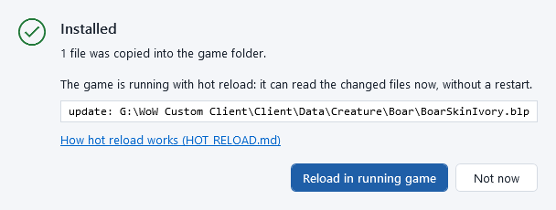
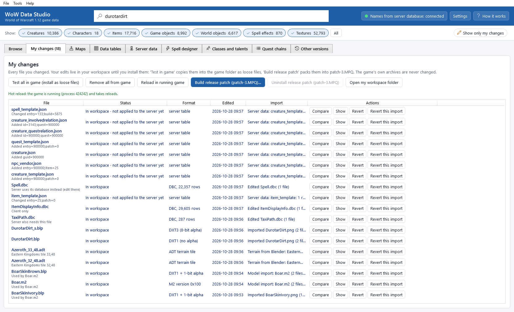
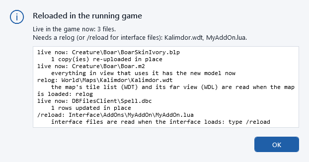

# Testing changes in the game

After you kept an edit ([Editing textures](editing-textures.md)), it sits in your workspace. To see it in the game,
there are two ways:

| Way | Good for | Undo |
|---|---|---|
| *Loose files* (this chapter): your edited files are copied into the game's `Data` folder one by one | quick tests while you work | **Remove from game** |
| *Release patch*: all your changes packed into one archive, `patch-3.MPQ` | the finished result, sharing, and testing with any client | see [Releasing](releasing.md) |

Map changes are tested the same way, with **Test map in game (loose files)** in the **Maps** tab; remember that the
server needs its own update too ([Maps and terrain](maps-and-terrain.md#update-server-maps)).

## What loose files need: the loose-file mode

The game normally reads everything from its archives (the `.MPQ` files) and ignores single files lying in its `Data`
folder. It only reads them when its *loose-file mode* is on.

* The project's own client has the loose-file mode built in from update *wave185* on.
* A normal (unmodified) 1.12.1 client does not: it ignores loose files, and your change does not show. Use
  [a release patch](releasing.md) instead; it works with every client.

Not sure which client you have? Test it: install a clearly visible change (paint something bright red), restart the
game and look. If it does not show, your client has no loose-file mode. The technical details are in
**Help > About the loose-file mode (LOOSE_FILES_PATCH.md)**.

## Install one change

1. Select the texture you changed (it has a **Modified** badge).
2. Click **3. Test in game (install as loose files)**.
3. A dialog explains where the file goes, for example `C:\...\Client\Data\Creature\Boar\BoarSkinIvory.blp`, and
   reminds you about the loose-file mode. Click **Install into the game folder** (or **Cancel**).

   

4. **Installed** confirms how many files were copied, and where.

If a file with the same name is already in the game folder and the app did not put it there, it asks first
(**A file is already there**). **Back it up and replace it** saves the existing file and puts it back when you remove
your change later; **Cancel** leaves everything as it is.

## Install all your changes at once

In the **My changes** tab, click **Test all in game (install as loose files)**. Every edited file is copied the same way.

## See it in the game

1. *Restart the game.* The game reads textures when it starts and keeps them in memory, so a game that is already
   running keeps showing the old texture. Close it completely and start it again. With the project's client and hot
   reload switched on, the running game can read them again instead: see
   [Reload in the running game](#reload-in-the-running-game-hot-reload).
2. Go where the thing is. For the Mottled Boar: the Valley of Trials in Durotar. On your own test server, a game master
   can also summon a creature, for example `.npc add 3098`.
3. Remember that a shared texture changes everywhere: every boar with the Ivory skin looks different now.

You do not need to delete the game's `WDB` cache folder for a texture change.

## After you change it again

If you import a new version of a texture that is already installed, its status in **My changes** says
**installed loose (older version - reinstall)**. Click **3. Test in game (install as loose files)** again (or
**Test all in game (install as loose files)**) to copy the new version, then restart the game (or reload it in the
running game).

## Remove from game

To go back to the game's original while keeping your edit in the workspace:

* one texture: select it and click **Remove from game**;
* everything: in **My changes**, click **Remove all from game**.

Confirm with **Remove from game**. The app deletes only files it installed itself and that nobody changed since:

* a file that was in the game folder before is put back from its backup;
* a file that something else changed after the install is left in place (the message says which, and where it is);
* *Removed from the game folder* lists what was done.

Restart the game to see the original again.

**Revert my change** (see [My changes](my-changes.md)) also removes the loose copy from the game folder, and throws your
edit away.

## Reload in the running game (hot reload)

With *hot reload*, the game that is already running reads your installed changes again, without a restart: a new
texture shows on the boar in front of you, a changed tree appears where the old one stood.

It needs three things:

* the project's own client with the hot-reload update (*HR1* of `wowcode.dll`, deployed on 2026-10-14). With an older
  `wowcode.dll` the app says *The running game has no hot-reload support* and you restart the game as before;
* the switch in [Settings](settings.md#hot-reload-in-the-running-game): **Switch on hot reload for this game folder**. It
  writes the small file `wowhotreload.txt` next to `WoW.exe`; the game reads it when it starts, so start (or restart)
  the game once after switching it on;
* for loose files, the loose-file mode (see above). A release patch reloads without it.

### Use it

1. Install your change as usual: **3. Test in game (install as loose files)**, **Test all in game (install as loose
   files)**, **Test map in game (loose files)** in the Maps tab or **Test in game** in the Data tables tab.
2. When the game runs with hot reload, the dialog after the install offers it at once: click **Reload in running game**
   (or **Not now**).

   

3. You can also click **Reload in running game** in [My changes](my-changes.md) at any time: it reloads all your changes.
   The line under the buttons says whether the game takes reloads right now.

   

4. The result says what is live in the game now and what needs a relog or a restart; the box lists every file with the
   game's own explanation.

   

**Remove from game** and **Remove all from game** offer the same: the running game goes back to the originals.

### What can be reloaded

| Change | In the running game |
|---|---|
| Texture (`.blp`) with the same size and format | live: replaced where it is, everywhere it is used (creatures, items, buildings, terrain, interface) |
| Texture with another size or format | relog (an interface texture: restart) |
| Character skins and armor textures (combined into a character's look) | relog |
| Model (`.m2`) | live for creatures, characters and their mounts, objects (chests, signs, mailboxes) and the doodads placed in the world (trees, rocks); the character screen, portraits and spell effects that are already playing change when they are shown again |
| Building (`.wmo`) | live: the area around your character is loaded again (a short pause, like a teleport within the zone); a building that a ship or a zeppelin uses: relog |
| Terrain tile (`.adt`) | live: the land around your character is loaded again; tiles further away read the new file when you get there |
| The map's tile list and far view (`.wdt`, `.wdl`) | relog |
| Data tables (`.dbc`) with the same rows | live for most tables (a creature or item display rebuilds every creature and character in view); flight paths and the world map: relog; a few tables the game prepares once (lights, character sections, races, sounds of footsteps and weapons, item classes): restart |
| Data tables with rows added or removed | restart |
| Interface files (`.lua`, `.xml`, `.toc`) | type `/reload` in the chat |
| Sounds | the next time they play |

### The release patch while the game runs

**Build release patch (patch-3.MPQ)...** with **Also install it into the game:** works while the game runs with hot
reload: the game lets go of its `patch-3.MPQ`, the new one is installed, then the game opens it again and reloads the
files of the old and the new patch. **Uninstall release patch (patch-3.MPQ)** works the same way. If the game is reading a
file of the patch at that moment, the app asks it again a few times; if it still cannot let go, nothing is changed and
the message says so. Without hot reload, a running game keeps `patch-3.MPQ` locked: close the game first.

### When it cannot reload

The line in My changes and the message of **Reload in running game** say why:

| Message | What to do |
|---|---|
| *The game is not running from ...* | start the game from this game folder (the folder chosen in [Settings](settings.md)). Version 0.13.0 said this also while the game *did* run, when it was started by `WoWDebug.exe` (the project's launcher): update to 0.13.1 or later |
| *Hot reload is off for this game folder* | switch it on in [Settings](settings.md#hot-reload-in-the-running-game), then restart the game once |
| *... the running game was started before it was turned on* | restart the game once |
| *The running game has no hot-reload support* | the client's `wowcode.dll` is older than the hot-reload update, or it is a normal client: restart the game to see your changes |
| *... does not answer* | the game is at a long loading screen or stuck: try again in a moment |
| *... another WoW Data Studio window or a wds command is talking to this game right now* | the game takes one connection at a time: wait until the other one is done (or close the other window), then try again |

### Is it safe?

* It is off unless you switch it on for a game folder; a normal player's client never has `wowcode.dll` or the switch.
* Reloading never changes the game's files: the game only reads your installed files again. It does the work at a safe
  moment between two frames, and it swaps a model or a building only through the game's own code (the way a shape
  change or a teleport does), so nothing still in use is thrown away.
* If something looks wrong after a reload, relog (or restart the game): the game then reads everything fresh.

Technical details for the curious: `docs\HOT_RELOAD.md` in the app's installation folder.

## Loose files and patch-3.MPQ together

With the loose-file mode on, a loose file wins over every archive, including your `patch-3.MPQ`. To check that your
release patch works on its own, first click **Remove all from game**, then restart the game. **Remove all from game**
removes loose files only: to take the release patch out, use **Uninstall release patch (patch-3.MPQ)** in
[My changes](my-changes.md).

A ground texture edit that does not show: the game may draw the texture's `_s` file instead (terrain specular on); see
[Ground textures and specular files](editing-textures.md#ground-textures-and-specular-files).

Next: [release your changes](releasing.md).

## Command line

`wds changes install --yes` installs your changes as loose files (one file: give its path; `--dry-run` lists them first), `wds changes remove --yes` takes them out again. `wds changes reload --wait` reloads them in the running game (`--reload` on `install` and `remove` does it right away), `wds changes reload --status` says whether the game takes reloads, and `wds settings set hot-reload on --yes` switches hot reload on for the game folder. See [The command line](command-line.md#my-changes-testing-and-releasing).
