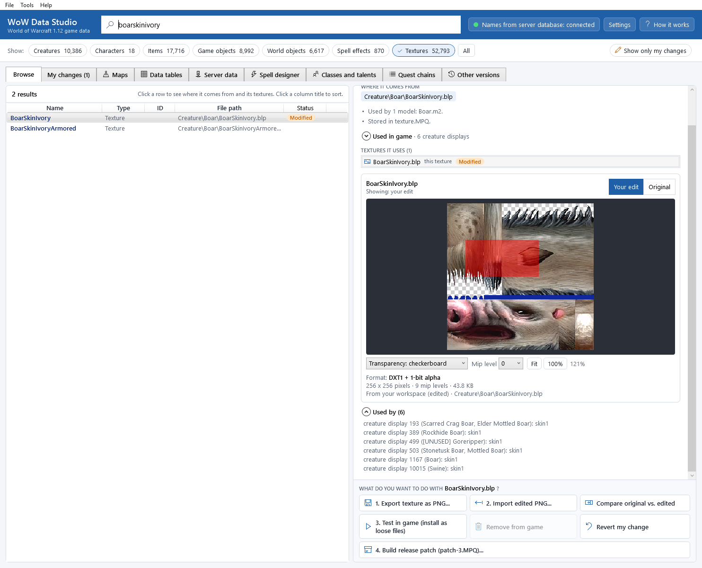

# The texture viewer

The texture viewer shows the selected texture in the details panel, below the 3D view and the texture list. Every
control is explained here. To open it, click a texture in **TEXTURES IT USES**, click a texture name under
**Textures shown on the model (click one to open it below)** in the 3D view, or click a row of type *Texture* in the
results list.

## The header

* *The file name* of the texture, for example *BoarSkinIvory.blp*.
* *What you are looking at*: *Original (from game)* for a texture you did not change. For a texture you changed it
  says *Showing: your edit* or *Showing: original (from game)*.
* **Your edit** / **Original** (top right, only for a texture you changed): switch between your edited version and
  the game's original, in place.

## The picture

| Do | How |
|---|---|
| Zoom in and out | mouse wheel (it zooms towards the mouse pointer) |
| Move the picture | drag with the mouse |
| Fit the whole texture into the view | double-click the picture, or click **Fit** |
| Show it at its real size (one texture pixel per screen pixel) | click **100%** |

The current zoom is shown after the **100%** button, for example *200%*.

## Transparency

Many textures have transparent parts (a boar's bristles, the edges of leaves). The first drop-down chooses how they
are shown:

| Choice | What you see |
|---|---|
| **Transparency: checkerboard** | transparent parts show a grey checkerboard behind them (the default) |
| **Transparency: ignore (colour only)** | the colours only, as if nothing were transparent. Useful to see colours hidden under transparent pixels. |
| **Alpha channel only** | the transparency itself as a grey picture: white = solid, black = fully transparent |

## Mip level

**Mip level** chooses which copy of the texture you see. Textures store smaller copies of themselves (*mip levels*)
that the game shows when the model is far away: level 0 is the full-size picture, level 1 is half the size, and so on.
You normally look at level 0. The other levels are useful to check that your edit also looks right from a distance:
the app rebuilds them for you when you import an edit.

## The facts below the picture

* **Format**: how the game stores the texture, for example *DXT1 + 1-bit alpha*, *DXT5 (8-bit alpha)* or
  *palette 256 + 8-bit alpha*. Your edit is saved in the same format. The [Glossary](glossary.md) explains the formats.
* *Size*: for example *256 x 256 pixels · 9 mip levels · 43.9 KB*, and which level you are looking at.
* *Where it comes from*: the game archive the texture is stored in (for example *From texture.MPQ*), or
  *From your workspace (edited)*, followed by the texture's full path inside the game.

If the texture cannot be shown, the viewer says *This texture could not be shown:* and the reason. That only happens
with a damaged file; the rest of the app keeps working.

## What next

Below the viewer, **Used by** lists everything that uses this texture. The action bar at the bottom of the panel exports
it, imports your edit, and so on: see [Editing textures](editing-textures.md).

## Command line

`wds textures info <texture>` prints a texture's format, size and mip levels; `wds textures compare <texture> --mip 2 --heatmap diff.png` compares one mip level. See [The command line](command-line.md#textures).
