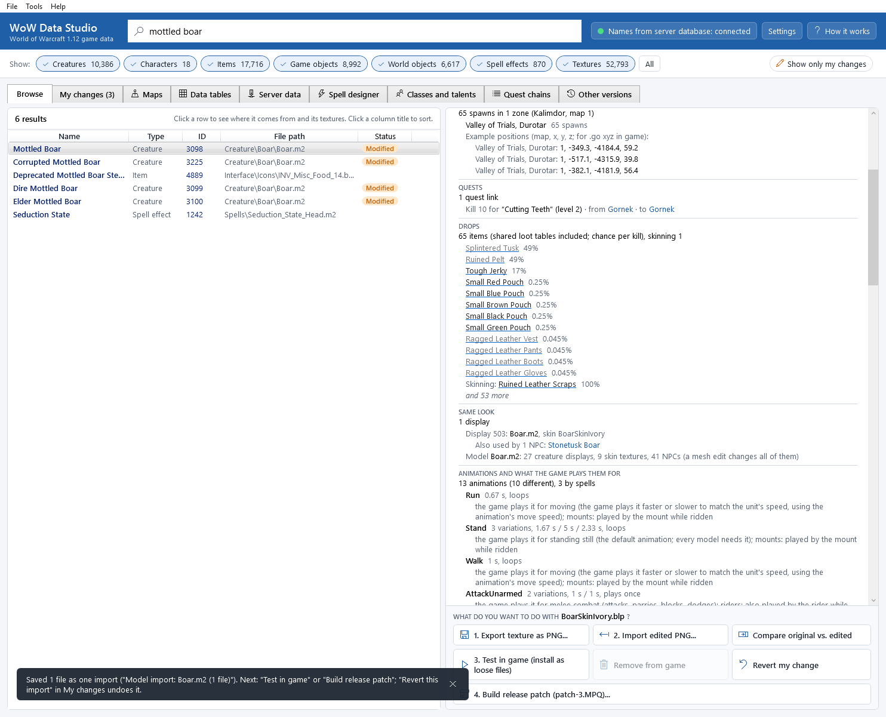
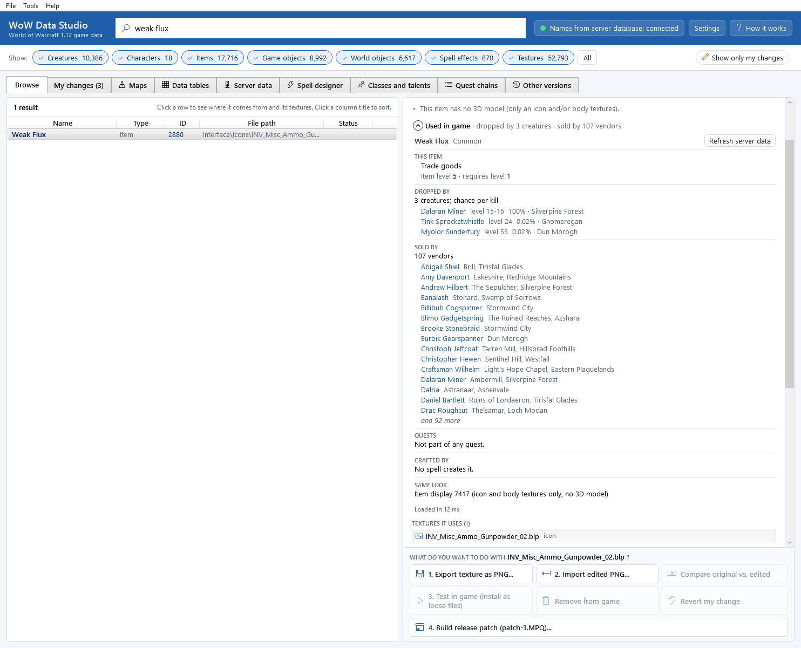
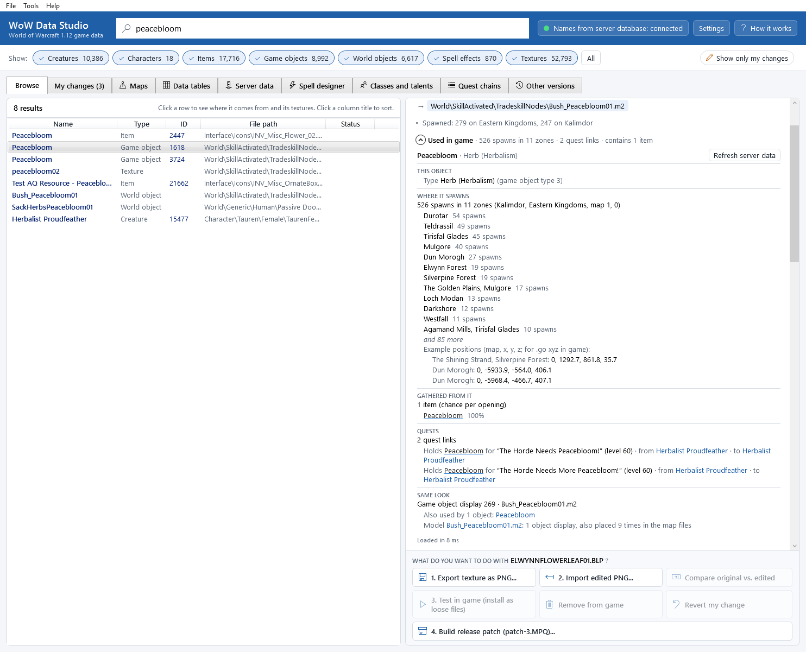
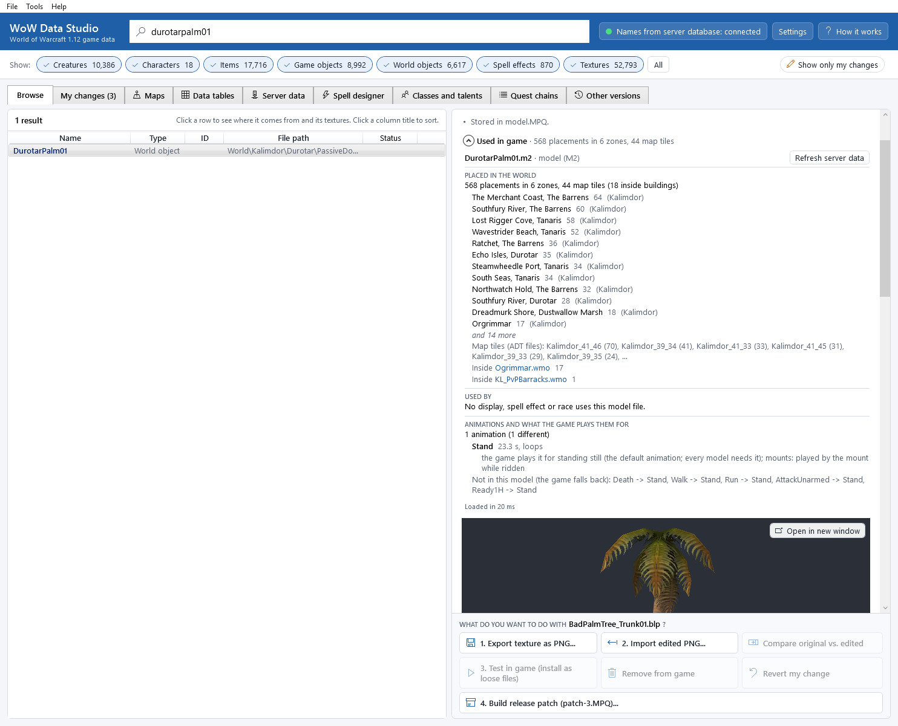
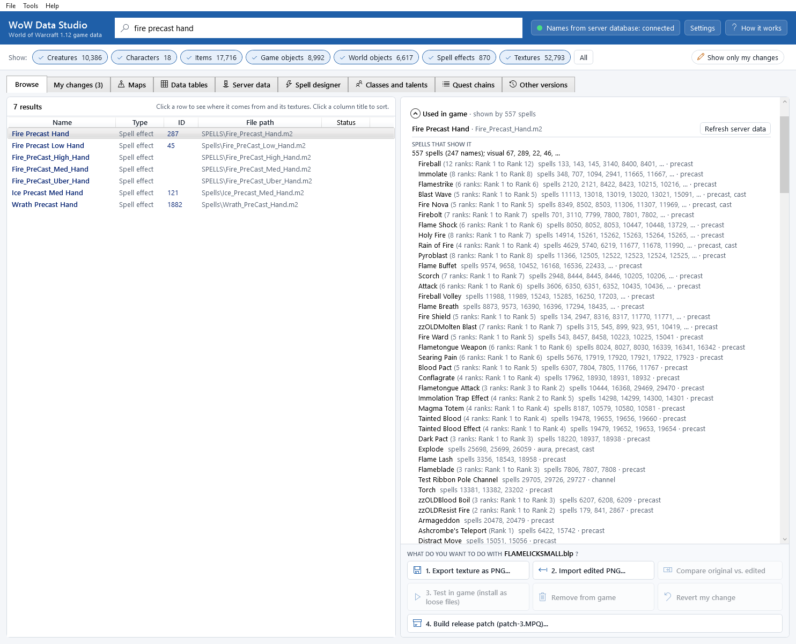
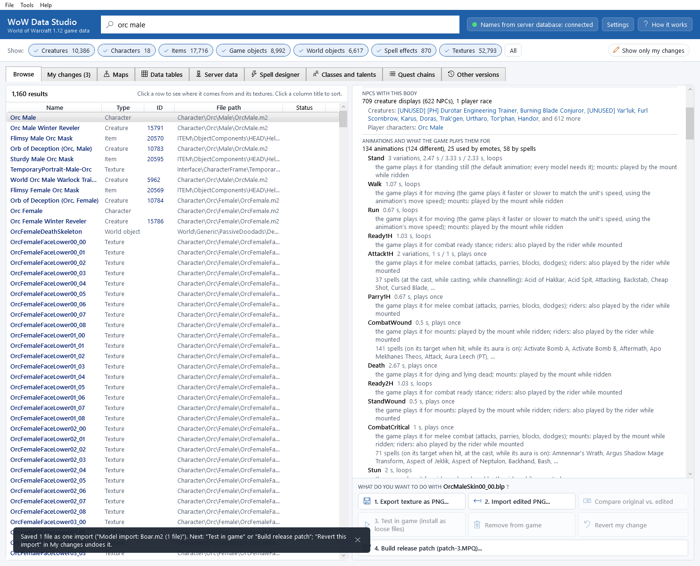
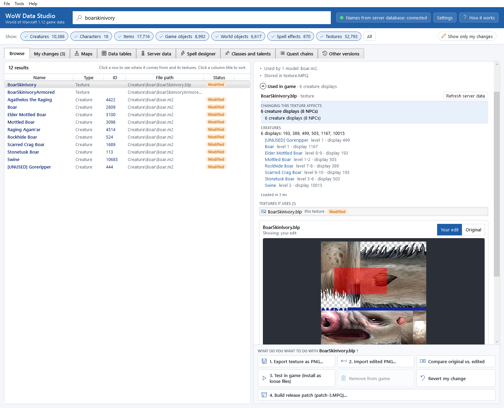

# Used in game

When you look something up, the details panel can tell you *how the game uses it*: which NPCs wear a model and where
they stand, who drops or sells an item, where a tree is planted on the map, which spells show an effect, and what
else changes when you edit a texture. Every name in it is a link: click it to jump to that entry.

## Open it

1. Select something in the list (see [Finding things](finding-things.md)).
2. In the details panel, under the facts, click **Used in game** to open it.
   Even when it is closed, its header shows a one-line summary, for example
   *Used in game · 65 spawns in 1 zone · 1 quest link · drops 65 items*.

The panel stays open for the next entries you select until you close it again. Press <kbd>F1</kbd> inside it to open
this chapter.

## What it shows

Each block has a title, a summary line and a short list (the longest lists end with *and N more*).

### A creature (NPC)

* **This NPC**: level range, rank (normal, elite, rare, rare elite, boss), creature type (beast, humanoid...), its faction
  and how it reacts to Alliance and Horde players (friendly, neutral or hostile), and its roles (vendor, trainer, quest
  giver, flight master...).
* **Where it spawns**: how many times it is placed in the world, per zone and subzone (for example
  *Valley of Trials, Durotar*), with the map, and three example positions (map, x, y, z) that you can use with the
  `.go xyz` command on your server.
* **Quests**: the quests it gives and takes back, the quests that ask you to kill it (with the quest giver and the NPC
  you return to), and the quest items it drops.
* **Drops**: its loot with the chance per kill, shared loot tables included, plus skinning and pickpocketing.
* **Sells**, **Teaches** and **Spells it casts**, when it has them.
* **Same look**: the other NPCs that use the same display, and how many displays, skins and NPCs share its model
  (*a mesh edit changes all of them*).
* **Mount, companion or disguise**: shown when a spell turns this creature into a mount, a companion pet or a
  disguise, with the item that teaches or casts it.

### An item

* **This item**: the item's type and slot, item level and required level, how it binds, and its spells
  (*Use:*, *Equip:*, *Teaches:*). The name has the item's quality colour.
* **Dropped by**: the creatures that drop it, with the chance per kill and the zone where each one lives (most
  spawns). Items in shared loot tables (world drops) list every creature that uses the table, best chance first.
  Separate blocks list chests, herbs and ore nodes (**Found in (chests, herbs, ore, objects)**), skinning,
  pickpocketing, containers and fishing.
* **Sold by**: the vendors and where they stand, and whether their stock is limited.
* **Quests**: the quests that reward it (or offer it as a choice), ask for it, give it to you or start from it.
* **Crafted by**: the spells that create it, their profession (for example *First Aid*), how many trainers teach them
  and the recipe item, if any.
* **Item set**: the set's name and its pieces.
* **Same look**: the other items that share the item display, and how many item displays use its model.

### A game object

The type in plain words (chest, herb, mining node, door, mailbox, book, spell focus such as an anvil or a forge...),
**Where it spawns** (as for creatures), what it holds (**Contains**, or **Gathered from it** for herbs and ore), its
quests, and the other objects with the same look.

### A world object (trees, rocks, buildings)

**Placed in the world** counts every placement on the map files: per zone and subzone, with the map, the map tiles
(the `.adt` files, for example `Kalimdor_41_46`) that place it most, and the buildings that contain it as furniture
(for example *Inside Ogrimmar.wmo*). **Used by** adds the displays, spell effects and player races that use the same
model file.

### A spell effect

* **Spells that show it**: every spell whose visual uses this effect, one line per spell name with its ranks, the spell
  numbers and where the effect appears: *precast* (while casting), *cast*, *impact* (on each target hit), *aura* (on the
  target while the aura lasts), *channel*, *missile*, *area* (a persistent area such as Blizzard or Consecration). Spells with many ranks
  (the players' spells) come first.
* **Who casts it**: the classes whose trainers teach these spells (for example *Mage trainers*), the creatures that
  cast them (with their zone) and the items that use them.
* **Same model**: other effects that use the same model file.

### A character (player race)

**Character creation choices** counts the skin colours, faces, hair styles and colours and facial hair styles of the
race and sex. **NPCs with this body** lists the NPCs whose display uses the same body model.

### Animations (any animated model)

For a creature, a character, an item, a game object, a spell effect or a model file with animations, the block
**Animations and what the game plays them for** lists every animation of its model:

* its name, the number of variations and their lengths, and whether it loops or plays once;
* *the game plays it for*: what the game's own code plays it for: moving (and that it is played faster or slower to
  match the unit's speed), fighting, casting, emotes, dying, swimming, mounts (the mount's body or the rider);
* *emotes*: the chat commands that play it (`/dance`, `/wave`...);
* *spells*: the spells whose visual plays it on the caster (*while casting*, *at the cast*, *while channelling*) or on
  the target (*on its target when hit*, *while its aura is on*);
* at the end, the common animations the model lacks and what the game plays instead (*Run -> Walk*).

See [Skeleton and animations](skeleton-and-animation.md) to change them.

### A texture

The first block, **Changing this texture affects**, sums up everything your edit would change, for example
*6 creature displays (8 NPCs)*. Then one block per kind of use:

* **Creatures**, **Items** and **Game objects**: the NPCs, items and objects whose displays use the texture (a skin,
  a model texture, a body texture of an armour, an inventory icon);
* **Character creation**: which choice it is, for example *Orc Male · Skin colour 1 of 9*, or
  *Face 3 of 9, for skin colour 2*, with the CharSections section, variation and colour numbers;
* **Models that use it**: the model files that name the texture inside them, with how often each is placed in the
  world;
* **Spell effects** that use those models;
* **Interface**: the spells whose icon it is.

## Data tables: what each one controls

The game's data tables (spells, icons, item and creature looks, races, maps, flight points, talents, sounds...) have
their own tab, **Data tables** ([Data tables](dbc-editor.md)). For each table it says in plain words what it controls
in the game (above the grid, and when you point at a table in the list), and what your server does with it:

* *Client only*: only the game reads it;
* *Server also needs this file*: the server reads its own copy too (copy your edit with **Copy to server...**);
* *Server uses its database instead (edit there)*: the server reads the same data from its database (for example
  Spell from `spell_template`), so your edit changes what the game shows, not what the server does.

For one row of a table, **Used by** (in the right panel of that tab) lists the rows of other tables that link to it:
the spells that use an icon, the displays that use a creature model, the routes that start at a flight point.

## Following the links

Blue names and underlined item names (in the item's quality colour) are links. Click one to select that entry in the list: the type
filter is turned on, the search box is set to its name, and the details panel shows it. **Back** (top right of the
panel) returns to where you were. Names without a link have no entry of their own in the list (quests and zones, for
example).

## Server database or not

Spawns, loot, vendors, quests, trainers and creature spells come from your server's world database (see
[Getting started](getting-started.md#names-from-the-server-database-optional)). Without it, the panel shows what the
game files give (displays, models, map placements, textures, spells, character choices) and a note: *Connect the
server database in Settings to see spawns, loot and vendors.* Its **Settings...** button opens the settings.

The server data is read once, when the index is built, and kept with it. After you change the database (or start the
server), click **Refresh server data** at the top of the panel; it does the same as
**File > Reload names from the server database**.

For a VMaNGOS database, which keeps one row per content patch, the panel uses the newest row up to patch 10 (1.12),
the same rule as the project's scripts. CMaNGOS and MaNGOS databases work too.

To *change* what the server does with an entry (its loot, vendors, spawns, quests, stats), use the
[Server data](server-data.md) tab: it shows the same data from the database, live, with every row editable, and its
**Show in Browse** comes back here. After you applied edits to the server, **Refresh server data** reads them here.

## Where the numbers come from

All of it is prepared once, while the app is *Organizing game data* (the progress screen shows the stages
*Reading zones, factions and spells*, *Mapping world placements and zones* and
*Linking spawns, loot, vendors and quests*). That takes a few seconds more; afterwards the panel opens in a few
milliseconds (the time is shown at its bottom).

* *Zones* come from the map files: every map tile (`.adt`) stores the area of each of its 256 squares. A server spawn
  has only a map and a position, so the app looks up the square under it.
* *Placements* are read from every map tile (models and buildings) and from every building's furniture list. A
  placement on the border of two tiles is counted once.
* *Loot chances* are per kill (or per opening). A shared loot table's chance is multiplied by the chance that the
  table is used. Items in a group without their own chance share what is left of the group equally. *(quest)* marks
  items that drop only while you have the quest.

## Not shown yet

* Creatures spawned only by scripts, events or spells (the panel says *Not spawned in the world by the database*).
* Disenchanting results are shown by their table number only.
* Quest names are not links: quests have no entry in the list.
* Animations played by server scripts (a creature's scripted emote) are not listed: only the client's own situations,
  the chat emotes and the spells.

## Command line

`wds find used <entry>` prints the same blocks (`--json` for scripts); `wds maps tile <map> <x> <y>` prints what is on a tile. See [The command line](command-line.md#find-the-browse-tab).
